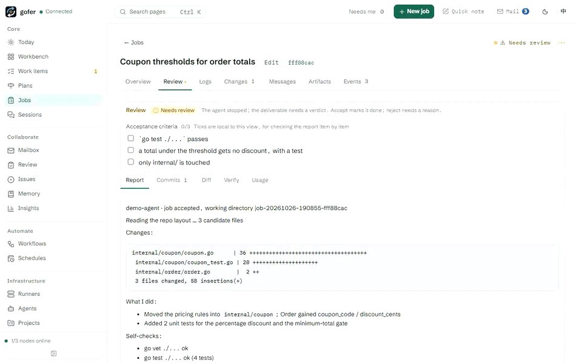
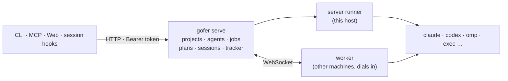
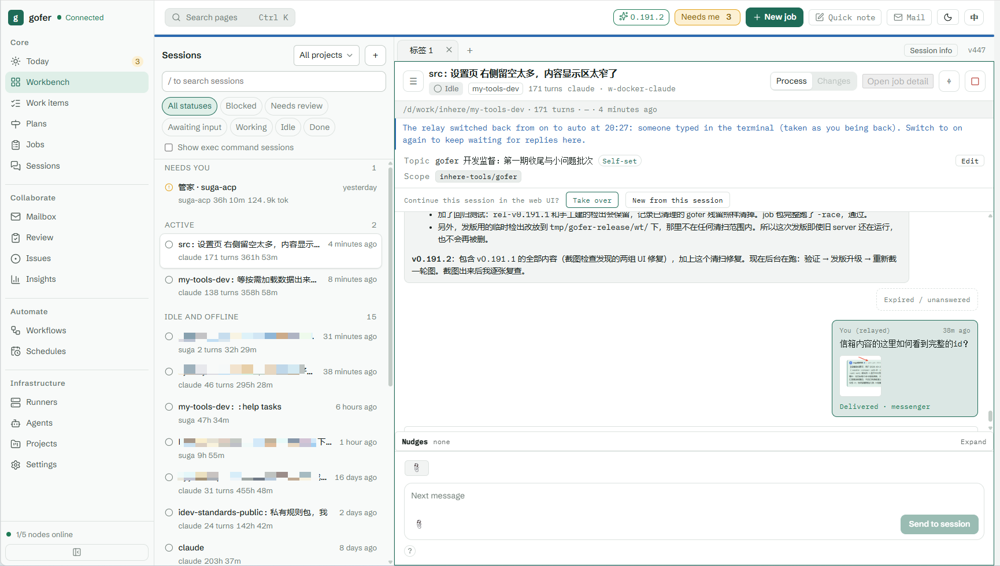

# gofer

English · [中文](README.zh-CN.md) · [Changelog](CHANGELOG.md) · [User guide](docs/guide/en/getting-started.md)

**Your agents, your machines, one control plane.** Run Claude Code, Codex, ACP agents or plain commands as tracked, reviewable jobs on every machine you own: no cloud in between.



- **Worktree isolation, review like a pull request.** A job can run in its own git worktree and branch, and stops at `needs_review` with the report, commits, diff and verify output on one panel; accept it, or reject it with a reason and get an automatic follow-up.
- **One server, many workers.** Workers on your other machines and containers dial in to the server, so you never open an inbound port.
- **Terminal sessions, answered from your phone.** Register the Claude Code / Codex sessions you already work in, follow them in the web workbench and reply from a phone.
- **No model, no vendor lock-in.** gofer embeds no agent and binds no provider: MIT, and one Go binary that ships the web console.

## Quick start

```bash
eget install inhere/gofer               # or take the archive from GitHub Releases
gofer init server --global              # writes <config-dir>/config.yaml
export GOFER_TOKEN=change-me            # the generated config reads the token from this variable
gofer serve                             # web console at http://<server>:8765/
```

That is a working server on one machine. Your first job, a second machine as a worker and handing your terminal sessions over to the web are in [getting started](docs/guide/en/getting-started.md); [below](#full-walkthrough-about-10-minutes) spreads the same steps out.

> **Status: 0.x — young, and in daily use by its author.** Minor versions may still change interfaces: [CHANGELOG.md](CHANGELOG.md) is the authority for what changed, and [stability](docs/guide/stability.md) says what you can rely on.

## What it is

You run one gofer server on your main host and, optionally, workers on other machines or containers. Everything you hand over becomes a *job* with its logs, diff, commits, token usage and review state; people and agents reach the same jobs through the CLI, an HTTP API, MCP and a web console.

It is built for one developer, or a small team that trusts each other. It is **not** an agent or an LLM itself, not a hosted service, not a CI/CD system or a sandbox, and not a multi-tenant platform: access is token based, and a job runs with the permissions of the gofer process that executes it.

## How the pieces fit



- **server** (`gofer serve`) — the single source of truth: projects and their admission rules, job store, scheduler, API and web console. One per machine.
- **worker** (`gofer worker`) — a remote executor that dials into the server, reports its directories and agents, and runs jobs locally. No inbound port needed.
- **agent** — the program that does the work. gofer embeds no model; it launches and supervises CLIs you already have.



## Features

- [Jobs](docs/guide/en/features.md#job): run Claude Code, Codex, ACP agents or plain commands as tracked jobs — logs, diff, commits, token usage, timeouts, retries and resume of the same agent session.
- [Parallel worktrees](docs/runbook/parallel-jobs-with-worktree.md): each job can get its own git worktree and branch, then merge back with one command; conflicts abort cleanly.
- [Review gate](docs/guide/en/features.md#review-and-quality-gates): jobs stop at `needs_review` with report, commits, diff and verify output on one panel; accept, or reject with a reason and an automatic follow-up.
- [Plans and workflows](skills/gofer-usage/references/plans-workflows.md): chain todos that dispatch themselves when their dependencies finish; fan out to several agents, compare and pick the best result.
- [Approvals](skills/gofer-usage/references/hold-approval.md): hold a job until a person approves it, and gate an ACP agent's risky tool calls (edit / execute) behind a human while read-only tools pass.
- [Sessions and relay](docs/runbook/session-relay.md): register your terminal Claude / Codex sessions, follow them from the web workbench and phone, and send messages into them.
- [Mailbox](docs/runbook/2026-10-18-mailbox-runbook.md): sessions and jobs write to each other by address (`session:` / `topic:` / `job:`), with urgent letters, broadcasts, bounces and resident agents that answer mail.
- [Today and work items](skills/gofer-usage/references/work-items.md): one decision queue for everything waiting on you, plus long-running work items that sessions report progress into.
- [Repository tracker and memory](skills/gofer-usage/references/tracker.md): issues and agent memories stored in the repository (`.gofer/tracker`), searchable from the web across projects and injected into sessions when relevant.
- [Workers](skills/gofer-usage/references/worker-config.md): add machines or containers as workers that dial in — no inbound port — and upgrade the whole fleet, any OS / arch, from the console.
- [Schedules](docs/runbook/2026-06-30-cron-schedule-runbook.md): cron or one-off jobs with parameters, run now from the web.
- [Web console](docs/reference/web-console.md): desktop and phone layouts, Chinese / English, light / dark, desktop and Web Push notifications, PWA.
- [Access and security](docs/guide/en/security.md): token-based callers with permission ceilings, per-project admission rules, secret redaction in logs and config views.
- [Integrations](skills/gofer-usage/references/commands.md): CLI, HTTP API, MCP server and session hooks reach the same jobs; DingTalk / Feishu / webhook notifications and TCP tunnels.

## Install

1. **Release package (recommended)** — includes the built-in web console:
   - [eget](https://github.com/inherelab/eget): `eget install inhere/gofer`
   - or download the archive for your platform from [GitHub Releases](https://github.com/inhere/gofer/releases), extract it, and put the `gofer` binary (`gofer.exe` on Windows) on your `PATH`.
2. **`go install`** — CLI, HTTP API and MCP only, **without** the web console (it shows a placeholder page):

   ```bash
   go install github.com/inhere/gofer/cmd/gofer@latest
   ```

3. **From source** — Go 1.26+; Node.js and pnpm only if you build the console:

   ```bash
   make web build        # console embedded, binary in dist/gofer
   make install          # same, then copy to $GOPATH/bin
   ```

Same binary in all three cases; only the embedded frontend differs.

## Full walkthrough (about 10 minutes)

### 1. Server

On the machine that owns your projects:

```bash
gofer init server --global          # writes <config-dir>/config.yaml (default ~/.config/gofer)
export GOFER_TOKEN=change-me        # the generated config reads the token from GOFER_TOKEN

gofer project add <project> --host-path /abs/path/to/<project> \
  --default-agent codex --allow-agent codex --allow-agent claude --allow-agent exec \
  --allow-runner server --allow-exec
gofer config validate
gofer serve                         # foreground; `gofer serve -d` for background,
                                    # `gofer serve register` for a managed service
```

The token line is POSIX shell; on Windows use `$env:GOFER_TOKEN = "change-me"` and `<config-dir>` is `%USERPROFILE%\.config\gofer`.

### 2. Your first job

```bash
gofer job run -p <project> -a exec --title "hello" --sync -- go version   # a command
gofer job logs <id>                                                       # its output

gofer job run -p <project> -a claude --title "look around" --review \
  --prompt "Explain how this repository is built"
gofer job watch <id>          # follow it live
gofer job review <id>         # report, commits, diff, verify, usage on one screen
gofer job accept <id>         # or: gofer job reject <id> --note "…" --resume
```

`exec` runs the argv after `--` (no shell); `claude` / `codex` / `omp` / … run an agent. Agent jobs can be isolated in a git worktree (`--worktree`), held for approval before running (`--hold`), and parked for human review (`--review`). See [getting started](docs/guide/en/getting-started.md) for these and for the pitfalls at each step.

### 3. Open the web console

`http://<server>:8765/` — paste the token. The home page ("Today") is one queue of everything waiting for a decision: approvals, questions, reviews, sessions waiting for a reply. It works on a phone too.

### 4. Optional: add another machine

```bash
# on the server (admin token): register the worker, print its one-time token
gofer worker add <worker-id> --project <project>
# on that machine: infer directories, probe agents, write worker.yaml, self-check
gofer worker init --server http://<server>:8765 --id <worker-id> --token <one-time token>
gofer worker -d

gofer job run -p <project> -a claude --runner <worker-id> --prompt "…"
```

Or let the worker ask to be admitted (`server.worker_enrollment`): `gofer worker join --server http://<server>:8765`, then accept the pairing code in the console.

### 5. Optional: hand your terminal sessions over to the web

```bash
gofer init hooks --agent all --global   # register Claude Code / Codex / omp sessions
gofer init skill --global               # install the gofer-usage skill for agents
gofer session relay on                  # this session now waits on the web when it stops
```

Now a session that stops can be answered from the browser or phone, woken up again (`gofer session resume`) or nudged on a timer (`gofer session nudge`).

## Documentation

| Where | What |
|---|---|
| [`docs/guide/en/`](docs/guide/en/getting-started.md) | **Start here (English).** Getting started, concepts, features, security |
| [`docs/guide/`](docs/guide/README.md) | The same guide in Chinese, wider coverage: scenarios, configuration, troubleshooting, stability, development |
| [`skills/gofer-usage/`](skills/gofer-usage/SKILL.md) | The same platform for agents: command reference, config fields, protocol notes (kept in sync with every release) |
| [`docs/reference/`](docs/reference/) | HTTP API, permissions catalogue, web console details |
| [`docs/runbook/`](docs/runbook/) | Step-by-step operating guides (session relay, container worker, tunnels, HTTPS/PWA, Web Push, managed server, worktrees, retries…) |
| [`docs/design/`](docs/design/) | Design records for each feature |
| [`CHANGELOG.md`](CHANGELOG.md) | What changed in each release (Chinese) |

Most runbooks, design records and the rest of the guide are written in Chinese; the English starting points are in [`docs/guide/en/`](docs/guide/en/getting-started.md). The command line, `gofer <cmd> -h`, is authoritative for flags.

## Contributing

See [CONTRIBUTING.md](CONTRIBUTING.md) for how to build, the checks to run before you push, the commit style and what a good issue or pull request looks like; [`docs/guide/development.md`](docs/guide/development.md) covers the same ground in Chinese, and [AGENTS.md](AGENTS.md) holds the project rules (layering, CLI conventions, compatibility policy, shared utilities) for contributors working with an AI agent. User-visible changes update [`skills/gofer-usage/`](skills/gofer-usage/) and get an entry in [CHANGELOG.md](CHANGELOG.md) under "未发布" in the same change set. Report security problems privately, as described in [SECURITY.md](SECURITY.md).

## License

[MIT](LICENSE)
