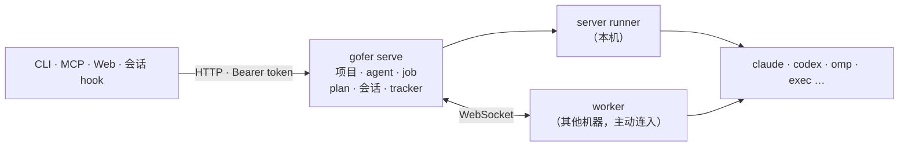
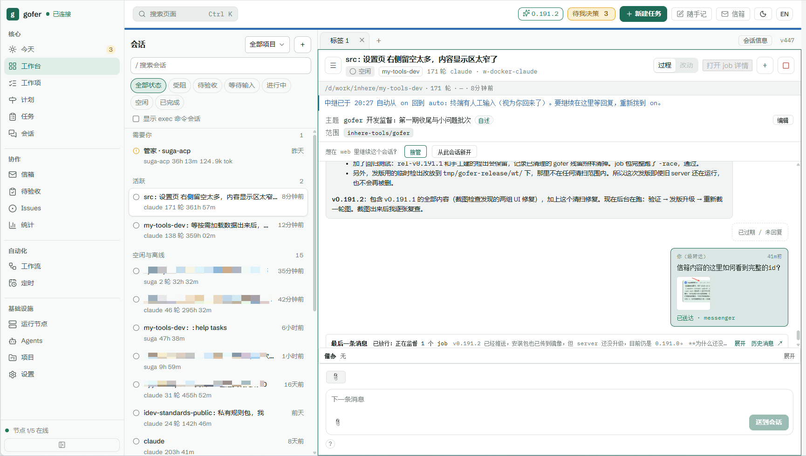

# gofer

[English](README.md) · 中文 · [更新日志](CHANGELOG.md) · [用户指南](docs/guide/README.md)

> **状态：0.x，很年轻，但作者每天都在用。** 发版频繁（有时一周几个版本），minor 版本之间接口仍可能调整：以 [CHANGELOG.md](CHANGELOG.md) 为准，[稳定性说明](docs/guide/stability.md) 写明哪些可以放心依赖。

**gofer 是一个自托管的控制平面：把 Claude Code、Codex、ACP agent 或普通命令，作为可追踪、可验收的 job，在你自己的机器上、在真实的项目目录里运行。**

你在主力机器上跑一个 gofer server，按需在其他机器或容器里跑 worker。交出去的每件事都是一个 *job*，带日志、diff、提交、token 用量和验收状态；人和 agent 通过 CLI、HTTP API、MCP 和 Web 控制台看到的是同一批 job。



- **server**（`gofer serve`）——唯一真源：项目与准入规则、job 存储、调度、API 与 Web 控制台。一台机器一个。
- **worker**（`gofer worker`）——远程执行机，主动连入 server，上报自己的目录和 agent，在本机执行 job；不需要开放入站端口。
- **agent**——真正干活的程序。gofer 不内置模型，只启动和监督你已经装好的 CLI。

它面向一个开发者、或互相信任的小团队。它**不是** agent 或大模型本身，不是托管服务，不是 CI/CD 系统或沙箱，也不是多租户平台：访问基于 token，job 以执行它的 gofer 进程的权限运行。



## 功能特色

- [任务（job）](docs/guide/features.md#job)：把 Claude Code、Codex、ACP agent 或普通命令作为可追踪的任务运行——日志、diff、提交、token 用量、超时、重试，以及续接同一个 agent 会话。
- [并行 worktree](docs/runbook/parallel-jobs-with-worktree.md)：每个任务可以有自己的 git worktree 与分支，一条命令合并回来；冲突时干净地中止。
- [验收关口](docs/guide/features.md#验收与质量关口)：任务停在「待验收」，汇报、提交、diff、验证输出在一个面板里看完；通过，或写明理由打回并自动续投。
- [计划与工作流](skills/gofer-usage/references/plans-workflows.md)：待办按依赖自动派发；一份任务扇出给多个 agent，对比后择优合并。
- [审批](skills/gofer-usage/references/hold-approval.md)：任务可以先挂起等人批准；ACP agent 的高风险工具调用（改文件 / 执行命令）要人点头，只读工具自动放行。
- [会话与传话](docs/runbook/session-relay.md)：登记终端里的 Claude / Codex 会话，在 web 工作台和手机上跟进，并把消息送进会话。
- [信箱](docs/runbook/2026-10-18-mailbox-runbook.md)：会话与任务按地址（`session:` / `topic:` / `job:`）互相写信，支持急件、群发、退信，以及常驻收信的 agent。
- [今天与工作项](skills/gofer-usage/references/work-items.md)：所有等你决定的事汇成一个决策队列；长期工作项由会话持续汇报进展。
- [仓库 tracker 与记忆](skills/gofer-usage/references/tracker.md)：issue 与 agent 记忆存在仓库里（`.gofer/tracker`），web 上可跨项目搜索，相关时自动注入会话。
- [Worker](skills/gofer-usage/references/worker-config.md)：把其他机器或容器加为 worker，由 worker 主动连入、无需开放入站端口；在控制台里一键升级整个机群，不限操作系统与架构。
- [定时任务](docs/runbook/2026-06-30-cron-schedule-runbook.md)：cron 或一次性任务，可带参数，在 web 上立即执行。
- [Web 控制台](docs/reference/web-console.md)：桌面与手机布局、中文 / 英文、浅色 / 深色，桌面通知与 Web Push，支持 PWA。
- [接入与安全](docs/guide/security.md)：基于 token 的调用方与权限上限、按项目的准入规则、日志与配置视图中的密钥脱敏。
- [集成入口](skills/gofer-usage/references/commands.md)：CLI、HTTP API、MCP server 与会话 hook 操作同一批任务；钉钉 / 飞书 / webhook 通知，以及 TCP 隧道。

## 安装

1. **Release 包（推荐）**——内含 Web 控制台：
   - 用 [eget](https://github.com/inherelab/eget)：`eget install inhere/gofer`
   - 或从 [GitHub Releases](https://github.com/inhere/gofer/releases) 下载对应平台的归档，解压后把 `gofer` 二进制（Windows 为 `gofer.exe`）放到 `PATH`。
2. **`go install`**——只有 CLI、HTTP API 与 MCP，**不含** Web 控制台（打开是占位页）：

   ```bash
   go install github.com/inhere/gofer/cmd/gofer@latest
   ```

3. **从源码构建**——需要 Go 1.26+；构建控制台时还需要 Node.js 与 pnpm：

   ```bash
   make web build        # 内嵌控制台，生成 dist/gofer
   make install          # 同上，再复制到 $GOPATH/bin
   ```

三种方式装出来的是同一个 CLI，区别只在有没有内嵌前端。

## 10 分钟上手

### 1. Server

在拥有项目目录的那台机器上：

```bash
gofer init server --global          # 写出 <config-dir>/config.yaml（默认 ~/.config/gofer）
export GOFER_TOKEN=change-me        # 生成的配置从 GOFER_TOKEN 读取 token

gofer project add <project> --host-path /abs/path/to/<project> \
  --default-agent codex --allow-agent codex --allow-agent claude --allow-agent exec \
  --allow-runner server --allow-exec
gofer config validate
gofer serve                         # 前台；后台用 `gofer serve -d`，
                                    # 注册成受管服务用 `gofer serve register`
```

token 那行是 POSIX shell 写法；Windows 上换成 `$env:GOFER_TOKEN = "change-me"`，`<config-dir>` 是 `%USERPROFILE%\.config\gofer`。

### 2. 第一个 job

```bash
gofer job run -p <project> -a exec --title "hello" --sync -- go version   # 跑一条命令
gofer job logs <id>                                                       # 看它的输出

gofer job run -p <project> -a claude --title "先看看这个仓库" --review \
  --prompt "解释这个仓库是怎么构建的"
gofer job watch <id>          # 实时跟到结束
gofer job review <id>         # 一屏看完：汇报、提交、diff、验证、用量
gofer job accept <id>         # 或：gofer job reject <id> --note "…" --resume
```

`exec` 原样执行 `--` 之后的命令（不经过 shell）；`claude` / `codex` / `omp` 等跑 agent。agent job 可以放进独立的 git worktree（`--worktree`）、执行前等人批准（`--hold`）、做完停在验收台等人验收（`--review`）。这些用法见[常见用法](docs/guide/scenarios.md)。

### 3. 打开 Web 控制台

浏览器打开 `http://<server>:8765/`，粘贴 token。首页「今天」是一个队列，列出所有在等你决定的事：待批准、待回答、待验收、等回复的会话。手机上同样可用。

### 4. 可选：再加一台机器

```bash
# 在 server 上（管理员 token）：登记 worker，打印一次性 token
gofer worker add <worker-id> --project <project>
# 在那台机器上：推断目录、探测 agent、写 worker.yaml、跑自检
gofer worker init --server http://<server>:8765 --id <worker-id> --token <一次性 token>
gofer worker -d

gofer job run -p <project> -a claude --runner <worker-id> --prompt "…"
```

也可以让 worker 自己申请加入（需开 `server.worker_enrollment`）：`gofer worker join --server http://<server>:8765`，然后在控制台输入配对码接受。

### 5. 可选：把终端会话交给 Web

```bash
gofer init hooks --agent all --global   # 登记 Claude Code / Codex / omp 会话
gofer init skill --global               # 为 agent 安装 gofer-usage skill
gofer session relay on                  # 本会话之后每次停下都在 Web 等我回复
```

停下的会话可以在浏览器或手机上回复，也可以重新唤醒（`gofer session resume`）或定时催办（`gofer session nudge`）。

## 文档

| 位置 | 内容 |
|---|---|
| [`docs/guide/`](docs/guide/README.md) | **从这里开始**：核心概念、常见用法、配置、安全、排障、稳定性 |
| [`skills/gofer-usage/`](skills/gofer-usage/SKILL.md) | 同一个平台，写给 agent 看：命令速查、配置字段、协议说明（随每个版本同步） |
| [`docs/reference/`](docs/reference/) | HTTP API、权限目录、Web 控制台细节 |
| [`docs/runbook/`](docs/runbook/) | 操作手册：会话中继、容器 worker、隧道、HTTPS/PWA、Web Push、受管 server、worktree、重试…… |
| [`docs/design/`](docs/design/) | 各功能的设计记录 |
| [`CHANGELOG.md`](CHANGELOG.md) | 每个版本的用户可见变化 |

指南、大部分 runbook 与设计记录用中文撰写；flag 一律以 `gofer <命令> -h` 为准。

## 参与开发

构建、提交前检查、提交信息约定以及 issue / PR 的期待见 [CONTRIBUTING.md](CONTRIBUTING.md)（英文）；中文说明见 [docs/guide/development.md](docs/guide/development.md)；项目规则（分层、CLI 约定、兼容策略、公共工具）见 [AGENTS.md](AGENTS.md)。用户可见的改动在同一批提交里更新 [`skills/gofer-usage/`](skills/gofer-usage/)，并在 [CHANGELOG.md](CHANGELOG.md) 的「未发布」下加一条。安全问题请私下报告，方式见 [SECURITY.md](SECURITY.md)。

## 许可

[MIT](LICENSE)
