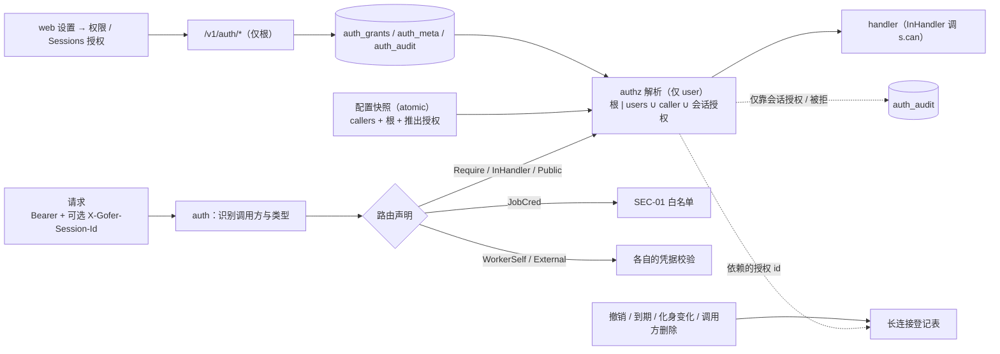
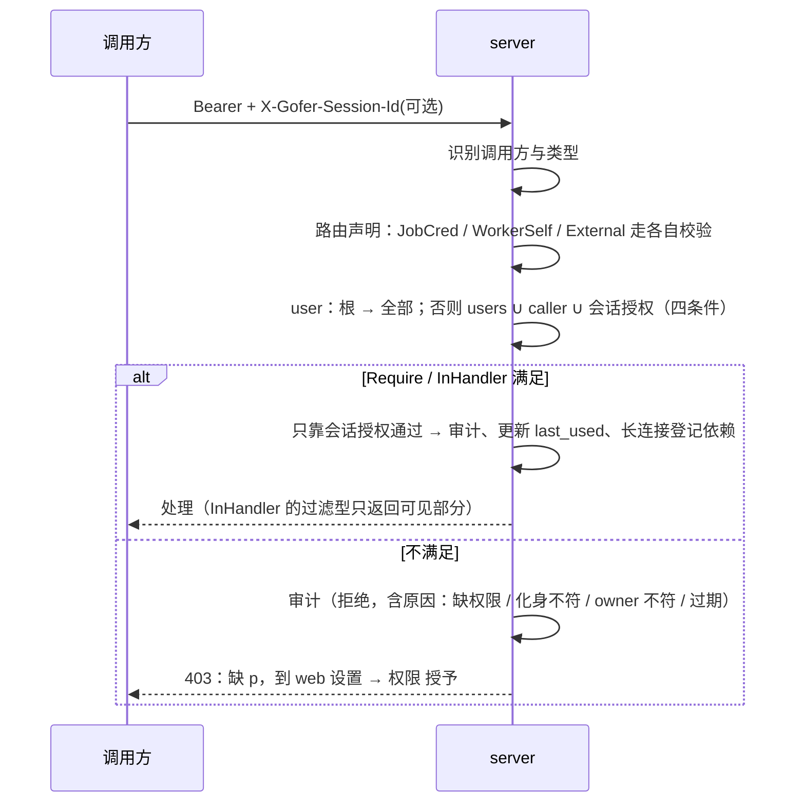

<!-- template_id: design; template_version: 1.1.1 -->
# 权限目录与授权（入库、模式匹配、会话授权） 设计

> 状态：Draft 0.4 / 待人工计划批准
>
> - issue：gofer-kd8q（并入 gofer-6pw0 权限第二步的模型部分）；先行加固 gofer-hxld
> - 思考模式：RIGOROUS
> - 核心目标：一次把权限模型定清楚。权限有固定名称；授权就是给主体（全体用户、某个调用方、某个会话）发一组名称模式，在 web 上管理，即时生效，对 agent 透明。现有部署升级后行为不变，已知旁路一并关闭
> - scope freeze：本稿覆盖权限目录、授权模型与判定、主体与会话化身、路由声明与测试兜底、存储与种入、长连接撤销、web / API / CLI、审计、过渡与回滚。按项目限定范围只定数据模型，第二期再执行
> - review budget：已完成两轮评审（共 20 项 CORE_BLOCKING，均已吸收），本版做 confirmation 轮
> - 停止条件：用户批准本稿，或 confirmation 轮发现新的 CORE_BLOCKING

## 修订记录

| 版本 | 日期 | 作者 | 摘要 |
|---|---|---|---|
| 0.1 | 2026-10-14 | Claude（监督会话） | 初稿：能力拆分、库存能力、会话授权 |
| 0.2 | 2026-10-14 | Claude（监督会话） | 按第一轮评审修订 8 项核心问题 |
| 0.3 | 2026-10-14 | Claude（监督会话） | 按用户要求重做模型：固定名称目录，授权 = 主体 + 名称模式，路由声明 |
| 0.4 | 2026-10-14 | Claude（监督会话） | 按全量路由清单（附录 A）补齐目录，共 39 项；吸收第二轮 12 项（映射真值表、旁路入口、会话化身、长连接撤销、路由类别与兜底、种入标记、loader 规则等）；写入用户裁决（根管理员拥有全部权限；`job.submit` 为危险级；`job.review` 不可授予会话）；终端工具权限提示可由会话 owner 或持有 `session.permission.answer` 的人作答 |

> 仅语义变化递增版本；纯 identity/provenance/元数据纠正沿用原版本，并在 Git/进度记录中留痕。

## 背景与目标

2026-10-13 起，server 支持多个调用方。人用 `default`（`can_admin`），agent 和容器 hook 用 `agent-dev`。现有权限有四类问题：

1. **写在配置里、粒度粗**：只有四个能力位外加四个 governance 开关，改了要重启。
2. **口径不一、旁路多**：全量路由清单（附录 A）显示：
   - 310 条路由里有 130 条没有任何检查；
   - 「管理」有三套判断口径；
   - 同一能力往往有好几个入口，检查不一致。例如推送通知按钮、决策回答接口绕过了答复类检查；托管隧道绕过了 `can_tunnel`。
3. **worker token 权限过大**：worker token 在 `/v1` 组内是合法调用方，能访问 78 条写接口，包括 `POST /v1/jobs`。
4. **不能按会话授权**：容器里的业务会话需要开隧道访问现场设备，监督会话需要发版升级，现在都只能给整个 token 授权。

用户要的结果（2026-10-14）：

- 权限有固定名称，存在数据库里，在 web 上管理；授权就是把权限发给 token，用简单的名称模式匹配，类似 Jenkins。
- 能对单个会话授权，在 web 上点一下即可；会话里的 agent 不用改任何东西。
- 终端会话里「是否允许执行工具」的提示切到 gofer web 后，web 上的人也能作答，转发来的不行。
- 设计一次到位，避免返工。

## 名词

- **权限（permission）**：一个固定名称的操作许可，格式 `<资源>.<动作>[.others]`。`.others` 表示「他人的资源」：操作自己的资源不需要这类权限。
- **权限目录**：全部权限名在代码里登记；每项带说明、风险级别、能否授予会话、能否限定范围、种入版本。
- **模式（pattern）**：匹配权限名的字符串。`*` 匹配任意字符（包括 `.`），其余按字面匹配。不支持正则。
- **主体（subject）**：权限发给谁，有三种：
  - `users`：全体用户类调用方；
  - `caller:<id>`：某个调用方，也就是某个 token；
  - `session:<sid>`：某个终端会话的某一个化身。
- **会话化身（incarnation）**：会话每次新建，或从 `ended` 恢复为 `running` 时，生成一个新的随机值。会话被删除后再登记，也一定是新值。
- **根管理员（root）**：配置文件里 `can_admin: true` 的用户类调用方；没有配置 callers 的单 token 部署里就是 `default`。拥有全部权限，是唯一能管理授权的主体，web 上撤不掉。
- **调用方类型**：
  - user：`server.callers` 中的调用方，以及旧的单一 server token；
  - worker：worker 凭据；
  - job：server 按 job 签发的凭据，包括 steward。

## 范围与非目标

**范围**

- 权限目录（39 项）及其与全部 310 条路由的对应关系（附录 A）。
- 授权模型、判定流程、会话授权、长连接撤销。
- 路由声明、覆盖测试与 InHandler 兜底。
- 配置推出授权的真值表、数据库种入、loader 规则、过渡与回滚。
- web（设置 → 权限、Sessions 页授权）、API、`gofer auth whoami`、审计。

**非目标**

- **第二期才执行**：按项目、agent、runner 限定范围（授权的 `scope` 字段第一期只允许 `*`）。
- **job 与 steward 凭据**：维持现有内置白名单（SEC-01 / `jobcredential.go`），不经过授权表。
- **worker 凭据**：只能访问 WorkerSelf 与外部凭据路由，没有任何权限。这一项先由 gofer-hxld 单独落地。
- **身份管理**：在 web 上新建调用方、生成 token，暂不做。
- **拒绝规则**：只做叠加授权，不做否定模式。
- **冒用防护**：防同用户进程冒用会话 id 的加密手段，不做。
- **本地 MCP**：`gofer mcp --standalone` 是受信的本地入口，直接操作数据库，不经过 authz，这一点写入文档。

## 已确认事实与规范

- 全量路由清单（附录 A，代码基线 `61627db2`）：
  - `buildRouter()` 注册 309 条：组外 10 条，`/v1` 组内 299 条，另有 1 条静态资源回退。
  - 现有检查的分布：无检查 130 条、只拒 worker / job 若干、`callerMayAdmin` 23 条、strict admin 8 条、会话答复类 18 条、只认 owner 5 条、外部凭据 9 条、worker 自用 7 条。
- **映射要点（第二轮评审逐条核对）**：
  - `sessionMayAnswer`：开关关闭时，非 owner 一律被拒；开关打开时，`can_answer` 才放行。
  - `callerMayAnswer` / `humanReviewer` / `tunnelConnect` / `canWakeJob`：只认 `can_answer` / `can_tunnel`，不认 `can_admin`。
  - `callerMayAdmin`：不看调用方类型。
  - `DELETE /tracker/repos/{id}` 才是 admin 检查，同步本身没有检查。
  - 单个 job 的 pty 录像走 `callerMayAttach`。
  - 秘密扫描是过滤语义，而且带跨调用方脱敏。
- **旁路**（附录 A 第 3 节）：
  - `/push/actions`：不验 `can_answer`，推送对象是 serve 启动时的用户快照；
  - `/decisions/{id}/answer`：没有任何检查，能恢复他人终端；
  - 托管隧道与预设：不验 `can_tunnel`，autostart 在启动时自动托管；
  - schedule `run-now` 借用创建者身份；`GET /v1/schedules` 返回 `trigger_token`；
  - `GET /v1/xfer/{id}/content` 可下载他人拉回的文件。
- **会话结束的路径不止一条**：
  - 心跳带 `ended`；
  - `SetSessionState`；
  - `ReleaseSessionHandedOff` 的 SQL；
  - `DELETE /sessions/{sid}` 删行；
  - 崩溃的会话只会变成 `offline`。
- **长连接**：`/tunnels/connect`、attach、`/v1/ws`、job SSE 只在建连时校验；`/v1/ws` 推送不按调用方过滤。
- **工具权限提示**：`permissionCallerIsOwner` 只认会话 owner。切 token 后 owner 是 `agent-dev`，web 用户 `default` 会被拒（用户 2026-10-14 指出，修复见 gofer-hxld）。
- **配置**：`config/loader.go:812-858` 要求开关打开时至少一个调用方带对应能力位；`SetServerConfig` 替换 cfg 与 callers 之间存在窗口。
- **遵循的规范**：SR1403 / SR1410（默认最小充分）、SR1409（安全边界，按高暴露度评审）、AGENTS.md G021 / G022（入口层判定，job 层不读调用方配置）、G032（兼容层带移除标记）。

## 总体方案

### 一、权限目录（39 项）

风险：危险 = 持有者能在 server / worker 上执行任意代码或读到根管理员 token；高 = 影响他人工作、读写敏感内容或改所有 agent 的输入。「种入」= 首次启用时发给 `users`（保持现状）；「配置」= 由旧能力位 / 开关推出。

| 权限 | 覆盖（详见附录 A） | 风险 | 授予会话 | 范围 | 来源 |
|---|---|---|---|---|---|
| `job.read.others` | 读他人的 job、workflow、workbench 线程、interaction 列表、wakeup / retry、SSE 流；过滤型 | 中 | 是 | 是 | 种入 |
| `job.submit` | 一切产生 job 的入口：jobs、workflows、schedules 创建与 run-now、plan run / resume、todo dispatch、resume / rebuild、agent probe、评论 @ 派发、workbench agent 线程、work-item to-todo | 危险 | 否 | 是 | 种入 |
| `job.cancel.others` | 取消他人 job、workflow、retry | 中 | 是 | 是 | 种入 |
| `job.manage.others` | 他人 job 的 resume / rebuild / say / end / title / worktree 删除与合并 / deliver / workflow pick / 注入 interaction（另需 `job.submit` 的照样要） | 高 | 否 | 是 | 种入 |
| `job.delete.others` | 删除、脱敏他人 job | 高 | 否 | 是 | 仅根 |
| `job.attach` | attach 自己的交互 job、看自己的 pty 录像与会话 | 中 | 是 | 是 | 配置 |
| `job.attach.others` | attach 他人 job、他人录像；全局 pty 会话列表（过滤型） | 高 | 否 | 是 | 仅根 |
| `job.review` | 验收、拒绝、批准 hold（只有人签收） | 中 | **否** | 是 | 配置 |
| `job.wake.others` | 唤醒他人 job | 中 | 是 | 是 | 配置 |
| `interaction.answer` | 回答 job 的工具审批与提问、punt、非中继类决策、推送通知按钮 | 中 | 是 | 是 | 配置 |
| `session.read.others` | 他人会话的列表 / 详情 / 消息 / outbox / tail / turn / nudge / 收件箱（过滤型） | 中 | 是 | 否 | 种入 |
| `session.reply.others` | 向他人会话说话：say / messages / ack / deliver / relay / 中继类决策回答 / workbench 会话线程 / session-ask / report-request / 会话 job 的 say | 高 | 是 | 否 | 配置 |
| `session.manage.others` | 删除他人会话、开 / 释放 turn、release-takeover | 中 | 否 | 否 | 种入 |
| `session.permission.answer` | 回答**他人**终端的工具权限提示（会话 owner 自己不需要） | 高 | **否** | 否 | 仅根 |
| `session.transfer` | 转移会话归属 | 高 | 否 | 否 | 仅根 |
| `plan.manage.others` | 他人 plan 的修改 / run / pause / resume / attach / todo 增改与派发 / handoff | 中 | 否 | 是 | 种入 |
| `plan.supervise.others` | 给他人 plan 绑定 supervisor，或绑定他人会话 | 中 | 否 | 是 | 仅根 |
| `schedule.manage.others` | 他人 schedule 的删除 / 启停 / 轮换 token / run-now（run-now 另需 `job.submit`） | 中 | 否 | 是 | 种入 |
| `steward.manage` | steward start / stop / restart / ask / review，以及 notes 写入 | 高 | 否 | 否 | 种入 |
| `memory.write` | 写 tracker 记忆与 scoped 记忆（会注入所有 job 的 prompt），采纳记忆建议 | 高 | 否 | 是 | 种入 |
| `tracker.sync` | 推快照、repo sync | 低 | 否 | 是 | 种入 |
| `tracker.delete` | 删除 tracker 镜像、删除记忆（写墓碑） | 高 | 否 | 是 | 配置 |
| `tunnel.open` | 开隧道连接 | 中 | 是 | 第二期 | 配置 |
| `tunnel.hosted` | 托管转发启停、写或删预设、导入预设、autostart（另需 `tunnel.open`） | 高 | 否 | 否 | 种入 |
| `tunnel.manage.others` | 停他人的转发与托管转发 | 高 | 否 | 否 | 仅根 |
| `xfer.write` | 创建传输（在执行主机读写文件） | 危险 | 否 | 是 | 种入 |
| `xfer.manage.others` | 读取、下载、删除他人的传输 | 高 | 否 | 是 | 仅根（关闭旁路） |
| `pty.recordings` | 已并入 `job.attach` / `job.attach.others`，不单列 | — | — | — | — |
| `secret.scan.all` | 跨调用方秘密扫描与脱敏（过滤型） | 高 | 否 | 否 | 仅根 |
| `update.check` | 触发检查新版本（`GET /v1/update` 为 Public） | 低 | 是 | 否 | 种入 |
| `update.apply` | 一键更新执行与取消；带 workers 时另需 `worker.upgrade` | 高 | 是 | 否 | 配置 |
| `worker.upgrade` | 用 server 自身二进制升级 worker | 高 | 是 | 否 | 配置 |
| `worker.upgrade.upload` | 上传二进制；`source=staged` 也需要 | 危险 | 否 | 否 | 配置 |
| `worker.manage` | 注册、删除、重载 worker | 危险 | 否 | 否 | 配置 |
| `config.read` | `GET /v1/config`、MCP 注册表读取（`/meta`、`/agents`、`/runners` 为 Public） | 低 | 是 | 否 | 种入 |
| `config.write` | 写配置（含 steward / work）、校验、重载 | 危险 | 否 | 否 | 配置 |
| `project.write` | 项目增删改 | 危险 | 否 | 否 | 配置 |
| `rules.write` | 规则库写入 | 危险 | 否 | 否 | 配置 |
| `skills.write` | skills 导入、更新、删除 | 危险 | 否 | 否 | 配置 |
| `auth.manage` | 管理授权（仅根管理员，任何授权都匹配不到） | 根 | 否 | 否 | 仅根 |

说明：

- 以上合计 39 项有效权限，`pty.recordings` 行只作说明，不计入。
- `job.read.others`、`session.read.others` 等过滤型权限：没有权限时只返回自己的数据，不报 403。
- **只认 owner、不可授予**的操作不进目录：会话 owner 自己回答工具权限提示，`job.say` 中会话 job 的 owner 路径等。

### 二、授权模型与判定

一条授权的字段：

```
subject   users | caller:<id> | session:<sid>
pattern   名称模式（tunnel.* / job.*.others / *）
scope     *（第一期）| project:<glob> 等（第二期）
expires   session 主体必填，最长 24 小时；其他可空
incarnation  session 主体必填：授权时会话的化身
owner     session 主体必填：授权时会话的 owner
source    config（推出，只读）| db
```

**有效权限**：只对 user 类调用方计算，worker 与 job 不走这套。

- 根管理员：全部权限。
- 其他调用方，合并下面三部分：
  - `users` 的授权；
  - `caller:<自己>` 的授权；
  - 本次请求附带的、生效中的 `session:<sid>` 授权。

**展开规则**

- 任何授权都匹配不到 `auth.manage`。
- **通配符不展开到危险级**：危险级权限只能字面写出，例如 `job.submit`，不能靠 `job.*` 得到。这样目录以后新增权限时，旧的通配符不会悄悄扩到危险级。
- 会话授权只展开到「授予会话 = 是」的权限。
- 保存时模式必须至少匹配一项，并保存展开快照；目录升级后，如果某条模式能匹配到新权限，web 上提示「有新权限待确认」。

**孤儿授权**：`caller:<id>` 在配置里不存在时标为孤儿并停用。同一 id 以后重新出现，仍保持停用，要根管理员在 web 上确认后才恢复，防止换了人的同名 token 继承旧授权。

**预设**（web 快捷填充，存的仍是模式）：
- 隧道使用：`tunnel.open`
- 发版升级：`update.*`、`worker.upgrade`
- 代答（人用）：`interaction.answer`、`session.reply.others`。`job.review` 不放进预设，需要时单独授予调用方。
- 只读他人：`job.read.others`、`session.read.others`、`config.read`

### 三、配置推出的授权（真值表）与数据库种入

**配置推出**（`source=config`）：每次加载配置都重新计算，web 上只读。`gate X` 表示对应的 `require_X_capability`。

| 配置 | gate X 关闭（默认） | gate X 打开 |
|---|---|---|
| `can_admin` | 根管理员：全部 | 根管理员：全部 |
| answer 组：`job.review`、`job.wake.others`、`interaction.answer` | `users` 获得 | 只有 `can_answer` 的调用方获得 |
| `session.reply.others` | **没有人获得**（现状：非 owner 一律被拒） | 只有 `can_answer` 的调用方获得 |
| `job.attach` | `users` 获得 | 只有 `can_attach` 的调用方获得 |
| `tunnel.open` | `users` 获得 | 只有 `can_tunnel` 的调用方获得 |
| admin 组：`config.write`、`project.write`、`rules.write`、`skills.write`、`worker.manage`、`worker.upgrade`、`worker.upgrade.upload`、`update.apply`、`tracker.delete` | `users` 获得 | 只有根管理员 |

- 严格检查的那组（`job.delete.others`、`job.attach.others`、`session.transfer`、`session.permission.answer`、`plan.supervise.others`、`tunnel.manage.others`、`xfer.manage.others`、`secret.scan.all`）只属于根管理员，与开关无关。
- 实施时，这张表要有对照测试：逐个开关、逐个能力位，与旧判断函数的结果逐格比较。

**数据库种入**（`source=db`，web 可改）：首次启用时把今天没有检查的那组发给 `users`。种入只做一次：

- 用持久标记 `auth_meta(seed_version)` 判断，和建表放在同一个迁移事务里；
- 以后目录新增「原本无检查」的权限时，`seed_version` 递增，只种新增的那几项；
- 管理员收紧过的授权不会被重新放开。

本次种入：`job.read.others`、`job.submit`、`job.cancel.others`、`job.manage.others`、`session.read.others`、`session.manage.others`、`plan.manage.others`、`schedule.manage.others`、`steward.manage`、`memory.write`、`tracker.sync`、`tunnel.hosted`、`xfer.write`、`config.read`、`update.check`。

**有意不保持现状的三处**（关闭旁路，写进 CHANGELOG）：

1. `xfer.manage.others` 不种入：他人的传输只有根管理员能读取、下载。
2. `tunnel.hosted` 另需 `tunnel.open`：开关打开时，托管隧道不再能绕过隧道权限。
3. 推送通知按钮、中继类决策回答，按 `interaction.answer` / `session.reply.others` 判定。

**用户裁决带来的行为变化**（写进 CHANGELOG）：根管理员拥有全部权限，开关打开时也能答复、验收、开隧道、唤醒他人 job。

**loader 规则**：

- 开关打开时，「至少一个调用方带对应能力位」的要求改为「存在根管理员」即可满足。
- 推荐的新配置写法：只写 callers 与根管理员，四个 governance 开关全部打开，其余都在 web 上授权。
- 旧能力位（`can_answer` / `can_attach` / `can_tunnel`）与开关标为 `DEPRECATED`，三个版本后移除（用户确认）；期间启动时提示「请改用 web 授权」。
- 回滚注意：采用新写法后再回滚到旧版本，要先把能力位补回配置，否则旧版本 loader 会拒绝启动。

**一致性**：{cfg、callers、根管理员集合、配置推出的授权} 组成一个不可变快照，用 `atomic.Pointer` 一次替换，每个请求只读一次。数据库授权缓存带版本号，写入后本进程立即刷新，其他进程按 5 秒 TTL 失效。

### 四、会话授权

- **生效条件**，同时满足：
  - 请求带了会话 id；
  - 请求方是 user 类；
  - 会话**当前** owner、授权记录的 owner、请求方三者一致；
  - 会话**当前**化身等于授权记录的化身；
  - 授权未撤销、未过期。
- **失效**：
  - 化身一变就失效。会话结束后复活、删除后重新登记，都会换化身，不用逐条去堵各条 ended 路径。
  - 归属转移时，撤销授权和改 owner 在 jobstore 的同一事务里完成。
- **有效期**：可选 1 / 4 / 24 小时，或「会话结束」。「会话结束」也一律带上不超过 24 小时的 `expires`。
- **会话 id 的携带**：
  - CLI 只有一个注入点：所有请求、隧道拨号、SSE / WS 握手都经由它加 `X-Gofer-Session-Id`。
  - 规则：显式设置了 `GOFER_SESSION_ID` 就用它；否则其余变量去重后**恰好一个**取值才附带。
  - `GOFER_SESSION_ID`、`CODEX_THREAD_ID`、`CODEX_SESSION_ID` 加入 job 环境的禁止清单。
  - `whoami` 显示会话 id 的来源。文档写明：显式设置的 `GOFER_SESSION_ID` 会被后代进程继承，包括 `tunnel forward -d` 守护进程。

### 五、工具权限提示（终端「是否允许执行工具」）

- 可以作答的：会话 owner 本人；持有 `session.permission.answer` 的用户类调用方，默认就是根管理员，也就是 web 上的人。
- 不能作答的：其他调用方；worker、job、steward 凭据；IM 等转发渠道。
- `session.permission.answer` 只能授予用户类调用方，不能授予会话。

### 六、长连接的撤销

- 解析结果附带「依赖的授权 id 集合」。
- 隧道连接、托管转发、attach relay、SSE、WS 在建连时登记这个集合。
- 授权被撤销、到期、化身变化，或调用方被删时，主动断开依赖它的连接。
- 托管转发记录启动者，autostart 恢复时按启动者重新判定。
- 推送通知的用户列表在配置重载时刷新；动作按钮在签发和兑现时都检查权限。
- `/v1/ws` 的推送按 `job.read.others` / `session.read.others` 过滤 topic。

## 架构



- **`internal/authz`（新包，纯逻辑，只依赖 `config`）**：
  - 权限目录、模式匹配与展开、真值表推出、判定；
  - 给 handler 用的 `Decision`：权限集、每项来源、依赖的授权 id。
- **路由声明**（按路由包裹，不用组中间件；rux 的组中间件拿不到匹配到的路由）。类别：
  - `Require(perm…)`；
  - `InHandler(perm…, deny|filter)`：结果取决于资源归属；
  - `Public`：任何 user 类调用方；
  - `JobCred(key)`：SEC-01 白名单；
  - `WorkerSelf`；
  - `External(credential)`：ticket、trigger_token、签名、nonce、worker token；
  - `Static`。
- **测试兜底**：
  1. **覆盖测试**：遍历全部路由，没有声明的失败；声明里的权限名必须在目录里。
  2. **InHandler 反向用例**：每条 InHandler 路由在表里登记一个用例（缺权限、操作他人资源 → 期望 403 或被过滤），没登记就失败。
  3. **调用断言**：测试构建下，`s.can` 把判定过的权限记进请求上下文，handler 返回后断言每个声明的权限都被判定过。
  4. **真值表测试**：见上。
- **job 层**：`wakeup.go` 不再读配置，由入口层传入判定结果。`gofer mcp --standalone` 传入「全部允许」。
- **数据层**（additive 迁移）：
  - `auth_grants(id, subject, pattern, scope, expires_at, session_owner, session_incarnation, granted_by, granted_at, revoked_at, revoked_by, orphaned_at, expand_snapshot, note, last_used_at, use_count)`
  - `auth_meta(key, value)`：`seed_version`、`grants_version`
  - `auth_audit(at, actor, action, subject, permission, session_id, grant_id, method, path, status, reason)`，保留 90 天（用户确认）
  - `agent_sessions` 加 `incarnation` 列。

### 接口

| 接口 | 声明 | 说明 |
|---|---|---|
| `GET /v1/auth/whoami` | Public | 调用方、是否根管理员、有效权限与来源、会话 id 的附带情况与来源 |
| `GET /v1/auth/catalog` | Public | 权限目录 |
| `GET /v1/auth/grants` | Require(`auth.manage`) | 全部授权，含推出的只读项与孤儿 |
| `POST /v1/auth/grants` | Require(`auth.manage`) | 新增；会话主体自动记下 owner 与化身 |
| `DELETE /v1/auth/grants/{id}` | Require(`auth.manage`) | 撤销；推出项不可撤销 |
| `POST /v1/auth/grants/{id}/activate` | Require(`auth.manage`) | 恢复孤儿授权 |
| `GET /v1/auth/audit` | Require(`auth.manage`) | 按主体、权限、授权 id 过滤 |

- `auth.manage` 只看根管理员，与开关无关。worker、job 凭据访问一律 403。
- 403 响应写明缺哪个权限，以及去 web 的哪里授权。
- 没有根管理员的部署（配了 callers 但没有一个 `can_admin`）：权限页只读，`whoami` 与启动日志给出提示。

## 关键流程

### 判定一次请求



### 在 web 上授权

1. 打开「设置 → 权限」，有四个页签：
   - 「授权」：按主体分组，标来源（配置 / 数据库），孤儿单独标出；
   - 「会话授权」；
   - 「权限目录」；
   - 「审计」。
2. 新增授权：选主体，选预设或填写模式。下方实时显示展开结果；包含高级别要确认，危险级要字面写出并填写原因。
3. 会话授权：在 Sessions 页的会话行或抽屉里点「授权」，只列可授予会话的权限，再选有效期。
4. web 按 `whoami` 隐藏没有权限的操作；403 时显示缺的权限名。

## 安全、数据、运维与回滚

- **防自锁**：根管理员来自配置；推出的授权是只读下限；种入只做一次。
- **防权限越给越大**：只有根管理员能管理授权；授权匹配不到 `auth.manage`；通配符不展开到危险级；危险级不能授予会话。
- **威胁模型**：权限用来防误操作，不做隔离。持有危险级权限等同管理员。同一 token 的其他进程可以冒用会话 id，缓解：
  - 会话授权绑定 owner 与化身，最长 24 小时；
  - 危险级不能授予会话；
  - 全程审计；
  - 撤销后连长连接一起断开。

  web 上写明这一点。
- **类型隔离**：只对 user 类解析权限；loader 拒绝调用方 id 与 worker id 重名；worker 只能访问自用与外部凭据路由（gofer-hxld）。
- **新增接口漏检查**：靠覆盖测试、InHandler 反向用例、调用断言三道兜底。
- **数据**：新表只增不改，`agent_sessions` 只加列。
- **回滚**：
  - 回到旧版本后，数据库授权与种入不再生效；
  - 管理员收紧过的授权在旧版本里**不会延续**，旧版本对这些操作本来就不检查；
  - 关掉的三处旁路会重新出现；
  - 采用新配置写法的，回滚前要补回能力位。
- **兼容**：除「有意不保持现状的三处」和「根管理员拥有全部权限」外，现有部署行为不变，由真值表测试保证。

## 决策

1. 权限用固定名称、代码登记的目录；授权 = 主体 + 名称模式（`*` 通配，不用正则）；只做叠加（用户 2026-10-14）。
2. 主体三种：`users`、`caller:<id>`、`session:<sid>`（绑定化身）。不做自定义角色，用预设代替。
3. 配置只保留身份与根管理员；旧能力位与开关推出只读授权，三个版本后移除（用户确认）。
4. 根管理员拥有全部权限，含答复、验收、开隧道（用户裁决，行为变化）。
5. `job.submit` 为危险级，不可授予会话，默认种给 `users`，第二期用范围收窄（用户裁决）；`job.review` 不可授予会话（用户裁决）。
6. 风险分级与可授予会话按目录表；`tunnel.open` 中风险、可授予会话；`update.apply` / `worker.upgrade` 高风险、可授予会话（用户确认）。
7. 终端工具权限提示：会话 owner，或持有 `session.permission.answer` 的用户类调用方（默认根管理员）可以作答；转发渠道不行（用户 2026-10-14）。
8. 会话授权用化身判定失效；长连接撤销后主动断开。
9. 每条路由声明所需权限，配四道测试兜底。
10. 审计保留 90 天（用户确认）；授权带 `scope` 字段，第二期执行。
11. 先行加固（gofer-hxld）与本设计解耦，先上线。

## 待确认事项

无。上一版的三个待确认项已由用户确认（见决策 3、6、10）。

## 结论与人工计划 Gate

建议按本稿推进。下一步：

1. 对 0.4 做 confirmation 轮评审，只核对 0.3 的 12 项是否闭合、有没有新的核心问题；
2. 你批准设计；
3. 写实施计划，你批准后派给 suga，分三批：
   - 第一批：`authz` 包、路由声明与四道测试、配置推出与真值表、种入；
   - 第二批：数据库授权、会话化身与会话授权、长连接撤销、审计、`whoami`；
   - 第三批：web。

gofer-hxld 不等本设计，可以先派。

批准语句示例：「批准 权限目录与授权 设计 Draft 0.4，进入计划」。

## 附录 A：全量路由清单

> 来源：独立 agent 逐条读 handler 源码整理（代码基线 `61627db2`），原文件 `tmp/authz/route-inventory.md`。「建议权限」一列以正文第一节的目录为准。附录只收总表与「需要关注」两节。


### A.1 说明


**范围**：`buildRouter()` 共注册 309 条路由（`/v1` 鉴权组外 10 条、组内 299 条），另有 1 条 web 静态资源回退（`r.NotFound`），合计 **310 行**。MCP 没有 HTTP 入口：`internal/mcpserver` 只走 stdio，全仓库除本 router 外没有其他 `http.Server`/路由注册（`internal/tunnel/forwarder.go` 的 `net.Listen` 是转发用的裸 TCP 监听，不是 HTTP 路由）。条件挂载：`/metrics`（metrics 启用）、`/v1/workers/connect`、`/v1/tunnels/connect`、`/v1/workers/tunnel-connect`（hub 已装配）、`/v1/workers/pty-connect`（hub+relay 已装配）、`/v1/agents/register` 等 6 条 presence 路由（presence 已装配）、静态回退（web_enabled）。

**中间件链（`/v1` 组）**：metrics → `authMiddleware`（user / worker token 常量时间比对；不匹配时再试 `gjt_` job 凭据；allow_empty_token 时以空 caller 作为 user 放行）→ `jobCredentialMiddleware`（SEC-01：member/leader job 凭据可读全部 GET，写只放行 `jobWriteAllowlist` 的 17 个键；steward 凭据读写都只放行 `stewardReadAllow`/`stewardWriteAllow`）→ 限流（只限 `POST /v1/jobs`、`/v1/workflows`）。**worker token 在组内是合法 caller（kind=worker）**，中间件不拦，是否拒绝完全取决于 handler。

**凭据列**（handler 实际放行的调用方，已叠加 SEC-01 中间件与 handler 内 kind 检查）：`U`=user token（含 allow_empty_token 匿名）；`W`=worker token；`J`=member/leader job 凭据；`S`=steward 凭据；`T(...)`=路由自带的外部凭据；`无`=不鉴权。括号内是进一步的目标限制。

**现有检查列**取值：`none`（任何通过中间件的调用方）、`user-only`（拒 worker 且拒 job，含 SEC-01 默认拒）、`jobcred-allow`（SEC-01 白名单放行 job / steward 凭据，handler 再做目标限制）、`callerMayAdmin`（governance.require_admin_capability 关闭时恒真，且不看 caller kind）、`strict-admin`（`CallerCanAdmin`/`callerHoldsAdmin`，不受开关影响）、`callerMayAnswer`、`humanReviewer`（拒 worker + callerMayAnswer）、`sessionMayAnswer`（拒 worker；会话 owner / 无主 / 开关开启时 can_answer）、`callerMayAttach`、`can_tunnel`、`owner`、`owner-only`、`filter`、`worker-self`。为准确起见补充 3 个值：`deny-worker`（只拒 worker，job 凭据照常可达）、`deny-job`（只拒 job，worker 可达）、`ext-cred`（路由自带凭据：ticket / token / nonce / agent_token）。多个用 `+` 连接。

**建议权限列**：目录草案中的权限直接写名字；草案外的写「新增：x」（首次出现处说明理由，见 2.1）；`InHandler(p, deny|filter)` 表示「自己的资源无需权限，他人的资源需 p，无 p 时拒绝 / 过滤」；`Public`=任何 user；`WorkerSelf`=只有对应 worker 自己；`External(x)`=外部凭据。

### A.2 总表

| # | 方法 | 路径 | handler | 源码 | 凭据 | 现有检查 | 性质 | 建议权限 | 备注 |
|---|---|---|---|---|---|---|---|---|---|
| 1 | GET | `/health` | handleHealth | project_handler.go:19 | 无 | none | read | External(无) | 未鉴权存活探针 |
| 2 | GET | `/metrics` | handleMetrics | metrics_handler.go:18 | 无 / metrics.token | ext-cred | read | External(metrics.token，可选) | 仅 metrics 启用时挂载；未配 metrics.token 时完全开放，依赖内网边界 |
| 3 | GET/HEAD | `/*（未匹配路径）` | NotFound → webui | server.go:1378 | 无 | none | read | External(无) | 仅 web_enabled 时；SPA 静态资源回退，其他方法 404 |
| 4 | GET | `/v1/agents` | handleListAgents | agent_handler.go:80 | U W J | none | read | Public |  |
| 5 | GET | `/v1/agents/presence` | handleListPresence | presence_handler.go:67 | U W J | none | read | Public | 仅装配 presence 时挂载 |
| 6 | POST | `/v1/agents/register` | handleRegisterAgent | presence_handler.go:44 | U W | none | write, secrets | Public | 仅装配 presence 时挂载；返回 agent_token |
| 7 | POST | `/v1/agents/{id}/deregister` | handleDeregister | presence_handler.go:134 | U W | ext-cred | write | Public | body.agent_token 校验 |
| 8 | GET | `/v1/agents/{id}/inbox` | handleListInbox | presence_handler.go:103 | U W J | none | read, others-resource, secrets | InHandler(新增 session.read.others, deny) | 不需要 agent_token：任何调用方可读任意 agent 收件箱 |
| 9 | POST | `/v1/agents/{id}/inbox/poll` | handlePollInbox | presence_handler.go:79 | U W | ext-cred | write | Public | body.agent_token 校验；会消费消息 |
| 10 | POST | `/v1/agents/{id}/probe` | handleProbeAgent | agent_probe_handler.go:61 | U W | none | write, creates-job, host-exec | job.submit | 走普通 job 提交路径同步跑探针（exec agent 跑 execProbeCmd）；worker token 可触发 |
| 11 | GET | `/v1/config` | handleGetConfig | config_handler.go:443 | U W J | none | read | config.read | 视图已脱敏（token / env 值不出） |
| 12 | PUT | `/v1/config/agents/{key}` | handlePutConfigAgent | config_write_handler.go:389 | U W | callerMayAdmin | write, host-exec | config.write | 可改 agents.*.command/args，即改变 server/worker 上执行的命令；callerMayAdmin 不看 caller kind，governance 关闭时 worker token 也能写 |
| 13 | DELETE | `/v1/config/agents/{key}` | handleDeleteConfigAgent | config_write_handler.go:893 | U W | callerMayAdmin | write | config.write |  |
| 14 | POST | `/v1/config/reload` | handleReloadConfig | config_write_handler.go:1579 | U W | callerMayAdmin | write | config.write | 重读配置文件；SetServerConfig 重建 caller 表 |
| 15 | PUT | `/v1/config/server` | handlePutConfigServer | config_write_handler.go:940 | U W | callerMayAdmin | write | config.write | 仅白名单字段（callers / governance / event_hooks 等不可经 API 写） |
| 16 | PUT | `/v1/config/steward` | handlePutConfigSteward | steward_handler.go:468 | U W | callerMayAdmin | write, creates-job | config.write | 可开启 steward、改其 agent/project，间接决定 steward job |
| 17 | POST | `/v1/config/validate` | handleValidateConfig | config_write_handler.go:1361 | U W | callerMayAdmin | read | config.write | dry-run，不落盘 |
| 18 | PUT | `/v1/config/work` | handlePutConfigWork | work_summarize_handler.go:221 | U W | callerMayAdmin | write | config.write |  |
| 19 | GET | `/v1/decisions` | handleListDecisions | decision_handler.go:133 | U W J | none | read | Public |  |
| 20 | POST | `/v1/decisions` | handleAskDecision | decision_handler.go:84 | U W J | none+jobcred-allow | write | Public | ask_human |
| 21 | GET | `/v1/decisions/{id}` | handleGetDecision | decision_handler.go:153 | U W J | none | read | Public |  |
| 22 | POST | `/v1/decisions/{id}/answer` | handleAnswerDecision | decision_handler.go:175 | U W | none | write, others-resource | interaction.answer | 无任何 caller 检查（worker token 可答）；kind=permission 时 409；中继 turn 决策答复后 relay.OnAnswered，效果等同 session say 却不走 sessionMayAnswer（此类应 InHandler(session.reply.others, deny)） |
| 23 | GET | `/v1/interactions` | handleListPendingInteractions | interaction_handler.go:83 | U W J | none | read, others-resource | InHandler(interaction.answer, filter) |  |
| 24 | GET | `/v1/issues` | handleIssueList | issue_read_handler.go:38 | U W J S | none | read | Public |  |
| 25 | GET | `/v1/issues/{id}` | handleIssueGet | issue_read_handler.go:110 | U W J S | none | read | Public |  |
| 26 | GET | `/v1/jobs` | handleListJobs | job_handler.go:229 | U W J S | none | read, others-resource | InHandler(job.read, filter) | ?caller= 只是可选查询参数 |
| 27 | POST | `/v1/jobs` | handleCreateJob | job_handler.go:35 | U W J(member+can_submit) | none+jobcred-allow | write, creates-job, host-exec | job.submit | worker token 可直接提交任意 job；job 凭据：仅 member、同项目、submit_agents 内、不得 no_rules、issue 只能关联自己的 |
| 28 | POST | `/v1/jobs/secret-scan` | handleSecretScan | secret_scan_handler.go:23 | U W | filter+strict-admin | read, write, secrets | InHandler(secret.scan.all, filter) | 非 admin 自动限定 OwnerID=caller；redact=true 时改写库内数据 |
| 29 | GET | `/v1/jobs/{id}` | handleGetJob | job_include.go:219 | U W J S | none | read, others-resource, secrets | InHandler(job.read, deny) | can_attach / can_delete 只是计算位 |
| 30 | PATCH | `/v1/jobs/{id}` | handlePatchJob | job_title_handler.go:16 | U J(仅本 job) | user-only+jobcred-allow | write, others-resource | InHandler(新增 job.manage.others, deny) | 只改 title；任何 user 可改他人 job 标题；job 只能改自己 |
| 31 | DELETE | `/v1/jobs/{id}` | handleDeleteJob | job_delete_handler.go:12 | U W | owner+strict-admin | write, others-resource | InHandler(job.delete.others, deny) |  |
| 32 | POST | `/v1/jobs/{id}/accept` | handleAcceptJob | job_handler.go:552 | U | humanReviewer | write, host-exec, others-resource | job.review | 不校验 owner；accept 默认触发交付（merge/push/PR） |
| 33 | GET | `/v1/jobs/{id}/acp/stream` | handleJobACPStream | acp_stream_handler.go:17 | U W J | none | read, long-lived, others-resource, secrets | InHandler(job.read, deny) | SSE |
| 34 | POST | `/v1/jobs/{id}/approve` | handleApproveJob | job_handler.go:598 | U | humanReviewer | write, creates-job, others-resource | job.review | 放行待批 job 开始执行 |
| 35 | GET | `/v1/jobs/{id}/artifacts` | handleListArtifacts | artifact_handler.go:20 | U W J | none | read, others-resource | InHandler(job.read, deny) |  |
| 36 | GET | `/v1/jobs/{id}/artifacts/{name:.+}` | handleDownloadArtifact | artifact_handler.go:36 | U W J | none | read, others-resource, secrets | InHandler(job.read, deny) |  |
| 37 | GET | `/v1/jobs/{id}/attach` | handleJobAttach | attach_handler.go:35 | T(attach ticket) | ext-cred | write, long-lived, host-exec, others-resource | External(attach ticket) | ticket 30s 一次性，绑定 caller/job/pty_session/Origin；签发处（attach-ticket）做 callerMayAttach；建连后不再复核；mode=write 可向 pty 输入，等同在执行主机敲命令 |
| 38 | POST | `/v1/jobs/{id}/attach-ticket` | handleAttachTicket | attach_ticket_handler.go:15 | U | callerMayAttach | write, others-resource | InHandler(job.attach.others, deny) | 另需 job.attach（对应 require_attach_capability）；签发 30s 一次性 ticket |
| 39 | POST | `/v1/jobs/{id}/cancel` | handleCancelJob | job_handler.go:509 | U W | none | write, others-resource | InHandler(job.cancel.others, deny) | 无任何 caller 检查（worker token 可取消任意 job） |
| 40 | GET | `/v1/jobs/{id}/comments` | handleListJobComments | comment_handler.go:177 | U W J | none | read, others-resource | InHandler(job.read, deny) |  |
| 41 | POST | `/v1/jobs/{id}/comments` | handlePostJobComment | comment_handler.go:173 | U J | deny-worker+jobcred-allow | write, creates-job, others-resource | Public | user 评论可 @ 派发新 job（派发时建议 InHandler(job.submit, deny)）；member 只记录；leader 可在本 plan 内派发 |
| 42 | POST | `/v1/jobs/{id}/deliver` | handleDeliverJob | worktree_handler.go:101 | U | user-only | write, host-exec, others-resource | InHandler(新增 job.manage.others, deny) | merge / push / PR；无 owner 校验 |
| 43 | GET | `/v1/jobs/{id}/deliveries` | handleListDeliveries | delivery_handler.go:15 | U W J | none | read, others-resource | InHandler(job.read, deny) |  |
| 44 | GET | `/v1/jobs/{id}/diff` | handleGetDiff | diff_handler.go:23 | U W J | none | read, others-resource, secrets | InHandler(job.read, deny) |  |
| 45 | POST | `/v1/jobs/{id}/end` | handleSessionJobEnd | session_job_handler.go:70 | U J(仅自己派出的) | deny-worker+jobcred-allow | write, others-resource | InHandler(新增 job.manage.others, deny) | 同上 |
| 46 | GET | `/v1/jobs/{id}/events` | handleListEvents | event_handler.go:18 | U W J | none | read, others-resource | InHandler(job.read, deny) |  |
| 47 | POST | `/v1/jobs/{id}/findings/issue` | handleFindingIssue | finding_issue_handler.go:29 | U | user-only | write | Public | 写 tracker 镜像 |
| 48 | GET | `/v1/jobs/{id}/interactions` | handleListInteractions | interaction_handler.go:64 | U W J | none | read, others-resource | InHandler(job.read, deny) |  |
| 49 | POST | `/v1/jobs/{id}/interactions` | handleCreateInteraction | interaction_handler.go:34 | U W | none | write, others-resource | InHandler(新增 job.manage.others, deny) | 向任意运行中 job 注入交互；worker token 可调用 |
| 50 | POST | `/v1/jobs/{id}/interactions/{interaction_id}/answer` | handleAnswerInteraction | interaction_handler.go:102 | U W | callerMayAnswer | write, others-resource | interaction.answer | 不看 caller kind：governance 关闭时 worker token 可答；responder 字段走派生作答闸 |
| 51 | POST | `/v1/jobs/{id}/interactions/{interaction_id}/punt` | handlePuntInteraction | interaction_handler.go:137 | U W | callerMayAnswer | write, others-resource | interaction.answer |  |
| 52 | GET | `/v1/jobs/{id}/logs/stderr` | handleJobLogsStderr | job_handler.go:289 | U W J | none | read, others-resource, secrets | InHandler(job.read, deny) |  |
| 53 | GET | `/v1/jobs/{id}/logs/stdout` | handleJobLogsStdout | job_handler.go:288 | U W J | none | read, others-resource, secrets | InHandler(job.read, deny) |  |
| 54 | GET | `/v1/jobs/{id}/pty/recording` | handlePtyRecording | pty_recording_handler.go:33 | U W J | callerMayAttach | read, others-resource, secrets | InHandler(job.attach.others, deny) | owner 或 can_admin；require_attach_capability 开启时还要 can_attach/can_admin；CallerID 为空的 job 只有 admin |
| 55 | GET | `/v1/jobs/{id}/pty/sessions` | handlePtySessions | pty_sessions_handler.go:27 | U W J | callerMayAttach | read, others-resource | InHandler(job.attach.others, deny) |  |
| 56 | POST | `/v1/jobs/{id}/rebuild` | handleRebuildJob | job_handler.go:457 | U W | none | write, creates-job, others-resource | InHandler(新增 job.manage.others, deny) | 同上 |
| 57 | POST | `/v1/jobs/{id}/redact` | handleRedactJob | job_redact_handler.go:16 | U W | owner+strict-admin | write, others-resource | InHandler(job.delete.others, deny) | 与 delete 同门：owner 或 CallerCanAdmin（不受 governance 开关影响） |
| 58 | POST | `/v1/jobs/{id}/reject` | handleRejectJob | job_handler.go:577 | U | humanReviewer | write, creates-job, others-resource | job.review | resume=true 时以 note 续投新 job |
| 59 | GET | `/v1/jobs/{id}/request` | handleGetJobRequest | job_handler.go:268 | U W J | none | read, others-resource, secrets | InHandler(job.read, deny) | 已脱敏 request（env 留在 server） |
| 60 | POST | `/v1/jobs/{id}/resume` | handleResumeJob | job_handler.go:437 | U W | none | write, creates-job, others-resource | InHandler(新增 job.manage.others, deny) | 新 job 归属当前 caller，另需 job.submit；worker token 可调用 |
| 61 | GET | `/v1/jobs/{id}/retries` | handleListRetries | retry_handler.go:64 | U W J | none | read, others-resource | InHandler(job.read, deny) |  |
| 62 | POST | `/v1/jobs/{id}/say` | handleSessionJobSay | session_job_handler.go:50 | U J(仅自己派出的) | deny-worker+jobcred-allow | write, others-resource | InHandler(新增 job.manage.others, deny) | user 不校验 owner；job 只能对自己派出的会话 job 说话 |
| 63 | GET | `/v1/jobs/{id}/stream` | handleJobStream | stream_handler.go:26 | U W J | none | read, long-lived, others-resource, secrets | InHandler(job.read, deny) | SSE |
| 64 | GET | `/v1/jobs/{id}/wakeups` | handleListWakeups | wakeup_handler.go:138 | U W J | none | read, others-resource | InHandler(job.read, deny) |  |
| 65 | POST | `/v1/jobs/{id}/wakeups` | handleCreateWakeup | wakeup_handler.go:110 | U J(仅本 job) | owner+callerMayAnswer+jobcred-allow | write, creates-job, others-resource | InHandler(job.wake.others, deny) | 服务层 canWakeJob：owner；否则 require_answer_capability 关闭时任何人、开启时需 can_answer；job 只能唤醒自己 |
| 66 | GET | `/v1/jobs/{id}/worktree` | handleGetJobWorktree | worktree_handler.go:22 | U W J | none | read, others-resource | InHandler(job.read, deny) |  |
| 67 | DELETE | `/v1/jobs/{id}/worktree` | handleDeleteJobWorktree | worktree_handler.go:33 | U W | none | write, host-exec, others-resource | InHandler(新增 job.manage.others, deny) | git worktree remove；?delete_branch=1 连带删分支；worker token 可调用 |
| 68 | POST | `/v1/jobs/{id}/worktree/merge` | handleMergeJobWorktree | worktree_handler.go:49 | U W | none | write, host-exec, others-resource | InHandler(新增 job.manage.others, deny) | 合并进主 checkout（可 cleanup_others）；worker token 可调用 |
| 69 | GET | `/v1/mcp-servers` | handleListMCPServers | mcp_handler.go:84 | U W J | none | read | config.read | 只回 secret env 名与是否已设置 |
| 70 | GET | `/v1/mcp-servers/{name}` | handleGetMCPServer | mcp_handler.go:93 | U W J | none | read | config.read |  |
| 71 | POST | `/v1/mcp-servers/{name}/test` | handleTestMCPServer | mcp_handler.go:120 | U | user-only | write, host-exec, secrets | config.write | 在 server 主机按注册表拉起 / 请求 MCP server，使用 server 进程环境里的 secret；不要求 can_admin |
| 72 | GET | `/v1/memories` | handleScopedMemories | scoped_memory_handler.go:32 | U W J | none | read | Public |  |
| 73 | POST | `/v1/memories` | handleScopedMemoryCreate | scoped_memory_handler.go:46 | U W | deny-job | write | 新增：memory.write | scopedMemoryUserWrite 只拒 job；worker token 可写（含 global scope） |
| 74 | GET | `/v1/memories/{scope}/{scope_key}/{key}` | handleScopedMemoryGet | scoped_memory_handler.go:67 | U W J | none | read | Public |  |
| 75 | PUT | `/v1/memories/{scope}/{scope_key}/{key}` | handleScopedMemoryPut | scoped_memory_handler.go:84 | U W | deny-job | write | 新增：memory.write |  |
| 76 | DELETE | `/v1/memories/{scope}/{scope_key}/{key}` | handleScopedMemoryDelete | scoped_memory_handler.go:106 | U W | deny-job | write | 新增：memory.write |  |
| 77 | POST | `/v1/memories/{scope}/{scope_key}/{key}/flag` | handleScopedMemoryFlag | scoped_memory_handler.go:135 | U W J(global/本项目) | none+jobcred-allow | write | Public | job 只能标记 global 或自身项目的记忆 |
| 78 | DELETE | `/v1/memories/{scope}/{scope_key}/{key}/flag` | handleScopedMemoryUnflag | scoped_memory_handler.go:167 | U W | deny-job | write | 新增：memory.write |  |
| 79 | GET | `/v1/memory-candidates` | handleListMemoryCandidates | memory_candidate_handler.go:24 | U J | deny-worker | read | Public |  |
| 80 | POST | `/v1/memory-candidates/{n}/accept` | handleDecideMemoryCandidate | memory_candidate_handler.go:38 | U | user-only | write | 新增：memory.write | 接受即写入记忆 |
| 81 | POST | `/v1/memory-candidates/{n}/reject` | handleDecideMemoryCandidate | memory_candidate_handler.go:38 | U | user-only | write | Public |  |
| 82 | GET | `/v1/memory-findings` | handleMemoryFindings | today_memory_handler.go:23 | U J S | deny-worker | read | Public |  |
| 83 | GET | `/v1/memory-suggestions` | handleListMemorySuggestions | today_memory_handler.go:36 | U J S | deny-worker | read | Public |  |
| 84 | POST | `/v1/memory-suggestions` | handleAddMemorySuggestion | today_memory_handler.go:48 | U S | user-only+jobcred-allow | write | Public | steward 凭据放行（只是提议） |
| 85 | POST | `/v1/memory-suggestions/{n}/adopt` | handleDecideMemorySuggestion | today_memory_handler.go:80 | U | user-only | write | 新增：memory.write | 采纳即修改记忆 |
| 86 | POST | `/v1/memory-suggestions/{n}/dismiss` | handleDecideMemorySuggestion | today_memory_handler.go:80 | U | user-only | write | Public |  |
| 87 | POST | `/v1/messages` | handlePostMessage | presence_handler.go:119 | U W | none | write, others-resource | Public | from_agent 自报、不校验 token，可冒名 |
| 88 | GET | `/v1/meta` | handleMeta | meta_handler.go:112 | U W J | none | read | Public |  |
| 89 | GET | `/v1/nudges` | handleListAllNudges | session_nudge_handler.go:121 | U W J | none | read, others-resource | InHandler(新增 session.read.others, filter) |  |
| 90 | PATCH | `/v1/nudges/{id}` | handlePatchNudge | session_nudge_handler.go:150 | U | user-only+sessionMayAnswer | write | InHandler(session.reply.others, deny) |  |
| 91 | DELETE | `/v1/nudges/{id}` | handleDeleteNudge | session_nudge_handler.go:183 | U | user-only+sessionMayAnswer | write | InHandler(session.reply.others, deny) |  |
| 92 | GET | `/v1/plans` | handleListPlans | plan_handler.go:316 | U W J | none | read | Public | 计划是协作容器，见 2.1 |
| 93 | POST | `/v1/plans` | handleCreatePlan | plan_handler.go:258 | U W | none+owner+strict-admin | write | Public | 仅在绑定 supervisor_session_id 时要求会话属于本人或 can_admin（callerHoldsAdmin） |
| 94 | GET | `/v1/plans/{id}` | handleGetPlan | plan_handler.go:470 | U W J | none | read | Public |  |
| 95 | PATCH | `/v1/plans/{id}` | handleUpdatePlan | plan_handler.go:558 | U W | none+owner+strict-admin | write, creates-job, others-resource | InHandler(新增 plan.manage.others, deny) | status/progress/leader/tags 无检查；改 supervisor_session_id 需 plan owner 或 can_admin（对应 plan.supervise.others）；leader=on 后完成的 job 会唤起 leader 轮次 |
| 96 | GET | `/v1/plans/{id}/comments` | handleListPlanComments | comment_handler.go:187 | U W J | none | read | Public |  |
| 97 | POST | `/v1/plans/{id}/comments` | handlePostPlanComment | comment_handler.go:183 | U J | deny-worker+jobcred-allow | write, creates-job | Public | @ 派发规则同 job comments |
| 98 | GET | `/v1/plans/{id}/events` | handleListPlanEvents | event_handler.go:54 | U W J | none | read | Public |  |
| 99 | GET | `/v1/plans/{id}/handoff` | handleGetPlanHandoff | plan_handoff.go:33 | U W J | none | read | Public |  |
| 100 | PUT | `/v1/plans/{id}/handoff` | handlePutPlanHandoff | plan_handoff.go:70 | U W J(仅本 plan) | none+jobcred-allow | write, others-resource | InHandler(新增 plan.manage.others, deny) | job 只能写自己所在 plan |
| 101 | GET | `/v1/plans/{id}/handoff/history` | handleListPlanHandoffHistory | plan_handoff.go:58 | U W J | none | read | Public |  |
| 102 | POST | `/v1/plans/{id}/jobs` | handleAttachPlanJob | plan_handler.go:780 | U W | none | write, others-resource | InHandler(新增 plan.manage.others, deny) | 可把任意 job 挂到任意 plan |
| 103 | POST | `/v1/plans/{id}/pause` | handlePausePlan | plan_handler.go:751 | U W | none | write, others-resource | InHandler(新增 plan.manage.others, deny) |  |
| 104 | POST | `/v1/plans/{id}/resume` | handleResumePlan | plan_handler.go:762 | U W | none | write, creates-job, others-resource | InHandler(新增 plan.manage.others, deny) |  |
| 105 | POST | `/v1/plans/{id}/run` | handleRunPlan | plan_handler.go:739 | U W | none | write, creates-job, others-resource | InHandler(新增 plan.manage.others, deny) | worker token 可调用 |
| 106 | POST | `/v1/plans/{id}/todos` | handleAddPlanTodo | plan_handler.go:828 | U W | none | write, others-resource | InHandler(新增 plan.manage.others, deny) |  |
| 107 | GET | `/v1/plans/{id}/todos/{todo_id}/comments` | handleListPlanTodoComments | comment_handler.go:215 | U W J | none | read | Public |  |
| 108 | POST | `/v1/plans/{id}/todos/{todo_id}/comments` | handlePostPlanTodoComment | comment_handler.go:207 | U J | deny-worker+jobcred-allow | write, creates-job | Public | 同上 |
| 109 | GET | `/v1/projects` | handleListProjects | project_handler.go:28 | U W J | none | read | Public |  |
| 110 | POST | `/v1/projects` | handleCreateProject | project_handler.go:136 | U W | callerMayAdmin | write, host-exec | project.write | host_path / allow_exec 等决定执行位置 |
| 111 | GET | `/v1/projects/{key}` | handleGetProject | project_handler.go:124 | U W J | none | read | Public |  |
| 112 | PUT | `/v1/projects/{key}` | handleUpdateProject | project_handler.go:176 | U W | callerMayAdmin | write, host-exec | project.write |  |
| 113 | DELETE | `/v1/projects/{key}` | handleDeleteProject | project_handler.go:210 | U W | callerMayAdmin | write | project.write |  |
| 114 | GET | `/v1/projects/{key}/file` | handleGetProjectFile | project_browse_handler.go:57 | U W J | none | read, secrets | Public | 白名单关键文件 + SafeJoin |
| 115 | GET | `/v1/projects/{key}/git` | handleGetProjectGit | project_browse_handler.go:21 | U W J | none | read | Public | server 侧以固定参数跑 git |
| 116 | GET | `/v1/projects/{key}/repos` | handleListRepos | project_browse_handler.go:38 | U W J | none | read | Public |  |
| 117 | GET | `/v1/projects/{key}/templates` | handleListProjectTemplates | template_handler.go:24 | U W J | none | read | Public |  |
| 118 | GET | `/v1/projects/{key}/templates/{name}` | handleGetProjectTemplate | template_handler.go:38 | U W J | none | read | Public |  |
| 119 | GET | `/v1/pty/sessions` | handleRecentPtySessions | pty_sessions_handler.go:53 | U W J | filter+strict-admin | read, others-resource | InHandler(pty.manage, filter) | 非 admin 只看 Owner==caller；不看 can_attach |
| 120 | POST | `/v1/push/actions` | handlePushAction | push_handler.go:149 | T(push token) | ext-cred | write | External(push action token) | HMAC token 10min 一次性；只复核 token 中的 caller 仍在 serve 启动时的 user 快照里，不检查 can_answer |
| 121 | GET | `/v1/push/subscriptions` | handleListPushSubscriptions | push_handler.go:55 | U | user-only | read | Public | 按 caller 作用域 |
| 122 | POST | `/v1/push/subscriptions` | handleCreatePushSubscription | push_handler.go:78 | U | user-only | write | Public |  |
| 123 | DELETE | `/v1/push/subscriptions` | handleDeletePushSubscription | push_handler.go:102 | U | user-only | write | Public |  |
| 124 | POST | `/v1/push/test` | handleTestPush | push_handler.go:127 | U | user-only | write | Public |  |
| 125 | GET | `/v1/push/vapid-public-key` | handlePushPublicKey | push_handler.go:39 | U | user-only | read | Public |  |
| 126 | DELETE | `/v1/retries/{rid}` | handleCancelRetry | retry_handler.go:86 | U W | none | write, others-resource | InHandler(job.cancel.others, deny) | worker token 可调用 |
| 127 | GET | `/v1/rules` | handleListRules | rules_handler.go:95 | U W J | none | read | Public |  |
| 128 | GET | `/v1/rules/{name}` | handleGetRule | rules_handler.go:111 | U W J | none | read | Public |  |
| 129 | PUT | `/v1/rules/{name}` | handlePutRule | rules_handler.go:140 | U W | callerMayAdmin | write | rules.write | 规则注入 job prompt |
| 130 | DELETE | `/v1/rules/{name}` | handleDeleteRule | rules_handler.go:191 | U W | callerMayAdmin | write | rules.write |  |
| 131 | GET | `/v1/runners` | handleListRunners | runner_handler.go:260 | U W J | none | read | Public |  |
| 132 | GET | `/v1/runners/{name}/messenger/agents` | handleRunnerMessengerAgents | runner_messenger_handler.go:82 | U W J | none | read | Public | 经 WS 询问 worker |
| 133 | GET | `/v1/schedules` | handleListSchedules | schedule_handler.go:131 | U W J | none | read, others-resource, secrets | InHandler(新增 schedule.manage.others, filter) | 每条都带 trigger_token；job 凭据也能读 |
| 134 | POST | `/v1/schedules` | handleCreateSchedule | schedule_handler.go:54 | U W | none | write, creates-job, secrets | job.submit | CallerID=调用者；worker token 可建；响应含 trigger_token |
| 135 | GET | `/v1/schedules/{id}` | handleGetSchedule | schedule_handler.go:144 | U W J | none | read, others-resource, secrets | InHandler(新增 schedule.manage.others, deny) | 同上 |
| 136 | DELETE | `/v1/schedules/{id}` | handleDeleteSchedule | schedule_handler.go:157 | U W | none | write, others-resource | InHandler(新增 schedule.manage.others, deny) |  |
| 137 | POST | `/v1/schedules/{id}/disable` | handleDisableSchedule | schedule_handler.go:177 | U W | none | write, others-resource | InHandler(新增 schedule.manage.others, deny) |  |
| 138 | POST | `/v1/schedules/{id}/enable` | handleEnableSchedule | schedule_handler.go:173 | U W | none | write, creates-job, others-resource | InHandler(新增 schedule.manage.others, deny) |  |
| 139 | POST | `/v1/schedules/{id}/rotate-token` | handleRotateScheduleToken | schedule_handler.go:246 | U W | none | write, others-resource, secrets | InHandler(新增 schedule.manage.others, deny) |  |
| 140 | POST | `/v1/schedules/{id}/run-now` | handleRunSchedule | schedule_handler.go:206 | U W | none | write, creates-job, others-resource | InHandler(新增 schedule.manage.others, deny) | 以 schedule 存的原 CallerID 提交（借用创建者身份） |
| 141 | POST | `/v1/schedules/{id}/trigger` | handleScheduleTrigger | schedule_handler.go:282 | T(trigger_token) | ext-cred | write, creates-job | External(trigger_token) | 常量时间比较 + 同一 schedule 10s 限频；提交时 CallerID 置空 |
| 142 | POST | `/v1/session-ask` | handleSessionAsk | session_ask_handler.go:25 | U S | sessionMayAnswer+jobcred-allow | write, others-resource | InHandler(session.reply.others, deny) | user：目标为终端会话时 sessionMayAnswerQuiet，目标为会话 job 时任何 user 都可；steward：Allow 恒真，不受 owner 限制 |
| 143 | GET | `/v1/sessions` | handleListSessions | session_handler.go:515 | U W J S | none | read, others-resource | InHandler(新增 session.read.others, filter) |  |
| 144 | POST | `/v1/sessions` | handleRegisterSession | session_handler.go:479 | U W | owner | write | Public | 已存在会话只允许 owner 刷新；新会话 owner=调用者（worker token 也能登记） |
| 145 | GET | `/v1/sessions/{sid}` | handleGetSession | session_handler.go:547 | U W J S | none | read, others-resource | InHandler(新增 session.read.others, deny) |  |
| 146 | DELETE | `/v1/sessions/{sid}` | handleDeleteSession | session_handler.go:709 | U W | none | write, others-resource | InHandler(新增 session.manage.others, deny) | 无 owner 校验；worker token 可删 |
| 147 | POST | `/v1/sessions/{sid}/deliver` | handleSessionDeliver | session_handler.go:1026 | U | sessionMayAnswer | write, creates-job, host-exec, others-resource | InHandler(session.reply.others, deny) | tmux send-keys；allow_takeover 时起接管 pty job |
| 148 | POST | `/v1/sessions/{sid}/heartbeat` | handleSessionHeartbeat | session_handler.go:751 | U W | owner | write | Public | ClaimAgentSessionOwner：无主会话被首个调用者认领 |
| 149 | GET | `/v1/sessions/{sid}/messages` | handleSessionMessages | session_handler.go:571 | U W J | none | read, others-resource, secrets | InHandler(新增 session.read.others, deny) | 消息日志原文 |
| 150 | POST | `/v1/sessions/{sid}/messages` | handleSendSessionMessage | session_handler.go:597 | U | sessionMayAnswer | write, others-resource | InHandler(session.reply.others, deny) | owner；或 require_answer_capability 开启且有 can_answer；或会话无主 |
| 151 | GET | `/v1/sessions/{sid}/nudges` | handleListSessionNudges | session_nudge_handler.go:108 | U W J | none | read | InHandler(新增 session.read.others, deny) |  |
| 152 | POST | `/v1/sessions/{sid}/nudges` | handleCreateSessionNudge | session_nudge_handler.go:81 | U | user-only+sessionMayAnswer | write | InHandler(session.reply.others, deny) | 定时向会话发消息 |
| 153 | GET | `/v1/sessions/{sid}/outbox` | handleSessionOutbox | session_handler.go:659 | U J | sessionMayAnswer | read, others-resource, secrets | InHandler(新增 session.read.others, deny) |  |
| 154 | POST | `/v1/sessions/{sid}/owner` | handleSetSessionOwner | session_owner_handler.go:35 | U | strict-admin | write, others-resource | session.transfer | callerHoldsAdmin，不受 governance 开关影响；拒 worker |
| 155 | POST | `/v1/sessions/{sid}/permissions` | handleOpenSessionPermission | session_permission_handler.go:63 | U | owner-only | write | Public(owner-only) | permissionCallerIsOwner：只认会话 owner（或无主），不接受 can_answer 委托 |
| 156 | POST | `/v1/sessions/{sid}/permissions/resolve` | handleResolveSessionPermission | session_permission_handler.go:86 | U | owner-only | write | Public(owner-only) |  |
| 157 | POST | `/v1/sessions/{sid}/permissions/{id}/answer` | handleAnswerSessionPermission | session_permission_handler.go:103 | U | owner-only | write, host-exec | Public(owner-only) | 批准终端工具权限＝允许 agent 在主机执行 |
| 158 | POST | `/v1/sessions/{sid}/relay` | handleSetSessionRelay | session_handler.go:791 | U | sessionMayAnswer | write | InHandler(session.reply.others, deny) |  |
| 159 | POST | `/v1/sessions/{sid}/release-takeover` | handleSessionReleaseTakeover | session_handler.go:1062 | U | user-only | write, others-resource | InHandler(新增 session.manage.others, deny) | 无 owner 校验（job 被 SEC-01 拒，worker 被 handler 拒） |
| 160 | POST | `/v1/sessions/{sid}/replies` | handleSessionReply | session_handler.go:635 | U W | owner | write | Public | source=session 时同样认领 owner |
| 161 | POST | `/v1/sessions/{sid}/resume` | handleSessionResume | session_resume_handler.go:38 | U | sessionMayAnswer | write, creates-job, host-exec, others-resource | InHandler(session.reply.others, deny) | 起 --resume 接管 job |
| 162 | POST | `/v1/sessions/{sid}/say` | handleSessionSay | session_handler.go:969 | U | sessionMayAnswer | write | InHandler(session.reply.others, deny) |  |
| 163 | GET | `/v1/sessions/{sid}/tail` | handleSessionTail | steward_handler.go:397 | U J S | deny-worker | read, others-resource, secrets | InHandler(新增 session.read.others, deny) | transcript 尾部；steward 凭据放行 |
| 164 | GET | `/v1/sessions/{sid}/takeover-plan` | handleSessionTakeoverPlan | session_resume_handler.go:16 | U W J | none | read, others-resource | InHandler(新增 session.read.others, deny) |  |
| 165 | POST | `/v1/sessions/{sid}/turns` | handleOpenTurn | session_handler.go:824 | U W | none | write, others-resource | InHandler(新增 session.manage.others, deny) | hook 侧开 turn，无 owner 校验 |
| 166 | GET | `/v1/sessions/{sid}/turns/{id}` | handleWaitTurn | session_handler.go:848 | U W J | none | read, long-lived, others-resource | InHandler(新增 session.read.others, deny) | 长轮询 ≤25s |
| 167 | POST | `/v1/sessions/{sid}/turns/{id}/ack` | handleAckTurn | session_handler.go:876 | U | sessionMayAnswer | write | InHandler(session.reply.others, deny) |  |
| 168 | DELETE | `/v1/sessions/{sid}/turns/{id}/ack` | handleUnackTurn | session_handler.go:888 | U | sessionMayAnswer | write | InHandler(session.reply.others, deny) |  |
| 169 | POST | `/v1/sessions/{sid}/turns/{id}/complete-watches` | handleCompleteWatchedTurn | session_handler.go:148 | U | sessionMayAnswer | write | InHandler(session.reply.others, deny) |  |
| 170 | POST | `/v1/sessions/{sid}/turns/{id}/release` | handleReleaseTurn | session_handler.go:909 | U W | none | write, others-resource | InHandler(新增 session.manage.others, deny) | 无 owner 校验 |
| 171 | GET | `/v1/sessions/{sid}/watches` | handleListSessionWatches | session_handler.go:111 | U W J | none | read, others-resource | InHandler(新增 session.read.others, deny) |  |
| 172 | POST | `/v1/sessions/{sid}/watches` | handleAddSessionWatch | session_handler.go:76 | U J(只能 watch 自己) | sessionMayAnswer+jobcred-allow | write, others-resource | InHandler(session.reply.others, deny) | job 凭据跳过会话 owner 检查，可把自己挂到任意会话 |
| 173 | POST | `/v1/sessions/{sid}/watches/complete` | handleCompleteWatchedJobs | session_handler.go:157 | U | sessionMayAnswer | write | InHandler(session.reply.others, deny) |  |
| 174 | DELETE | `/v1/sessions/{sid}/watches/{job_id}` | handleRemoveSessionWatch | session_handler.go:133 | U | sessionMayAnswer | write | InHandler(session.reply.others, deny) |  |
| 175 | GET | `/v1/skills` | handleListSkills | skills_handler.go:169 | U W J | none | read | Public |  |
| 176 | POST | `/v1/skills/import` | handleImportSkill | skills_handler.go:227 | U W | callerMayAdmin | write, host-exec | skills.write | 写 server 技能目录，技能内容进入 agent |
| 177 | GET | `/v1/skills/{name}` | handleGetSkill | skills_handler.go:185 | U W J | none | read | Public |  |
| 178 | DELETE | `/v1/skills/{name}` | handleDeleteSkill | skills_handler.go:363 | U W | callerMayAdmin | write | skills.write |  |
| 179 | GET | `/v1/skills/{name}/export` | handleExportSkill | skills_handler.go:379 | U W J | none | read | Public |  |
| 180 | POST | `/v1/skills/{name}/update` | handleUpdateSkill | skills_handler.go:336 | U W | callerMayAdmin | write, host-exec | skills.write |  |
| 181 | GET | `/v1/stats` | handleStats | stats_handler.go:179 | U W J | none | read | Public |  |
| 182 | POST | `/v1/stats/backfill` | handleStatsBackfill | stats_overview_handler.go:64 | U | user-only | write | Public |  |
| 183 | GET | `/v1/stats/overview` | handleStatsOverview | stats_overview_handler.go:23 | U W J | none | read | Public |  |
| 184 | GET | `/v1/steward` | handleStewardStatus | steward_handler.go:102 | U J S | deny-worker | read | Public |  |
| 185 | POST | `/v1/steward/ask` | handleStewardAsk | steward_handler.go:156 | U | user-only | write, creates-job | 新增：steward.manage | steward 以自身凭据行事，其 session-ask / report-request 不受会话 owner 限制（见第三节） |
| 186 | GET | `/v1/steward/notes` | handleStewardNotesGet | steward_handler.go:193 | U J S | deny-worker | read | Public |  |
| 187 | PUT | `/v1/steward/notes` | handleStewardNotesPut | steward_handler.go:221 | U S | deny-worker+jobcred-allow | write | 新增：steward.manage | member/leader job 被 SEC-01 拒，steward 凭据白名单放行；user 无进一步检查 |
| 188 | POST | `/v1/steward/restart` | handleStewardRestart | steward_handler.go:143 | U | user-only | write, creates-job | 新增：steward.manage |  |
| 189 | POST | `/v1/steward/review` | handleStewardReview | steward_handler.go:176 | U | user-only | write, creates-job | 新增：steward.manage |  |
| 190 | POST | `/v1/steward/review-summary` | handleStewardReviewSummary | steward_handler.go:251 | U S | deny-worker+jobcred-allow | write | 新增：steward.manage | 同上 |
| 191 | POST | `/v1/steward/start` | handleStewardStart | steward_handler.go:117 | U | user-only | write, creates-job | 新增：steward.manage | 启动 steward job（以 steward 凭据运行） |
| 192 | POST | `/v1/steward/stop` | handleStewardStop | steward_handler.go:130 | U | user-only | write | 新增：steward.manage |  |
| 193 | GET | `/v1/today` | handleToday | today_handler.go:29 | U J S | deny-worker | read | Public |  |
| 194 | POST | `/v1/today/actions` | handleTodayAction | today_handler.go:51 | U | user-only | write | Public |  |
| 195 | POST | `/v1/today/advice` | handleTodayAdvice | today_advice_handler.go:16 | U S | user-only+jobcred-allow | write | Public | steward 凭据放行，其他 job 拒 |
| 196 | GET | `/v1/today/handled` | handleTodayHandled | today_handler.go:77 | U J | deny-worker | read | Public |  |
| 197 | GET | `/v1/today/lanes` | handleTodayLanes | today_lanes_handler.go:14 | U J | deny-worker | read | Public |  |
| 198 | POST | `/v1/today/snooze` | handleTodaySnooze | today_snooze_handler.go:27 | U | user-only | write | Public |  |
| 199 | DELETE | `/v1/today/snooze/{key:.+}` | handleTodayUnsnooze | today_snooze_handler.go:45 | U | user-only | write | Public |  |
| 200 | GET | `/v1/today/snoozed` | handleTodaySnoozed | today_snooze_handler.go:63 | U J | deny-worker | read | Public |  |
| 201 | PATCH | `/v1/todos/{todo_id}` | handleUpdateTodo | plan_handler.go:893 | U W J(leader:本 plan) | none+jobcred-allow | write, creates-job, others-resource | InHandler(新增 plan.manage.others, deny) | status=ready 或改 assignee 会立即尝试派发；leader job 只能在本 plan 置 ready/skipped |
| 202 | GET | `/v1/todos/{todo_id}/comments` | handleListTodoComments | comment_handler.go:200 | U W J | none | read | Public |  |
| 203 | POST | `/v1/todos/{todo_id}/comments` | handlePostTodoComment | comment_handler.go:196 | U J | deny-worker+jobcred-allow | write, creates-job | Public | @ 派发规则同 job comments |
| 204 | POST | `/v1/todos/{todo_id}/dispatch` | handleDispatchTodo | plan_handler.go:1010 | U W | none | write, creates-job, others-resource | InHandler(新增 plan.manage.others, deny) | 服务层只在 plan 绑定 supervisor 会话时要求 by==plan.Owner；新 job 以调用者为 CallerID |
| 205 | GET | `/v1/tracker/issues` | handleTrackerIssues | tracker_handler.go:301 | U W J | none | read | Public |  |
| 206 | POST | `/v1/tracker/issues/batch` | handleTrackerIssueBatch | tracker_handler.go:526 | U W | none | write | Public | worker token 可写；建议至少拒 worker |
| 207 | GET | `/v1/tracker/issues/{id}` | handleTrackerIssueGet | tracker_handler.go:385 | U W J | none | read | Public |  |
| 208 | PUT | `/v1/tracker/issues/{id}` | handleTrackerIssueEdit | tracker_handler.go:469 | U W | none | write | Public | worker token 可写 |
| 209 | POST | `/v1/tracker/issues/{id}/comments` | handleTrackerIssueComment | tracker_handler.go:407 | U W | none | write | Public | worker token 可写 |
| 210 | GET | `/v1/tracker/memories` | handleTrackerMemories | tracker_handler.go:450 | U W J | none | read | Public |  |
| 211 | PUT | `/v1/tracker/memories/{id}` | handleTrackerMemoryEdit | tracker_handler.go:559 | U W | none | write | 新增：memory.write | tracker 记忆会注入 job prompt；worker token 可写 |
| 212 | DELETE | `/v1/tracker/memories/{id}` | handleTrackerMemoryDelete | tracker_handler.go:591 | U W | none | write | 新增：tracker.delete | 写墓碑，下次 repo sync 传播回仓库；worker token 可删 |
| 213 | GET | `/v1/tracker/repos` | handleTrackerRepos | tracker_handler.go:349 | U W J | none | read | Public |  |
| 214 | DELETE | `/v1/tracker/repos/{tracker_id}` | handleTrackerRepoDelete | tracker_repo_sync_handler.go:213 | U | user-only+callerMayAdmin | write | 新增：tracker.delete |  |
| 215 | GET | `/v1/tracker/repos/{tracker_id}/clients` | handleTrackerSyncClients | tracker_handler.go:367 | U W J | none | read | Public |  |
| 216 | POST | `/v1/tracker/repos/{tracker_id}/rename` | handleTrackerRepoRename | tracker_repo_sync_handler.go:157 | U J(仅关联 tracker) | user-only+jobcred-allow | write | tracker.sync | DEPRECATED(v0.126) 旧 id 改名；user 无进一步限制 |
| 217 | POST | `/v1/tracker/repos/{tracker_id}/sync` | handleTrackerRepoSync | tracker_repo_sync_handler.go:38 | U | user-only | write, creates-job, host-exec | tracker.sync | 以 exec job 在项目目录执行 `gofer repo sync` |
| 218 | POST | `/v1/tracker/sync` | handleTrackerSync | tracker_handler.go:137 | U W J(仅关联 tracker) | none+jobcred-allow | write | tracker.sync | user/worker 无任何限制，可推任意 tracker 快照；job 只能推自身关联 tracker、不能推全局记忆；steward 拒 |
| 219 | GET | `/v1/tunnels` | handleListTunnels | tunnel_handler.go:190 | U W J | none | read, others-resource | InHandler(tunnel.manage.others, filter) | 列出所有 caller 的活动隧道（target、client IP） |
| 220 | GET | `/v1/tunnels/connect` | handleTunnelConnect | tunnel_handler.go:36 | U | user-only+can_tunnel | long-lived | tunnel.open | tunnelAuth 只认 user/worker token：worker 403、job 凭据 401；allow_empty_token 时为匿名 user；can_tunnel 仅在 governance.require_tunnel_capability 开启时生效；经 worker 访问任意 target（网络穿透） |
| 221 | GET | `/v1/tunnels/forwarders` | handleListTunnelForwarders | tunnel_forwarder_handler.go:104 | U W J | none | read, others-resource | InHandler(tunnel.manage.others, filter) | 列出所有 caller 的 forwarder |
| 222 | POST | `/v1/tunnels/forwarders` | handleRegisterTunnelForwarder | tunnel_forwarder_handler.go:114 | U | user-only | write | tunnel.open | 仅登记；不校验 can_tunnel |
| 223 | PUT | `/v1/tunnels/forwarders/{id}` | handleHeartbeatTunnelForwarder | tunnel_forwarder_handler.go:149 | U | user-only+owner-only | write | tunnel.open | registry.Heartbeat 要求 CallerID 相同，无 admin 例外 |
| 224 | DELETE | `/v1/tunnels/forwarders/{id}` | handleDeleteTunnelForwarder | tunnel_forwarder_handler.go:183 | U | user-only+owner-only | write | tunnel.open | 同上 |
| 225 | POST | `/v1/tunnels/forwarders/{id}/stop` | handleStopTunnelForwarder | tunnel_forwarder_handler.go:207 | U | user-only+owner+strict-admin | write, others-resource | InHandler(tunnel.manage.others, deny) | RequestStop(asAdmin=CallerCanAdmin) |
| 226 | POST | `/v1/tunnels/hosted/{name}` | handleStartHostedForwarder | tunnel_hosted_handler.go:34 | U | user-only | write, long-lived, others-resource, host-exec | 新增：tunnel.hosted | 在 server 主机开监听端口并经 worker 转发；不校验 can_tunnel；托管转发无 owner |
| 227 | DELETE | `/v1/tunnels/hosted/{name}` | handleStopHostedForwarder | tunnel_hosted_handler.go:78 | U | user-only | write, others-resource | 新增：tunnel.hosted | 可停任何托管转发 |
| 228 | GET | `/v1/tunnels/local-presets` | handleListLocalTunnelPresets | tunnel_hosted_handler.go:108 | U W J | none | read | Public | 读 server 本机 tunnels 配置 |
| 229 | POST | `/v1/tunnels/local-presets/{name}` | handleImportLocalTunnelPreset | tunnel_hosted_handler.go:142 | U | user-only | write | 新增：tunnel.hosted | 可带 autostart |
| 230 | GET | `/v1/tunnels/presets` | handleListTunnelPresets | tunnel_preset_handler.go:77 | U W J | none | read | Public |  |
| 231 | GET | `/v1/tunnels/presets/{name}` | handleGetTunnelPreset | tunnel_preset_handler.go:103 | U W J | none | read | Public |  |
| 232 | PUT | `/v1/tunnels/presets/{name}` | handlePutTunnelPreset | tunnel_preset_handler.go:122 | U W | none | write | 新增：tunnel.hosted | server.go 注释称 worker 由 handler 拒绝，但 handler 未检查 caller kind（worker token 可写）；autostart=true 的预设在 serve 启动时自动托管（StartHostedAutostart） |
| 233 | DELETE | `/v1/tunnels/presets/{name}` | handleDeleteTunnelPreset | tunnel_preset_handler.go:175 | U W | none | write | 新增：tunnel.hosted | 同上，worker token 可删 |
| 234 | GET | `/v1/update` | handleUpdateStatus | update_handler.go:17 | U W J | none | read | Public | 仅读状态 |
| 235 | POST | `/v1/update/apply` | handleUpdateApply | update_apply.go:291 | U | user-only+callerMayAdmin | write, host-exec | update.apply | upgradeAdmin；替换 server 二进制 |
| 236 | DELETE | `/v1/update/apply` | handleUpdateApplyCancel | update_apply.go:549 | U | user-only+callerMayAdmin | write | update.apply | upgradeAdmin |
| 237 | POST | `/v1/update/check` | handleUpdateCheck | update_handler.go:27 | U W | none | write | update.check | 触发向发布源的出站检查 |
| 238 | GET | `/v1/wakeups/{wid}` | handleGetWakeup | wakeup_handler.go:157 | U W J | none | read, others-resource | InHandler(job.read, deny) |  |
| 239 | PATCH | `/v1/wakeups/{wid}` | handleUpdateWakeup | wakeup_handler.go:173 | U | owner+callerMayAnswer | write, creates-job, others-resource | InHandler(job.wake.others, deny) | authorizeWakeup（同 canWakeJob）；enable 会重新布防 |
| 240 | DELETE | `/v1/wakeups/{wid}` | handleDeleteWakeup | wakeup_handler.go:193 | U | owner+callerMayAnswer | write, others-resource | InHandler(job.wake.others, deny) |  |
| 241 | GET | `/v1/work-items` | handleListWorkItems | work_handler.go:94 | U J S | deny-worker | read | Public | work item 没有 owner 模型 |
| 242 | POST | `/v1/work-items` | handleCreateWorkItem | work_handler.go:154 | U | user-only | write | Public |  |
| 243 | POST | `/v1/work-items/delete` | handleDeleteWorkItems | work_handler.go:710 | U | user-only | write, others-resource | Public | 批量删除；无 owner 模型 |
| 244 | GET | `/v1/work-items/digest` | handleWorkDigestPreview | work_handler.go:659 | U J | deny-worker | read | Public |  |
| 245 | POST | `/v1/work-items/digest` | handleWorkDigestSend | work_handler.go:672 | U | user-only | write | Public | 立即发送到已订阅 webhook（出站） |
| 246 | GET | `/v1/work-items/merge-suggestions` | handleListMergeSuggestions | steward_handler.go:307 | U J S | deny-worker | read | Public |  |
| 247 | POST | `/v1/work-items/merge-suggestions/{n}/accept` | handleAcceptMergeSuggestion | steward_handler.go:362 | U | user-only | write | Public |  |
| 248 | POST | `/v1/work-items/merge-suggestions/{n}/dismiss` | handleDismissMergeSuggestion | steward_handler.go:379 | U | user-only | write | Public |  |
| 249 | GET | `/v1/work-items/requests` | handleListAllWorkRequests | work_handler.go:632 | U J S | deny-worker | read | Public |  |
| 250 | GET | `/v1/work-items/summarizer` | handleWorkSummarizerStatus | work_summarize_handler.go:126 | U J | deny-worker | read | Public |  |
| 251 | GET | `/v1/work-items/{id}` | handleGetWorkItem | work_handler.go:189 | U J S | deny-worker | read | Public |  |
| 252 | PATCH | `/v1/work-items/{id}` | handlePatchWorkItem | work_handler.go:216 | U S | deny-worker+jobcred-allow | write | Public | steward 只能改描述 / 调度字段 |
| 253 | DELETE | `/v1/work-items/{id}` | handleDeleteWorkItem | work_handler.go:697 | U | user-only | write, others-resource | Public |  |
| 254 | GET | `/v1/work-items/{id}/journal` | handleListWorkJournal | work_handler.go:257 | U J S | deny-worker | read | Public |  |
| 255 | POST | `/v1/work-items/{id}/journal` | handleAddWorkJournal | work_handler.go:284 | U S | deny-worker+jobcred-allow | write | Public |  |
| 256 | GET | `/v1/work-items/{id}/links` | handleListWorkLinks | work_handler.go:373 | U J S | deny-worker | read | Public |  |
| 257 | POST | `/v1/work-items/{id}/links` | handleAddWorkLink | work_handler.go:390 | U | user-only | write | Public |  |
| 258 | DELETE | `/v1/work-items/{id}/links` | handleRemoveWorkLink | work_handler.go:411 | U | user-only | write | Public |  |
| 259 | POST | `/v1/work-items/{id}/merge` | handleMergeWorkItems | work_handler.go:467 | U | user-only | write | Public |  |
| 260 | POST | `/v1/work-items/{id}/merge-suggestions` | handleAddMergeSuggestion | steward_handler.go:321 | U S | deny-worker+jobcred-allow | write | Public |  |
| 261 | POST | `/v1/work-items/{id}/report` | handleReportWorkItem | work_handler.go:536 | U J | deny-worker+jobcred-allow | write | Public | 任何 member/leader job 可向任意 work item 写报告（handler 无目标校验） |
| 262 | POST | `/v1/work-items/{id}/report-request` | handleWorkReportRequest | work_handler.go:576 | U S | sessionMayAnswer+jobcred-allow | write, others-resource | InHandler(session.reply.others, deny) | user：逐会话 sessionMayAnswerQuiet；steward：Allow 恒真 |
| 263 | GET | `/v1/work-items/{id}/requests` | handleListWorkRequests | work_handler.go:618 | U J S | deny-worker | read | Public |  |
| 264 | GET | `/v1/work-items/{id}/sessions` | handleListWorkSessions | work_handler.go:316 | U J S | deny-worker | read | Public |  |
| 265 | POST | `/v1/work-items/{id}/sessions` | handleAttachWorkSession | work_handler.go:332 | U | user-only | write | Public |  |
| 266 | DELETE | `/v1/work-items/{id}/sessions/{sid}` | handleDetachWorkSession | work_handler.go:361 | U | user-only | write | Public |  |
| 267 | POST | `/v1/work-items/{id}/split` | handleSplitWorkItem | work_handler.go:487 | U | user-only | write | Public |  |
| 268 | POST | `/v1/work-items/{id}/suggestions/{field}/accept` | handleAcceptWorkSuggestion | work_summarize_handler.go:59 | U | user-only | write | Public |  |
| 269 | POST | `/v1/work-items/{id}/suggestions/{field}/dismiss` | handleDismissWorkSuggestion | work_summarize_handler.go:68 | U | user-only | write | Public |  |
| 270 | POST | `/v1/work-items/{id}/summarize` | handleWorkSummarize | work_summarize_handler.go:20 | U S | deny-worker+jobcred-allow | write, creates-job | Public | 起一次性只读 summarizer job（系统 job） |
| 271 | POST | `/v1/work-items/{id}/to-todo` | handleWorkToTodo | work_handler.go:425 | U | user-only | write, others-resource | InHandler(新增 plan.manage.others, deny) | 可向任意 plan 加 todo，或新建 plan |
| 272 | GET | `/v1/workbench/layout` | handleGetWorkbenchLayout | workbench_handler.go:39 | U W J | none | read | Public | 按 caller 读自己的 |
| 273 | PUT | `/v1/workbench/layout` | handlePutWorkbenchLayout | workbench_handler.go:52 | U | user-only | write | Public |  |
| 274 | GET | `/v1/workbench/threads` | handleListWorkbenchThreads | workbench_handler.go:93 | U W J | none | read, others-resource | InHandler(job.read, filter) | 线程不按 caller 过滤（只有偏好按 caller） |
| 275 | POST | `/v1/workbench/threads/seen-all` | handleSeenAllWorkbenchThreads | workbench_handler.go:162 | U | user-only | write | Public | 只改自己的偏好 |
| 276 | PATCH | `/v1/workbench/threads/{id}` | handlePatchWorkbenchThread | workbench_handler.go:129 | U | user-only | write | Public | 只改自己的偏好 |
| 277 | GET | `/v1/workbench/threads/{id}/diff` | handleGetWorkbenchThreadDiff | workbench_review_handler.go:12 | U W J | none | read, others-resource, secrets | InHandler(job.read, deny) |  |
| 278 | POST | `/v1/workbench/threads/{id}/review` | handleReviewWorkbenchThread | workbench_review_handler.go:38 | U | user-only | write, creates-job, others-resource | InHandler(新增 job.manage.others, deny) | 以评审 prompt 续接 agent 会话（ResumeJob 起新 job）；无 owner 校验 |
| 279 | POST | `/v1/workbench/threads/{id}/turn` | handleWorkbenchTurn | workbench_handler.go:183 | U | user-only+sessionMayAnswer | write, creates-job, others-resource | InHandler(新增 job.manage.others, deny) | sessionMayAnswer 只用于 r: 中继线程；s: agent 线程直接 SaySession / ResumeJob，无 owner 校验（中继线程对应 session.reply.others） |
| 280 | POST | `/v1/workers` | handleRegisterWorker | worker_registration.go:30 | U W | callerMayAdmin | write, secrets | worker.manage | 返回新签发的 worker token（也可归 auth.manage） |
| 281 | GET | `/v1/workers/connect` | handleWorkerConnect | server.go:1403 | W | worker-self | long-lived, host-exec | WorkerSelf | lookupCaller 接受任意 user/worker token，非 worker 在 hub.Accept 的 worker_id↔token 绑定校验处被拒；worker 经此接收并执行 job |
| 282 | GET | `/v1/workers/pty-connect` | handlePtyConnect | pty_connect_handler.go:32 | W | worker-self+ext-cred | long-lived, host-exec | WorkerSelf | callerID 必须等于 nonce 绑定的 worker；仅 hub+relay 装配时挂载 |
| 283 | GET | `/v1/workers/tunnel-connect` | handleWorkerTunnelConnect | tunnel_handler.go:185 | W | worker-self+ext-cred | long-lived | WorkerSelf | relay nonce + worker_id/instance/tunnel_id 校验 |
| 284 | GET | `/v1/workers/{id}` | handleWorkerView | worker_view_handler.go:21 | U W J | none | read | Public |  |
| 285 | DELETE | `/v1/workers/{id}` | handleRemoveWorker | worker_registration.go:109 | U W | callerMayAdmin | write | worker.manage | 提交后主动断开该 worker 连接 |
| 286 | GET | `/v1/workers/{id}/assignable` | handleWorkerAssignable | worker_assignable_handler.go:40 | U W(仅本 worker) J | worker-self | read | WorkerSelf | user / job 不受限（相当于 Public）；worker 只能查自己 |
| 287 | GET | `/v1/workers/{id}/projects` | handleWorkerProjects | worker_view_handler.go:41 | U W J | none | read | Public |  |
| 288 | POST | `/v1/workers/{id}/reload` | handleWorkerReload | worker_reload_handler.go:139 | U W | callerMayAdmin | write | worker.manage |  |
| 289 | POST | `/v1/workers/{id}/upgrade` | handleWorkerUpgrade | worker_upgrade_handler.go:137 | U | user-only+callerMayAdmin | write, host-exec | worker.upgrade | upgradeAdmin |
| 290 | GET | `/v1/workers/{id}/upgrade/file` | handleWorkerUpgradeFile | worker_upgrade_handler.go:97 | W(仅本 worker) | worker-self | read | WorkerSelf |  |
| 291 | PUT | `/v1/workers/{id}/upgrade/file` | handleWorkerUpgradeStage | worker_upgrade_handler.go:77 | U | user-only+callerMayAdmin | write, host-exec | worker.upgrade.upload | 上传的原始二进制会被 worker 下载执行 |
| 292 | GET | `/v1/workflow-templates` | handleListWorkflowTemplates | workflow_handler.go:108 | U W J | none | read | Public | 读项目目录与配置目录模板 |
| 293 | GET | `/v1/workflow-templates/{name}` | handleListWorkflowTemplates | workflow_handler.go:108 | U W J | none | read | Public |  |
| 294 | POST | `/v1/workflow-templates/{name}/render` | handleRenderWorkflowTemplate | workflow_handler.go:128 | U W | none | read | Public | 只渲染不提交 |
| 295 | GET | `/v1/workflows` | handleListWorkflows | workflow_handler.go:201 | U W J | none | read, others-resource | InHandler(job.read, filter) |  |
| 296 | POST | `/v1/workflows` | handleCreateWorkflow | workflow_handler.go:42 | U W | none | write, creates-job, host-exec | job.submit | worker token 可提交工作流 |
| 297 | GET | `/v1/workflows/{id}` | handleGetWorkflow | workflow_handler.go:150 | U W J | none | read, others-resource | InHandler(job.read, deny) |  |
| 298 | POST | `/v1/workflows/{id}/cancel` | handleCancelWorkflow | workflow_handler.go:244 | U W | none | write, others-resource | InHandler(job.cancel.others, deny) |  |
| 299 | GET | `/v1/workflows/{id}/events` | handleListWorkflowEvents | workflow_handler.go:219 | U W J | none | read, others-resource | InHandler(job.read, deny) |  |
| 300 | GET | `/v1/workflows/{id}/export` | handleExportWorkflow | workflow_handler.go:181 | U W J | none | read, others-resource | InHandler(job.read, deny) | 导出时剥离 secret |
| 301 | POST | `/v1/workflows/{id}/pick` | handlePickWorkflow | workflow_handler.go:257 | U W | none | write, creates-job, others-resource | InHandler(新增 job.manage.others, deny) | 推进到下一步（起新 job） |
| 302 | GET | `/v1/ws` | handleWS | ws_handler.go:123 | T(ws ticket) | ext-cred | read, long-lived, others-resource, secrets | External(ws ticket) | 订阅的 topic（stats / pending 交互与决策 / job 事件回填）不按 caller 过滤；仅 shutdown 时 CloseAll |
| 303 | POST | `/v1/ws-ticket` | handleWSTicket | ws_handler.go:94 | U | user-only | write | Public |  |
| 304 | GET | `/v1/xfer` | handleXferList | xfer_handler.go:323 | U W J | none | read, others-resource | InHandler(新增 xfer.manage.others, filter) | 列出所有 caller 的传输（路径、runner） |
| 305 | POST | `/v1/xfer` | handleXferCreate | xfer_handler.go:86 | U | user-only | write, host-exec, secrets | 新增：xfer.write | push：上传后由执行主机落盘；get：从执行主机读文件 |
| 306 | POST | `/v1/xfer/precheck` | handleXferPrecheck | xfer_handler.go:281 | U | user-only | read | 新增：xfer.write |  |
| 307 | GET | `/v1/xfer/{id}` | handleXferStatus | xfer_handler.go:345 | U W J | none | read, others-resource | InHandler(新增 xfer.manage.others, deny) |  |
| 308 | DELETE | `/v1/xfer/{id}` | handleXferDelete | xfer_handler.go:364 | U | user-only | write, others-resource | InHandler(新增 xfer.manage.others, deny) | 无 owner 校验 |
| 309 | GET | `/v1/xfer/{id}/content` | handleXferContentGet | xfer_handler.go:397 | U W(仅本 runner 的 put) J | none+worker-self | read, others-resource, secrets | InHandler(新增 xfer.manage.others, deny) | user / job 凭据可下载任何已完成 get 的文件内容；worker 只能取分配给自己的 put 源 |
| 310 | PUT | `/v1/xfer/{id}/content` | handleXferContentPut | xfer_handler.go:457 | W(仅被分配者) | worker-self | write | WorkerSelf | 仅被分配的 worker 上传 get 结果 |

### A.3 需要关注

#### A.3.1 当前没有任何检查，但具有 creates-job / others-resource / host-exec 性质

「没有任何检查」指现有检查为 `none` 或 `none+jobcred-allow`（后者只限制了 job 凭据，user / worker 路径不检查）。下表由总表筛出：

| 方法 | 路径 | 性质 | 凭据 | 建议权限 |
|---|---|---|---|---|
| POST | `/v1/agents/{id}/probe` | write, creates-job, host-exec | U W | job.submit |
| POST | `/v1/decisions/{id}/answer` | write, others-resource | U W | interaction.answer |
| POST | `/v1/jobs` | write, creates-job, host-exec | U W J(member+can_submit) | job.submit |
| POST | `/v1/jobs/{id}/cancel` | write, others-resource | U W | InHandler(job.cancel.others, deny) |
| POST | `/v1/jobs/{id}/interactions` | write, others-resource | U W | InHandler(新增 job.manage.others, deny) |
| POST | `/v1/jobs/{id}/rebuild` | write, creates-job, others-resource | U W | InHandler(新增 job.manage.others, deny) |
| POST | `/v1/jobs/{id}/resume` | write, creates-job, others-resource | U W | InHandler(新增 job.manage.others, deny) |
| DELETE | `/v1/jobs/{id}/worktree` | write, host-exec, others-resource | U W | InHandler(新增 job.manage.others, deny) |
| POST | `/v1/jobs/{id}/worktree/merge` | write, host-exec, others-resource | U W | InHandler(新增 job.manage.others, deny) |
| POST | `/v1/messages` | write, others-resource | U W | Public |
| PUT | `/v1/plans/{id}/handoff` | write, others-resource | U W J(仅本 plan) | InHandler(新增 plan.manage.others, deny) |
| POST | `/v1/plans/{id}/jobs` | write, others-resource | U W | InHandler(新增 plan.manage.others, deny) |
| POST | `/v1/plans/{id}/pause` | write, others-resource | U W | InHandler(新增 plan.manage.others, deny) |
| POST | `/v1/plans/{id}/resume` | write, creates-job, others-resource | U W | InHandler(新增 plan.manage.others, deny) |
| POST | `/v1/plans/{id}/run` | write, creates-job, others-resource | U W | InHandler(新增 plan.manage.others, deny) |
| POST | `/v1/plans/{id}/todos` | write, others-resource | U W | InHandler(新增 plan.manage.others, deny) |
| DELETE | `/v1/retries/{rid}` | write, others-resource | U W | InHandler(job.cancel.others, deny) |
| POST | `/v1/schedules` | write, creates-job, secrets | U W | job.submit |
| DELETE | `/v1/schedules/{id}` | write, others-resource | U W | InHandler(新增 schedule.manage.others, deny) |
| POST | `/v1/schedules/{id}/disable` | write, others-resource | U W | InHandler(新增 schedule.manage.others, deny) |
| POST | `/v1/schedules/{id}/enable` | write, creates-job, others-resource | U W | InHandler(新增 schedule.manage.others, deny) |
| POST | `/v1/schedules/{id}/rotate-token` | write, others-resource, secrets | U W | InHandler(新增 schedule.manage.others, deny) |
| POST | `/v1/schedules/{id}/run-now` | write, creates-job, others-resource | U W | InHandler(新增 schedule.manage.others, deny) |
| DELETE | `/v1/sessions/{sid}` | write, others-resource | U W | InHandler(新增 session.manage.others, deny) |
| POST | `/v1/sessions/{sid}/turns` | write, others-resource | U W | InHandler(新增 session.manage.others, deny) |
| POST | `/v1/sessions/{sid}/turns/{id}/release` | write, others-resource | U W | InHandler(新增 session.manage.others, deny) |
| PATCH | `/v1/todos/{todo_id}` | write, creates-job, others-resource | U W J(leader:本 plan) | InHandler(新增 plan.manage.others, deny) |
| POST | `/v1/todos/{todo_id}/dispatch` | write, creates-job, others-resource | U W | InHandler(新增 plan.manage.others, deny) |
| POST | `/v1/workflows` | write, creates-job, host-exec | U W | job.submit |
| POST | `/v1/workflows/{id}/cancel` | write, others-resource | U W | InHandler(job.cancel.others, deny) |
| POST | `/v1/workflows/{id}/pick` | write, creates-job, others-resource | U W | InHandler(新增 job.manage.others, deny) |

写接口 31 条。另有 39 条 GET 读他人资源且无过滤（job 详情 / 日志 / SSE / diff / 产物、会话消息与 transcript、schedule 含 trigger_token、xfer 内容、presence 收件箱、隧道列表等），member/leader job 凭据同样可读：

`/v1/agents/{id}/inbox`, `/v1/interactions`, `/v1/jobs`, `/v1/jobs/{id}`, `/v1/jobs/{id}/acp/stream`, `/v1/jobs/{id}/artifacts`, `/v1/jobs/{id}/artifacts/{name:.+}`, `/v1/jobs/{id}/comments`, `/v1/jobs/{id}/deliveries`, `/v1/jobs/{id}/diff`, `/v1/jobs/{id}/events`, `/v1/jobs/{id}/interactions`, `/v1/jobs/{id}/logs/stderr`, `/v1/jobs/{id}/logs/stdout`, `/v1/jobs/{id}/request`, `/v1/jobs/{id}/retries`, `/v1/jobs/{id}/stream`, `/v1/jobs/{id}/wakeups`, `/v1/jobs/{id}/worktree`, `/v1/nudges`, `/v1/schedules`, `/v1/schedules/{id}`, `/v1/sessions`, `/v1/sessions/{sid}`, `/v1/sessions/{sid}/messages`, `/v1/sessions/{sid}/takeover-plan`, `/v1/sessions/{sid}/turns/{id}`, `/v1/sessions/{sid}/watches`, `/v1/tunnels`, `/v1/tunnels/forwarders`, `/v1/wakeups/{wid}`, `/v1/workbench/threads`, `/v1/workbench/threads/{id}/diff`, `/v1/workflows`, `/v1/workflows/{id}`, `/v1/workflows/{id}/events`, `/v1/workflows/{id}/export`, `/v1/xfer`, `/v1/xfer/{id}`

最需要优先处理的几类：
- **以他人身份或代他人起 job**：`POST /v1/schedules/{id}/run-now` 以 schedule 创建者的 CallerID 提交；`POST /v1/todos/{todo_id}/dispatch`、`PATCH /v1/todos/{todo_id}`（ready/assignee）、`POST /v1/plans/{id}/run|resume` 对任何 plan 生效；`POST /v1/jobs/{id}/resume|rebuild`、`POST /v1/workflows/{id}/pick` 对任何 job 生效。
- **在主机上动 git**：`DELETE /v1/jobs/{id}/worktree`、`POST /v1/jobs/{id}/worktree/merge` 无任何检查，worker token 也能调用。
- **注入与中断**：`POST /v1/jobs/{id}/cancel`、`POST /v1/jobs/{id}/interactions`、`POST /v1/decisions/{id}/answer`、`DELETE /v1/sessions/{sid}`、`POST /v1/sessions/{sid}/turns` 与 `.../release`。
- **凭据泄露**：`GET /v1/schedules`、`GET /v1/schedules/{id}` 对所有调用方返回 `trigger_token`（外部 webhook 的唯一凭据）；`GET /v1/xfer/{id}/content` 可下载他人从执行主机拉回的文件。
- **筛选口径外、实质上也几乎不查的**：`PATCH /v1/plans/{id}`（只有改 supervisor_session_id 时查 owner / admin，status / leader / tags 不查）、`GET /v1/xfer/{id}/content`（只约束 worker，user 与 job 凭据不查）、`POST /v1/jobs/{id}/say|end`（user 不查 owner）、`POST /v1/sessions/{sid}/release-takeover`、`POST /v1/jobs/{id}/deliver`、`POST /v1/tunnels/hosted/{name}`（只拒 worker）。

#### A.3.2 同一能力多个入口、检查不一致

| 能力 | 入口与现有检查 | 不一致点 |
|---|---|---|
| 回答终端会话的等待（中继 turn） | `POST /sessions/{sid}/say`、`/messages`、`/turns/{id}/ack`、`/deliver`、`/relay`：sessionMayAnswer（拒 worker；owner / 无主 / 开关开启时 can_answer）<br>`POST /decisions/{id}/answer`：**无检查**（worker 也可），答完调用 `relay.OnAnswered` 让会话恢复运行<br>`POST /workbench/threads/{id}/turn`：`r:` 线程走 sessionMayAnswer，`s:` agent 线程直接 SaySession / ResumeJob，**无 owner**<br>`POST /session-ask`：user 走 sessionMayAnswerQuiet，目标是会话 job 时任何 user 可；**steward 恒放行**<br>`POST /work-items/{id}/report-request`：同 session-ask<br>`POST /jobs/{id}/say`：user **无 owner 校验** | decision answer 是绕过 session 作答门的旁路；steward 是另一条旁路（任何能 `steward/ask` 的 user 都能间接驱动它）；同一个「向他人会话说话」在 4 个入口有 4 种口径 |
| 回答 job interaction | `POST /jobs/{id}/interactions/{iid}/answer`、`/punt`：callerMayAnswer，**不拒 worker**<br>`POST /push/actions`：只验 HMAC token 与 caller 仍在 **serve 启动时的 user 快照**中，**不验 can_answer**<br>`POST /decisions/{id}/answer`：无检查<br>`POST /sessions/{sid}/permissions/{id}/answer`：owner-only，不接受 can_answer | require_answer_capability 开启后，没有 can_answer 的 user 仍能通过推送通知按钮作答；worker token 在开关关闭时能直接答 interaction |
| 打开隧道 | `GET /tunnels/connect`：拒 worker + can_tunnel（开关开启时）<br>`POST /tunnels/hosted/{name}`：只拒 worker，**不验 can_tunnel**，托管转发无 owner，任何 user 可停任何托管转发<br>`PUT /tunnels/presets/{name}`：**无检查**（server.go 注释称 worker 被 handler 拒，实际没有），autostart 预设在 serve 启动时自动托管<br>`POST /tunnels/forwarders`：只拒 worker，不验 can_tunnel（真正建连仍走 tunnels/connect） | 开启 require_tunnel_capability 后，没有 can_tunnel 的 user 可经托管转发达到同样效果；worker token 可写预设并在下次启动生效 |
| 处置他人 job | delete / redact：owner 或 strict-admin<br>cancel / resume / rebuild / worktree 删除与合并 / interactions 注入：**none**（含 worker）<br>accept / reject / approve：humanReviewer，**不看 owner**<br>deliver：user-only，不看 owner<br>PATCH title：任何 user | 删除要 admin，而取消、合并进主 checkout、push/PR 不需要任何权限 |
| admin 判定 | `callerMayAdmin`（开关关闭时恒真、**不看 caller kind**）：config / project / skills / rules / worker 注册与 reload / tracker repo 删除<br>`upgradeAdmin`（user + callerMayAdmin）：server 与 worker 升级<br>`strict-admin`（CallerCanAdmin / callerHoldsAdmin）：job delete/redact、secret-scan 全量、forwarder stop、session owner 转移、plan 绑定他人会话、pty 会话全量 | 同属「管理」却有三套口径；开关关闭时 worker token 能改 agent 命令、注册 worker、导入技能 |
| 查看 attach 相关数据 | `attach-ticket`、`pty/recording`、`jobs/{id}/pty/sessions`：callerMayAttach<br>`GET /pty/sessions`：strict-admin 过滤，**不看 can_attach** | 开启 require_attach_capability 后，owner 无 can_attach 仍能在全局列表看到自己的 pty 会话 |
| 以谁的身份起 job | schedule `run-now`：用创建者 CallerID<br>schedule `trigger`：CallerID 置空<br>todo dispatch / resume / rebuild / probe：用当前调用者 | run-now 可借用他人身份 |
| 写 work item | user 写：拒 worker、无 owner 模型<br>`POST /work-items/{id}/report`：任何 member/leader job 可写任意 item | job 报告没有目标校验 |

#### A.3.3 只要求 user（或完全不查），但 worker token 今天也能访问的写接口

共 78 条（凭据列含 `W`、且不是 worker-self 路由）。其中按「本应只给人用」的程度排序的重点：

- **起 job / 执行**：`POST /v1/jobs`（worker token 可提交任意 job，绕过 SEC-01 给 job 凭据设的 can_submit 约束）、`POST /v1/workflows`、`POST /v1/schedules`、`POST /v1/agents/{id}/probe`、`POST /v1/jobs/{id}/resume|rebuild`、`POST /v1/plans/{id}/run|resume`、`POST /v1/todos/{todo_id}/dispatch`、`PATCH /v1/todos/{todo_id}`、`POST /v1/schedules/{id}/run-now|enable`、`POST /v1/workflows/{id}/pick`。
- **改主机状态**：`DELETE /v1/jobs/{id}/worktree`、`POST /v1/jobs/{id}/worktree/merge`；governance 关闭时还有 `PUT /v1/config/agents/{key}`、`POST|PUT /v1/projects`、`POST /v1/skills/import`、`POST /v1/workers`（签发新 worker token）、`POST /v1/workers/{id}/reload`、`POST /v1/config/reload`。
- **作答与中断**：`POST /v1/decisions/{id}/answer`、`POST /v1/jobs/{id}/interactions/{iid}/answer|punt`（开关关闭时）、`POST /v1/jobs/{id}/cancel`、`POST /v1/jobs/{id}/interactions`、`DELETE /v1/retries/{rid}`、`POST /v1/workflows/{id}/cancel`。
- **会话**：`DELETE /v1/sessions/{sid}`、`POST /v1/sessions/{sid}/turns`、`.../turns/{id}/release`；`POST /v1/sessions`、`/heartbeat`、`/replies` 以 worker id 认领无主会话。
- **记忆 / tracker / 隧道预设**：`POST|PUT|DELETE /v1/memories/...`、tracker issue/memory 编辑与删除、`POST /v1/tracker/sync`（任意 tracker）、`PUT|DELETE /v1/tunnels/presets/{name}`。

完整列表：

`POST /v1/agents/register`, `POST /v1/agents/{id}/deregister`, `POST /v1/agents/{id}/inbox/poll`, `POST /v1/agents/{id}/probe`, `PUT /v1/config/agents/{key}`, `DELETE /v1/config/agents/{key}`, `POST /v1/config/reload`, `PUT /v1/config/server`, `PUT /v1/config/steward`, `POST /v1/config/validate`, `PUT /v1/config/work`, `POST /v1/decisions`, `POST /v1/decisions/{id}/answer`, `POST /v1/jobs`, `POST /v1/jobs/secret-scan`, `DELETE /v1/jobs/{id}`, `POST /v1/jobs/{id}/cancel`, `POST /v1/jobs/{id}/interactions`, `POST /v1/jobs/{id}/interactions/{interaction_id}/answer`, `POST /v1/jobs/{id}/interactions/{interaction_id}/punt`, `POST /v1/jobs/{id}/rebuild`, `POST /v1/jobs/{id}/redact`, `POST /v1/jobs/{id}/resume`, `DELETE /v1/jobs/{id}/worktree`, `POST /v1/jobs/{id}/worktree/merge`, `POST /v1/memories`, `PUT /v1/memories/{scope}/{scope_key}/{key}`, `DELETE /v1/memories/{scope}/{scope_key}/{key}`, `POST /v1/memories/{scope}/{scope_key}/{key}/flag`, `DELETE /v1/memories/{scope}/{scope_key}/{key}/flag`, `POST /v1/messages`, `POST /v1/plans`, `PATCH /v1/plans/{id}`, `PUT /v1/plans/{id}/handoff`, `POST /v1/plans/{id}/jobs`, `POST /v1/plans/{id}/pause`, `POST /v1/plans/{id}/resume`, `POST /v1/plans/{id}/run`, `POST /v1/plans/{id}/todos`, `POST /v1/projects`, `PUT /v1/projects/{key}`, `DELETE /v1/projects/{key}`, `DELETE /v1/retries/{rid}`, `PUT /v1/rules/{name}`, `DELETE /v1/rules/{name}`, `POST /v1/schedules`, `DELETE /v1/schedules/{id}`, `POST /v1/schedules/{id}/disable`, `POST /v1/schedules/{id}/enable`, `POST /v1/schedules/{id}/rotate-token`, `POST /v1/schedules/{id}/run-now`, `POST /v1/sessions`, `DELETE /v1/sessions/{sid}`, `POST /v1/sessions/{sid}/heartbeat`, `POST /v1/sessions/{sid}/replies`, `POST /v1/sessions/{sid}/turns`, `POST /v1/sessions/{sid}/turns/{id}/release`, `POST /v1/skills/import`, `DELETE /v1/skills/{name}`, `POST /v1/skills/{name}/update`, `PATCH /v1/todos/{todo_id}`, `POST /v1/todos/{todo_id}/dispatch`, `POST /v1/tracker/issues/batch`, `PUT /v1/tracker/issues/{id}`, `POST /v1/tracker/issues/{id}/comments`, `PUT /v1/tracker/memories/{id}`, `DELETE /v1/tracker/memories/{id}`, `POST /v1/tracker/sync`, `PUT /v1/tunnels/presets/{name}`, `DELETE /v1/tunnels/presets/{name}`, `POST /v1/update/check`, `POST /v1/workers`, `DELETE /v1/workers/{id}`, `POST /v1/workers/{id}/reload`, `POST /v1/workflow-templates/{name}/render`, `POST /v1/workflows`, `POST /v1/workflows/{id}/cancel`, `POST /v1/workflows/{id}/pick`

#### A.3.4 long-lived 路由在授权撤销后是否断开

「撤销」指：从 `server.callers` / `server.workers` 移除或换 token 后 reload（`SetServerConfig` 重建 caller 表、`core` 调 `hub.UpdateBindings`），或 `DELETE /v1/workers/{id}`，或去掉 can_tunnel / can_attach 等能力位。

| 路由 | 建立时校验 | 撤销后 |
|---|---|---|
| `GET /v1/workers/connect` | worker token + worker_id 绑定 | **会断开**：`hub.UpdateBindings` 对绑定变化 / 移除的 worker `gracefulClose`；`DELETE /v1/workers/{id}` 调 `DisconnectWorker` |
| `GET /v1/workers/tunnel-connect`、`/v1/workers/pty-connect` | worker token + 一次性 nonce + instance | 握手后不复核；worker 主连接断开时这两条数据连接是否随之关闭未在 handler 内处理，**待核**（需读 `tunnel.Splice` 与 `ptyrelay` 的关闭链） |
| `GET /v1/tunnels/connect` | user token + can_tunnel（开关开启时） | **不会断开**：splice 持续到任一端关闭，期间不复核 caller 与 can_tunnel |
| `POST/DELETE /v1/tunnels/hosted/{name}` 及 autostart 预设 | 启动时只拒 worker | **不受影响**：托管转发不绑定任何 caller，只能显式 DELETE 或停 server |
| `GET /v1/jobs/{id}/attach` | 30s 一次性 ticket（签发时 callerMayAttach） | **不会断开**：建连后直到 relay 关闭 / job 结束；已签发未使用的 ticket 在 30s 内仍可用 |
| `GET /v1/ws` | 30s 一次性 ticket（签发时只要求 user） | **不会断开**：只在 serve 关闭时 `CloseAll`；且推送内容本就不按 caller 过滤 |
| `GET /v1/jobs/{id}/stream`、`/acp/stream`（SSE） | 普通 bearer | **不会断开**：直到 job 结束或客户端断开 |
| `GET /v1/sessions/{sid}/turns/{id}`（长轮询） | 普通 bearer | 单次最长 25s，自然结束；下次请求按新 caller 表鉴权 |
| `POST /v1/push/actions`（推送按钮） | HMAC token | **不会失效**：`webpush` 的 `UserCallers` / `Visible` 在 serve 启动时快照 user 列表，reload 移除的 caller 仍会继续收到带 action token 的推送，且 token 仍被接受，直到 serve 重启；新增的 caller 反之收不到推送 |

