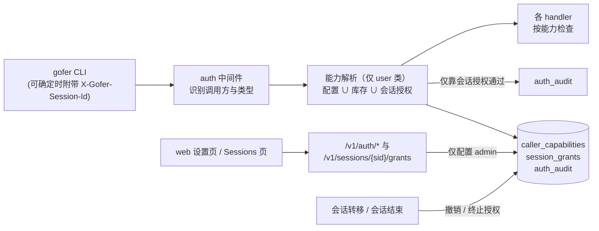
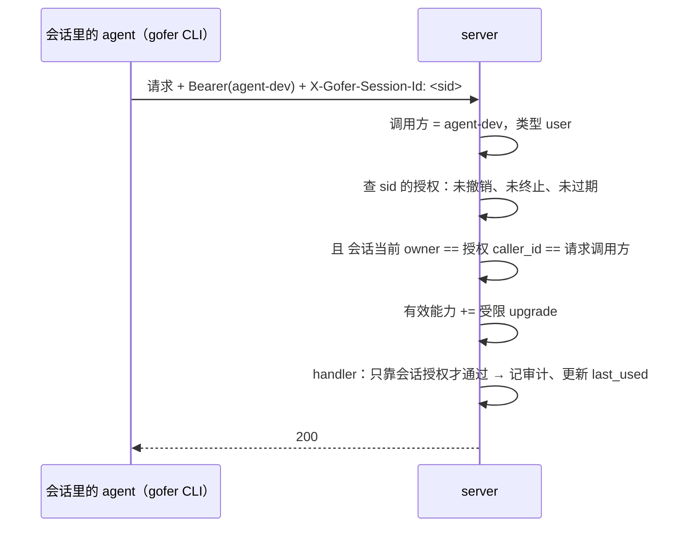

<!-- template_id: design; template_version: 1.1.1 -->
# 能力授予入库与会话授权 设计

> 状态：Draft 0.2 / 待人工计划批准
>
> - issue：gofer-kd8q（关联 gofer-6pw0 权限第二步）
> - 思考模式：RIGOROUS
> - 核心目标：人在 web 上管理调用方的管理类能力，并能把「发版升级」能力临时授予某个终端会话，对会话里的 agent 透明
> - scope freeze：管理类能力拆细并入库；会话授权只开放受限的升级能力；授权的 web / API / CLI 入口与审计。身份与 token 仍在配置文件；`answer` / `attach` / `tunnel` 不动
> - review budget：一轮设计评审（已完成，8 项 CORE_BLOCKING 已在 0.2 处理）；本版只做 confirmation
> - 停止条件：用户批准本稿，或确认轮发现新的 CORE_BLOCKING

## 修订记录

| 版本 | 日期 | 作者 | 摘要 |
|---|---|---|---|
| 0.1 | 2026-10-14 | Claude（监督会话） | 初稿 |
| 0.2 | 2026-10-14 | Claude（监督会话） | 按评审修订：授权与会话当前 owner 绑定，转移即撤销；会话结束即永久终止；`admin` 不再包含 answer / attach / tunnel；取消他人 job 不纳入；管理接口永远只认配置 admin；写明威胁模型，会话只能授予受限的 `upgrade`；会话 id 只在可确定时附带；能力只对 user 类调用方生效 |

> 仅语义变化递增版本；纯 identity/provenance/元数据纠正沿用原版本，并在 Git/进度记录中留痕。

## 背景与目标

2026-10-13 起，server 支持多个调用方（`server.callers`）。人和 agent 已经用不同 token：人用 `default`，带 `can_admin`；agent 和容器里的 hook 用 `agent-dev`，不带管理权限。随之出现两个问题：

1. **权限改起来麻烦**：能力写在配置文件里，改了要重启 server；`can_admin` 又是全有或全无，无法只给某个调用方其中一项。
2. **监督会话做不了发版的最后一步**：升级远程 worker 需要管理权限，只能由人在 web 上逐台点。

用户要的结果：

- 管理类能力在 web 上勾选，即时生效，不用重启。
- 在 Sessions 页找到某个会话，点「授权」，选有效期，这个会话就能完成发版的升级步骤；会话里的 agent 不用改任何东西。
- 设置页有一栏「会话授权」，能看到全部授权、每个授权的使用记录，随时解除。

## 名词

- **调用方（caller）**：一个 token 对应的身份，分三类：
  - user：来自 `server.callers`，以及旧的单一 server token（调用方 id 为 `default`）；
  - worker：worker 凭据；
  - job：server 按 job 签发的凭据。
- **能力（capability）**：某类操作的许可。
- **配置能力**：配置文件里写给调用方的能力，作为下限，web 上不能撤销。
- **库存能力**：存在 DB、在 web 上授予调用方的能力。
- **会话授权（session grant）**：授予某个已登记终端会话的受限能力，绑定会话 id 与会话 owner，有有效期，可以撤销。
- **会话 owner**：登记该会话的调用方（`agent_sessions.caller_id`），管理员可以转移。
- **配置 admin**：配置文件里带 `can_admin: true`（或 `capabilities` 含 `admin`）的 user 类调用方。

## 范围与非目标

**范围**

- 把现有「管理」检查点拆成四项能力，并入库管理。
- 会话授权：只开放一项受限能力 `upgrade`，见「威胁模型」。
- CLI 在可确定会话时附带会话 id；新增 `gofer auth whoami`。
- web：设置页「权限」「会话授权」两栏；Sessions 页的「授权」按钮与「已授权」徽标。

**非目标**（deferred）

- `answer`、`attach`、`tunnel` 三项能力及其检查点：不变，不入库，不可授予。
- 在 web 上新建调用方、生成 token；governance 开关挪到 web。
- 给「取消他人 job」加门槛：它现在没有任何检查，加门槛属于行为变化，不在本次范围。
- 调用方作用范围（项目 / runner / exec 限制、只读调用方）：属于 gofer-6pw0 的其余部分。
- 用加密手段防止同用户进程冒用会话 id。

## 已确认事实与规范

以下逐条核对过源码（评审记录见 gofer-kd8q 评论）。

- 鉴权在 `internal/httpapi/auth.go`，结果写进请求上下文：`ctxCallerID`、`ctxCallerKind`（user / worker / job）。job 凭据由 `authenticateJobToken` 识别。
- 管理类检查有两种写法：
  - `callerMayAdmin`（`server.go:104`）：governance 的 `require_admin_capability` 关闭时一律放行。共 11 处，用在：
    - 写配置、项目 ×3、规则、skills、tracker 同步；
    - worker 注册 ×2、worker 重载；
    - `upgradeAdmin`（`worker_upgrade_handler.go:54`，要求 user 类调用方），覆盖 worker 升级与一键更新的执行和取消。
  - 严格的 `CallerCanAdmin` / `callerHoldsAdmin`：约 12 处，用在：
    - 他人 job 的 attach、删除、脱敏；
    - pty 会话与录像；
    - 跨调用方秘密扫描、他人隧道；
    - 会话归属转移、管理员绑定 plan supervisor。
- 取消 job（`job_handler.go:509`）没有任何调用方检查；一键更新的「检查」（`update_handler.go:27`）对所有调用方开放。
- `CallerCanAdmin` 只按 id 查找、不看调用方类型；user 与 worker 的 id 在同一个命名空间，加载时也不校验重名。
- 会话再次登记时，`ended` / `offline` 会被改回 `running`，`ended_at` 清空（`internal/jobstore/sessions.go:553-571`）。所以「会话当前状态」不能作为授权的终止依据。
- 调用方与 governance 的改动要重启（`editable.go`，RestartRequired）；token、secrets 只允许写在文件里。
- CLI 识别会话的环境变量顺序：`GOFER_SESSION_ID`、`CLAUDE_CODE_SESSION_ID`、`CODEX_THREAD_ID`、`CODEX_SESSION_ID`（`internal/client/plan_autobind.go:18`）。子 agent 会继承父会话的这些变量。job 环境的禁止清单（`internal/job/credential.go:78`）只去掉了 `CLAUDE_CODE_SESSION_ID`。
- 遵循的规范：SR1403、SR1410（默认最小充分方案）、SR1409（这次改的是安全边界，按高暴露度评审）、AGENTS.md G021 / G022。

## 总体方案

### 能力

| 能力 | 覆盖的检查点 | 可入库 | 可授予会话 |
|---|---|---|---|
| `upgrade` | 一键更新的执行与取消、升级 worker（含上传二进制） | 是 | 受限，见下 |
| `config` | 写配置（含 steward / work 配置）、重载、项目增删改、规则、skills、worker 注册与重载、tracker 同步 | 是 | 否 |
| `sessions` | 转移会话归属、管理员绑定他人 plan 的 supervisor | 是 | 否 |
| `others_jobs` | 他人 job 的 attach（与现有「attach 或 admin」规则并列）、删除、脱敏；pty 会话与录像；跨调用方秘密扫描；他人隧道 | 是 | 否 |
| `admin` | 以上四项，加上管理库存能力与会话授权 | 否 | 否 |

- 配置里的 `can_admin: true` 等于 `admin`，含义只扩展到上面四项。`answer`、`attach`、`tunnel` 照旧是独立的能力位，`admin` 不包含它们。现有配置在开着这些 governance 开关时不会被扩权。
- 配置里另加 `capabilities: [upgrade, …]` 写法，可直接给细分能力，作为下限。loader 的「开了 `require_admin_capability` 至少要有一个 admin」校验同时认这两种写法。
- governance 开关的语义不变：
  - 原来走 `callerMayAdmin` 的检查点，`require_admin_capability` 关闭时照旧放行；
  - 原来严格的检查点继续严格，改成检查对应的细分能力；
  - 单 token 部署（没配 callers）在开关关闭时行为完全不变。

### 有效能力

```
有效能力 = 配置能力 ∪ 库存能力 ∪ 生效的会话授权能力
```

- 三项都**只对 user 类调用方生效**。worker 和 job 凭据的有效能力恒为空，与重名无关。
- loader 拒绝调用方 id 与 worker id 重名。

### 谁能管理

- 管理库存能力与会话授权的接口：只认**配置 admin**，且调用方必须是 user 类。**永远不受 governance 开关影响**。
- 库存能力和会话授权都不能包含 `admin`。

### 威胁模型

- 能力用来**防误操作，不做隔离**。`config` 能改 agent 的启动命令，`upgrade` 能上传任意二进制给 worker 运行，所以持有任一项，实际上都可以在 server 或 worker 主机上执行代码，进而读到 admin token。设置页把这两项标为「高危，等同管理员」，授予前二次确认。
- 会话授权只开放受限的 `upgrade`：
  - 只能执行一键更新：官方或已配置的发布源，下载后有 sha256 校验；
  - 只能用 server 自身二进制升级 worker；
  - **不能上传任意二进制**。
- `config`、`sessions`、`others_jobs` 不能授予会话。其中 `sessions` 能改会话 owner，而会话授权正是靠 owner 锚定的，必须排除。

## 架构



- **入口层**（`internal/httpapi`）：
  - auth 之后为 user 类调用方解析有效能力，放进请求上下文；
  - 统一的检查函数按「检查点类别 + governance 语义」判断；
  - 两个不接请求上下文的纯函数（`canDeleteJob`、`canAttachNow`）改为接收能力集。
- **数据层**（`internal/jobstore`），三张新表，均为 additive 迁移：
  - `caller_capabilities(caller_id, capability, granted_by, granted_at)`；
  - `session_grants(id, session_id, caller_id, capabilities, granted_by, granted_at, expires_at, until_session_end, ended_at, revoked_at, revoked_by, last_used_at, use_count)`，`caller_id` 为授权时会话的 owner；
  - `auth_audit(at, actor, action, caller_id, session_id, grant_id, capability, method, path, status)`。授权的使用与管理动作（授予、撤销、改库存能力）都记录在这里。
- **会话层**（`internal/sessionrelay` / `jobstore`）：
  - 归属转移成功时，撤销该会话全部生效中的授权（`revoked_by=system:owner_transfer`）；
  - 会话进入 `ended` 时，给 `until_session_end` 的授权写 `ended_at`。之后会话再次登记或复活，授权也不再生效。
- **CLI**（`internal/client`）附带会话 id 的规则：
  - 显式设置了 `GOFER_SESSION_ID` 就用它；
  - 否则只在其余变量去重后**恰好一个**取值时附带；
  - 有多个取值（例如在 Claude 会话里启动的 codex）就不附带，`gofer auth whoami` 说明原因。
  - `GOFER_SESSION_ID`、`CODEX_THREAD_ID`、`CODEX_SESSION_ID` 加入 `DefaultJobEnvDeny`。
- **web**：
  - 设置页「权限」列出 user 类调用方及其配置能力、库存能力；「不在配置中」的残留行单独标出，可清理；
  - 设置页「会话授权」列出授权与使用记录，可撤销；
  - Sessions 页显示「授权」按钮与「已授权」徽标。

### 接口

| 接口 | 权限 | 说明 |
|---|---|---|
| `GET /v1/auth/whoami` | 任意 user 调用方 | 本次请求的调用方、有效能力及来源，是否附带了会话 id 及原因 |
| `GET /v1/auth/capabilities` | 配置 admin | 全部 user 调用方的配置能力、库存能力、残留行 |
| `PUT /v1/auth/callers/{id}/capabilities` | 配置 admin | 设置库存能力；`{id}` 必须是已知 user 调用方；不能包含 `admin`，不能动配置能力 |
| `POST /v1/sessions/{sid}/grants` | 配置 admin | `{ttl_sec, until_session_end}`，能力固定为受限 `upgrade` |
| `GET /v1/auth/session-grants` | 配置 admin | `?active=1` 只看生效中的 |
| `DELETE /v1/auth/session-grants/{id}` | 配置 admin | 撤销 |
| `GET /v1/auth/audit` | 配置 admin | `?grant=` / `?caller=` 过滤 |

- 读接口在 handler 里检查调用方类型；job 凭据与 worker 凭据一律 403。
- 写接口照 `internal/httpapi/jobcredential.go` 的写法登记，并把相应路由词加入 `jobRouteWords`。
- CLI 加 `gofer auth whoami`；授权的管理只放在 web。

## 关键流程

### 授权

1. 管理员在 Sessions 页找到会话，点「授权」。弹窗说明授予的是「发版升级」，并写明威胁模型里的限制。
2. 有效期可选「会话结束」（默认）、1 小时、4 小时、24 小时；无论选哪个，最长都不超过 24 小时。
3. server 记下授权，`caller_id` 取会话当前的 owner。以下情况拒绝授权：
   - 会话没有 owner；
   - 会话已结束；
   - owner 不是 user 类调用方。

### 使用（对 agent 透明）



以下任一情况，授权都不生效：
- 请求方不是 user 类；
- 会话当前 owner、授权的 `caller_id`、请求调用方三者不一致；
- 授权已撤销、已终止或已过期；
- 请求的操作超出受限范围，例如上传二进制，这时返回 403 并写明原因。

### 撤销与终止

- 设置页手动撤销，立即生效。
- 会话归属被转移时自动撤销。
- `until_session_end` 的授权在会话进入 `ended` 时终止，之后不会复活。
- 到期在请求时判断，不需要后台清理任务。

## 安全、数据、运维与回滚

- **冒用**：同一 token 的其他进程可以伪造会话 id 请求头。缓解：
  - 授权绑定 owner，转移即撤销；
  - 最长 24 小时，默认会话结束即终止；
  - 只开放受限的 `upgrade`；
  - 使用全程审计，随时可撤销。

  web 上写明「防误操作，不防同用户进程有意冒用」。
- **子 agent 误带父会话 id**：会话 id 只在可确定时附带，见「架构」CLI 一条。
- **job 与 worker 拿不到能力**：能力解析只对 user 类生效；job 环境去掉全部会话变量。
- **防自锁与防扩张**：配置能力是下限；管理授权只认配置 admin，不受 governance 开关影响；库存能力与会话授权都不能包含 `admin`。
- **数据**：三张新表，只增不改。库存能力没有有效期，调用方改名或删除后会残留，设置页标出并可清理。旧版本 server 读不到新表，只是忽略；回滚后效果等同于没有库存能力和会话授权，再升级时库存能力会恢复，设置页会提示。
- **兼容**：`can_admin` 的含义收窄为四项管理能力，与现状一致：现在它本来就不覆盖 answer / tunnel，attach 仍按「attach 或 admin」。取消 job 的行为不变。单 token 部署不受影响。
- **运维**：库存能力与会话授权即时生效，不用重启。调用方与 token 仍改配置后重启。

## 决策

1. 身份与 token 留在配置文件，能力授予入库（用户 2026-10-14 确认按推荐）。
2. 会话授权默认「会话结束即终止」，最长 24 小时（用户确认按推荐）。
3. 在 web 上新建调用方、生成 token 暂不做（用户确认按推荐）。
4. 会话授权只开放受限 `upgrade`，不再按能力勾选。0.1 的「按能力勾选 + 发版预设」收窄为此项；评审 C6 指出其余能力等同管理员。**需用户确认**。
5. `admin` = `upgrade` + `config` + `sessions` + `others_jobs` + 管理授权；`answer` / `attach` / `tunnel` 不动。
6. 取消他人 job 不加门槛，保持现状。
7. 管理接口只认配置 admin，且必须是 user 类，永远不受 governance 开关影响。
8. 能力只对 user 类调用方生效；loader 拒绝调用方 id 与 worker id 重名。

## 待确认事项

1. 决策 4：会话授权只开放受限 `upgrade`，是否接受？
2. 会话变为 `offline`（长时间没心跳）时，授权仍有效，直到会话结束、到期或撤销。
3. `auth_audit` 保留 90 天，复用现有的清理时机。

## 结论与人工计划 Gate

建议按本稿推进。这次改的是鉴权边界与 Schema，按 SR1107 / SR1409 走完整流程：

1. 本稿已完成一轮评审，确认轮之后由你批准；
2. 再写实施计划，你批准后派给 suga 实施。

批准语句示例：「批准 db-capabilities-and-session-grants 设计 Draft 0.2，进入计划」。
