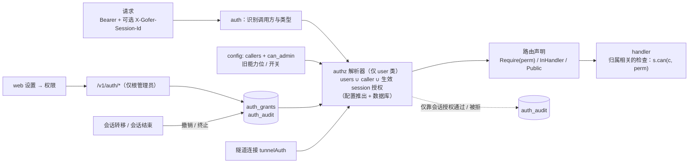
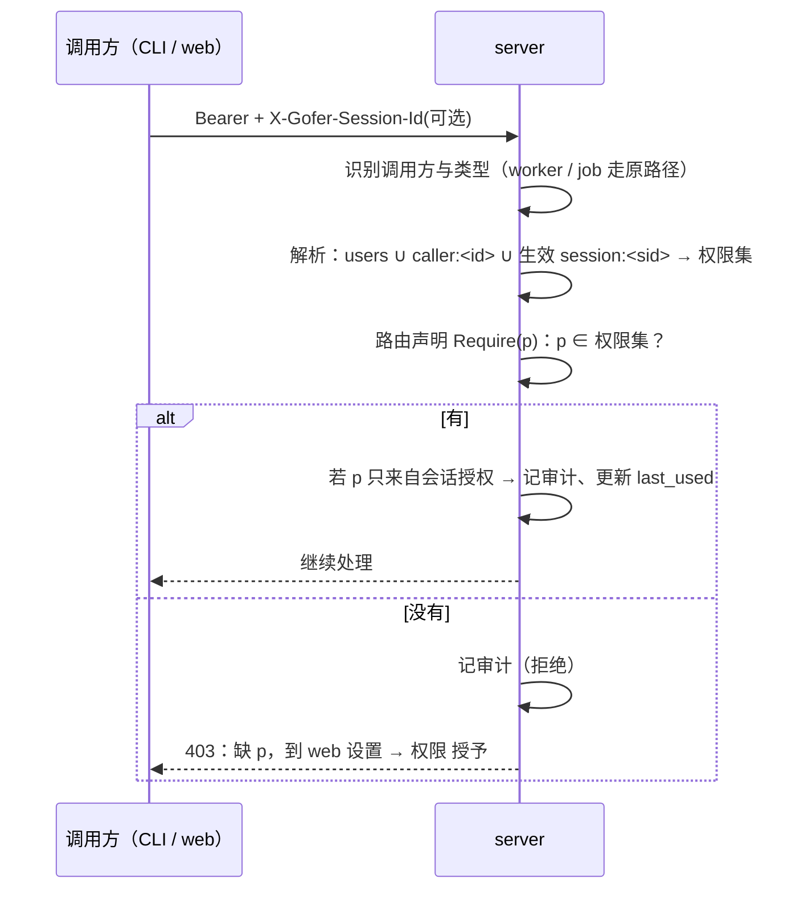

<!-- template_id: design; template_version: 1.1.1 -->
# 权限目录与授权（入库、模式匹配、会话授权） 设计

> 状态：Draft 0.3 / 待人工计划批准
>
> - issue：gofer-kd8q（并入 gofer-6pw0 权限第二步的模型部分）
> - 思考模式：RIGOROUS
> - 核心目标：一次把权限模型定清楚。权限有固定名称；授权就是给主体（全体用户、某个调用方、某个会话）发一组名称模式，在 web 上管理，即时生效，对 agent 透明
> - scope freeze：权限目录、授权模型与匹配、主体、判定流程、路由声明、存储、web / API / CLI、审计；按项目限定范围只定数据模型，第二期再执行
> - review budget：0.1 已完成一轮评审，8 项 CORE_BLOCKING 已吸收；0.3 改了模型，需再做一轮评审
> - 停止条件：用户批准本稿，或评审发现需要用户裁决的核心问题

## 修订记录

| 版本 | 日期 | 作者 | 摘要 |
|---|---|---|---|
| 0.1 | 2026-10-14 | Claude（监督会话） | 初稿：能力拆分、库存能力、会话授权 |
| 0.2 | 2026-10-14 | Claude（监督会话） | 按评审修订 8 项核心问题 |
| 0.3 | 2026-10-14 | Claude（监督会话） | 用户要求重做模型：权限按固定名称建目录；授权 = 主体 + 名称模式（类似 Jenkins）；隧道等能力也纳入，容器会话可用；配置只保留身份与根管理员；路由逐条声明所需权限，并有测试兜底；预留按项目限定范围 |

> 仅语义变化递增版本；纯 identity/provenance/元数据纠正沿用原版本，并在 Git/进度记录中留痕。

## 背景与目标

2026-10-13 起，server 支持多个调用方。人用 `default`，带 `can_admin`；agent 和容器 hook 用 `agent-dev`。现在的权限有四个问题：

1. **写在配置里**：只有四个能力位（`can_admin` / `can_answer` / `can_attach` / `can_tunnel`），外加四个 governance 开关；改了要重启。
2. **粒度太粗**：`can_admin` 全有或全无；有的操作根本没有检查，例如取消他人 job。
3. **规则分散**：检查点散落在约 30 处，写法有两种：一种受 governance 开关影响，一种不受。新增接口时很容易漏检查。
4. **只能按 token 授权**：容器里的业务会话需要开隧道临时访问现场设备，监督会话需要发版升级。现在只能给整个 token 授权，或者新建 token 并重启会话。

用户要的结果（2026-10-14）：

- 权限有固定名称，存在数据库里，在 web 上管理。
- 授权就是把权限发给 token（调用方），用简单的名称模式匹配，类似 Jenkins。
- 能对单个会话授权，在 web 上点「授权」即可，会话里的 agent 不用改任何东西。
- 设计一次到位，避免以后返工。

## 名词

- **权限（permission）**：一个固定名称的操作许可，格式 `<资源>.<动作>[.others]`，例如 `tunnel.open`、`job.cancel.others`。全部名称在代码里登记，组成**权限目录**。
- **模式（pattern）**：匹配权限名称的字符串。`*` 匹配任意字符（包括 `.`），其余字符按字面匹配，例如 `tunnel.*`、`job.*.others`、`*`。不支持正则。
- **主体（subject）**：权限发给谁。
  - `users`：全体已认证的用户调用方；
  - `caller:<id>`：某个调用方，也就是某个 token；
  - `session:<sid>`：某个已登记的终端会话。
- **授权（grant）**：一条「主体 + 模式 + 范围 + 有效期 + 来源」记录。
- **根管理员**：配置文件里 `can_admin: true` 的调用方。拥有全部权限，是唯一能管理授权的主体，web 上撤不掉。
- **调用方类型**：
  - user：`server.callers` 中的调用方，以及旧的单一 server token（id 为 `default`）；
  - worker：worker 凭据；
  - job：server 按 job 签发的凭据。

## 范围与非目标

**范围**

- 权限目录：名称、说明、风险级别、能否授予会话、能否限定范围、对应的旧配置项。
- 授权模型：主体、模式、有效期、来源；判定流程。
- 路由声明：每条 `/v1` 路由声明所需权限，并有测试保证不漏。
- 存储、web、API、CLI（`gofer auth whoami`）、审计。
- 从现有配置平滑过渡，现有部署行为不变。

**非目标**

- 以下只定数据模型，第二期执行：
  - 按项目、runner 限定范围（例如只能向 `zy-*` 项目提交 job）；
  - 只读调用方的完整体验。
- job 凭据的权限：维持现有内置白名单（`jobcredential.go`），只在目录里把它记为内置主体 `job`，不可配置。
- worker 凭据：没有任何权限，与现在一致。
- 在 web 上新建调用方、生成 token：身份与 token 仍只在配置文件。
- 拒绝规则（deny）：只做叠加授权，不做否定模式。
- 防同用户进程冒用会话 id 的加密手段。

## 已确认事实与规范

- 鉴权在 `internal/httpapi/auth.go`，结果写进请求上下文：调用方 id 与类型（user / worker / job）。隧道连接另有自己的鉴权（`tunnel_handler.go:20` 的 `tunnelAuth`），不经过 `/v1` 中间件。
- `server.go` 里注册了 309 条路由。现有检查点（0.1 评审逐条核对过，见 gofer-kd8q 评论）：
  - **受 governance 开关影响的**：
    - `callerMayAdmin`：写配置、项目、规则、skills、tracker 同步、worker 注册与重载、worker 升级、一键更新执行；
    - `callerMayAnswer`：回答交互；
    - `humanReviewer`：验收、拒绝、批准；
    - `sessionMayAnswer`：代答他人会话；
    - `callerMayAttach`：attach 自己的 job；
    - 隧道：开隧道。
  - **严格的（只认能力位）**：他人 job 的 attach、删除、脱敏；pty 会话与录像；跨调用方秘密扫描；他人隧道；会话归属转移；绑定他人 plan 的 supervisor。
  - **没有检查的**：提交与查看 job、取消他人 job、一键更新的检查。
  - **job 层**：`internal/job/wakeup.go:273` 直接读配置判断能否唤醒他人 job。
- `CallerCanAdmin` 等只按 id 查找，不看类型；user 与 worker 的 id 在同一命名空间，加载时不校验重名。
- 会话再次登记时，`ended` 会被改回 `running`（`internal/jobstore/sessions.go:553-571`）。
- CLI 识别会话的环境变量顺序：`GOFER_SESSION_ID`、`CLAUDE_CODE_SESSION_ID`、`CODEX_THREAD_ID`、`CODEX_SESSION_ID`。子 agent 会继承父会话的变量；job 环境只去掉了 `CLAUDE_CODE_SESSION_ID`。
- 遵循的规范：SR1403 / SR1410（默认最小充分）、SR1409（安全边界，按高暴露度评审）、AGENTS.md G021 / G022（权限判断放在入口层；job 层不读调用方配置）、G032（不积累永久兼容层）。

## 总体方案

### 一、权限目录（代码中登记，web 只读展示）

| 权限 | 说明 | 风险 | 可授予会话 | 可限定范围 | 现在由什么控制 |
|---|---|---|---|---|---|
| `job.read` | 查看 job、日志、plan、workflow | 低 | 是 | 是 | 无检查 |
| `job.submit` | 提交、续接、重跑 job | 中 | 是 | 是 | 无检查 |
| `job.cancel.others` | 取消他人的 job | 中 | 是 | 是 | 无检查 |
| `job.attach` | attach 自己的交互 job | 中 | 是 | 是 | `can_attach` + 开关 |
| `job.attach.others` | attach 他人的交互 job | 高 | 否 | 是 | 严格 admin |
| `job.delete.others` | 删除、脱敏他人的 job | 高 | 否 | 是 | 严格 admin |
| `job.review` | 验收、拒绝、批准 hold | 中 | 是 | 是 | `can_answer` + 开关 |
| `job.wake.others` | 唤醒他人的 job | 中 | 是 | 是 | `can_answer`（job 层） |
| `interaction.answer` | 回答 job 的工具审批与提问 | 中 | 是 | 是 | `can_answer` + 开关 |
| `session.reply.others` | 代答、给他人终端会话发消息 | 中 | 是 | 否 | `can_answer` + 开关 |
| `session.transfer` | 转移会话归属 | 高 | 否 | 否 | 严格 admin |
| `plan.supervise.others` | 绑定他人 plan 的 supervisor | 中 | 否 | 是 | 严格 admin |
| `tunnel.open` | 开隧道（访问现场设备、调试） | 中 | 是 | 第二期 | `can_tunnel` + 开关 |
| `tunnel.manage.others` | 管理他人的隧道转发 | 高 | 否 | 否 | 严格 admin |
| `pty.manage` | 列出 pty 会话、查看录像 | 高 | 否 | 否 | 严格 admin |
| `secret.scan.all` | 跨调用方秘密扫描 | 高 | 否 | 否 | 严格 admin |
| `update.check` | 检查新版本 | 低 | 是 | 否 | 无检查 |
| `update.apply` | 一键更新的执行与取消（发布源 + sha256） | 高 | 是 | 否 | admin + 开关 |
| `worker.upgrade` | 用 server 自身二进制升级 worker | 高 | 是 | 否 | admin + 开关 |
| `worker.upgrade.upload` | 上传任意二进制升级 worker | 危险 | 否 | 否 | admin + 开关 |
| `worker.manage` | 注册、重载 worker | 危险 | 否 | 否 | admin + 开关 |
| `config.read` | 读配置视图 | 低 | 是 | 否 | 无检查 |
| `config.write` | 写配置（含 steward / work）、重载 | 危险 | 否 | 否 | admin + 开关 |
| `project.write` | 增删改项目 | 危险 | 否 | 否 | admin + 开关 |
| `rules.write` | 改规则库 | 危险 | 否 | 否 | admin + 开关 |
| `skills.write` | 改 skills | 危险 | 否 | 否 | admin + 开关 |
| `tracker.sync` | tracker 仓同步 | 中 | 否 | 是 | admin + 开关 |
| `auth.manage` | 管理授权 | 根 | 否 | 否 | （新增） |

- **风险级别**：
  - **危险**：等同管理员。持有者能让 server 或 worker 执行任意代码，例如改 agent 启动命令、上传二进制、往所有 job 注入规则。
  - **高**：能影响他人的工作或读到敏感内容。
  - web 授予高与危险级别时要二次确认，危险级别还要写明原因。
- **能否授予会话**：危险级别与 `auth.manage` 一律不能授予会话。高级别中只有发版需要的 `update.apply`、`worker.upgrade` 可以。
- 新增接口必须先在目录里登记权限，见「路由声明」。权限名称一经发布不改名；要废弃，按 G032 标 `DEPRECATED`。

### 二、授权模型

一条授权的字段：

```
subject   users | caller:<id> | session:<sid>
pattern   名称模式，如 tunnel.* / job.*.others / *
scope     *（第一期只允许 *）| project:<glob>（第二期）
expires   空 = 不过期；session 主体必须有，最长 24 小时
source    config（由配置文件推出，只读）| db（web 管理）
```

**有效权限**：调用方是 user 类时，合并三部分，展开成具体的权限名：

- `users` 的授权；
- `caller:<自己>` 的授权；
- 本次请求附带的、生效中的 `session:<sid>` 授权。

worker 与 job 凭据不走这套：worker 恒为空，job 用内置白名单。

`auth.manage` 只属于根管理员：任何 db 授权的模式（包括 `*`）都匹配不到它。会话授权的模式只能展开到「可授予会话」的权限。

**模式校验**：保存时，模式必须至少匹配目录里的一个权限，防止拼写错误悄悄失效。保存后，web 实时显示这条模式展开成哪些权限。

**预设**（web 上的快捷填充，存的仍是模式）：
- 隧道使用：`tunnel.open`
- 发版升级：`update.*`、`worker.upgrade`
- 代答：`interaction.answer`、`job.review`、`session.reply.others`
- 只读：`job.read`、`config.read`、`update.check`

### 三、配置与数据库的分工（平滑过渡）

- **配置文件**：只管身份（callers、token、配额）和根管理员（`can_admin`）。
- **由旧配置推出的只读授权**（`source=config`），每次加载都重新计算；web 上显示为「来自配置」，不能改：
  - `can_answer` → `caller:<id>`：`job.review`、`job.wake.others`、`interaction.answer`、`session.reply.others`
  - `can_attach` → `caller:<id>`：`job.attach`
  - `can_tunnel` → `caller:<id>`：`tunnel.open`
  - 某个 `require_*_capability` 关闭 → `users` 得到它原本管的那组权限。
    - `require_admin_capability` 关闭时，`users` 得到原 `callerMayAdmin` 管的那组：`update.apply`、`worker.*`、`config.write`、`project.write`、`rules.write`、`skills.write`、`tracker.sync`。
    - 严格检查的那些权限不在这组里，与现状一致。
- **数据库首次启用时种入**（`source=db`，可以在 web 上改）：`users` 得到今天没有任何检查的那组：`job.read`、`job.submit`、`job.cancel.others`、`update.check`、`config.read`。
  - 之后可以在 web 上收紧，例如去掉 `users` 的 `job.submit`，再按调用方单独授予，就得到只读调用方。
- **结果**：现有部署（包括单 token、governance 全关）升级后行为完全不变。
- **推荐的新配置写法**：只写 callers 与根管理员，governance 开关全部打开，其余都在 web 上授权。旧能力位与 governance 开关标为 `DEPRECATED`，三个版本后移除（G032）；移除前，启动时提示「请在 web 上改用授权」。

### 四、会话授权

- **主体**是 `session:<sid>`，授权时记下会话当前的 owner。
- **生效条件**（四条都要满足）：
  - 请求附带了这个会话 id；
  - 请求方是 user 类；
  - 会话**当前** owner、授权记录的 owner、请求方三者一致；
  - 授权未撤销、未终止、未过期。
- **失效**：
  - 会话归属转移时，自动撤销该会话的全部授权；
  - 会话进入 `ended` 时，给「会话结束即终止」的授权写终止标记。之后会话即便重新登记，授权也不会复活。
- **有效期**：默认「会话结束」，可选 1 / 4 / 24 小时；最长 24 小时。
- **CLI 附带会话 id 的规则**：
  - 显式设置了 `GOFER_SESSION_ID` 就用它；
  - 否则只在其余变量去重后恰好一个取值时附带；
  - 有多个取值（例如在 Claude 会话里启动的 codex）就不附带。
  - `GOFER_SESSION_ID`、`CODEX_THREAD_ID`、`CODEX_SESSION_ID` 加入 job 环境的禁止清单。
- **典型用法**：
  - 容器里的业务会话要访问现场设备 → 在 Sessions 页给它授权「隧道使用」；也可以给 `caller:agent-dev` 授予 `tunnel.open`，让该 token 的所有会话都能用。
  - 监督会话要发版 → 授权「发版升级」。

## 架构



- **`internal/authz`（新包，纯逻辑）**：
  - 权限目录、模式匹配与展开；
  - 由旧配置推出授权；
  - 判定函数：输入调用方、会话、授权集，输出权限集及每项的来源。

  只依赖 `config`，不依赖入口层与 job 层（G022）。
- **入口层**（`internal/httpapi`）：
  - auth 之后解析有效权限，放进请求上下文；
  - 隧道连接的 `tunnelAuth` 用同一个解析器。
- **路由声明**：每条 `/v1` 路由注册时声明下列之一：
  - `Require(perm)`：路由级检查，统一在中间件里做；
  - `InHandler(perm…)`：结果取决于归属，例如「自己的 job 不需要权限，他人的需要 `job.cancel.others`」，由 handler 调 `s.can(c, perm)`；
  - `Public`：任何 user 类调用方都可以，例如 `whoami`。
- **覆盖测试**：遍历全部路由，没有声明的路由让测试失败；声明里的权限名必须在目录里。以后新增接口忘了声明，CI 就会挂。这是避免以后出缺陷的主要手段。
- **job 层**：`wakeup.go` 不再读配置，改由入口层把「能否唤醒他人 job」的判定传进去（G021）。
- **数据层**（`internal/jobstore`），additive 迁移：
  - `auth_grants(id, subject, pattern, scope, expires_at, until_session_end, session_owner, ended_at, granted_by, granted_at, revoked_at, revoked_by, note, last_used_at, use_count)`；
  - `auth_audit(at, actor, action, subject, permission, session_id, grant_id, method, path, status)`。
  - 授权在内存里缓存，写操作后立即刷新；数据量很小。
- **CLI**：`gofer auth whoami`，列出有效权限、每项的来源，以及会话 id 有没有附带、为什么。授权的管理只放在 web。

### 接口

| 接口 | 权限 | 说明 |
|---|---|---|
| `GET /v1/auth/whoami` | Public | 调用方、有效权限与来源、会话 id 附带情况 |
| `GET /v1/auth/catalog` | Public | 权限目录 |
| `GET /v1/auth/grants` | `auth.manage` | 全部授权（含来自配置的只读项），`?subject=` 过滤 |
| `POST /v1/auth/grants` | `auth.manage` | 新增授权；会话主体走同一接口 |
| `DELETE /v1/auth/grants/{id}` | `auth.manage` | 撤销；来自配置的项不可撤销 |
| `GET /v1/auth/audit` | `auth.manage` | 审计，按主体、权限、授权 id 过滤 |

- `auth.manage` 只看根管理员，与 governance 开关无关。worker 与 job 凭据访问以上接口一律 403。
- 403 响应写明缺哪个权限，以及去 web 的哪里授权。

## 关键流程

### 判定一次请求



### 在 web 上授权

1. 打开「设置 → 权限」，选主体（全体用户 / 某个调用方），选预设或填写模式。下方实时显示展开后的权限；包含高或危险级别时要确认。
2. 会话授权：在 Sessions 页的会话行或抽屉里点「授权」，选预设或模式（只列可授予会话的权限）和有效期。
3. 设置页「权限」下有四个页签：
   - 「授权」：按主体分组，标出来源；
   - 「会话授权」：生效中的、已失效的；
   - 「权限目录」；
   - 「审计」。

## 安全、数据、运维与回滚

- **防自锁**：根管理员来自配置，web 上撤不掉；配置推出的授权也是只读下限。
- **防权限越给越大**：只有根管理员能管理授权；数据库授权永远匹配不到 `auth.manage`；危险级别不能授予会话。
- **威胁模型**：权限用来防误操作，不做隔离。持有危险级别权限等同管理员；同一 token 的其他进程可以冒用会话 id。缓解：
  - 会话授权绑定 owner，有效期最长 24 小时；
  - 危险级别不能授予会话；
  - 全程审计，随时可撤销。

  web 上写明这一点。
- **类型隔离**：只对 user 类解析权限；loader 拒绝调用方 id 与 worker id 重名。
- **新增接口漏检查**：靠路由声明的覆盖测试兜底。
- **数据**：两张新表，只增不改。旧版本 server 会忽略这两张表；回滚后只剩配置推出的授权，`users` 的种入授权不再生效。旧版本对这些操作本来就不检查，所以行为等同现在。
- **兼容**：现有配置升级后行为不变，见「配置与数据库的分工」。
- **运维**：数据库授权即时生效，不用重启；调用方与 token 仍改配置后重启。

## 决策

1. 权限用固定名称、代码登记的目录；授权 = 主体 + 名称模式（`*` 通配，不用正则）；只做叠加，不做否定（用户 2026-10-14 要求按名称发权限、类似 Jenkins）。
2. 主体三种：`users`、`caller:<id>`、`session:<sid>`。不做自定义角色，用预设代替。
3. 配置只保留身份与根管理员；旧能力位与 governance 开关推出只读授权，保证行为不变，并按 G032 标为待移除。
4. 会话授权可以授予非危险级别的权限（含 `tunnel.open`、发版升级），默认会话结束即终止，最长 24 小时。
5. 每条路由声明所需权限，覆盖测试兜底。
6. 授权带 `scope` 字段，第一期只允许 `*`；按项目限定范围在第二期执行。

## 待确认事项

1. 第 3 条的过渡方式：旧能力位与 governance 开关先继续生效（显示为「来自配置」），三个版本后移除。是否接受？还是希望升级时一次性迁进数据库、立即删除旧写法？
2. 风险分级与「可授予会话」两列是否符合你的预期？重点是 `tunnel.open` 为中风险、可授予会话，`update.apply` / `worker.upgrade` 为高风险、可授予会话。
3. 审计保留 90 天。

## 结论与人工计划 Gate

建议按本稿推进。下一步：

1. 对 0.3 再做一轮独立评审，修正发现的核心问题；
2. 你批准设计；
3. 写实施计划，你批准后派给 suga，大致分两批：
   - 第一批：authz 包、路由声明与覆盖测试、配置推出授权、种入；
   - 第二批：数据库授权、会话授权、web、审计。

批准语句示例：「批准 权限目录与授权 设计 Draft 0.3，进入计划」。
