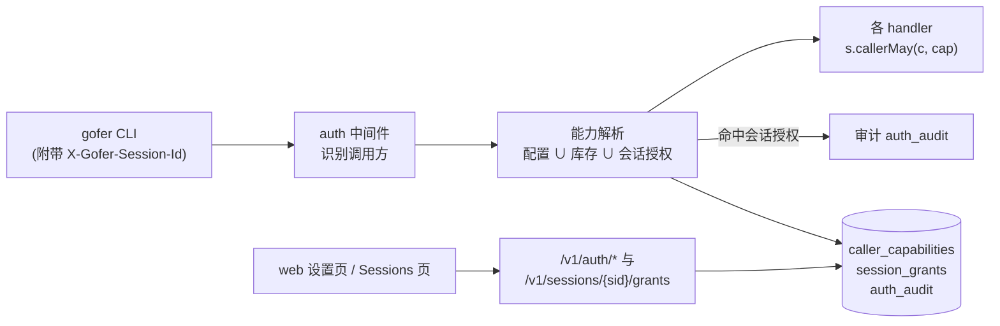
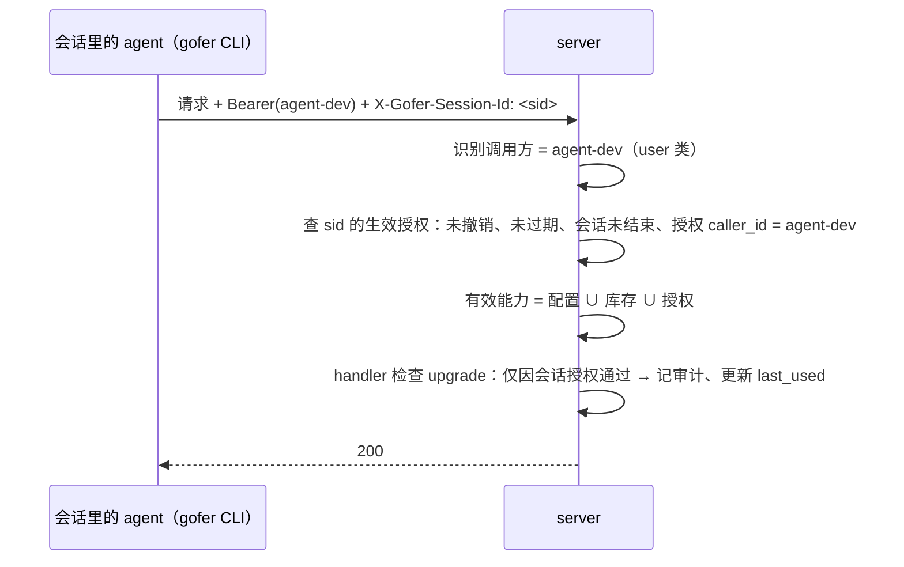

<!-- template_id: design; template_version: 1.1.1 -->
# 能力授予入库与会话授权 设计

> 状态：Draft 0.1 / 待人工计划批准
>
> - issue：gofer-kd8q（关联 gofer-6pw0 权限第二步）
> - 思考模式：RIGOROUS
> - 核心目标：人在 web 上管理「谁能做什么」，并能把指定能力临时授予某个终端会话，对会话里的 agent 透明
> - scope freeze：能力授予（调用方级、会话级）、能力拆细、授权的 web / API / CLI 入口与审计；身份与 token 仍在配置文件
> - review budget：一轮设计评审；无 `CORE_BLOCKING` 即停
> - 停止条件：用户批准本稿，或评审发现需要用户裁决的核心问题

## 修订记录

| 版本 | 日期 | 作者 | 摘要 |
|---|---|---|---|
| 0.1 | 2026-10-14 | Claude（监督会话） | 初稿 |

> 仅语义变化递增版本；纯 identity/provenance/元数据纠正沿用原版本，并在 Git/进度记录中留痕。

## 背景与目标

2026-10-13 起，server 支持多个调用方（`server.callers`）。人和 agent 已经用不同 token：人用 `default`，带 `can_admin`；agent 和容器里的 hook 用 `agent-dev`，不带管理权限。随之出现两个问题：

1. **权限改起来麻烦**：能力写在配置文件里，改了要重启 server；`can_admin` 又是全有或全无，无法只给某个调用方「升级」这一项。
2. **监督会话做不了发版的最后一步**：升级远程 worker 需要管理权限，只能由人在 web 上逐台点。要给某个会话授权，现在只能新建一个带 `can_admin` 的调用方，再用它的 token 重启会话。这样配置麻烦，而且一给就是全部管理权限。

用户要的结果：

- 能力在 web 上勾选，即时生效，不用重启。
- 在 Sessions 页找到某个会话，点「授权」，勾选能力和有效期，这个会话就能执行对应操作；会话里的 agent 不用改任何东西。
- 设置页有一栏「会话授权」，能看到全部授权，随时解除。

## 名词

- **调用方（caller）**：一个 token 对应的身份。用户调用方来自 `server.callers` 和旧的 server token（`default`）；另有 worker 凭据，以及 server 按 job 签发的 job 凭据。
- **能力（capability）**：某类操作的许可，例如 `upgrade`。
- **配置能力**：配置文件里写给调用方的能力，作为下限，web 上不能撤销。
- **库存能力**：存在 DB、在 web 上授予调用方的能力。
- **会话授权（session grant）**：授予某个已登记终端会话的一组能力，绑定会话 id，有有效期，可以撤销。
- **会话 owner**：登记该会话的调用方（`agent_sessions.caller_id`），可以由管理员转移。

## 范围与非目标

**范围**

- 拆细 `can_admin`，并给现有接口按能力重新标注检查点。
- 调用方级能力：配置能力加上库存能力，在 web 上管理。
- 会话级授权：授予、使用、到期、撤销、审计。
- CLI 自动附带会话 id；新增 `gofer auth whoami` 查看自己当前的有效能力。
- web：设置页的「权限」与「会话授权」两栏，Sessions 页的「授权」按钮。

**非目标**（不在本次，记为 deferred）

- 在 web 上新建调用方、生成 token：身份与 token 仍只在配置文件。
- governance 开关（`require_*_capability`）挪到 web：仍在配置里。
- 调用方作用范围，即项目 / runner / exec 限制和只读调用方：属于 gofer-6pw0 的其余部分。
- 用加密手段防止同用户进程冒用会话 id：见下文「安全」。

## 已确认事实与规范

- 鉴权在 `internal/httpapi/auth.go`，结果写进请求上下文：`ctxCallerID`、`ctxCallerKind`（user / worker / job）。job 凭据由 server 按 job 签发（`authenticateJobToken`）。
- 管理类检查有两种写法：
  - `callerMayAdmin`：governance 的 `require_admin_capability` 关闭时一律放行。用在配置写入、项目写入、规则、skills、tracker 同步、worker 注册 / 重载 / 升级（`server.go:104` 等 11 处）。
  - 严格 `CallerCanAdmin` / `callerHoldsAdmin`：只认能力位。用在操作他人 job（attach、取消、删除、脱敏）、pty 会话、跨 job 秘密扫描、他人隧道、会话归属转移、管理员绑定 plan supervisor（约 14 处）。
  - 一键更新另有 `upgradeAdmin`。
- 调用方与 governance 的改动要重启（`internal/config/editable.go` 标记为 RestartRequired）。token、secrets 等只允许写在文件里，写接口不暴露。
- CLI 已经能识别所在会话：`internal/client/plan_autobind.go` 的 `AgentSessionEnvKeys` 依次读 `GOFER_SESSION_ID`、`CLAUDE_CODE_SESSION_ID`、`CODEX_THREAD_ID`、`CODEX_SESSION_ID`，`plan create` 靠它自动绑定会话。
- 会话 owner 在首次登记时确定；被拒的上报会记在 `refused_caller_id`；管理员可以转移归属（`POST /v1/sessions/{sid}/owner`，v0.155.1）。
- 遵循的规范：SR1403、SR1410（默认最小充分方案）、SR1409（这次改的是安全边界，按高暴露度评审）、AGENTS.md G021 / G022（权限判断放在入口层，job 层不引入调用方概念）。

## 总体方案

**有效能力** = 配置能力 ∪ 库存能力 ∪ 当前请求命中的会话授权能力。

governance 开关保持原语义：某类检查对应的 `require_*_capability` 关闭时，该检查对所有调用方放行，单 token 部署的行为不变。原先那些「严格」检查（不看 governance）继续严格，只是改成检查对应的细分能力。

### 能力拆分

| 能力 | 覆盖的操作（现有检查点） |
|---|---|
| `upgrade` | 一键更新的检查 / 执行 / 取消、升级 worker |
| `config` | 写配置、重载配置、项目增删改、规则、skills、worker 注册与重载、tracker 同步 |
| `sessions` | 转移会话归属、管理员绑定他人 plan 的 supervisor |
| `others_jobs` | attach / 取消 / 删除 / 脱敏他人 job、pty 会话、跨调用方秘密扫描、他人隧道 |
| `answer` / `attach` / `tunnel` | 不变 |
| `admin` | 以上全部，外加管理能力与会话授权 |

- 配置里写的 `can_admin: true` 等于持有 `admin`，原有配置不用改。
- 配置里另加 `capabilities: [upgrade, …]` 写法，可以直接给细分能力，作为下限。

### 谁能管理

- 授予或撤销库存能力、授予或撤销会话授权：只有**配置能力里有 `admin`** 的调用方可以做。
- 通过库存或会话授权得到的 `admin` 不能再去管理授权，防止授权链自我扩张。
- 库存能力与会话授权都**不能包含 `admin`**，只能授予细分能力。

## 架构

- **入口层**（`internal/httpapi`）：新增能力解析，按请求算出有效能力放进上下文；新增统一检查 `s.callerMay(c, cap)`，替换现有的 `callerMayAdmin`、`callerHoldsAdmin`、`CallerCanAdmin` 检查点。
- **数据层**（`internal/jobstore`）：新增三张表，均为 additive 迁移。
  - `caller_capabilities(caller_id, capability, granted_by, granted_at)`；
  - `session_grants(id, session_id, caller_id, capabilities, granted_by, granted_at, expires_at, until_session_end, revoked_at, revoked_by, last_used_at, use_count)`。`caller_id` 是授权时会话的 owner；
  - `auth_audit(at, caller_id, session_id, grant_id, capability, method, path, status)`。
- **CLI**（`internal/client`）：每个请求自动带上 `X-Gofer-Session-Id`，取值顺序与 `AgentSessionEnvKeys` 相同；没有就不带。
- **web**：设置页加「权限」「会话授权」两栏；Sessions 列表与会话抽屉加「授权」按钮与「已授权」徽标。

### 接口

| 接口 | 权限 | 说明 |
|---|---|---|
| `GET /v1/auth/whoami` | 任意用户调用方 | 本次请求的调用方、有效能力及每项的来源（配置 / 库存 / 会话授权） |
| `GET /v1/auth/capabilities` | 配置 admin | 全部用户调用方及其配置能力、库存能力 |
| `PUT /v1/auth/callers/{id}/capabilities` | 配置 admin | 设置库存能力；不能包含 `admin`，不能动配置能力 |
| `POST /v1/sessions/{sid}/grants` | 配置 admin | `{capabilities, ttl_sec, until_session_end}` |
| `GET /v1/auth/session-grants` | 配置 admin | `?active=1` 只看生效中的 |
| `DELETE /v1/auth/session-grants/{id}` | 配置 admin | 撤销 |
| `GET /v1/auth/session-grants/{id}/audit` | 配置 admin | 该授权的使用记录 |

- job 凭据和 worker 凭据访问以上接口一律 403，按 `jobcredential.go` 的写法登记。
- CLI 加 `gofer auth whoami`。授权的管理只放在 web，CLI 不提供。

## 关键流程

### 授权

1. 管理员在 Sessions 页找到会话，点「授权」。
2. 在弹窗里勾选能力。预设「发版所需」只含 `upgrade`。有效期可选「会话结束」（默认）、1 小时、4 小时、24 小时；任何选项最长都不超过 24 小时。
3. server 记下授权，`caller_id` 取会话当前的 owner。会话还没有 owner，或已经结束，就拒绝授权。

### 使用（对 agent 透明）

- 以下任一情况，授权都不生效，按没有授权处理：
  - 请求方是 job 凭据或 worker 凭据；
  - 请求方调用方与授权的 `caller_id` 不一致（例如会话归属已被转走）；
  - 授权已撤销、已过期，或会话已结束。
- 只有当某项检查**仅靠会话授权**才通过时才记审计，避免审计被日常请求淹没。

### 撤销与失效

- 在设置页「会话授权」里点撤销，立即生效。
- 「会话结束」型授权在会话状态变为 `ended` 时失效。会话长时间没有心跳（`offline`）不算结束，因为可能只是暂时断开。
- 到期由请求时判断，不需要后台清理任务；列表只按状态显示。

## 安全、数据、运维与回滚

- **冒用风险**：同一个 token 的其他进程可以伪造 `X-Gofer-Session-Id`。所以会话授权防的是误操作：别的 agent 不会无意中带上这个会话的 id。它防不了同用户进程有意冒用；容器里所有进程是同一个用户，本来就能互相读取 token。缓解手段如下，在 web 授权弹窗与设置页说明里写明这条限制：
  - 授权绑定 owner 调用方；
  - 有效期最长 24 小时，默认会话结束即失效；
  - 不能授予 `admin`；
  - 每次使用都记审计，设置页可以查看；
  - 随时可撤销。
- **不扩大 job 的权限**：job 凭据不受会话授权影响，job 进程即便继承了会话的环境变量也一样。
- **防自锁**：配置能力是下限，web 上撤不掉；管理授权只认配置里的 `admin`。
- **数据**：三张新表，只增不改。旧版本 server 读不到这些表，只是忽略，回滚后效果等同于没有库存能力和会话授权。
- **兼容**：没有配置 callers 的单 token 部署，原 governance 开关关闭时，行为不变。`can_admin` 的含义不变。
- **运维**：库存能力和会话授权即时生效，不用重启。调用方和 token 仍然改配置后重启。

## 决策

1. 身份与 token 留在配置文件，能力授予入库（用户 2026-10-14 确认按推荐）。
2. 会话授权默认「会话结束即失效」，最长 24 小时（用户确认按推荐）。
3. 授权弹窗按能力勾选，提供「发版所需」预设（用户确认按推荐）。
4. 在 web 上新建调用方、生成 token 暂不做（用户确认按推荐）。
5. 库存能力与会话授权都不能包含 `admin`；只有配置能力里有 `admin` 的调用方才能管理授权。
6. 原有的严格检查（不看 governance）继续严格，按细分能力检查。

## 待确认事项

1. 会话变为 `offline` 时授权是否继续有效？本稿按「有效，直到会话结束或到期」处理。
2. `others_jobs` 是否需要再拆成「取消」与「删除 / 脱敏」？本稿不拆，等有实际需求再拆。
3. `auth_audit` 保留多久？本稿按 90 天，复用现有的清理时机。

## 结论与人工计划 Gate

建议按本稿推进。这次改的是鉴权边界与 Schema，按 SR1107 / SR1409 走完整流程：

1. 本稿经一轮评审，你批准；
2. 再写实施计划，你批准后派给 suga 实施。

批准语句示例：「批准 db-capabilities-and-session-grants 设计 Draft 0.1，进入计划」。
