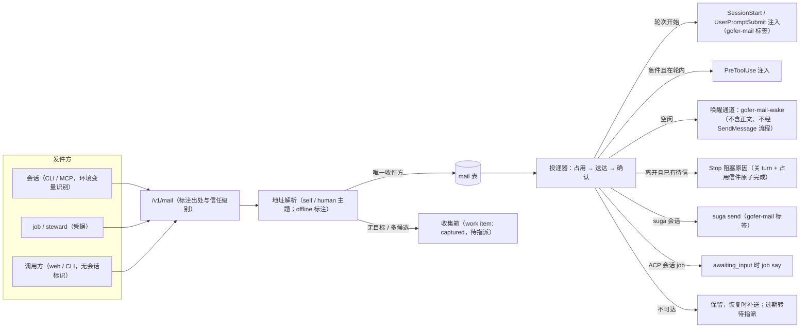
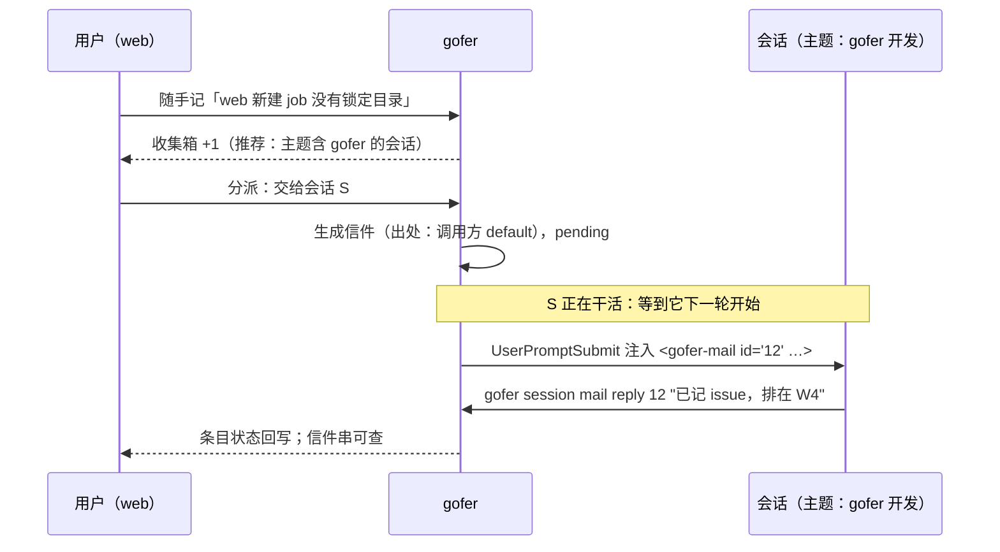
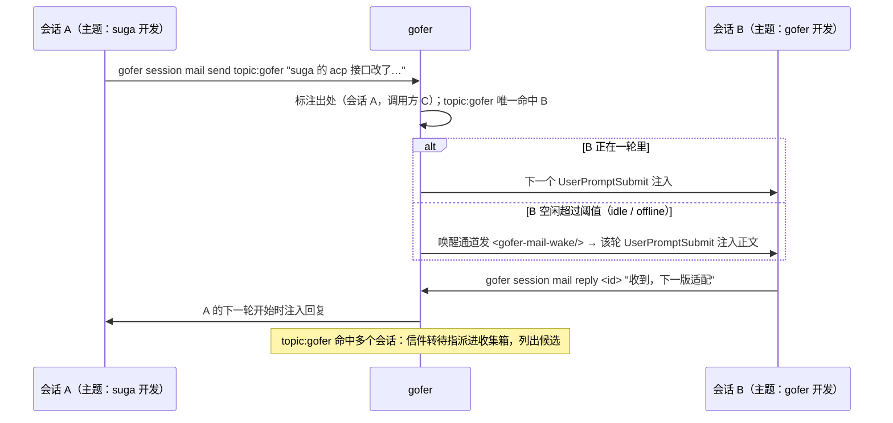

<!-- template_id: design; template_version: 1.1.1 -->
# 会话工作主题、gofer 信箱与收集箱 设计

> 状态：Draft 0.4 / 待人工计划批准
> issue：gofer-e6sb

- 思考模式：rigorous。
- 核心目标：让会话按「在做什么」互相找到；会话之间、会话与主机 agent 之间经 gofer 传话，不再要用户人工转述；给用户一个随手记录、再分派的入口。
- scope freeze：三期范围以本稿「范围与非目标」为准；实施中发现超出范围的需求另开 issue。
- review budget：两轮独立评审已用完（0.1、0.2 各一轮）；0.3 按第二轮的必改项修订，0.4 按用户对 0.3 的意见修订，均经作者自查，不再做第三轮。
- 停止条件：用户对本稿给出具名的批准，或明确要求停止。

## 修订记录

| 版本 | 日期 | 作者 | 摘要 |
|---|---|---|---|
| 0.1 | 2026-10-16 | Claude（监督会话） | 初稿：会话主题与查找、信箱、收件箱（基于 work item）、三期分期 |
| 0.2 | 2026-10-16 | Claude（监督会话） | 按第一轮评审修订：送达点改为 SessionStart / UserPromptSubmit；信件带出处、不当作用户输入；发件信任级别；当前会话只按环境变量识别；读信权限对齐 outbox；投递占用与至少一次；会话 job 投递器；web 发消息与 session-ask 不并入；「收件箱」改名「收集箱」并列出受影响面；推断主题不参与投递；分期依赖与限制；CLI 归入现有命令组；事实更正 |
| 0.3 | 2026-10-16 | Claude（监督会话） | 按第二轮评审修订：唤醒提示用独立标签并走独立通道（不经 SendMessage / Say / outbox）；offline 会话视为「可能在线」，空闲判据写明；取消「用户本人」标注，所有 user 类发件同为「调用方」；Stop 送达只在 Stop 时已有待信且判定离开时阻塞，关 turn 与占用信件原子完成；收集箱不进看板列、只作「待整理」页签，补齐 Report / Steward / PATCH 写入面；急件在 PreToolUse 注入，读信即确认；jobCred 关系字段、秘密扫描扩展、回滚命令与唤醒成本写明 |
| 0.4 | 2026-10-16 | Claude（监督会话） | 按用户意见（「大体上没问题」）修订：「转仓库 issue」纳入第一期，由 server 在镜像里按仓库前缀分配 id、经同步回到仓库；给出全部数值的默认值；待确认事项逐条给出推荐；presence/driver 改为退役（分析其从未被使用的原因），supervisor 升级改投信箱 |

> 仅语义变化递增版本；纯 identity/provenance/元数据纠正沿用原版本，并在 Git/进度记录中留痕。

## 背景与目标

用户同时开着多个 agent 会话（容器里的 Claude Code、主机上的 codex 与 suga、gofer 派出的 job），遇到三个问题：

1. **找错会话**：会话之间想找「做某件事的那个会话」时只能看目录或标题。目录相同的会话很多（例如都在工作区根 `my-tools-dev`），标题取最近一次用户提问的首行，随提问改变，于是会找错。
2. **人工传话**：一个会话需要另一个会话调整时，要用户在两个会话之间复制粘贴；和主机上的 codex、suga 对话还要切换系统。
3. **想法无处落脚**：用户想到的需求或发现的问题，要先写进记事本，再挑一个会话贴进去。

用户可见的目标：

- 每个会话都有一个工作主题，会话和用户都能按主题或路径找到它。
- 会话可以给另一个会话、主机 agent 或用户发信；收件方暂时不在时，信件由 gofer 保管，之后送达或交给用户指派。用户在 web 上能看到往来，必要时插话。
- web、CLI 与会话里都能随手记一条想法或问题，之后一键交给某个会话、新建 agent job、转成 plan todo 或仓库 issue。

## 名词

- **会话**：登记在 gofer 的终端 agent 会话（`agent_sessions` 一行），由 hook 或 agent 自己登记，含 Claude Code、codex、suga 等。
- **会话 job**：以持续会话方式运行的 job，用 `job say` 对话；本稿只覆盖 ACP 形态（pty 形态不支持 `job say`）。
- **主题（topic）**：一句话说明会话在做什么，如「gofer 开发」。
- **范围（scope）**：会话主要工作的子路径，相对项目根，如 `inhere-tools/gofer`；可以有多个。
- **信件（mail）**：一条经 gofer 在 agent 之间传递的消息，有发件方、地址、状态与所属对话串。与「web 发给会话的消息」不同：信件注入时始终带出处标签，不当作用户输入。
- **唤醒提示**：一条不含信件正文的短提示，只用来让空闲会话开始一轮，以便在该轮开始时注入信件。
- **收集箱（capture）**：用户的待整理记录区，存放随手记下的想法、问题，以及无人认领的信件。避免与 presence 的 agent 收件箱（`/v1/agents/{id}/inbox`）重名。
- **轮次边界**：会话下一轮开始（UserPromptSubmit）或会话开始（SessionStart）时 hook 运行的时刻。
- **可投递会话**：状态为 `running`、`idle`、`waiting_reply`、`needs_attention`、`offline` 之一的会话；不含 `handed_off`、`ended`。`offline` 是心跳中断后的推测状态（闲置的会话也会被扫成 offline），在查找与地址解析里照常参与，但标注「可能不在线」。

## 范围与非目标

范围（分三期，见「总体方案 / 分期」）：

- 会话主题与范围的设置、推断、展示与查找。
- 信箱：地址解析、发件出处与信任级别、持久保存、投递与送达、回复串、过期处理、web 查看与插话。
- 收集箱：快速记录（web、CLI、MCP）、分派动作、状态回写、目标推荐。
- 主机 agent（codex、suga）作为可寻址的收件方；presence/driver 退役，supervisor 升级改投信箱。

非目标：

- 不改变 web 发给会话的消息（`POST /v1/sessions/{sid}/messages`）与管家带话（`POST /v1/session-ask`）的语义与存储；web 信箱页只是把它们与信件并排显示。
- 不做即时通讯式的聊天产品；不做跨 server 的信件联邦。
- 不用模型做自动路由决策：目标推荐只按文本与路径匹配给出候选，由发件方或用户选择；地址有歧义时不猜。
- 不替代 work item、plan、tracker issue；收集箱复用 work item，分派结果落到已有的 job、todo、tracker issue。
- 不新增权限目录条目；新路由按现有权限目录声明（AGENTS.md G056）。
- 不在本稿内区分「web 控制台」与「持同一种 token 的 CLI / agent」：server 目前无法判定请求来自哪一端（见「已确认事实」），这件事属于权限与身份的后续工作。

受影响项目：`inhere-tools/gofer`（server、CLI、MCP、hook、web、skill）。suga 终端会话的身份与收件方式需与 suga 的维护会话配合（见「待确认事项」）。

## 已确认事实与规范

盘点于 2026-10-16，main `b6c8aaaf`；两轮评审按 `bc2b85ba`、`e32e1187` 复核。

会话登记与查找：

- `agent_sessions` 的字段见 `internal/jobstore/sessions.go:266-332`；没有主题、范围、标签字段。已有的可读名是 `peer_name`（来自 Claude Code 自己的会话名，用户在 Claude Code 里改名后来源记为 user，`internal/hookrelay/peer.go:53-110`），以及 `progress_text`。
- 会话状态有 `running`、`idle`、`waiting_reply`、`needs_attention`、`handed_off`、`ended`、`offline`（`internal/jobstore/sessions.go:30-40`）；心跳中断超过阈值（默认 1800 秒）的会话被扫成 `offline`，任何后续登记或心跳都会让它恢复（`sessions.go:37-40`，`internal/config/model.go:1386-1388`）。没有「空闲起始时间」字段，`last_seen_at` 随心跳刷新。
- `title` 取最近一次用户提问首行的前 40 字，harness 产生的提问不改写（`internal/hookrelay/run.go:202-208`、`:956-975`）。
- 会话没有 PATCH 路由（`internal/httpapi/authz_routes.go:337-367`）。
- `gofer session ls` 只有 `--project/--state/--agent/--all`（`internal/commands/session.go:57-71`）；server 端的 cwd 过滤语义是「会话 cwd 等于查询路径或是它的祖先」（`internal/jobstore/sessions.go:835-838`）。MCP 有只读的 `gofer_session_list/get`，管家另有 `gofer_session_tail`。
- 会话首次收到用户提问时会自动建一条草稿 work item，标题即首句（`internal/jobstore/work.go:355-381`）。

身份：

- user 类调用方用 bearer token 鉴权，请求上下文里只有调用方 id 与类型（`internal/httpapi/auth.go:43-65`）；web 控制台与 CLI、agent 用同一种 token，server 无法判定请求来自哪一端。

当前会话的识别（三套机制并存）：

- hook 用 stdin 里的 `session_id`。
- CLI 的 `LookupCurrentAgentSession` 读环境变量 `GOFER_SESSION_ID`、`CLAUDE_CODE_SESSION_ID`、`CODEX_THREAD_ID`、`CODEX_SESSION_ID`，要求去重后唯一（`internal/client/plan_autobind.go:12-30`、`:66`）。
- `gofer session relay/say` 用 `resolveCurrentSession`：按 cwd 匹配，再回退到 SessionStart 写的标记文件（`internal/commands/session.go:418-440`）——同目录多会话时这正是找错的来源。

传话：

- web 发给会话：`POST /v1/sessions/{sid}/messages`（`internal/httpapi/session_handler.go:648-689`，`internal/sessionrelay/message.go:70-140`），受 `messagingEnabled` 总开关控制（`message.go:83-85`）。会话在等回复时走 `Say`，在收件方眼里等同「[gofer web 回复]」的用户输入（`message.go:94-101`）；否则按送达梯度：agent 的 `deliver_command`、tmux；Claude 会话有 peer 地址时经传话人，传话人固定加「[来自 web，…]」前缀（`message.go:219-231`），收件方用 SendMessage 回复传话人的内容被记为 web 回复（`internal/httpapi/server.go:758-761`）；本机 runner 之外没有常驻传话人时，每次传话是一个一次性的 `claude -p` job（`message.go:154-167`）。
- 内置 `deliver_command`：codex 为 `codex queue --thread <sid> --message <text>`，已退出的会话在下次 resume 时收到；suga 为 `suga send --session <sid> --source gofer`，文本走 stdin，会话不在线时返回 3（`internal/config/readonly.go:58-74`）。
- 发出的消息记在每个会话的 outbox JSONL（`internal/jobstore/sessions.go:116-200`），发件方只有调用方 id。已结束的会话拒收（`message.go:80-82`），送达失败不重发。
- 管家带话 `POST /v1/session-ask`：前缀「[gofer 管家带话]」，同步送达，目标不在线时返回 409、不排队，送达后写 work item 日志（`internal/httpapi/session_ask_handler.go:41-48`，`internal/work/ask.go:27-29`、`:67-130`）。

hook 的注入与 Stop：

- `additionalContext` 只在 SessionStart、UserPromptSubmit、PreToolUse 上生效（`internal/hookrelay/run.go:120-127`、`:777-800`）；Stop 只能返回阻塞与原因（`run.go:517-664`）。
- codex 与 generic 的 SessionStart / UserPromptSubmit 输出同样会喂给模型（`CatchUpAgent`，`run.go:796-799`）。
- 人在键盘前时 Stop 放行（gofer-rhux，`run.go:542-557`、`:702-723`）；`waitJobsOnly` 只在有 watch 时进入（`run.go:547-551`）；relay 等待循环里 turn 已打开（`run.go:582-586`），watch 通知以「关 turn」原子完成（`CompleteSessionWatchTurn`，`run.go:848-870`）。未送出的 job 通知在下一个 SessionStart / UserPromptSubmit 补上，补送先确认、再注入（`run.go:803-831`）。
- harness 产生的提问由 `IsHarnessPrompt` 识别（`run.go:920-945`）：以固定标签开头的文本（如 job 完成通知的标签）不算用户在打字；裸文本会被当成用户输入。

会话 job：

- `job say` 只支持 ACP，每次只能挂一条待发输入；远端 worker 离线时报错（`internal/job/session_commands.go:12-73`）。
- job 与会话、plan 的关系字段：`jobs.source_session_id`、`jobs.plan_id` → `plans.supervisor_session_id`、`jobs.caller_id`（`internal/jobstore/jobs.go:80-82`，`internal/jobstore/plans.go:65-66`）。

presence：

- `agent_presence` 与 `messages` 表（`internal/jobstore/store.go:262-296`），服务在 `internal/presence/service.go`；寻址有 agent id、`role:`、`role-one:`、`broadcast`，消息 kind 有 task、note、answer、escalation；supervisor 的升级消息与 answerguard 依赖它（`internal/supervisor/service.go:347-375`，`internal/presence/service.go:37-50`）。
- 每个 `gofer mcp` 进程自动登记为 `mcp-<hosthash>-<pid>`，身份不关联会话（`internal/mcpserver/server.go:356-399`）。
- 来历与使用情况：presence 来自 2026-06 的多 agent 协作设计（`docs/design/2026-06-28-multi-agent-collab-design.md`，E36「driver agent」身份 / 信箱）。该设计明确让 `agent_id` 与会话无关、只能由 agent 主动轮询收件（MCP 只有工具，没有推送，推送留作二期）。2026-10-16 线上 presence 名册为 0 行。supervisor 的升级链依次投给 job 的来源 agent、job 级 `escalate_to`、全局 `role-one:supervisor`（`internal/supervisor/service.go:346-375`），没有在线收件方时 interaction 保持待答，最终由人在 web / Today / 推送里作答。
- 之后上线的会话 hook 登记（2026-09）、web 发消息与传话人（2026-10-01/02）、管家带话、job 完成通知会话（`--notify`）都能把内容送进会话的轮次，不依赖 agent 轮询。

work item、Today、tracker：

- `WorkStatuses` 是看板列序，`ValidWorkStatus` 也用于汇报与摘要器的 status_hint（`internal/jobstore/work.go:26-32`）；`SetWorkItemAutoStatus` 改写 `status_source=auto` 的条目（`work.go:1112-1130`）。能写状态的路径还有：`work.Service.Report` 的显式 status（`internal/work/service.go:488-498`）、`StewardUpdate`（可设任一非终态，`internal/work/steward.go:33-45`）、`PATCH /v1/work-items/{id}`（对 job 凭据开放，`authz_routes.go:185`）。状态枚举也出现在摘要器 prompt（`internal/work/summarize.go:489`）与 MCP 工具描述里（`internal/mcpserver/work.go:174`，`internal/mcpserver/steward.go:128`、`:164`）。旧版本只在设置 status 时校验取值（`work.go:285`，`service.go:497`）。
- Today 的 KindWork 卡片见 `internal/today/cards.go:582-620`；Today 有回复、请求汇报、搁置等动作，但没有新建入口（`internal/today/today.go:21-37`）。另有 `Unsorted` 草稿区。
- tracker issue 的 id 前缀来自仓库配置（`internal/tracker/entries.go:40-48`），server 镜像表 `tracker_repos` 也存了 `prefix`（`internal/jobstore/store.go:796-814`）；id 由纯函数 `GenerateIssueID(已有 issue, 前缀, 父 id)` 随机生成（`internal/tracker/id.go:12-30`）。仓库与镜像按版本化快照同步（`internal/tracker/sync.go`、`sync_http.go:133`），web 在镜像上的修改经下一次 `gofer tracker sync` 回到仓库。镜像目前只做 Patch，web 没有新建 issue 的接口。

秘密扫描与脱敏：

- `job secret-scan` 只遍历 jobs 表，非 admin 按 `caller_id` 过滤，报告只有 `jobs[]`（`internal/job/secret_scan.go:94-150`，`internal/httpapi/secret_scan_handler.go:23-55`）；job 脱敏按 `job_id` 等列匹配（`internal/jobstore/redact.go:233-259`）。

引用的规范：AGENTS.md G021 / G022（分层）、G032（兼容策略）、G033（CLI 分组）、G045 / G046（skill 同步与对外视角）、G051–G054（测试）、G056（路由声明）；权限设计 `docs/design/2026-10-14-db-capabilities-and-session-grants-design.md`（outbox 归 `session.reply.others` 的决定，以及 T2.2 的 CLI 会话头单一注入点）。

## 总体方案

### 一、会话主题与查找

- 会话增加 `topic`（一句话）、`scope`（子路径列表）、`topic_source`（`self` 会话自己设 / `human` 在 web 上设 / `inferred` 推断）与 `topic_at`。
- 设置途径：会话内 `gofer session topic "<主题>" [--scope <路径>]…`，MCP 同名工具，web 会话卡片与详情上直接编辑。
- **当前会话只按环境变量识别**（`LookupCurrentAgentSession` 那一套，去重后唯一才用）；不按 cwd、不读标记文件。识别不到或不唯一时要求显式 `--session`。
- 推断：主题为空时按 `last_cwd` 相对项目根的路径与 `peer_name` 生成展示用的推断值，标 `inferred`；**推断值只用于展示与推荐，不参与信件地址解析**。
- 提醒：主题为空或仍是推断值时，SessionStart 注入一行提示（带标签，不算用户输入），让 agent 用一句话设定主题。
- 查找：`gofer session find <关键词|路径>`、MCP `gofer_session_find`、`GET /v1/sessions?q=…&path=…`，在可投递会话里找，`offline` 的结果标注「可能不在线」。匹配与排序：
  - `path:P` 命中条件为会话某个 scope `S` 等于 `P` 或是 `P` 的祖先（「谁负责这个路径」）；`P` 是 `S` 的祖先时只作弱命中；
  - 关键词按主题、`peer_name`、项目匹配；
  - 排序为 scope 命中 > 主题命中 > `peer_name` 命中 > 项目相同，同等时在线优先；结果带命中原因与来源（`self`/`human`/`inferred`）。

### 二、gofer 信箱

- 信件持久存在 server 的数据库里，按对话串组织，每封都有发件方、原始地址、解析后的收件方与状态。
- **发件出处与信任级别**（server 无法区分 web 控制台与 CLI，不设「用户本人」标注）：
  - `session`：会话发件，由 CLI / MCP 带的会话标识确定（复用权限设计 T2.2 的会话头单一注入点）。server 只核对「会话存在、未结束、属于同一调用方」，所以这是**同一调用方内的归属标注，不是认证**：同一 token 下的会话可以互相冒充。出处显示为「会话 X（调用方 C）」。
  - `caller`：user 类调用方未带会话标识时（web 控制台、CLI、未识别出会话的 agent），出处显示为「调用方 C」。
  - `job`：job 凭据发件，由凭据认证，出处显示为「job J」；steward 凭据同此规则。
- **信件不是用户输入**：信件注入时一律包在固定标签里，例如 `<gofer-mail id="12" from="会话 X（调用方 C）" topic="…">…</gofer-mail>`；标签纳入 `IsHarnessPrompt`，不会被当成用户在打字（不关闭 relay、不改写标题、不触发自动草稿 work item）。信件**不走** `Say`、不加「[gofer web 回复]」或「[来自 web，…]」前缀。需要用户本人语气的话，仍由用户在 web 发消息。
- 地址写法与解析见「架构 / 信箱」。地址只解析到唯一收件方时才投递；有多个候选时不猜，信件转为「待指派」进收集箱并列出候选。候选列表按读者的 `session.read.others` 过滤。
- 送达点：
  - 普通件：收件会话的下一个 SessionStart / UserPromptSubmit 注入。
  - 空闲会话：状态为 `idle` 或 `offline` 且 `last_seen_at` 早于唤醒阈值时，发一条唤醒提示触发一轮；`waiting_reply` 的会话不发唤醒（它在等人回复），留给 Stop 或下一轮。
  - 用户离开：Stop 时若已有待信且判定为离开，以阻塞原因送出信件（只在已有待信时阻塞，不为等信而阻塞）。
  - 急件：会话正在一轮里时在下一个 PreToolUse 注入；空闲时立即唤醒。
- **唤醒提示**：内容固定为 `<gofer-mail-wake count="N"/>` 加一句「有待读信件，将在本轮开始时注入，无需回复」，标签纳入 `IsHarnessPrompt`。它走独立的唤醒通道：不经 web 发消息的 SendMessage 流程、不走 `Say`、不写 outbox、不加 web 前缀；传话人对唤醒提示的任何回复被丢弃，不记为 web 回复。
- 收件方不在线时信件保留：同一会话恢复（重新登记或心跳）时补送；超过送达期限仍未送达，转为「待指派」进收集箱，由用户改投、新建 job 或丢弃。
- 回复挂在同一对话串，唯一途径是 `gofer session mail reply <id>` 或 MCP 同名工具，按同样方式送回发件方。web 信箱页显示全部往来（信件与 web 消息、管家带话并排），用户可以回复、转交或插话。

### 三、收集箱

- 收集箱基于 work item：新增状态 `captured` 与字段 `kind`（`idea` 想法 / `issue` 问题 / `request` 需求 / `note` 记录），`status_source` 固定为 `human`。来源记 `human`（user 类调用方）、`agent`（含发件会话，可选）或 `mail`（待指派的信件）。
- **web 位置**：收集箱是「待整理」区的一个页签（另一个页签是 `Unsorted` 草稿），**不进看板列**；`captured` 不加入看板顺序 `WorkStatuses`，单独定义并单独校验。草稿与收集箱条目在数据上互不转换。
- **写入面**：只有收集箱自己的入口（快速记录、分派、归档 / 丢弃）能把条目移入或移出 `captured`。其余写路径一律不得设置或改出 `captured`：
  - `work.Service.Report` 的显式 status 与摘要器的 status_hint：拒绝 `captured`，且不改动 `captured` 条目的状态；
  - `StewardUpdate`：同上；
  - `PATCH /v1/work-items/{id}`：job 凭据不能改 `captured` 条目；user 类调用方改出 `captured` 视同归档动作；
  - `SetWorkItemAutoStatus`：收集箱条目 `status_source=human`，不会被自动改写；
  - 摘要器 prompt 与 MCP 工具描述里的状态枚举不列 `captured`。
- 其他消费方：`Summary.Open` 计数、health 与到期提醒、合并建议排除 `captured`；Today 不为单条出 KindWork 卡片，改为一张「收集箱 N 条待处理」汇总卡。
- 快速记录：web 顶栏「随手记」（手机可用），`gofer work capture "<内容>" [--kind …] [--project …]`，MCP `gofer_work_capture`（agent 发现问题时记下；发件会话按环境变量识别，识别不到就不带）。
- 分派动作：
  - **交给会话**：按主题与范围推荐候选会话。第一期走现有的 web 发消息接口，与 `POST /v1/sessions/{sid}/messages` 同等信任（任何持 user token 的调用方本来就能用该接口发出「[来自 web]」消息，不新增风险）；第二期起改发信件，回复可回写。
  - **新建 job**：打开新建 job 表单，预填 prompt、项目与目录，job 与条目关联。
  - **转 plan todo**：沿用现有 to-todo。
  - **转仓库 issue**：选择仓库后，server 在该仓库的镜像里用 `GenerateIssueID` 按仓库前缀分配 id 并写入，条目记下 issue id；仓库在下一次 `gofer tracker sync` 时收到这条 issue（与 web 修改 issue 走同一条路），未同步前 web 上标「待同步」。
  - **归档 / 丢弃**。
- 状态回写：关联的 job 结束、信件被回复、todo 完成时写进条目日志；分派送出失败时条目保持 `captured`。

### 分期

| 期 | 内容 | 解决的问题 | 依赖与限制 |
|---|---|---|---|
| 第一期 | 会话主题、推断、提醒与查找；收集箱快速记录与分派（交给会话、新建 job、转 todo、转仓库 issue） | 找错会话；靠记事本中转 | 前置：实测 Claude Code `/clear` 后 MCP 进程的会话环境变量（第一期就有 MCP 工具）。当前会话识别用环境变量，识别不到时要求显式参数。「交给会话」走 web 发消息接口：已结束的会话被拒、失败不重发、无对话串，回复不能自动回写，条目只记「已送出」 |
| 第二期 | 信箱：发件出处、持久保存、地址解析、投递器与送达（含唤醒通道与 Stop 送达）、离线补送与期限、回复串、web 信箱页；收集箱分派改发信件 | 人工传话 | 权限 T2.2（会话头单一注入点）完成后开始 |
| 第三期 | 主机 agent 作为收件方（`agent:` 地址、常驻会话）；presence/driver 退役，supervisor 升级改投信箱 | 跨系统对话 | 第二期；suga 身份与收件方式与 suga 维护会话确认；presence/driver 退役：supervisor 升级改为依次投给 job 的 `source_session_id` 会话、所属 plan 的监督会话、`escalate_to` 指定的会话，都没有时进收集箱；presence 路由、MCP 工具（`gofer_register`、`gofer_poll_inbox`、`gofer_post_message`、`gofer_list_presence`）、CLI `gofer presence` 与 web 页面按 G032 标 `DEPRECATED`，三个版本后删除 |

## 架构

### 会话主题

- 新增列：`agent_sessions.topic TEXT`、`scope_json TEXT`、`topic_source TEXT`、`topic_at INTEGER`（additive 迁移）。
- 新增路由：`PATCH /v1/sessions/{sid}`（只改 topic 与 scope）：会话 owner 自己可改，改他人的需要 `session.manage.others`（InHandler deny）；job 凭据与 worker 拒绝。`GET /v1/sessions` 增加 `q`、`path` 参数，沿用 `session.read.others`（filter）。
- CLI 归入现有命令组（G033）：`gofer session topic`、`gofer session find`。

### 信箱

地址写法：

| 写法 | 含义 | 解析 |
|---|---|---|
| `session:<sid>` | 指定会话 | 直接命中 |
| `job:<id>` | 指定 ACP 会话 job | 直接命中 |
| `topic:<关键词>` | 按主题找 | 在可投递会话的 `self`/`human` 主题里匹配；唯一命中才投递 |
| `path:<子路径>` | 按范围找 | 按「会话主题与查找」的匹配规则；唯一强命中才投递 |
| `agent:<名字>` | 主机 agent（第三期） | 找该 agent 的常驻会话；没有时按配置新起一个会话 job |
| `caller` 或省略 | 发件调用方自己（用户） | 进收集箱 |

信件表 `mail`（additive）：`id`、`thread_id`、`reply_to`、`from_kind`（session / caller / job）、`from_id`、`from_caller`、`to_address`（原文）、`to_kind`、`to_id`、`to_caller`、`job_id`（收件方或发件方为 job 时）、`urgent`、`body`、`state`、`claimed_by`、`claim_until`、`attempts`、`last_error`、`created_at`、`delivered_at`、`read_at`、`deliver_by`（送达期限）、`capture_item_id`。

状态机：`pending`（待送）→ `delivering`（已被投递路径占用，带租期）→ `delivered`（已送达）→ `answered`（已回复）；旁路 `held`（待指派，进收集箱）、`expired`（超过送达期限）、`failed`（送达失败且不再重试）、`cancelled`（发件方撤回）。

投递语义：

- 每条送达路径先以 CAS 把信件从 `pending` 改为 `delivering` 并写租期（默认 60 秒），成功者才送；送达后确认为 `delivered`；租期内未确认则回到 `pending`。
- hook 路径（SessionStart / UserPromptSubmit / PreToolUse）与现有 watch 补送一致，**先确认、再注入**，为至多一次；server 侧路径（`suga send`、`job say`）为**至少一次**，标签带信件 id，收件 agent 可识别重复。
- 收件方本人用 `gofer session mail ls` / read 读到的信件即视为已送达，之后不再注入。
- hook 在一次注入里把信件与现有的 job 通知补送、记忆注入合并到同一个 `additionalContext`；单次最多注入若干封、限总长，其余留待下一轮。
- Stop 送达：心跳与登记的回应增加 `mail_pending` 计数。Stop 只在「此刻已有待信」且「按 relay 规则判定为离开」时阻塞，判定独立于 `stop_job_wait`（`always` 不会让人在键盘前时也为信件阻塞）。阻塞送出时，server 以一个原子操作关闭本轮 turn 并占用信件（与 `CompleteSessionWatchTurn` 同形），避免与 web 回复竞争。
- 投递器（server 内）：周期检查可投递会话的状态与 `last_seen_at`，对满足唤醒条件的会话发唤醒提示；监听 ACP 会话 job 进入 `awaiting_input` 时用 `job say` 送一封（一次只能挂一条）。

送达规则：

| 收件方 | 普通件 | 急件 |
|---|---|---|
| Claude Code 会话 | 下一个 SessionStart / UserPromptSubmit 注入；空闲超过阈值时经唤醒通道（传话人或 tmux）发唤醒提示；离开且已有待信时 Stop 阻塞送出 | 轮内：下一个 PreToolUse 注入；空闲：立即唤醒 |
| codex 会话 | 下一个 SessionStart / UserPromptSubmit 注入（`CatchUpAgent` 支持）；空闲超过阈值时经 `codex queue` 发唤醒提示（已退出的会话下次 resume 时收到） | 立即经 `codex queue` 发唤醒提示 |
| suga 会话 | 经 `suga send` 送正文（gofer-mail 标签）；返回 3 时视为不在线 | 同左 |
| ACP 会话 job | `awaiting_input` 时 `job say`，否则由投递器等待 | 同左 |
| pty 会话 job | 不支持，信件转待指派 | 同左 |
| 不可达 / 已结束 | 保留到送达期限；同一会话恢复时补送；过期转待指派 | 同左 |

路由与权限（G056，逐条写明 deny / filter）：

| 路由 | 用户类调用方 | job / steward 凭据（JobCred） | worker |
|---|---|---|---|
| `POST /v1/mail` | 发给自己的会话与自己（收集箱）不需要权限；他人的终端会话需 `session.reply.others`（deny）；他人的会话 job 需 `job.manage.others`（deny）；会新起 job 的地址另需 `job.submit` | 只能发给本 job 的 `source_session_id`、所属 plan 的 `supervisor_session_id` 与本 job 的 `caller_id`（收集箱）；`source_session_id` 为空时只能发给 caller | 拒绝 |
| `GET /v1/mail` | 自己发出或收到的不需要权限；他人终端会话的信件需 `session.reply.others`（filter，与 outbox 同口径）；涉及他人会话 job 的需 `job.read.others`（filter） | 只能读本 job 相关的信件 | 拒绝 |
| `POST /v1/mail/{id}/reply`、`/ack`、`/cancel` | 收件方或发件方本人；他人的按收件方类型取上述 `.others` 权限 | 本 job 相关的 | 拒绝 |
| `POST /v1/mail/{id}/readdress` | 等同重新发送，按新收件方判权限 | 拒绝 | 拒绝 |

- standalone 模式的 MCP（`gofer mcp --standalone`）不提供信箱工具，返回 `errNeedsServer`，与 `SessionAsk` 一致（`internal/mcpserver/backend_local.go:826`）。
- CLI 归入现有命令组（G033）：`gofer session mail send|ls|read|reply|cancel`。

### 收集箱

- `work_items` 新增 `kind TEXT`；`captured` 单独定义（不在 `WorkStatuses` 看板顺序里），写入面按「总体方案 / 收集箱」的规则收口。
- 新增路由：
  - `POST /v1/work-items/capture`（快速记录）：`Public`（与 work item 现有写入口一致）；job 凭据可用（agent 记下发现的问题），worker 拒绝。
  - `POST /v1/work-items/{id}/dispatch`（`to: session|job|todo|issue`）：`InHandler(permDeny, session.reply.others, job.submit, plan.manage.others)`——交给他人会话查 `session.reply.others`，新建 job 查 `job.submit`，转 todo 沿用 to-todo 的 `plan.manage.others`，转 issue 与现有 tracker issue 写入一致（不另需权限）；job 凭据与 worker 拒绝。
  - `POST /v1/tracker/repos/{tracker_id}/issues`（web 新建 issue，也供 dispatch 复用）：与现有 tracker issue 写路由一致为 `Public`；job 凭据按 SEC-01 现有 tracker 写口径处理，worker 拒绝。
- 目标推荐：按条目文本与会话主题、scope、`peer_name`、项目做关键词与路径匹配，返回前几名及命中原因；推断值参与推荐时标注出来。
- 回滚辅助：`gofer work park --captured` 把收集箱条目转为 `parked` 并写一条 journal（升级回来后可据此恢复）。

## 关键流程

随手记再分派（第二期形态）：

会话之间按主题传话：

### 默认数值

均可在 server 配置里调整（`mail.*`、`capture.*` 段，第二期随实现落定键名）；默认值按「不打断、不刷屏、不丢信」取：

| 项 | 默认值 | 理由 |
|---|---|---|
| 唤醒阈值 | 会话 `idle` / `offline` 且 `last_seen_at` 早于 5 分钟 | 正在一轮里的会话 5 分钟内通常会结束这一轮，下一轮开始时就能注入；更短会频繁唤醒 |
| 单会话唤醒频率 | 每 10 分钟最多 1 次，期间到达的信件合并到同一次 | 控制 token 成本；没有常驻传话人的 runner 上每次唤醒是一个一次性 job |
| 占用租期 | 60 秒 | 覆盖一次 hook 调用与 `suga send`、`job say` 的耗时 |
| 送达期限 | 24 小时，过期转待指派 | 与 presence 未读消息的 TTL 一致；隔夜仍未送达说明收件方大概率不会回来 |
| 保存期 | 90 天，之后清理 | 与权限审计的保留期一致 |
| 单次注入 | 最多 5 封、合计 8000 字；超出部分只注入标题行，并提示 `gofer session mail read <id>` | 不让信件挤占模型上下文 |
| 单封正文 | 32 KB | 足够放一段日志或 diff 摘要；更长的内容放文件或 job 产物再引用 |
| 发件限速 | 每个发件方每分钟 10 封、每小时 100 封，超出返回 429 | 挡住 agent 循环发信 |
| 对话串自动往返 | 同一对话串 20 封后，后续信件转待指派 | 两个 agent 互相回复停不下来时交给用户 |
| 收集箱推荐 | 返回前 3 个候选会话 | 足够选择，又不让列表变长 |

## 安全、数据、运维与回滚

- **身份与出处**：出处按「发件出处与信任级别」如实标注；会话标识是同一调用方内的归属标注，不是认证；server 不区分 web 与 CLI，所以不存在「用户本人」级别的信件。信件与唤醒提示从不以用户输入的形式注入。
- **权限**：所有新路由按 G056 声明并 `go generate` 更新权限参考文档；读信沿用权限设计把 outbox 归入 `session.reply.others` 的决定，不放宽。
- **防循环与滥发**：每个发件会话限速；同一对话串的自动往返轮数设上限，超限的信件转待指派；单封正文限长。
- **成本**：每封信至少让收件方多跑一轮；唤醒在没有常驻传话人的 runner 上是一个一次性的 `claude -p` job。唤醒按会话合并（一次唤醒注入多封），唤醒次数计入限速，注入总长设上限。
- **敏感信息**：秘密扫描扩展到信件——报告新增 mail 段，非 admin 按 `from_caller` / `to_caller` 过滤；新增按信件 id 的脱敏实现；与 job 相关的信件带 `job_id`，随 job 脱敏一并处理。信件正文不复制进收集箱条目、work journal 与 Today 卡片，它们只存信件引用与前若干字的摘要；脱敏信件时同步改写这些摘要。
- **数据**：新增列与表都是 additive 迁移。时长有两个：送达期限与保存期，默认值见「默认数值」。
- **server 新建 issue 的 id 冲突**：server 按镜像里已有的 issue 分配 id，仓库里尚未同步的本地新 issue 可能恰好同 id（4 位 36 进制随机，约 168 万分之一）。同步时检测到同 id 而创建时间、标题不同时，保留仓库一侧，把 server 一侧换一个新 id 并在条目日志里记下；有测试覆盖。
- **运维**：Today 增加「收集箱待处理」与「信件待指派」两类汇总卡；`gofer session mail ls` 与 web 信箱页可查全部往来。
- **回滚**：回到旧版本二进制时，新表与新列被忽略；`status=captured` 的 work item 在旧版本里显示为未知状态，旧版本只在设置 status 时校验取值，其他字段仍可改。回滚前可用 `gofer work park --captured` 把收集箱条目转为 `parked`（写进 CHANGELOG 与 runbook）。web 发消息与 outbox 不变，没有迁移。

## 决策

以下为本稿的提案，待用户确认：

1. **主题做成会话字段**，与 work item 并存。推断值只用于展示与推荐，不参与投递；不从 work item 标题取主题（自动草稿的标题就是首句，正是要解决的问题）。
2. **收集箱复用 work item**（新增 `captured` 状态与 `kind`），作为「待整理」页签而不是看板列，写入面只由收集箱入口改变。备选：独立实体——要重做挂会话、转 todo 等现成能力。
3. **presence/driver 退役，不并入信箱**：它从上线起没有被使用（线上名册 0 行），原因见「已确认事实 / presence」——身份与会话无关、只能靠 agent 主动轮询，而后来的会话 hook、web 发消息、传话人、管家带话、job 完成通知已经能把内容送进会话的轮次。第三期把 supervisor 升级改投信箱，presence 的路由、MCP 工具、CLI 与 web 页面按 G032 标弃用、三个版本后删除。备选：并入信箱、保留兼容——要为一套没人用的身份系统做迁移。
4. **普通件在下一轮开始时送达**；空闲（idle / offline 且超过阈值）用唤醒提示触发；离开且已有待信时 Stop 阻塞送出；急件在轮内经 PreToolUse 注入、空闲时立即唤醒。备选：一律立即——会打断收件会话。
5. **地址有歧义时不猜**，转待指派并给出候选；offline 会话照常参与解析并标注。
6. **信件不是用户输入，也没有「用户本人」级别**：信件与唤醒提示一律带标签、计入 harness 输入、不走 web 消息通道；所有 user 类发件同为「调用方」，会话标识只是归属标注。web 发消息与管家带话保持原语义。
7. **读信权限沿用 outbox 口径**：他人终端会话的信件看 `session.reply.others`，他人会话 job 的信件看 `job.read.others`，均为 filter。
8. **分期与先后**：本稿批准后先出第一期计划，第一期可与权限第二批交替实施；第二期排在权限 T2.2 之后。
9. **转仓库 issue 由 server 直接在镜像里新建**，按仓库前缀分配 id，经现有同步回到仓库，纳入第一期。备选：在仓库目录跑 exec job 执行 `gofer issue create`——依赖主机能进到仓库目录、要占一个 job，结果还要再同步一次。
10. **数值按「默认数值」表取默认**，均可配置。

## 待确认事项

以下事项不阻塞设计批准，各自给出推荐做法，在对应一期开工前闭合：

- **suga 终端会话的身份与收件**（第三期前）。推荐：请 suga 在会话进程里设置 `GOFER_SESSION_ID`，并像 Claude Code 一样向 gofer 登记会话、在轮次开始时调用取件；做不到时 suga 一律经 `suga send` 收正文，CLI / MCP 发件要求显式 `--session`。由监督会话给 suga 的维护会话发消息确认。
- **Claude Code `/clear` 后 MCP 进程的会话环境变量**（第一期开工前）。推荐：先实测；若环境变量确实停留在旧会话，hook 登记时记下 Claude Code 进程的 pid（hook 读 peer 信息时已经知道），MCP 侧按「父进程 pid 对应的最新会话」识别当前会话，环境变量只作后备。旧会话已结束时，server 拒绝以它的名义发件并提示显式 `--session`。
- **区分 web 控制台与其他 user 类调用方**（不在本稿）。推荐：暂不做，信件出处一律标「调用方」；若以后权限工作引入 web 会话凭据，再为信件增加「用户本人」级别。

## 结论与人工计划 Gate

本稿为 Draft 0.4：两轮独立评审的必改项已全部写入；按用户对 0.3 的意见加入「转仓库 issue」、默认数值、各待确认事项的推荐，并把 presence/driver 改为退役。需要用户确认「决策」十条（或指出要改的条目）并具名批准本设计后，才进入第一期实施计划的编写；设计批准不授权实施。
