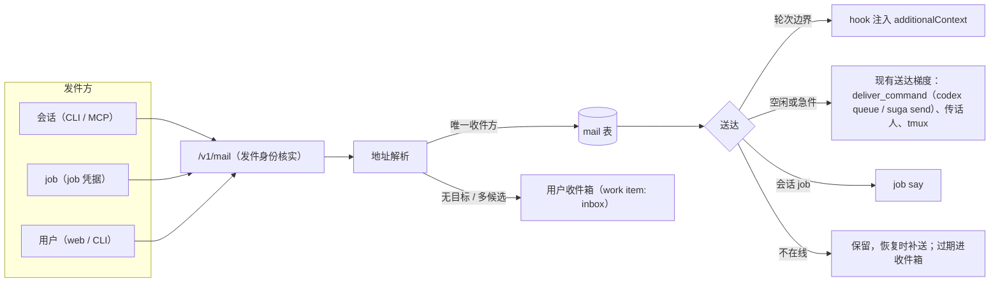
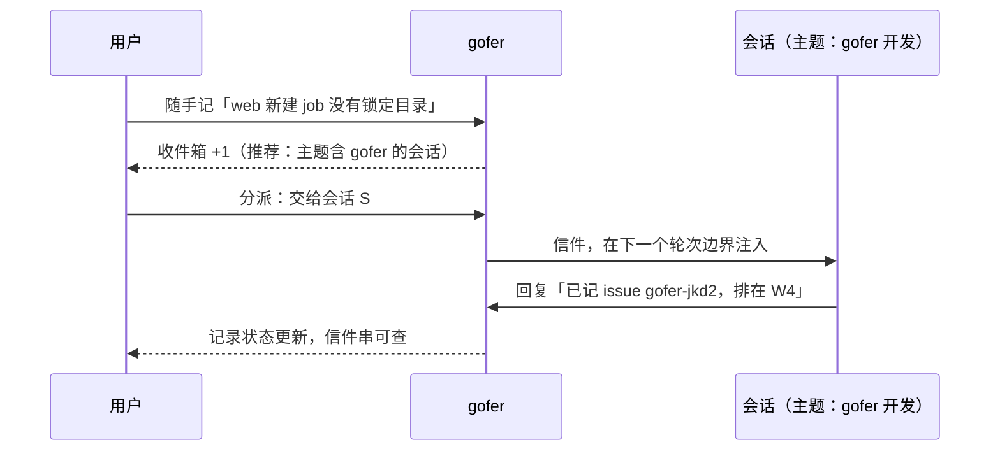
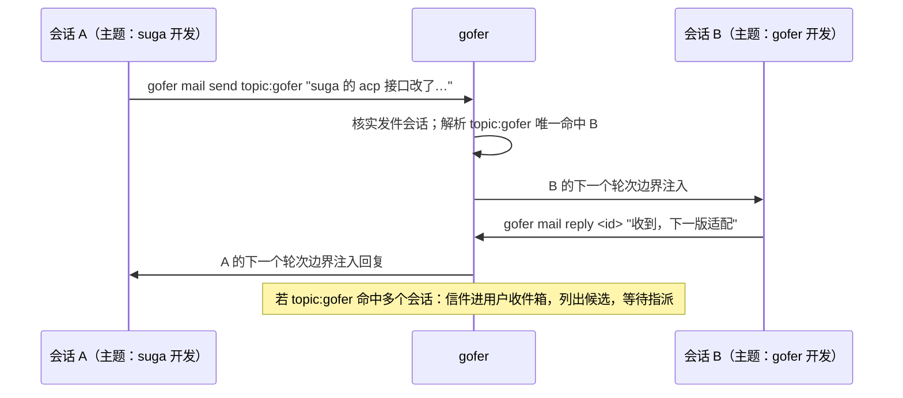

<!-- template_id: design; template_version: 1.1.1 -->
# 会话工作主题、gofer 信箱与全局收件箱 设计

> 状态：Draft 0.1 / 待人工计划批准
> issue：gofer-e6sb

- 思考模式：rigorous。
- 核心目标：让会话按「在做什么」互相找到；会话之间、会话与主机 agent 之间经 gofer 传话，不再要用户人工转述；给用户一个随手记录、再分派的入口。
- scope freeze：三期范围以本稿「范围与非目标」为准；实施中发现超出范围的需求另开 issue。
- review budget：本稿最多两轮独立评审；每轮的核心问题须在下一版闭合或转为「待确认事项」。
- 停止条件：用户对本稿给出具名的批准，或明确要求停止。

## 修订记录

| 版本 | 日期 | 作者 | 摘要 |
|---|---|---|---|
| 0.1 | 2026-10-16 | Claude（监督会话） | 初稿：会话主题与查找、信箱（地址、发件身份、持久、送达、回复）、收件箱（基于 work item）、三期分期 |

> 仅语义变化递增版本；纯 identity/provenance/元数据纠正沿用原版本，并在 Git/进度记录中留痕。

## 背景与目标

用户同时开着多个 agent 会话（容器里的 Claude Code、主机上的 codex 与 suga、gofer 派出的 job），遇到三个问题：

1. **找错会话**：会话之间想找「做某件事的那个会话」时只能看目录或标题。目录相同的会话很多（例如都在工作区根 `my-tools-dev`），标题由首句话自动生成且每轮被覆盖，于是会找错。
2. **人工传话**：一个会话需要另一个会话调整时，要用户在两个会话之间复制粘贴；和主机上的 codex、suga 对话还要切换系统。
3. **想法无处落脚**：用户想到的需求或发现的问题，要先写进记事本，再挑一个会话贴进去。

用户可见的目标：

- 每个活跃会话都有一个工作主题，会话和用户都能按主题或路径找到它。
- 会话可以给另一个会话、主机 agent 或用户发消息；收件方暂时不在时，消息由 gofer 保管，之后送达或交给用户指派。用户在 web 上能看到往来，必要时插话。
- web、CLI 与会话里都能随手记一条想法或问题，之后一键交给某个会话、新建 agent job、转成 plan todo 或仓库 issue。

## 名词

- **会话**：登记在 gofer 的终端 agent 会话（`agent_sessions` 一行），由 hook 或 agent 自己登记，含 Claude Code、codex、suga 等。
- **会话 job**：以持续会话方式运行的 job（ACP 或 pty），用 `job say` 对话。
- **主题（topic）**：一句话说明会话在做什么，如「gofer 开发」。
- **范围（scope）**：会话主要工作的子路径，相对项目根，如 `inhere-tools/gofer`；可以有多个。
- **信件（mail）**：一条经 gofer 传递的消息，有发件方、地址、状态与所属对话串。
- **地址**：信件的收件写法，见「架构 / 信箱」。
- **收件箱（inbox）**：用户的待处理记录区，存放随手记下的想法、问题，以及无人认领的信件。
- **轮次边界**：会话一轮结束（Stop）或下一轮开始（UserPromptSubmit / SessionStart）时 hook 运行的时刻。

## 范围与非目标

范围（分三期，见「总体方案 / 分期」）：

- 会话主题与范围的设置、推断、展示与查找。
- 信箱：地址解析、发件身份、持久保存、送达、回复串、过期处理、web 查看与插话。
- 收件箱：快速记录（web、CLI、MCP）、分派动作、状态回写、目标推荐。
- 主机 agent（codex、suga）作为可寻址的收件方；presence 收件箱并入信箱。

非目标：

- 不做即时通讯式的聊天产品（无在线状态推送、无已读回执之外的社交功能）。
- 不做跨 server 的信件联邦；只覆盖一台 gofer server 管理的会话、job 与 worker。
- 不用模型做自动路由决策：目标推荐只按文本与路径匹配给出候选，最终由发件方或用户选择；地址有歧义时不猜。
- 不替代 work item、plan、tracker issue；收件箱复用 work item，分派结果落到已有的 job、todo、issue。
- 不改变权限模型；新路由按现有权限目录声明（AGENTS.md G056）。

受影响项目：`inhere-tools/gofer`（server、CLI、MCP、hook、web、skill）。suga 与 codex 的终端会话登记方式若需配合，另与 suga 的维护会话沟通（见「待确认事项」）。

## 已确认事实与规范

会话登记与查找（盘点于 2026-10-16，main `b6c8aaaf`）：

- `agent_sessions` 的字段见 `internal/jobstore/sessions.go:266-332`；没有可由人或 agent 设置的主题、范围、标签字段。
- `title` 由 hook 在每次用户提问时按「目录名: 首句前 40 字」重写（`internal/hookrelay/run.go:208`、`:956-975`；`internal/jobstore/sessions.go:679-686`），不能表达长期主题。
- 会话没有 PATCH 路由（`internal/httpapi/authz_routes.go:337-367`）。
- 查找只有 `gofer session ls` 的 `--project/--state/--agent` 与 `cwd` 前缀过滤（`internal/commands/session.go:57-71`、`internal/jobstore/sessions.go:797-804`），MCP `gofer_session_list/get` 只读（`internal/mcpserver/work.go:205-211`）。
- 会话首次收到用户提问时会自动建一条草稿 work item（`internal/jobstore/work.go:360-381`）。

传话：

- web 或操作员发给会话：`POST /v1/sessions/{sid}/messages`（`internal/httpapi/session_handler.go:648-689`，`internal/sessionrelay/message.go:70-140`）。会话在等回复时直接答它的轮次；否则按送达梯度：agent 的 `deliver_command`、tmux；Claude 会话有 peer 地址时经传话人（`internal/messenger/resident.go:26-87`）。
- 内置 `deliver_command`：codex 为 `codex queue --thread <sid> --message <text>`，已退出的会话在下次 resume 时收到；suga 为 `suga send --session <sid> --source gofer`，文本走 stdin，会话不在线时返回 3（`internal/config/readonly.go:58-74`，`skills/gofer-usage/references/sessions-relay.md:106`）。
- 发出的消息记在每个会话的 outbox JSONL（`internal/jobstore/sessions.go:116-200`），发件方只有调用方 id，没有「来自哪个会话」。
- 已结束的会话拒收（`internal/sessionrelay/message.go:80-82`），送达失败标 `failed`，不重发。
- `POST /v1/session-ask`（`internal/work/ask.go:67-130`）目标不在线时返回 `ErrAskOffline`，不排队。
- hook 能在轮次边界把文本作为 `additionalContext` 注入模型（`internal/hookrelay/run.go:127`、`:796`）。

presence：

- `agent_presence` 与 `messages` 表（`internal/jobstore/store.go:262-296`），服务在 `internal/presence/service.go`；直接按 agent id 发送的消息在对方离线时保留，按角色或广播只投给在线者；未读 24 小时过期。
- 每个 `gofer mcp` 进程自动登记为 `mcp-<hosthash>-<pid>`（`internal/mcpserver/server.go:356-399`），身份不关联会话；收件要 agent 主动轮询。

work item、Today、tracker：

- work item 表与字段见 `internal/jobstore/store.go:851-966`，状态集合含 active、needs_me、parked、done 等；web 可新建（`web/src/views/Work.vue:240-251`），可挂会话、发汇报请求、转 plan todo（`internal/work/totodo.go`）；不能直接新建 job。
- Today 是只读的「待你决定」汇总（`internal/today/today.go:21-37`），没有新建入口。
- tracker issue 按仓库存放；web 能列、改、评论，没有新建接口（`web/src/api/client.ts:1257-1264`）。

引用的规范：AGENTS.md G021 / G022（分层）、G032（兼容策略）、G045 / G046（skill 同步与对外视角）、G051–G054（测试）、G056（路由声明）；权限设计 `docs/design/2026-10-14-db-capabilities-and-session-grants-design.md`（会话身份与 CLI 会话头单一注入点属其 T2.2）。

## 总体方案

### 一、会话主题与查找

- 会话增加 `topic`（一句话）、`scope`（子路径列表）、`topic_source`（`self` 会话自己设 / `human` 用户设 / `inferred` 推断）与 `topic_at`。
- 设置途径：会话内 `gofer session topic "<主题>" [--scope <路径>]…`（不带会话 id 时取当前会话，与 hook 用同一套识别）、MCP 同名工具、web 会话卡片与详情上直接编辑。
- 推断：主题为空时，用 `last_cwd` 相对项目根的路径作 `scope`、目录名作 `topic`，标 `inferred`；一旦有人设置就不再覆盖。
- 提醒：主题为空或仍是推断值时，SessionStart 注入一行提示，让 agent 用一句话设定主题。
- 查找：`gofer session find <关键词|路径>`、MCP `gofer_session_find`、`GET /v1/sessions?q=…`，只在活跃会话里找，按「scope 前缀命中 > 主题关键词命中 > 项目相同」排序，返回命中原因。
- 与 work item 的分工：主题说「这个会话是干什么的」，相对长期；work item 说「眼下在做哪件事」。会话挂上 work item 而主题为空时，主题默认取该 work item 的标题。

### 二、gofer 信箱

- 信件持久存在 server 的数据库里，按对话串组织，每封都有发件方、原始地址、解析后的收件方与状态。
- 发件方身份由 server 核实：会话发件由 CLI 带的会话标识确定（复用权限设计 T2.2 的会话头单一注入点，server 核对会话存在、未结束、属于同一调用方）；job 内发件取 job 凭据；web 发件即用户本人。客户端自报的发件人不被采信。
- 地址写法与解析见「架构 / 信箱」。地址只解析到唯一收件方时才投递；有多个候选时不猜，进用户收件箱并列出候选，由用户或发件方选择。
- 送达默认在收件会话的轮次边界注入，不打断它当前的工作；收件会话空闲时用现有送达梯度唤醒；标「急」的立即走送达梯度。
- 收件方不在线时信件保留：同一会话重新登记或恢复时补送；超过保留期仍未送达，进用户收件箱，由用户改投、新建 job 或丢弃。
- 回复挂在同一对话串，按同样方式送回发件方。web 的信箱页显示全部往来，用户可以回复、转交或插话。
- 现有 web → 会话的消息（outbox）与 session-ask 改为信箱的发送方式之一，不再各自维护一套记录（G032：旧 outbox 读取接口改由信件表提供，不保留双写）。

### 三、收件箱

- 收件箱基于 work item：新增状态 `inbox` 与字段 `kind`（`idea` 想法 / `issue` 问题 / `request` 需求 / `note` 记录），来源记 `human`、`agent`（含发件会话）或 `mail`（无人认领的信件）。
- 快速记录：web 顶栏「随手记」（手机可用），`gofer inbox add "<内容>" [--kind …] [--project …]`，MCP `gofer_inbox_add`（agent 发现问题时记下，自动带上发件会话）。
- 分派动作：
  - **交给会话**：按主题与范围推荐候选会话，发出一封信，记录与信件串关联；
  - **新建 job**：打开新建 job 表单，预填 prompt、项目与目录，job 与记录关联；
  - **转 plan todo**：沿用现有 to-todo；
  - **转仓库 issue**：选择仓库后新建 tracker issue，补上 web 新建 issue 的接口；
  - **归档 / 丢弃**。
- 状态回写：关联的 job 结束、信件被回复、todo 完成时写进记录的日志并更新状态；Today 显示收件箱里待处理的条数。

### 分期

| 期 | 内容 | 解决的问题 | 依赖 |
|---|---|---|---|
| 第一期 | 会话主题、推断、提醒与查找；收件箱快速记录与分派（交给会话先用现有的发消息接口，新建 job、转 todo、转 issue） | 找错会话；靠记事本中转 | 无 |
| 第二期 | 信箱：发件身份、持久保存、地址解析、轮次边界送达、离线补送与过期、回复串、web 信箱页；outbox 与 session-ask 并入 | 人工传话 | 权限 T2.2（会话身份） |
| 第三期 | 主机 agent 作为收件方（`agent:` 地址、常驻会话）；presence 收件箱并入信箱 | 跨系统对话 | 第二期 |

## 架构

### 会话主题

- 新增列：`agent_sessions.topic TEXT`、`scope_json TEXT`、`topic_source TEXT`、`topic_at INTEGER`（additive 迁移）。
- 新增路由：`PATCH /v1/sessions/{sid}`（只改 topic 与 scope），会话 owner 自己可改，改他人的需要 `session.manage.others`（InHandler deny）；`GET /v1/sessions` 增加 `q`、`path` 参数，读他人会话沿用 `session.read.others`（filter）。
- hook：SessionStart 在主题为空或为推断值时注入提示；`gofer session topic` 与 MCP 工具取当前会话 id 的方式与 hook 相同。

### 信箱

地址写法：

| 写法 | 含义 | 解析 |
|---|---|---|
| `session:<sid>` | 指定会话 | 直接命中 |
| `job:<id>` | 指定会话 job | 直接命中，送达走 `job say` |
| `topic:<关键词>` | 按主题找 | 在活跃会话里匹配主题；唯一命中才投递 |
| `path:<子路径>` | 按范围找 | 匹配 scope 前缀；唯一命中才投递 |
| `agent:<名字>` | 主机 agent（第三期） | 找该 agent 的常驻会话；没有时按配置新起一个会话 job |
| `human` 或省略 | 用户 | 进用户收件箱 |

信件表 `mail`（additive）：`id`、`thread_id`、`reply_to`、`from_kind`（session / job / human / agent）、`from_id`、`from_caller`、`to_address`（原文）、`to_kind`、`to_id`、`urgent`、`body`、`state`（`pending` 待送 / `delivered` 已送达 / `read` 已读 / `answered` 已回复 / `held` 待指派 / `expired` 过期 / `failed` 失败 / `cancelled` 撤回）、`attempts`、`last_error`、`created_at`、`delivered_at`、`read_at`、`expires_at`、`inbox_item_id`。

送达规则：

| 收件方 | 默认（普通件） | 急件 |
|---|---|---|
| Claude Code 会话 | 下一个轮次边界由 hook 取件、注入、确认；会话空闲超过阈值时经传话人唤醒 | 立即经传话人 |
| codex / suga 终端会话 | 走 agent 的 `deliver_command`（`codex queue` 本身会为已退出的会话排队） | 同左 |
| 会话 job | 状态为 `awaiting_input` 时 `job say`，否则等下一次空闲 | 同左 |
| 不在线 / 已结束 | 保留到 `expires_at`（默认 24 小时）；同一会话恢复时补送；过期后进收件箱 | 同左 |

路由与权限（G056）：

- `POST /v1/mail`：发给他人的终端会话需 `session.reply.others`，发给他人的会话 job 需 `job.manage.others`，会新起 job 的地址另需 `job.submit`；发给用户与自己的会话不需要权限。
- `GET /v1/mail`（按收件方、发件方、对话串过滤）：自己的信件不需要权限，他人的需 `session.read.others`（filter）。
- `POST /v1/mail/{id}/reply`、`/ack`、`/cancel`、`/readdress`：收件方或发件方本人；他人的需对应的 `.others` 权限。
- 不新增权限目录条目。

hook 侧：UserPromptSubmit、Stop、SessionStart 时取本会话的待送信件（每次最多若干封、限总长），注入为 `additionalContext`，并确认送达；Claude 会话用 SendMessage 答复传话时，沿用现有 PostToolUse 捕获，写成该对话串的回复。

### 收件箱

- `work_items` 新增 `kind TEXT`，状态集合新增 `inbox`；收件箱就是 `status=inbox` 的 work item 列表。
- 新增：`POST /v1/inbox`（快速记录，等同建 work item 的简化入口）、`POST /v1/work-items/{id}/dispatch`（`to: session|job|todo|issue`，分别产生信件、job、todo、issue，并写关联）、`POST /v1/tracker/repos/{tracker_id}/issues`（web 新建 issue）。
- 权限：work item 与 tracker issue 的读写现为 Public（权限设计第一批的结论），新入口保持一致；产生 job 的分派另需 `job.submit`，交给他人会话需 `session.reply.others`。
- 目标推荐：按记录文本与会话主题、scope、项目做关键词与路径匹配，返回前几名及命中原因。

## 关键流程

随手记再分派：

会话之间按主题传话：

## 安全、数据、运维与回滚

- **身份**：发件方由 server 核实，不采信客户端自报；会话身份依赖权限设计 T2.2 的会话头，未完成前第二期不上线。
- **权限**：所有新路由按 G056 声明并 `go generate` 更新权限参考文档；跨调用方的发送与读取沿用现有 `.others` 权限。
- **防循环与滥发**：每个发件会话限速（默认每分钟若干封）；同一对话串的自动往返轮数设上限，超限的信件改进用户收件箱；单封正文限长（默认 32KB）。
- **敏感信息**：信件正文走现有的秘密扫描与 job 脱敏流程覆盖范围（脱敏按库表遍历，新表自动纳入）；注入给模型的内容只含正文与发件说明，不含凭据。
- **数据**：新增列与表都是 additive 迁移；信件保留 90 天，过期清理；收件箱记录随 work item 现有的保留策略。
- **运维**：Today 增加「收件箱待处理」与「信件未送达」两类卡片；`gofer mail ls` 与 web 信箱页可查全部往来。
- **回滚**：回到旧版本二进制时新表与新列被忽略；旧 outbox 读取接口改由信件表提供，回滚后旧版本继续读 JSONL，期间新写入的消息在旧版本里看不到，属可接受的降级，写进 CHANGELOG。

## 决策

以下为本稿的提案，待用户确认：

1. **主题做成会话字段**，与 work item 并存；会话挂上 work item 且主题为空时取 work item 标题。备选：只用 work item 的 goal——缺点是一个会话可能先后做多件事，goal 随之变化，不能表达会话的长期分工。
2. **收件箱复用 work item**（新增 `inbox` 状态与 `kind`）。备选：独立实体——缺点是要重做挂会话、转 todo、合并拆分等现成能力。
3. **presence 收件箱在第三期并入信箱**，两套身份合一。备选：保留两套——缺点是同一个 agent 有两个地址，用户和 agent 都要判断用哪个。
4. **普通件在轮次边界送达**，空闲时唤醒，急件立即。备选：一律立即——缺点是打断收件会话正在做的事，传话人每封都要起一次。
5. **地址有歧义时不猜**，进用户收件箱并给出候选。这是对「找错会话」的直接回应。
6. **分期与先后**：本稿批准后先出第一期计划，第一期可与权限第二批交替实施；第二期排在权限 T2.2 之后。

## 待确认事项

- suga 终端会话目前如何登记进 gofer（suga 侧实现），以及 suga 是否能在轮次边界取件；需要与 suga 的维护会话确认，第三期前闭合。
- codex 终端会话的 hook 能否像 Claude Code 一样在轮次边界注入 `additionalContext`；不能的话，codex 收件一律走 `codex queue`。
- 信件默认保留期（建议 24 小时后进收件箱）、限速与自动往返上限的具体数值。
- Stop hook 是否在用户离开时为待送信件阻塞等待（与 `session.stop_job_wait` 的 away / always / never 口径对齐）。

## 结论与人工计划 Gate

本稿为 Draft 0.1。需要用户对「决策」六条给出确认或修改，并具名批准本设计后，才进入第一期实施计划的编写；设计批准不授权实施。
