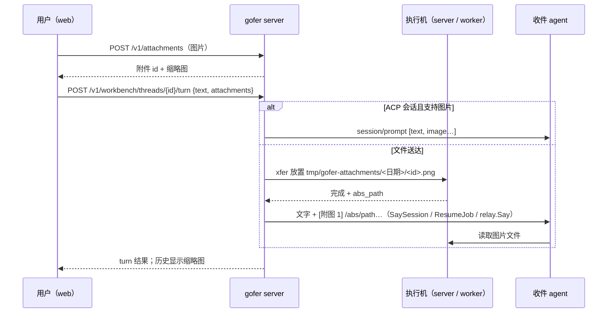

<!-- template_id: design; template_version: 1.1.1 -->
# 工作台会话输入框支持图片 设计

> 状态：Draft 0.1 / 已批准（用户 2026-10-19：「按推荐，批准设计」——决策 1–8 均取推荐值）
> issue：gofer-ha0x

- 思考模式：rigorous。
- 核心目标：在 web 工作台（含手机）给会话发消息时能附上图片——粘贴、拖放、选文件、手机拍照或相册——并让收件的 agent 真正看到图片，不管它是 ACP 会话、命令行会话 job，还是 Claude Code / Codex 终端会话，也不管它跑在 server 本机还是 worker 上。
- scope freeze：范围以本稿「范围与非目标」为准；实施中发现超出范围的需求另开 issue。
- review budget：本稿最多一轮独立评审；评审后修订由作者自查。
- 停止条件：用户对本稿给出具名的批准，或明确要求停止。

## 修订记录

| 版本 | 日期 | 作者 | 摘要 |
|---|---|---|---|
| 0.1 | 2026-10-19 | Claude（监督会话） | 初稿：两种送达方式（ACP 图片内容块 / 送文件到执行机并在消息里给路径）、server 端附件存储、xfer 回报绝对路径、web 交互与手机端压缩、限额与清理、权限 |

> 仅语义变化递增版本；纯 identity/provenance/元数据纠正沿用原版本，并在 Git/进度记录中留痕。

## 背景与目标

用户 2026-10-19 经 web 提出：工作台里会话的聊天输入框支持上传图片。典型场景：手机上截了一张报错或界面截图，想直接发给正在干活的会话；或者把设计图、日志截图交给 agent 参考。

目前工作台只能发文字：

- 会话 job：ACP 持续会话走 `SaySession`，命令行批处理会话走 `ResumeJob`（新起续接 job）；
- 终端会话（Claude Code / Codex 经传话）：走 `relay.Say`，由 hook、传话人或 tmux 把文字送进会话；
- 普通 job：续接。

目标：

1. web 输入框能附图片，发出后收件 agent 能看到图片内容。
2. 同一套交互在桌面与手机上都能用；手机照片自动压缩，不浪费流量。
3. 发出的消息在工作台历史里能看到缩略图。
4. 不支持图片的收件方在发送前就提示，而不是发出去才失败。

## 名词

- **附件**：随一条消息上传的图片。server 保存原件，送达时按收件方方式交付。
- **执行机**：收件会话 / job 实际运行的机器——server 本机，或某台 worker（含容器 worker）。
- **内联送达**：把图片作为 ACP 的 `image` 内容块直接放进 prompt。
- **文件送达**：把图片放到执行机上的项目目录里，在消息文字里写出它的绝对路径，由 agent 自己读取。

## 已确认事实与规范

- ACP 协议的 prompt 支持 `image` 内容块（`data` base64 + `mimeType`），agent 在 `initialize` 的 `promptCapabilities.image` 声明是否支持；gofer 目前只发送文本块（`internal/acp/types.go` `ContentBlock` 只有 `type` / `text`），`promptCapabilities` 原样保存未解析。
- Claude Code 与 Codex 都能按本地路径读取图片（Claude Code 的读文件工具支持图片；Codex 有查看本地图片的工具）。终端会话的消息只能是文字。
- server 知道终端会话的执行机、项目与当前目录（会话记录的 `runner` / `project_key` / `cwd`，例如 `w-docker-claude` / `my-tools-dev` / `/d/work/inhere/my-tools-dev`）；job 记录同样有 runner、项目与 cwd。
- 已有的文件传输 xfer：文件先暂存到 server，再送到目标 runner 上项目内的指定相对路径（`job run --upload`、`tool cp` 同一套）；有大小限额、sha256 校验、按调用方归属与权限、离线不排队。但 xfer 只记录项目内相对路径，**不回报执行机上的绝对路径**。
- 工作台发送接口 `POST /v1/workbench/threads/{id}/turn` 的权限按 thread 类型判定（`job.manage.others` / `session.reply.others` / `job.submit`），并受调用方上限约束（Resource `workbench_thread`）。

## 总体方案

1. **先上传，后发送**：web 选中图片后立即上传到 server（`POST /v1/attachments`），得到附件 id 并显示缩略图；点「发送」时 turn 请求带上附件 id 列表。
2. **按收件方选送达方式**：
   - ACP 会话（agent 声明 `promptCapabilities.image`）：内联送达，图片作为 `image` 内容块与文字一起发出。
   - 其余（命令行会话 job、终端会话、未声明图片能力的 ACP agent）：文件送达——server 用 xfer 把图片送到执行机的项目目录 `tmp/gofer-attachments/<日期>/<附件 id>.<扩展名>`，执行机回报绝对路径后，server 在消息文字末尾追加「附图」段落再发送。
   - 不能送达的（pty job、没有执行机信息的会话）：发送前 400，web 在附图时就提示。
3. **web 交互**：粘贴（Ctrl+V / 手机长按粘贴）、拖放、📎 按钮（`accept="image/*"`，手机上可选拍照或相册）；缩略图条可删除；上传中「发送」置灰；手机端对大图在浏览器里压缩（长边 2048px、JPEG 质量 0.85），桌面端可选「发原图」。
4. **历史显示**：turn 记录保存附件 id，工作台历史在该条消息下显示缩略图，点击看大图（从 server 原件读取）。
5. **保存与清理**：server 原件保留 14 天（可配置），过期后历史里显示「图片已过期」；执行机上的附件目录在每次放入新附件时清理 7 天前的日期子目录。

## 范围与非目标

范围：

- 工作台里会话的输入框（会话 job、终端会话、普通 job 续接）。
- 图片：PNG、JPEG、GIF、WebP。
- 桌面与手机 web。
- server 本机与 worker（含容器 worker）上的执行机。

非目标：

- 非图片附件（PDF、日志文件、压缩包）——可以复用同一套机制，另开 issue。
- 新建 job 页、信件、plan todo 的附件——本期只做工作台会话输入框。
- 图片内容审查与 OCR；EXIF 隐私信息的处理只做「压缩时自然丢弃」，原图模式不处理（写进文档）。
- CLI 发图（`gofer session say --image`）——接口具备后可另开 issue。

## 架构

### 附件存储（server）

- 新表 `attachments`（additive）：`id`、`caller`、`thread_id`（可空，发送后回填）、`mime`、`bytes`、`sha256`、`width`、`height`、`created_at`、`expires_at`、`path`（server 本地存储路径）。
- 文件存于 `<config-dir>/attachments/<yyyymmdd>/<id>`；不进 job 结果目录。
- `POST /v1/attachments`（multipart，单文件）：校验类型（看文件头，不信扩展名）与大小，返回 `{id, mime, bytes, width, height}`。
- `GET /v1/attachments/{id}`：返回原件（`Content-Type` 为校验后的类型，`Content-Disposition: inline`，`X-Content-Type-Options: nosniff`）；`?thumb=1` 返回缩略图（server 端生成，长边 320px，生成失败就返回原件）。
- `DELETE /v1/attachments/{id}`：上传者在发送前删除。
- 保存期清理接入 serve 的 prune 循环（`storage.attachment_retention_days`，默认 14）。

### 发送（workbench Turn）

- `POST /v1/workbench/threads/{id}/turn` 的请求体增加 `attachments: [id…]`（最多 6 个）。
- `workbench.Service.Turn` 先判定收件方的送达方式，再：
  - 内联：读原件，组成 `[text, image, image…]` 内容块，经 ACP `session/prompt` 发出（`internal/acp` 的 `ContentBlock` 增加 `image` 类型与 `data` / `mimeType` 字段；`Client.Prompt` 接受内容块列表，现有文本调用不变）。
  - 文件送达：为每个附件建一条 xfer（目标为该 thread 的执行机、项目、相对路径 `tmp/gofer-attachments/<日期>/<id>.<ext>`；项目配置了 `exchange_dir` 时放在它下面），等全部完成（上限 60 秒），拿到执行机回报的绝对路径后，在文字后追加：
    ```
    [附图 1] /abs/path/to/tmp/gofer-attachments/20261019/a1b2.png
    [附图 2] …
    ```
    再按原路径送达（`SaySession` / `ResumeJob` / `relay.Say`）。xfer 失败（执行机离线、超时）时整个发送失败并返回原因，不发出缺图的文字。
- 送达方式的判定（纯函数，可测）：ACP 会话 + `promptCapabilities.image=true` → 内联；ACP 会话不支持图片、cli 会话 job、终端会话 → 文件送达；pty job / 会话没有执行机或项目 → 不支持。
- 工作台 thread 数据增加 `attachments` 能力位（`inline` / `file` / `none`），web 据此决定是否显示 📎 与提示文案。

### xfer 回报绝对路径

- 执行机放置文件后，在 xfer 完成回报里增加 `abs_path`（additive 协议字段；worker 协议版本 +1）；server 本机执行时直接得到。
- 旧协议的 worker：拿不到绝对路径时，消息里写项目相对路径并注明「相对于项目根目录 `<project>`」，web 发送前提示「该 worker 版本较旧，agent 需按项目根目录查找图片」。

### 执行机上的清理

- 放置附件时，执行机删除 `tmp/gofer-attachments/` 下 7 天前的日期子目录（只删这个目录下的，路径在项目根内校验）。不另起定时任务。

### web

- 输入框组件（工作台 composer 与会话抽屉的回复框共用）：粘贴、拖放、📎 按钮；缩略图条（可删除、显示上传进度与失败重试）；超过数量或大小时就地提示。
- 手机端：`<input type="file" accept="image/*">`（系统会提供拍照 / 相册选项）；选中后在浏览器里用 canvas 压缩（长边 2048px、JPEG 0.85；PNG 截图小于 1MB 时保留原样）；桌面端默认不压缩、超过 10MB 才压缩。
- 历史：带附件的消息下显示缩略图网格，点开看大图；过期显示占位。
- 收件方不支持图片（能力位 `none`）时 📎 置灰并提示原因。

## 关键流程



## 安全、数据、运维与回滚

- **权限**：上传附件只需登录（附件属于上传者）；发送时附件必须属于发送者，否则 403；附件的读取权限跟随它所属 thread 的可见性（与读该会话 / job 的权限相同），未发送的附件只有上传者能读。新路由按 G056 声明，并声明调用方上限的 scope / rw 维度（附件按所属 thread 的项目判定）。
- **内容**：只接受四种图片类型，按文件头判定；返回时带 `nosniff`，不以 HTML / SVG 渲染（SVG 不在允许列表，避免脚本）。
- **大小与数量**：单张 10MB（配置 `server.attachments.max_bytes`），一条消息最多 6 张，每调用方每小时上传上限 200 张（防滥用）。
- **秘密**：图片可能含敏感信息（截图里的 token 等）。gofer 不做图片内容扫描，文档提醒；附件随 job 删除 / 脱敏时不自动处理（文档写明），保存期到期删除。
- **存储**：server 端按保存期清理；执行机端按 7 天清理。
- **回滚**：回到旧版本时 `attachments` 表与目录被忽略；web 回到不带 📎 的版本；执行机上已放置的附件留在 `tmp/gofer-attachments/` 下，可手工删除。worker 协议字段为 additive。

## 测试计划

- 送达方式判定的真值表（ACP 支持 / 不支持、cli 会话、终端会话、pty、无执行机）。
- 附件上传：类型校验（伪造扩展名）、大小上限、限速、跨调用方读取 403、未发送附件只有上传者能读。
- ACP 内联：fake ACP server 收到 `image` 内容块，文字与图片顺序正确；不支持图片的 agent 走文件送达。
- 文件送达：本机与 worker 两种执行机（worker 用测试 harness），xfer 完成后消息含绝对路径；xfer 失败时不发消息并返回原因；旧协议 worker 的相对路径分支。
- 执行机清理：只删 7 天前、只在附件目录内。
- 保存期清理与过期占位。
- web：粘贴 / 拖放 / 选择的纯函数（类型与大小判断、压缩参数选择）vitest；接线 `?raw` 断言；手机宽度截图人工核对。

## 文档

- `skills/gofer-usage/references/web-console.md`：工作台附图的用法与限制。
- `docs/reference/http-api.md`：`/v1/attachments` 与 turn 的 `attachments` 字段、thread 的能力位。
- `skills/gofer-usage/references/server-config.md`：`server.attachments.*` 与 `storage.attachment_retention_days`。
- `docs/guide/scenarios.md`：手机上截图发给会话的用法；`docs/guide/security.md`：截图可能含敏感信息。
- CHANGELOG。

## 决策

以下为本稿的提案，待用户确认：

1. **两种送达方式**：ACP 且支持图片时内联，其余一律送文件到执行机并在消息里给绝对路径。备选：一律送文件——实现更统一，但 ACP agent 要多调一次读文件工具。推荐：两种都做。
2. **server 保存原件 14 天**（用于历史缩略图与重发），执行机上的副本保存 7 天。备选：不保存原件——历史里看不到图。
3. **执行机上的存放位置**：项目目录 `tmp/gofer-attachments/<日期>/`（配置了 `exchange_dir` 时放在它下面）。备选：会话当前目录——可能不在项目内、也可能在仓库里被误提交。
4. **手机端自动压缩**（长边 2048px、JPEG 0.85，小于 1MB 的 PNG 截图不动），桌面端默认发原图。
5. **限额**：单张 10MB、一条消息 6 张、每调用方每小时 200 张，均可配置。
6. **xfer 失败时整条消息不发**，返回原因让用户重试；不发出缺图的文字。
7. **旧版 worker**（拿不到绝对路径）：发项目相对路径并提示，不阻止发送。
8. **本期只做工作台会话输入框**；新建 job、信件、todo 的附件与非图片文件另开 issue。

## 待确认事项

- Codex 终端会话读取本地图片的实际表现（是否需要在消息里提示「用查看图片工具打开」）：实施时实测，结论写进实施记录；不阻塞设计批准。
- suga 是否能读取本地图片：实施前向 suga 维护会话确认；不支持时 suga 会话按「不支持图片」处理（📎 置灰）。

## 结论与人工计划 Gate

本稿为 Draft 0.1。需要用户确认「决策」八条（或指出要改的条目）并具名批准本设计后，才进入实施计划的编写；设计批准不授权实施。
