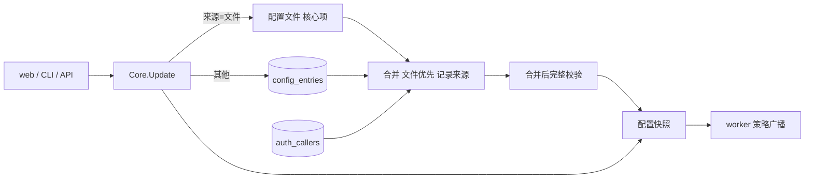

<!-- template_id: design; template_version: 1.2.0 -->
# 配置入库与最小配置文件设计

> 状态：Draft 0.3 / 待人工计划批准（0.2 经用户批准；0.3 依第一轮审核修订，新增 3 项需确认，见“待确认事项”）
> issue：gofer-nhh7

## 修订记录

| 版本 | 日期 | 作者 | 摘要 |
|---|---|---|---|
| 0.1 | 2026-11-03 | Claude（gofer 监督会话） | 初稿 |
| 0.2 | 2026-11-03 | Claude（gofer 监督会话） | 按用户决定：`event_hooks`、`decision_hooks`、`triggers` 入库并有 web 入口，专用高危权限与审计；env、proxy_url 入库打码；手动迁移 |
| 0.3 | 2026-11-03 | Claude（gofer 监督会话） | 按第一轮审核修订（8 阻塞、17 重要）：根只由文件判定；用户物化进配置快照；按条目来源写入；校验拆两段；坏条目进安全模式；迁移放 server；存 YAML；独立审计表；扩大高危字段范围；新用户须明确上限 |

> 仅语义变化递增版本；纯 identity/provenance/元数据纠正沿用原版本，并在 Git/进度记录中留痕。

思考模式：RIGOROUS。核心目标：配置文件只留启动必需项，其余在 web / CLI 改、不用碰文件。Scope freeze：只做下文“范围”所列。Review budget：两轮独立审核（涉及鉴权；第一轮已完成并吸收）。停止条件：待确认项由用户定下、审核无阻塞项。

## 背景与目标

用户要求（2026-11-03）：“扫一遍配置，把可以提的都往 db 里提，配置文件只留核心必要的配置，减少上手难度。”用户身份暂定继续用 token。

现在的问题：
- 新增用户要改 `server.callers` 并重启。
- 新手面对的是一份 941 行说明的配置参考。
- 有些设置 API 能写，web 上却没入口（`agents.*.can_submit`、`roles`），只能改文件。

用户可见结果：
- 新装只需写地址和 token 就能启动，其余在 web 上配。
- 新增用户、发 token、改权限和上限，都不用改文件，不用重启。
- 已有部署的文件继续有效，想迁时执行一条命令。

## 名词

- caller（用户）：一个 token 对应的身份。
- 根管理员：配置文件里的身份，权限最高，不依赖 DB。
- 核心配置：DB 打开之前就要用到的，或用来兜底恢复的配置。
- 条目：配置的归属单位。map 类按键算（`agents.<key>`、`projects.<key>`），其余按字段路径算（`server.retry`）。
- 文件优先：同一条目两边都有时，用文件的值。

## 范围与非目标

范围：
1. 用户入库：web / CLI 新增、发 token、轮换、停用、改上限。
2. 配置入库：通用存储，复用现有写入事务和字段策略表。
3. 迁移与备份：`config migrate`、`config export`。
4. 最小配置：`gofer init` 只生成核心配置。
5. 补 web 入口：`can_submit` / `submit_agents`、roles，以及迁移后没有入口的字段。

非目标：
- 密码登录、多人账号（用户已定：暂用 token）。
- worker 自身的 `worker.yaml`：它是 worker 连上 server 之前就要用的。
- 改变权限模型（`auth_grants` 不动）。
- 配置的多版本回滚 UI（本次只记审计，能导出）。

## 已确认事实与规范

| 事实 | 证据 |
|---|---|
| 授权已入库，web 可管、即时生效 | `auth_grants`；`/v1/auth/grants` |
| 用户在文件里，改了要重启；token 明文比对 | `editable.go` `server.callers`；`httpapi/auth.go` `lookupCallerIn` |
| job token 已按 sha256 哈希存储，有先例 | `jobstore` `job_tokens.token_hash` |
| ceiling 按当时决定只写文件 | `editable.go` 注释 |
| 所有配置写入走同一事务 `Core.Update → saveConfig → reloadLocked`，已有串行锁、失败不生效、向 worker 广播 | `core/core.go` |
| 字段策略表已区分可写、需重启、可热载，且被写接口和 `GET /v1/config` 共用 | `config/editable.go` |
| roles 只有读取视图，没有写接口；`can_submit` 有写接口，web 没字段 | `httpapi/config_handler.go`、`config_write_handler.go`、`web/src` |
| 已有 DB 设置表，但只放措辞、阈值、列表 | `internal/settings` |
| 根管理员判定依赖 `len(Callers)==0`，用户集合一变就可能翻转 | `config/model.go` `HasRootAdmin` |
| ceiling、配额、trigger 所有者都只读 `cfg.Server.Callers`；查不到 ceiling 等于无上限 | `config/ceiling.go`、`httpapi/authz_ceiling.go`、`job/ceiling.go` |
| 用户集合缩小时授权被标孤儿，id 回来也不恢复 | `httpapi/authz_resolve.go` |
| `require_admin_capability` 未开时，`config.write` 默认发给所有用户 | `authz/derive.go` |
| 校验在 `loadFile` 内、开 DB 之前；`core.Build` 在开 DB 前就用了 agents、projects、runners | `config/loader.go`、`core/core.go` |
| 开库失败进程退出；库文件缺失时静默建空库 | `core/core.go`、`jobstore/store.go` |
| `token_env` 的值只在 server 进程环境里 | `httpapi/server.go`、`serve/serve.go` |
| 多数配置结构只有 yaml tag，`ArgList`、`extends` 依赖 YAML 语义 | `config/model.go`、`config/extends.go` |
| `Clone` 共享 `Roles`、`Runners`、`Leader`、`Schedule` | `config/model.go` |
| 非 serve 路径约 25 处直接 `config.Load`，迁移后多数会静默答错（如 cwd 匹配不到项目，job 落到 `default`） | `commands/*.go`，清单见第一轮审核 |

**与既有决定的冲突（SR1413）：**
- 2026-10-20 设计划的界是“影响启动、安全边界、连通性、权限的留文件”，非目标里写了不把 config.yaml 的项搬进数据库。本设计经用户要求改变这条界：只有“启动、兜底、密钥来源”留文件。批准后要在那份设计里加指向本稿的说明。
- 2026-10-14 权限设计把“web 新建调用方”列为暂不做；`server.callers.*.ceiling` 定为只写文件。本设计取代这两条，用户已同意 ceiling 入库。

规范：G021–G024 分层；G056 路由登记；SR1301 安全；SR1402.1 真实验证；GR107–GR110。

## 总体方案

配置 = 文件 + DB 叠加。文件只负责启动和兜底，日常设置在 DB。

**字段归属（全量）：**

| 去向 | 字段 |
|---|---|
| 留文件：启动必需 | `server.addr`、`server.tls`、`server.token` / `token_env`、`server.allow_empty_token`、`server.web_enabled`、`server.web_dir`、`server.path_view`、`storage`、`log`、`include` |
| 留文件：密钥来源 | `secrets`（只存“去哪读”，且由执行机解析）、`server.metrics.token` |
| 留文件：根管理员 | `server.callers` 中 `can_admin` 的项，以及 `server.token` |
| 进用户表 | `server.callers`（根管理员除外）及其 ceiling、限流、并发 |
| 进 DB：可热载 | `agents`、`roles`、`projects`、`runners`（`worker` 类型）、`leader`、`wakeup`、`session`、`work`、`steward`、`memory`、`mail`、`tools`、`pricing`、`server.notification`、`inbox`、`retry`、`skills`、`mcp`、`skill_limits`、`rules`、`rules_max_bytes`、`comment_trigger`、`dir_lock*`、`agent_health`、`job_env_denylist`、`tunnel`、`language`、`read_dir_allow`、`max_job_timeout_sec`、`auto_resume_max`、`stall_timeout_sec`、`worker_enrollment`（除 `trusted_proxies`）、`hold`、`attachments`、`workers`（token 改存哈希，P3） |
| 进 DB：高危，专用权限 `config.exec.write` | `server.event_hooks`、`server.decision_hooks`、`server.triggers`、`server.update`、`mcp_servers`、`http_proxy`、`server.worker_enrollment.trusted_proxies` |
| 进 DB：改了要重启 | `schedule`、`pty`、`runners`（`peer-http`）、`server.runner_probe`、`server.session_messaging`、`governance`、`metrics`、`web_base_url`、`job_recover_window_sec`、`policy_repush`、`agent_fallback`、`push`、`xfer`、`preview`、`delivery_check`、`background_agents`、`worker_queue_max_wait_sec`。入库不要求热载：启动时读 DB，界面标“需重启” |

判断依据：DB 打开前要用的不能进；坏了要靠它恢复的不进；其余都进。`agents.*.command` 这类已经能经 API 写，进 DB 不扩大暴露面；原本只写文件的项按高危处理，因为入库后普通 `config.write` 不该能碰。

hooks 和 triggers 原定只写文件，用户决定入库，理由是：有权限的人改文件也一样能配，走 API 还多一条审计记录。

**优先级：文件优先，按条目来源写入。** 加载时记录每个条目的来源：
- 条目在文件里：读文件的值，写入也继续写文件，和今天完全一样。这样未迁移部署的控制台写能力不倒退。
- 条目不在文件里（新建的或已迁移的）：读写 DB。
- 文件和 DB 都有：用文件的值，界面标“被文件遮蔽”，并提供清理 DB 值的入口，否则从文件删掉后旧值会复活。

**新旧部署：**
- 新装：`gofer init` 只写核心配置，其余默认值 + DB。
- 已有部署：不自动迁移，升级后一切照旧；想迁就执行 `gofer config migrate`。

## 架构

代码组织：
- `internal/jobstore`：`config_entries(path PK, value_yaml, generation, updated_by, updated_at)`；`auth_callers(id PK, name, token_hash, token_hint, limits_json, ceiling_yaml, disabled_at, created_by, created_at, rotated_at)`，`token_hash` 是十六进制 sha256；`config_audit(id, actor, path, before_masked, after_masked, at)`，与写入同事务，有保留期。均为增量加表（G057），发版后补 `schema-v*.sql`。
- 值存 YAML 文本，走现有解码、严格校验和已移除键检查。`encoding/json` 会改键名、丢 `ArgList` 的 `[]` 语义和 `extends` 差异。
- `internal/config`：把校验拆成“单文件结构校验”和“合并后完整校验”，CLI 路径只做前者。新增 `ApplyEntries`（叠加，记录来源）和 `SplitForStore`（走 `authored` 投影，默认值、overlay、注入项不入库）。字段策略表拆成“归属”和“生效时机”两列，覆盖全部顶层节，用反射测试守护，并加 secret 标记。`Clone` 先对所有入库字段做深拷贝，加 race 测试。config 不依赖 jobstore（G021–G024）。
- `internal/serve`、`internal/core`：`serve.Start` 开头先开库、合并，再 `core.WithStore` 注入；叠加是显式选项，worker 和独立 mcp 的 worker 模式不启用。`saveConfig` 按条目来源分流：先写 DB，再写文件（文件优先，中途失败仍安全）。`reloadFromPathLocked` 也走同样的合并。
- 需重启的字段：写入后存 DB，运行中的快照保留旧值，界面标“重启后生效”。现状是“写入即发布”，这里要改。
- `internal/httpapi`：
  - 用户物化进 `cfg.Server.Callers`（带来源标记，写文件时剔除），所有读取方（ceiling、配额、trigger、授权声明）不用改。
  - `callerEntry` 增加哈希字段；认证先查哈希，再判断 `callersEmpty`。长连接指纹改由哈希推出，否则 DB 用户会在巡检时被断开。
  - 根判定只看文件：`HasRootAdmin` 只数文件来源的用户。
  - 读 `auth_callers` 失败时整次 reload 失败、保留旧快照，绝不当作空集；孤儿扫描只在拿到完整用户集时运行。
  - 新路由登记 `routeDecls`（G056）：`/v1/callers*`（根）、roles、`/v1/config/exec/*`（`config.exec.write`）。高危字段不进通用 `PUT /v1/config/server` 词表，预览和校验接口也不接收。
- `internal/commands`：`gofer auth caller add|ls|rotate|disable|set-ceiling`（G033，放在已有的 `auth` 下）；`config migrate`、`config export` 都是瘦客户端，经 server 执行；`export --offline` 走本机文件权限，用于 server 起不来时。
- 非 serve 的 `config.Load` 调用：必须叠加的（`serve.go:256`、`core.go:701`、`mcp.go:135`）走合并；会静默答错的（`job.go:1987`、`hook.go`、`repo.go`、`project.go`、`agent*.go` 等）改为经 server 读，读不到就明确报错。`gofer project add` 改走 API。计划阶段列全并逐项改，这是工作量最大的部分。
- `internal/settings` 保留：放提示词、阈值这类有注册表的值；`config_entries` 放配置结构。修改其包注释，写清边界。
- web：用户管理；agent 表单补 `can_submit`；roles 编辑；高危配置页；所有字段显示来源。打码字段 PUT 时能保留原值。

## 关键流程

新增用户：
1. 根管理员 `gofer auth caller add ci --ceiling-project p1`（或 `--no-ceiling` 明确不设），或在 web 上操作。未开 `require_admin_capability` 时，无上限的新用户能写 `agents.*.command`，界面和 CLI 都要提示。
2. server 生成带固定前缀的 token，只显示这一次，DB 存哈希。
3. 即时可用；权限照旧用 grants 发。
4. 轮换或停用时断开长连接（复用 `authz_live_conn`），记审计。

用户生命周期：不做硬删除，id 永不复用。停用的用户留在快照里（ceiling 继续约束它在跑的 job），但不能认证。`default` 等 id 保留。文件后来新增同 id 时，DB 条目整体隐藏（含 token），合并后校验报告。

鉴权：保持现有匹配优先级，DB 用户排在文件用户之后。

迁移（server 侧事务，持 `updateMu`，根权限）：
1. `gofer config migrate --dry-run`：列出每项去向、每个文件的结果、会丢的注释、重复 token、弱 token，高危项单独列。
2. 前置检查，不满足就拒绝：
   - 迁移前有根管理员（否则要求操作者明确指定）。
   - 打开了 `require_*_capability` 的旧能力位已转成 `caller:<id>` 授权。
3. 用户的哈希在 server 进程内计算，因此 `token_env` 能取到值；取不到的留在文件。提示：迁移后改环境变量不再能轮换 token。
4. 先写 DB，核对，再改写文件；文件里写标记 `config_store: required`。备份文件权限收紧，含明文 token，提示用户保管或销毁。
5. 对比前后有效配置（排除 token，单独核对身份集合、能力位、ceiling），不一致就回滚。

启动：
- 开库失败：进程退出（现状）。
- 有 `config_store: required` 标记但 DB 没有条目（库丢了或路径变了）：拒绝启动，不静默以空配置运行。
- DB 条目非法（写入时已校验，通常来自版本变化或手动改库）：进安全模式，只开根管理员和配置修复路由，不接 job，界面显示坏条目。不跳过，因为跳过 `governance`、`job_env_denylist`、`decision_hooks` 等于放开限制，还会连锁影响引用它的条目。

## 安全、数据、运维与回滚

- 权限：用户管理只限根管理员；上限只能由根管理员改。
- 高危字段：持有者能在 server 上执行命令或换二进制来源。专用权限 `config.exec.write`（风险“危险”），默认只有根管理员有，要显式授予，通配符不匹配，不能授给会话。每次改动进 `config_audit`：谁、何时、哪一项、打码后的前后值。读视图 env 只显示键。
- 剩余风险：能写 DB 文件或拿到该权限的人可以在 server 上执行命令；hook 执行本身不经过 job 审计；未开 `require_admin_capability` 时，普通用户的 `config.write` 仍能改 `agents.*.command`（现状如此，本设计不改权限模型）。
- 明文：DB 不存用户 token；worker token P3 改哈希。其余 secret 字段（`agents.*.env`、`roles.env`、hook env、MCP env 与 headers、`proxy_url`、webhook URL）入库，由字段策略表的 secret 标记统一打码，读接口和导出都打码，只有根管理员加 `--include-secrets` 才能看原值。`agents.*.env` 现在不可写，补写接口。
- token 强度：无盐 sha256 适合系统生成的随机 token；迁移时检查人工设的弱 token，提示轮换。
- 根管理员：DB 单条目坏了能进来修；库打不开时 server 起不来，这种情况靠离线修复（`export --offline`、恢复备份），不能承诺在线恢复。
- 备份：配置进 DB 后，备份 DB 就等于备份配置；用 SQLite 一致性备份，不要直接拷文件（WAL）。发版说明要提示。
- 损失：DB 里的配置不能用 git 管、不能直接 diff，靠审计和 export 补；要版本管理的条目可以留在文件。
- 版本回退：旧版本读不到 DB。迁移过的部署回退要用迁移前备份恢复文件；迁移后新建的 DB 用户只有哈希，回退后要重新发 token。未迁移部署不受影响。计划里要做真实回退测试。
- 跨进程：用户和配置的写入都只经 server，CLI 不直接写库，撤销即时生效。

## 决策

- 复用 `Core.Update` 和字段策略表，不另建配置系统：已有串行、失败回退、广播。
- 文件优先：升级零影响，且有救援通道。
- 用户单独建表，不放通用条目：哈希查找和停用都是身份语义。`token_hash` 不设唯一约束：今天同 token 配置是合法的，迁移前报告重复。
- 坏条目进安全模式，不跳过：跳过安全类条目等于放开，引用闭包也复杂。
- 整条目归属，不做字段级合并：同一个 agent 一部分在文件、一部分在 DB 很难看懂。
- 旧配置不自动迁移，由用户执行 `config migrate`（用户已批准）：自动迁移一旦判断错，升级时文件就被改了。
- 迁移放 server 侧：CLI 改文件时，运行中的 server 可能把配置写回文件。
- 分阶段：P1 用户入库（价值最大，独立可发）；P2 存储、迁移、最小 init、补 web 入口；P3 把“进 DB：改了要重启”这批和 hooks、triggers 搬完并清理文档。

## 待确认事项

0.2 的决定不变。以下三项因审核而新增，涉及权限和运行行为，需要确认：

1. **高危权限的范围是否扩大？** 建议扩大：除 hooks、triggers 外，`update`（能换二进制来源）、`mcp_servers`（含命令）、`http_proxy`、`worker_enrollment.trusted_proxies` 也归 `config.exec.write`。它们原本只写文件，入库后若只要普通 `config.write`，就等于放宽了。
2. **新增用户必须明确上限吗？** 建议必须：`caller add` 要带 `--ceiling-*` 或 `--no-ceiling`。因为未开 `require_admin_capability` 时，新用户默认能写 `agents.*.command`。代价是多打一个参数。另一个选择是默认开 `require_admin_capability`，但会改变现有部署的权限。
3. **DB 里有非法条目时，进安全模式吗？** 建议进：只开根管理员和配置修复路由，不接 job，直到修好。代价是一条坏配置会让整个 server 停止接活，但这是最不容易悄悄放开限制的做法。

## 结论与人工计划 Gate

用户确认上述三项、第二轮审核无阻塞项后写实施计划，计划另需批准；批准设计不等于授权实施。

验收：
- 新装：只写核心配置启动，web 上完成新增用户、发 token、开 `can_submit`，全程不改文件、不重启。
- 已有部署：升级后不迁移，有效配置与升级前逐项一致。
- 迁移：前后有效配置一致；文件只剩核心项；回退按文档能恢复；迁移期间控制台写入不会写回文件。
- 启动：库丢失时拒绝启动；坏条目进安全模式；DB 用户读失败时授权不被标孤儿。
- 安全：DB 和日志里查不到用户 token；普通用户调用用户管理接口被拒；停用后长连接断开；无专用权限的调用方改高危字段被拒，且不能经通用接口绕过；改动在审计里可查且不含密钥；DB 用户的 ceiling、配额生效，长连接不被误断。
