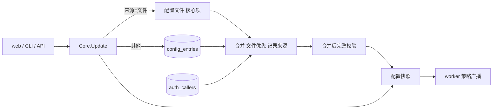

<!-- template_id: design; template_version: 1.2.0 -->
# 配置入库与最小配置文件设计

> 状态：Draft 0.10 / 已批准（用户 2026-11-03：“配置接受 0.10，先做 P1”，含 0.10 未复核修订；批准设计不等于授权实施）
> issue：gofer-nhh7

## 修订记录

| 版本 | 日期 | 作者 | 摘要 |
|---|---|---|---|
| 0.1 | 2026-11-03 | Claude（gofer 监督会话） | 初稿 |
| 0.2 | 2026-11-03 | Claude（gofer 监督会话） | 按用户决定：`event_hooks`、`decision_hooks`、`triggers` 入库并有 web 入口，专用高危权限与审计；env、proxy_url 入库打码；手动迁移 |
| 0.3 | 2026-11-03 | Claude（gofer 监督会话） | 按第一轮审核修订（8 阻塞、17 重要）：根只由文件判定；用户物化进配置快照；按条目来源写入；校验拆两段；坏条目进安全模式；迁移放 server；存 YAML；独立审计表；扩大高危字段范围；新用户须明确上限 |
| 0.4 | 2026-11-03 | Claude（gofer 监督会话） | 按第二轮审核修订（3 阻塞、9 重要）：文件模式与存储模式；坏条目改为拒绝启动加离线修复；存储标记带 id；需重启字段单独暂存；写入事务；停用用户语义 |
| 0.5 | 2026-11-03 | Claude（gofer 监督会话） | 按 0.4 改动项复核修订（4 阻塞、4 纠正）：未绑定标记解决新装建库；升级预检用只读开库；写入先写齐临时文件再 rename；停用在准入公共点判断；离线修复去掉 `entry disable`、补用户修复；P1 见到标记拒绝启动 |
| 0.6 | 2026-11-03 | Claude（gofer 监督会话） | 按确认轮修订（2 阻塞、5 纠正）：去掉未绑定状态，由 `init` 建库；判空不改用用户数；明确最严上限，补 `auth caller enable`；取到槽位后重判停用；更正崩溃窗口的说法 |
| 0.7 | 2026-11-03 | Claude（gofer 监督会话） | 按确认轮修订（1 阻塞、2 纠正）：重建空库用专门的离线命令，不复用 `init --force`；`init` 建库列为例外并要求 server 未运行；停用重判落在目录锁之后 |
| 0.8 | 2026-11-03 | Claude（gofer 监督会话） | 按确认轮修订（1 阻塞、2 纠正）：`init server` 以目标库为准判断，不靠 pid 文件；例外范围限定为用户和配置的写入；停用拒绝不进重试 |
| 0.9 | 2026-11-03 | Claude（gofer 监督会话） | 按确认轮修订（1 阻塞）：`init server` 遇到已绑定且有数据的库时拒绝，不写文件 |
| 0.10 | 2026-11-03 | Claude（gofer 监督会话） | 未复核修订，关闭第 8 轮阻塞项：现有文件带标记时 `init` 一律拒绝；目标库按现有文件解析；探测失败拒绝且不写文件；空库无 id 按库不存在处理 |

> 仅语义变化递增版本；纯 identity/provenance/元数据纠正沿用原版本，并在 Git/进度记录中留痕。

思考模式：RIGOROUS。核心目标：配置文件只留启动必需项，其余在 web / CLI 改、不用碰文件。Scope freeze：只做下文“范围”所列。Review budget：两轮独立审核已完成并吸收；0.4 只复核改动项。停止条件：待确认项由用户定下、审核无阻塞项。

## 背景与目标

用户要求（2026-11-03）：“扫一遍配置，把可以提的都往 db 里提，配置文件只留核心必要的配置，减少上手难度。”用户身份暂定继续用 token。

现在的问题：
- 新增用户要改 `server.callers` 并重启。
- 新手面对的是一份 941 行说明的配置参考。
- 有些设置 API 能写，web 上却没入口（`agents.*.can_submit`、`roles`），只能改文件。

用户可见结果：
- 新装只需写地址和 token 就能启动，其余在 web 上配。
- 新增用户、发 token、改权限和上限，都不用改文件，不用重启。
- 已有部署的文件继续有效，想迁时执行一条命令。

## 名词

- caller（用户）：一个 token 对应的身份。
- 根管理员：配置文件里的身份，权限最高，不依赖 DB。
- 核心配置：DB 打开之前就要用到的，或用来兜底恢复的配置。
- 条目：配置的归属单位。map 类按键算（`agents.<key>`、`projects.<key>`），其余按字段路径算（`server.retry`）。
- 文件优先：同一条目两边都有时，用文件的值。

## 范围与非目标

范围：
1. 用户入库：web / CLI 新增、发 token、轮换、停用、改上限。
2. 配置入库：通用存储，复用现有写入事务和字段策略表。
3. 迁移与备份：`config migrate`、`config export`。
4. 最小配置：`gofer init` 只生成核心配置。
5. 补 web 入口：`can_submit` / `submit_agents`、roles，以及迁移后没有入口的字段。

非目标：
- 密码登录、多人账号（用户已定：暂用 token）。
- worker 自身的 `worker.yaml`：它是 worker 连上 server 之前就要用的。
- 改变权限模型（`auth_grants` 不动）。
- 配置的多版本回滚 UI（本次只记审计，能导出）。

## 已确认事实与规范

| 事实 | 证据 |
|---|---|
| 授权已入库，web 可管、即时生效 | `auth_grants`；`/v1/auth/grants` |
| 用户在文件里，改了要重启；token 明文比对 | `editable.go` `server.callers`；`httpapi/auth.go` `lookupCallerIn` |
| job token 已按 sha256 哈希存储，有先例 | `jobstore` `job_tokens.token_hash` |
| ceiling 按当时决定只写文件 | `editable.go` 注释 |
| 所有配置写入走同一事务 `Core.Update → saveConfig → reloadLocked`，已有串行锁、失败不生效、向 worker 广播 | `core/core.go` |
| 字段策略表已区分可写、需重启、可热载，且被写接口和 `GET /v1/config` 共用 | `config/editable.go` |
| roles 只有读取视图，没有写接口；`can_submit` 有写接口，web 没字段 | `httpapi/config_handler.go`、`config_write_handler.go`、`web/src` |
| 已有 DB 设置表，但只放措辞、阈值、列表 | `internal/settings` |
| 根管理员判定依赖 `len(Callers)==0`，用户集合一变就可能翻转 | `config/model.go` `HasRootAdmin` |
| ceiling、配额、trigger 所有者都只读 `cfg.Server.Callers`；查不到 ceiling 等于无上限 | `config/ceiling.go`、`httpapi/authz_ceiling.go`、`job/ceiling.go` |
| 用户集合缩小时授权被标孤儿，id 回来也不恢复 | `httpapi/authz_resolve.go` |
| `require_admin_capability` 未开时，`config.write` 默认发给所有用户 | `authz/derive.go` |
| 校验在 `loadFile` 内、开 DB 之前；`core.Build` 在开 DB 前就用了 agents、projects、runners | `config/loader.go`、`core/core.go` |
| 开库失败进程退出；库文件缺失时静默建空库 | `core/core.go`、`jobstore/store.go` |
| `token_env` 的值只在 server 进程环境里 | `httpapi/server.go`、`serve/serve.go` |
| 多数配置结构只有 yaml tag，`ArgList`、`extends` 依赖 YAML 语义 | `config/model.go`、`config/extends.go` |
| `Clone` 共享 `Roles`、`Runners`、`Leader`、`Schedule` | `config/model.go` |
| 非 serve 路径约 25 处直接 `config.Load`，迁移后多数会静默答错（如 cwd 匹配不到项目，job 落到 `default`） | `commands/*.go`，清单见第一轮审核 |

**与既有决定的冲突（SR1413）：**
- 2026-10-20 设计划的界是“影响启动、安全边界、连通性、权限的留文件”，非目标里写了不把 config.yaml 的项搬进数据库。本设计经用户要求改变这条界：只有“启动、兜底、密钥来源”留文件。批准后要在那份设计里加指向本稿的说明。
- 2026-10-14 权限设计把“web 新建调用方”列为暂不做；`server.callers.*.ceiling` 定为只写文件。本设计取代这两条，用户已同意 ceiling 入库。

规范：G021–G024 分层；G056 路由登记；SR1301 安全；SR1402.1 真实验证；GR107–GR110。

## 总体方案

配置 = 文件 + DB 叠加。文件只负责启动和兜底，日常设置在 DB。

**字段归属（全量）：**

| 去向 | 字段 |
|---|---|
| 留文件：启动必需 | `server.addr`、`server.tls`、`server.token` / `token_env`、`server.allow_empty_token`、`server.web_enabled`、`server.web_dir`、`server.path_view`、`storage`、`log`、`include` |
| 留文件：密钥来源 | `secrets`（只存“去哪读”，且由执行机解析）、`server.metrics.token` |
| 留文件：根管理员 | `server.callers` 中 `can_admin` 的项，以及 `server.token` |
| 进用户表 | `server.callers`（根管理员除外）及其 ceiling、限流、并发 |
| 进 DB：可热载 | `agents`、`roles`、`projects`、`runners`（`worker` 类型）、`leader`、`wakeup`、`session`、`work`、`steward`、`memory`、`mail`、`tools`、`pricing`、`server.notification`、`inbox`、`retry`、`skills`、`mcp`、`skill_limits`、`rules`、`rules_max_bytes`、`runner_probe`（`interval_seconds` 除外，探测周期启动时固定，单列为需重启）、`comment_trigger`、`dir_lock*`、`agent_health`、`job_env_denylist`、`tunnel`、`language`、`read_dir_allow`、`max_job_timeout_sec`、`auto_resume_max`、`stall_timeout_sec`、`worker_enrollment`（除 `trusted_proxies`）、`hold`、`attachments`、`workers`（token 改存哈希，P3） |
| 进 DB：高危，专用权限 `config.exec.write` | `server.event_hooks`、`server.decision_hooks`、`server.triggers`、`server.update`、`mcp_servers`、`http_proxy`、`server.worker_enrollment.trusted_proxies` |
| 进 DB：改了要重启 | `schedule`、`pty`、`runners`（`peer-http`）、`server.session_messaging`、`governance`、`metrics`、`web_base_url`、`job_recover_window_sec`、`policy_repush`、`agent_fallback`、`push`、`xfer`、`preview`、`delivery_check`、`background_agents`、`worker_queue_max_wait_sec`。入库不要求热载：启动时读 DB，界面标“需重启” |

判断依据：DB 打开前要用的不能进；坏了要靠它恢复的不进；其余都进。`agents.*.command` 这类已经能经 API 写，进 DB 不扩大暴露面；原本只写文件的项按高危处理，因为入库后普通 `config.write` 不该能碰。

hooks 和 triggers 原定只写文件，用户决定入库，理由是：有权限的人改文件也一样能配，走 API 还多一条审计记录。

**两种模式，由标记决定：**

| | 文件模式（无标记） | 存储模式（有标记） |
|---|---|---|
| 谁在用 | 已有部署升级后，未执行迁移 | 新装（`gofer init`）、已执行 `config migrate` |
| 配置读写 | 和今天完全一样，新条目也写文件 | 文件里没有的条目读写 DB |
| 用户 | 文件用户 + DB 用户（用户表两种模式都可用，这是 P1 的价值） | 同左 |
| 高危字段 | web 只读（今天就是只写文件） | 经 `config.exec.write` 写 DB |

**优先级：文件优先。** 存储模式下，条目文件里有就用文件的值，写入也写文件，界面标“来自文件”。文件和 DB 都有时，界面标“被文件遮蔽”，并提供清理 DB 值的入口，否则从文件删掉后旧值会复活。

文件来源的用户：`rotate`、`disable` 拒绝并提示迁移（轮换会把明文写进文件，`token_env` 也轮换不了）；`set-ceiling` 写文件。

**新旧部署：**
- 新装：`gofer init server` 建库并写入 `config_store_id`，再原子写核心配置和标记 `config_store: {id: <uuid>}`，其余默认值 + DB。这样没有“未绑定”状态，serve 也不用回写文件（文件和 DB 无法同时提交，回写会出现崩溃后永久起不来）。崩溃在两步之间时，重跑 init 复用库里已有的 id；库里已有其他数据时的处理见“代码组织”。
- 已有部署：不自动迁移，升级后一切照旧；想迁就执行 `gofer config migrate`。

## 架构

代码组织：
- `internal/jobstore`：`config_entries(path PK, value_yaml, generation, updated_by, updated_at)`；`auth_callers(id PK, name, token_hash, token_hint, limits_json, ceiling_yaml, disabled_at, created_by, created_at, rotated_at)`，`token_hash` 是十六进制 sha256；`config_audit(id, actor, path, before_masked, after_masked, at)`，与写入同事务，有保留期。均为增量加表（G057），发版后补 `schema-v*.sql`。
- 值存 YAML 文本，走现有解码、严格校验和已移除键检查。`encoding/json` 会改键名、丢 `ArgList` 的 `[]` 语义和 `extends` 差异。
- `internal/config`：`validate` 加 `refs` 开关，只跳过跨条目引用类检查（fallback、leader、memory、mcp、triggers、能力位），CLI 路径关闭，合并后打开；`extends` 引用缺失推迟到合并后判断；能调 `agent.ValidateConfig` 的完整校验放编排层。`config validate` 优先调 server，server 不在时只读开库合并校验。`ApplyEntries` 放在 `loadFile` 之后，再跑一次 `ApplyDefaults`，否则会污染 `authored`。来源标记用未导出字段加访问器（与 `injectedAgents` 同款），条目来源 map 放 `Config` 并在 `Clone` 复制。新增 `ApplyEntries`（叠加，记录来源）和 `SplitForStore`（走 `authored` 投影，默认值、overlay、注入项不入库）。字段策略表拆成“归属”和“生效时机”两列，覆盖全部顶层节，用反射测试守护，并加 secret 标记。`Clone` 先对所有入库字段做深拷贝，加 race 测试。config 不依赖 jobstore（G021–G024）。
- `internal/serve`、`internal/core`：`serve.Start` 开头先开库、合并，再 `core.WithStore` 注入；叠加是显式选项，worker 不启用，standalone mcp 走合并。`saveConfig` 只写本次 diff 出的条目，并按来源分流：开 DB 事务写入和审计，文件先写齐所有临时文件（复制原权限，符号链接写到其目标），保留旧字节，全部 rename 后才提交事务；任一步失败，已 rename 的用旧字节恢复，事务回滚。include 拆分时 `saveSplit` 同样整批处理。进程在 rename 和提交之间崩溃的窗口不覆盖：新文件和旧 DB 各自合法时不会被发现，也没有审计行。这个窗口接受，不加写入意图记录。`reloadFromPathLocked` 也走同样的合并。写文件用新的 `fileProjection()`（按来源过滤），`CanonicalConfig` 保留全部；有 DB 用户时 Save 不改变文件字节。`server.callers` 改标热载。
- 需重启的字段：不走 `Core.Update`（它存和发布的是同一个对象，保留旧值会让下一次写入改回去）。新增 `StagePending`：持 `updateMu` 只写 DB、不发布；reload 合并时这批路径用进程启动时的值；界面对比 DB 值和启动值，显示“重启后生效”。来源是文件的继续拒绝 web 写入。`server.governance` 现在实际写入即生效，归入这一类后要一并修正。
- `internal/httpapi`：
  - 用户物化进 `cfg.Server.Callers`（带来源标记），ceiling、限流、授权声明不用改。要改的读取方：`TokenSet` 增加哈希判断；`callerCeilingWarnings` 改在合并后生成，`caller add` 也返回；并发上限信号量按 callerID 缓存、容量固定，取用时比较容量，否则改上限要重启。
  - `callerEntry` 增加哈希字段，比较保持恒定时间。长连接指纹改由哈希推出（等于 `token_hash[:16]`），否则 DB 用户会在巡检时被断开。所有 DB 用户都停用后也不能算“没有用户”，否则 `allow_empty_token` 部署会回到匿名。判空改为“`callerEntries` 为空且停用用户数为 0”，不能换成用户数：今天 `callerEntries` 还含 worker 条目和旧版 `server.token`，只数用户会放开匿名。`authMiddleware`、`tunnelAuth`、`liveCallerIdentity`、`UserCallerIDs`（回落到 `default` 的分支）四处共用这个判断。`UserCallerIDs` 和 `sessionCallerKnown` 不含停用用户（不能把新东西归给它）。
  - 根判定只看文件：`HasRootAdmin` 只数文件来源的用户。
  - 读 `auth_callers` 失败时整次 reload 失败、保留旧快照，绝不当作空集；孤儿扫描只在拿到完整用户集时运行。
  - 新路由登记 `routeDecls`（G056）：`/v1/callers*`（根）、roles、`/v1/config/exec/*`（`config.exec.write`）。高危字段不进通用 `PUT /v1/config/server` 词表，预览和校验接口也不接收。
- `internal/commands`：`gofer auth caller add|ls|rotate|disable|enable|set-ceiling`（G033，放在已有的 `auth` 下）；`config migrate`、`config export` 都是瘦客户端，经 server 执行。用户和配置的写入，“CLI 不直接写库”只有两个例外。`init server` 建库：目标文件已存在且带标记时一律拒绝（含 `--force`），指向 `config store rebuild --offline`。否则只读探测目标库（目标文件已存在时按它解析库路径），探测失败（损坏、被锁、不可读）拒绝且不写文件；库不存在或是没有 id 的空库才建；已存在且只含 `config_store_id` 时复用；已有其他数据时不跑 `Open`、不碰库：库里没有 `config_store_id`（旧库）就只写不带标记的文件模式配置并提示；库里有 id 就拒绝且不写文件，`--force` 也一样，否则标记被抹掉后 server 走文件模式，DB 里的 `governance`、`decision_hooks` 全部失效。不能只靠 pid 文件判断：pid 路径跟 `-c` 走，库路径不跟，查错位置时会让新 CLI 迁移线上库。另一个是离线修复：`config doctor --offline`、`config entry rm <path> --offline`（先打印旧值）、`auth caller repair <id> --offline`（用户行字段损坏时：停用该用户，坏的 `ceiling_yaml` 改成最严上限（空列表表示不限，不能用零值：`projects`、`runners`、`workers`、`agents` 都放一个保留的不匹配 glob，`read_only: true`，`allow_exec`、`global_memory` 为 false），坏的 `limits_json` 清空，不删行）、`config store rebuild --offline`、`config export --offline`，用 pid 文件确认 server 未运行，写 `config_audit`，actor 记 `offline:<用户>`。
- 非 serve 的 `config.Load` 调用：必须叠加的（`serve.go:256`、`core.go:701`、`mcp.go:135`）走合并；会静默答错的（`job.go:1987`、`hook.go`、`repo.go`、`project.go`、`agent*.go` 等）改为经 server 读，读不到就明确报错。`gofer project add` 改走 API。计划阶段列全并逐项改，这是工作量最大的部分。
- `internal/settings` 保留：放提示词、阈值这类有注册表的值；`config_entries` 放配置结构。修改其包注释，写清边界。
- web：用户管理；agent 表单补 `can_submit`；roles 编辑；高危配置页；所有字段显示来源。打码字段 PUT 时能保留原值。

## 关键流程

新增用户：
1. 根管理员 `gofer auth caller add ci --ceiling-project p1`（或 `--no-ceiling` 明确不设），或在 web 上操作。未开 `require_admin_capability` 时，无上限的新用户能写 `agents.*.command`，界面和 CLI 都要提示。
2. server 生成带固定前缀的 token，只显示这一次，DB 存哈希。
3. 即时可用；权限照旧用 grants 发。
4. 轮换或停用时断开长连接（复用 `authz_live_conn`），记审计。

用户生命周期：不做硬删除，id 永不复用。停用的用户留在快照里（ceiling 继续约束它在跑的 job），但不能认证；`effective` 对它返回空权限；它名下的 job 不再起，判断放在 `admitCeiling`，且在“没有 ceiling 就跳过”之前，否则无上限的用户会漏判。这样 trigger、schedule、retry、计划派发、leader 轮次、@ 触发、续跑、接管、放行 hold 都覆盖。两个缺口单独补：取到所有并发槽位和目录锁之后、开始执行之前重判停用，拒绝时 `finish(StatusFailed)`，并用结构化标记跳过 `maybeRetryJob`（`finish` 只留错误字符串，包装错误判断不了；否则停用前已排队的 job 之后仍会启动）；已转发到 worker 本地队列的 job 重判不到，这个残留接受；`inheritCeilingOwner` 也判停用（源 job 已清理时它可能返回空 owner，job 变成无主）。拒绝用 `ErrCeilingDenied`（永久，不重试）。系统 job 没有 owner，不受影响；带 owner 的内部 exec 里，只放行交付收尾类（具体清单在计划里列）。`default` 等 id 保留。文件后来新增同 id 时，DB 条目整体隐藏（含 token），合并后校验报告。

鉴权：保持现有匹配优先级，DB 用户排在文件用户之后。

迁移（server 侧事务，持 `updateMu`，根权限）：
1. `gofer config migrate --dry-run`：列出每项去向、每个文件的结果、会丢的注释、重复 token、弱 token，高危项单独列。
2. 前置检查，不满足就拒绝：
   - 迁移前有根管理员（否则要求操作者明确指定）。
   - 打开了 `require_*_capability` 的旧能力位已转成 `caller:<id>` 授权。
3. 用户的哈希在 server 进程内计算，因此 `token_env` 能取到值；取不到的留在文件。提示：迁移后改环境变量不再能轮换 token。
4. 同一事务写 DB 条目和 `config_store_id`（uuid），核对后改写文件，并写入标记 `config_store: {id: <uuid>}`。崩溃在两步之间时文件没有标记，仍是文件模式，重跑 migrate 覆盖这批条目。备份文件权限收紧，含明文 token，提示用户保管或销毁。
5. 对比前后有效配置（排除 token，单独核对身份集合、能力位、ceiling），不一致就回滚。

启动：
- 有标记时，开库之前先 stat 库文件（`Open` 会静默建空库）；开库后比对 `config_store_id`。库丢失或路径写错都拒绝启动，不以空配置运行。挂载空数据卷也算库丢失，确认是新卷时用 `gofer config store rebuild --offline`：按现有文件算出库路径，建库换新 id，只改标记，其余字节不动；文件无标记或库里已有数据就拒绝。不能用 `init --force`，它用模板覆盖整个文件，`storage`、`tls`、根管理员都会丢。
- 开库失败：进程退出（现状）。
- DB 条目非法（写入时已校验，通常来自版本变化或手动改库）：退出非零，打印坏条目路径，用 `config doctor --offline`、`config entry rm --offline`、`auth caller repair --offline` 修复。不做在线安全模式，也不跳过坏条目：跳过 `governance`、`job_env_denylist`、`decision_hooks` 等于放开限制。worker 断线会一直重连，所以 server 短暂起不来不影响 worker。
- 受管升级：候选二进制先做一次合并校验，在旧 server 还活着时拦下坏配置。现有 `Open` 必跑迁移，这时跑会改线上库，所以新增只读开库（不迁移）。预检查询只用 `config_entries(path, value_yaml)` 和 `auth_callers` 首版就有的列，后续版本加列不影响；缺表时无标记按空集，有标记报错。配置路径由 `spec.ConfigFile`、`spec.ConfigDir` 算出。

## 安全、数据、运维与回滚

- 权限：用户管理只限根管理员；上限只能由根管理员改。
- 高危字段：持有者能在 server 上执行命令或换二进制来源。专用权限 `config.exec.write`（风险“危险”），默认只有根管理员有，要显式授予，通配符不匹配，不能授给会话。每次改动进 `config_audit`：谁、何时、哪一项、打码后的前后值。读视图 env 只显示键。
- 剩余风险：能写 DB 文件或拿到该权限的人可以在 server 上执行命令；hook 执行本身不经过 job 审计；未开 `require_admin_capability` 时，普通用户的 `config.write` 仍能改 `agents.*.command`（现状如此，本设计不改权限模型）。
- 明文：DB 不存用户 token；worker token P3 改哈希。其余 secret 字段（`agents.*.env`、`roles.env`、hook env、MCP env 与 headers、`proxy_url`、webhook URL）入库，由字段策略表的 secret 标记统一打码，读接口和导出都打码，只有根管理员加 `--include-secrets` 才能看原值。`agents.*.env` 现在不可写，补写接口。
- token 强度：无盐 sha256 适合系统生成的随机 token；迁移时检查人工设的弱 token，提示轮换。
- 恢复：DB 条目坏了或库打不开时 server 都起不来，靠离线命令和恢复备份，需要能登录主机。不承诺在线恢复。
- 备份：配置进 DB 后，备份 DB 就等于备份配置；用 SQLite 一致性备份，不要直接拷文件（WAL）。发版说明要提示。
- 损失：DB 里的配置不能用 git 管、不能直接 diff，靠审计和 export 补；要版本管理的条目可以留在文件。
- 版本回退：旧版本解码不严格，读到迁移后的文件不会报错，会以“只有核心项”静默启动，hooks、`governance` 全部消失，DB 用户的授权被标孤儿（读代码所得，未实跑）。所以回退必须先用迁移前备份恢复文件；回退目标不低于首个支持标记的版本（P1）：P1 不懂合并，见到标记就拒绝启动，提示恢复备份或升级。迁移后新建的 DB 用户只有哈希，回退后要重新发 token。未迁移部署只有 DB 用户受影响。计划里要做真实回退测试。
- 跨进程：用户和配置的写入都只经 server，CLI 不直接写库（`init server` 和离线修复除外），撤销即时生效。

## 决策

- 复用 `Core.Update` 和字段策略表，不另建配置系统：已有串行、失败回退、广播。
- 文件优先：升级零影响，且有救援通道。
- 用户单独建表，不放通用条目：哈希查找和停用都是身份语义。`token_hash` 不设唯一约束：今天同 token 配置是合法的，迁移前报告重复。
- 坏条目拒绝启动，不跳过，也不做在线安全模式：跳过安全类条目等于放开。安全模式要给启动流程约 28 个副作用加门（估算），受管升级还会把它判成成功而不回滚，修好后仍要重启；收益不抵代价。
- 无标记即文件模式：否则未迁移部署也会变成混合存储，丢库或回退时丢数据。
- 整条目归属，不做字段级合并：同一个 agent 一部分在文件、一部分在 DB 很难看懂。
- 旧配置不自动迁移，由用户执行 `config migrate`（用户已批准）：自动迁移一旦判断错，升级时文件就被改了。
- 迁移放 server 侧：CLI 改文件时，运行中的 server 可能把配置写回文件。
- 分阶段：P1 用户入库（价值最大，独立可发），含“见到标记拒绝启动”；P2 存储、迁移、最小 init、补 web 入口；P3 把“进 DB：改了要重启”这批和 hooks、triggers 搬完并清理文档。

## 待确认事项

待用户决定：第 8 轮审核仍有阻塞项（`init server` 的 `--force` 能抹掉存储标记、探测失败没有分支），已到审核上限（`REVIEW_LIMIT_REACHED`）。0.10 修了这几处但未复核。用户可以按 0.9 批准、点名接受 0.10 的未复核修订后批准，或重置范围。

第二轮审核新增的三项，用户已于 2026-11-03 按建议确认：

1. 高危权限范围扩大：除 hooks、triggers 外，`update`、`mcp_servers`、`http_proxy`、`worker_enrollment.trusted_proxies` 也归 `config.exec.write`。
2. 新增用户必须明确上限：`caller add` 要带 `--ceiling-*` 或 `--no-ceiling`；不改 `require_admin_capability` 的默认值。
3. DB 里有非法条目时拒绝启动，提供离线修复命令，不做安全模式。

## 结论与人工计划 Gate

0.4 改动项复核无阻塞后写实施计划，计划另需批准；批准设计不等于授权实施。

验收：
- 新装：只写核心配置启动，web 上完成新增用户、发 token、开 `can_submit`，全程不改文件、不重启。
- 已有部署：升级后不迁移，有效配置与升级前逐项一致。
- 迁移：前后有效配置一致；文件只剩核心项；回退按文档能恢复；迁移期间控制台写入不会写回文件。
- 启动：新装 init 后首次 serve 能起来；库丢失或路径写错时拒绝启动；坏条目和损坏的用户行拒绝启动并能离线修好；DB 用户读失败时授权不被标孤儿。
- 写入：跨 DB 和文件的写入失败时两边都不生效（含 include 拆分，进程崩溃窗口除外），文件权限不变；需重启字段重启后才生效，其间其他写入不会把它改回去。
- 停用：停用后 trigger、schedule、计划派发、leader 轮次不再起 job；改并发上限不用重启。
- 安全：DB 和日志里查不到用户 token；普通用户调用用户管理接口被拒；停用后长连接断开；无专用权限的调用方改高危字段被拒，且不能经通用接口绕过；改动在审计里可查且不含密钥；DB 用户的 ceiling、配额生效，长连接不被误断。

## 实施记录（P1）

> 本节按计划 T1–T9 的实际交付写；T10 的真实环境验收与发版另记。

已落地（实现位置）：

- 存储（T1）：`auth_callers`（token 只存 sha256 + `token_hint`）与 `config_audit` 两张表，`init()` 追加 schema；`OpenExistingForRepair` 只打开已存在的库；`RepairCaller` 只把行改得更严。
- 合并（T2/T3）：`ApplyStoredCallers` 把入库用户追加进配置快照并带来源标记；`HasRootAdmin` 只数文件来源；`fileProjection` 让配置写回不落入库用户；接管（见 D10）与写入事务在 `internal/core/callers.go`。
- 鉴权与停用（T4/T5）：`callerEntry` 加哈希，判空改为「无条目且无停用用户」；停用在准入公共点判断，排队 job 拿到槽位后重新判定、失败不重试。
- 接口与命令（T6/T7）：`/v1/callers*`（全部 `auth.manage` + `grantAdminOnly`）；`gofer auth caller add|ls|rotate|disable|enable|set-ceiling|set-limits|audit` 与离线修复 `repair --offline`。
- 控制台（T8）：`web/src/views/settings/Callers.vue`（设置 → 用户，只对根管理员显示）、`web/src/api/callers.ts`、`web/src/utils/callers.ts`；配置页的用户表补来源与状态。
- 文档（T9）：`skills/gofer-usage/references/{server-config,web-console,commands}.md`、`docs/reference/http-api.md`、`docs/capabilities.md`、`docs/guide/en/security.md`、`config/gofer.example.yaml`、`CHANGELOG.md`。

对设计说法的收窄（实现比设计稿更窄的地方，以本节为准）：

- **D1（trigger owner）**：P1 里 trigger 的 owner 只能是配置文件里的用户；错误文案写明原因。P2 用 `refs` 开关解除。
- **D3（工作流重试）**：设计说「停用用户的 job 跳过重试」，但工作流 job 不走 `maybeRetryJob`。P1 不为它加逻辑：下一步 `Submit` 被准入拒绝，工作流失败；会多跑一轮退避，但能终止。
- **D10（文件接管入库行）**：入库行被同 id 的文件用户接管时**不拒绝启动**，而是标 `superseded_at` + 停用、`caller:<id>` 授权标孤儿、写审计（`system:file-takeover`），与合并同一步做；启用被接管的行要求先轮换（`rotated_at` 晚于 `superseded_at`），时间戳写入时保证先后；与 worker 同 id 的 id 进快照的「封锁 owner」集合，准入按停用拒绝。被文件用户接管期间，该 id 名下的 schedule 按文件用户的上限运行。
- **D18（回退）**：回退到不认识入库用户的版本时，这些用户名下的自动化（schedule、计划派发、排队 job）仍会照跑，但**不再受上限约束**（旧版本查不到用户，上限判定直接跳过，已发布的旧版改不了）。发版说明要求：回退前先取消它们名下的 schedule、计划与排队 job。回退后这些用户的 token 401、授权被标孤儿，重新升级后用 `activate` 恢复。「回退目标不低于首个支持标记的版本」从 P2 起才适用。

