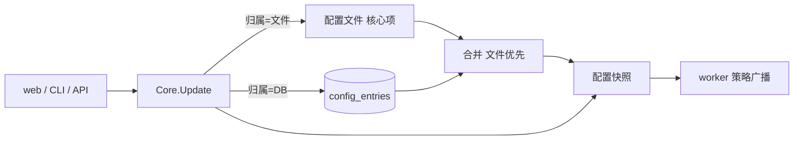

<!-- template_id: design; template_version: 1.2.0 -->
# 配置入库与最小配置文件设计

> 状态：Draft 0.2 / 已批准（用户 2026-11-03：hooks 与 triggers 也入库，“其他配置入库按建议批准”），待独立审核后写计划
> issue：gofer-nhh7

## 修订记录

| 版本 | 日期 | 作者 | 摘要 |
|---|---|---|---|
| 0.1 | 2026-11-03 | Claude（gofer 监督会话） | 初稿 |
| 0.2 | 2026-11-03 | Claude（gofer 监督会话） | 按用户决定：`event_hooks`、`decision_hooks`、`triggers` 入库并有 web 入口，专用高危权限与审计；env、proxy_url 入库打码；手动迁移 |

> 仅语义变化递增版本；纯 identity/provenance/元数据纠正沿用原版本，并在 Git/进度记录中留痕。

思考模式：RIGOROUS。核心目标：配置文件只留启动必需项，其余在 web / CLI 改、不用碰文件。Scope freeze：只做下文“范围”所列。Review budget：两轮独立审核（涉及鉴权）。停止条件：待确认项由用户定下、审核无阻塞项。

## 背景与目标

用户要求（2026-11-03）：“扫一遍配置，把可以提的都往 db 里提，配置文件只留核心必要的配置，减少上手难度。”用户身份暂定继续用 token。

现在的问题：
- 新增用户要改 `server.callers` 并重启。
- 新手面对的是一份 941 行说明的配置参考。
- 有些设置 API 能写，web 上却没入口（`agents.*.can_submit`、`roles`），只能改文件。

用户可见结果：
- 新装只需写地址和 token 就能启动，其余在 web 上配。
- 新增用户、发 token、改权限和上限，都不用改文件，不用重启。
- 已有部署的文件继续有效，想迁时执行一条命令。

## 名词

- caller（用户）：一个 token 对应的身份。
- 根管理员：配置文件里的身份，权限最高，不依赖 DB。
- 核心配置：DB 打开之前就要用到的，或用来兜底恢复的配置。
- 条目：配置的归属单位。map 类按键算（`agents.<key>`、`projects.<key>`），其余按字段路径算（`server.retry`）。
- 文件优先：同一条目两边都有时，用文件的值。

## 范围与非目标

范围：
1. 用户入库：web / CLI 新增、发 token、轮换、停用、改上限。
2. 配置入库：通用存储，复用现有写入事务和字段策略表。
3. 迁移与备份：`config migrate`、`config export`。
4. 最小配置：`gofer init` 只生成核心配置。
5. 补 web 入口：`can_submit` / `submit_agents`、roles，以及迁移后没有入口的字段。

非目标：
- 密码登录、多人账号（用户已定：暂用 token）。
- worker 自身的 `worker.yaml`：它是 worker 连上 server 之前就要用的。
- 改变权限模型（`auth_grants` 不动）。
- 配置的多版本回滚 UI（本次只记审计，能导出）。

## 已确认事实与规范

| 事实 | 证据 |
|---|---|
| 授权已入库，web 可管、即时生效 | `auth_grants`；`/v1/auth/grants` |
| 用户在文件里，改了要重启；token 明文比对 | `editable.go` `server.callers`；`httpapi/auth.go` `lookupCallerIn` |
| job token 已按 sha256 哈希存储，有先例 | `jobstore` `job_tokens.token_hash` |
| ceiling 按当时决定只写文件 | `editable.go` 注释 |
| 所有配置写入走同一事务 `Core.Update → saveConfig → reloadLocked`，已有串行锁、失败不生效、向 worker 广播 | `core/core.go` |
| 字段策略表已区分可写、需重启、可热载，且被写接口和 `GET /v1/config` 共用 | `config/editable.go` |
| roles 只有读取视图，没有写接口；`can_submit` 有写接口，web 没字段 | `httpapi/config_handler.go`、`config_write_handler.go`、`web/src` |
| 已有 DB 设置表，但只放措辞、阈值、列表 | `internal/settings` |

**与既有决定的冲突（SR1413）：**
- 2026-10-20 设计划的界是“影响启动、安全边界、连通性、权限的留文件”，非目标里写了不把 config.yaml 的项搬进数据库。本设计经用户要求改变这条界：只有“启动、兜底、密钥来源”留文件。批准后要在那份设计里加指向本稿的说明。
- 2026-10-14 权限设计把“web 新建调用方”列为暂不做；`server.callers.*.ceiling` 定为只写文件。本设计取代这两条，用户已同意 ceiling 入库。

规范：G021–G024 分层；G056 路由登记；SR1301 安全；SR1402.1 真实验证；GR107–GR110。

## 总体方案

配置 = 文件 + DB 叠加。文件只负责启动和兜底，日常设置在 DB。

**字段归属（全量）：**

| 去向 | 字段 |
|---|---|
| 留文件：启动必需 | `server.addr`、`server.tls`、`server.token` / `token_env`、`server.allow_empty_token`、`server.web_enabled`、`server.web_dir`、`server.path_view`、`storage`、`log`、`include` |
| 留文件：密钥来源 | `secrets`（只存“去哪读”，且由执行机解析） |
| 进用户表 | `server.callers`（根管理员除外）及其 ceiling、限流、并发 |
| 进 DB：可热载 | `agents`、`roles`、`projects`、`runners`、`leader`、`schedule`、`wakeup`、`session`、`work`、`steward`、`memory`、`pty`、`mail`、`tools`、`mcp_servers`、`pricing`、`http_proxy`、`server.notification`、`inbox`、`retry`、`skills`、`mcp`、`skill_limits`、`rules`、`rules_max_bytes`、`runner_probe`、`comment_trigger`、`dir_lock*`、`agent_health`、`job_env_denylist`、`tunnel`、`language`、`read_dir_allow`、`max_job_timeout_sec`、`auto_resume_max`、`stall_timeout_sec`、`worker_enrollment`、`hold`、`attachments`、`update`、`workers` |
| 进 DB：能执行命令或提交 job，专用权限 | `server.event_hooks`、`server.decision_hooks`、`server.triggers` |
| 进 DB：改了要重启 | `server.session_messaging`、`governance`、`metrics`、`web_base_url`、`job_recover_window_sec`、`policy_repush`、`agent_fallback`、`push`、`xfer`、`preview`、`delivery_check`、`background_agents`、`worker_queue_max_wait_sec`。入库不要求热载：启动时读 DB，界面标“需重启” |

判断依据：DB 打开前要用的不能进；坏了要靠它恢复的不进；其余都进。`agents.*.command` 这类已经能经 API 写，进 DB 不扩大暴露面。

hooks 和 triggers 原定只写文件，用户决定入库，理由是：有权限的人改文件也一样能配，走 API 还多一条审计记录。

**优先级：文件优先。** 同一条目文件里有，就用文件的值，界面只读并标“来自文件”。这样已有部署升级后行为完全不变，DB 出问题时写进文件也能救回来。

**新旧部署：**
- 新装：`gofer init` 只写核心配置，其余默认值 + DB。
- 已有部署：不自动迁移，升级后一切照旧；想迁就执行 `gofer config migrate`。

## 架构

代码组织：
- `internal/jobstore`：新增表和读写。`config_entries(path PK, value_json, updated_by, updated_at)`；`auth_callers(id PK, name, token_hash UNIQUE, token_hint, limits_json, ceiling_json, disabled_at, created_by, created_at, rotated_at)`。
- `internal/config`：纯函数 `ApplyEntries(cfg, entries)`（叠加）与 `SplitForStore(cfg)`（拆出 DB 条目）；`fieldPolicies` 增加“归属”列，作为唯一来源。config 不依赖 jobstore（G021–G024）。
- `internal/core`：`saveConfig` 改为按归属分流（文件的写文件，其余写 `config_entries`）；`loadFile` 之后叠加 DB。启动顺序：读文件 → 开 DB → 叠加 → 校验。
- `internal/httpapi`：现有写接口不变；新增 `/v1/callers*`、roles 写接口，并在 `routeDecls` 登记（G056）。`buildCallers` 合并文件和 DB 的用户。
- `internal/commands`：`caller add|ls|rotate|disable|set-ceiling`、`config migrate`、`config export`。
- web：设置页新增用户管理；agent 表单补 `can_submit`；roles 编辑；所有字段按“来自文件”只读。

只改写入和加载两个接缝，读取方（`cfg.Agents` 等）和 worker 广播都不用动。

## 关键流程

新增用户：
1. 根管理员 `gofer caller add ci --ceiling-project p1` 或在 web 上操作。
2. server 生成 token，只显示这一次，DB 存 sha256。
3. 即时可用，不用重启；权限照旧用 grants 发。
4. 停用或轮换时断开它的长连接（复用 `authz_live_conn`），记审计。

鉴权顺序：根管理员（文件）→ 文件用户 → DB 用户（按哈希查）。id 与文件用户冲突时拒绝创建。

迁移：
1. `gofer config migrate --dry-run` 列出每项去向。
2. 执行：先备份，把可入库的条目写进 DB，再改写文件只留核心项；用户的 token 只存哈希，原值不变所以客户端不用换。
3. reload，对比迁移前后的有效配置，不一致就回滚（恢复文件、清掉本次条目）。

## 安全、数据、运维与回滚

- 权限：配置写接口仍只限现有权限；用户管理只限根管理员。上限只能由根管理员改，防止用户给自己放宽。
- hooks 与 triggers：持有者能在 server 上执行命令，等同最高危。新增专用权限（风险级别“危险”），默认只有根管理员有，经 grants 显式授予；不随普通配置写权限附带。每次改动记审计：谁、何时、哪一项、改前改后（打码）。读接口同样打码，不返回 `secret_env` 所指的值。`config migrate` 不把它们的改动算作普通字段，dry-run 单独列出。
- 剩余风险：能写 DB 文件或拿到该权限的人可以在 server 上执行命令，且 hook 本身的执行不经过 job 审计。审计记录的是配置改动，不是每次执行。
- 根管理员不入库：DB 坏了或被改了，文件里的 token 仍能进来。
- 明文：DB 里不存用户 token。`http_proxy.proxy_url` 可能带密码，`agents.*.env` 可能带密钥：入库，读接口和导出都打码，只有根管理员加 `--include-secrets` 才能看原值。
- 备份：配置进 DB 后，备份 DB 就等于备份配置。`config export` 导出 YAML，便于审阅。发版说明要提示。
- 损失：DB 里的配置不能用 git 管、不能直接 diff，靠审计和 export 补；要版本管理的条目可以留在文件。
- 版本回退：旧版本读不到 DB 条目。迁移过的部署回退前要先 `config export` 放回文件；计划里要做真实回退测试。未迁移的部署不受影响。
- 本机 CLI：`config show|validate|lint` 等直接读文件的命令，在迁移后只看得到核心项，要改成经 server 读。这个清单计划阶段要列全。
- DB 里的值非法：启动校验失败时跳过该条目并报警，不让整个 server 起不来（根管理员还能进来修）。

## 决策

- 复用 `Core.Update` 和字段策略表，不另建配置系统：已有串行、失败回退、广播。
- 文件优先：升级零影响，且有救援通道。
- 用户单独建表，不放通用条目：token 哈希查找、唯一约束和停用都是身份语义。
- 整条目归属，不做字段级合并：同一个 agent 一部分在文件、一部分在 DB 很难看懂。
- 旧配置不自动迁移，由用户执行 `config migrate`（用户已批准）：自动迁移一旦判断错，升级时文件就被改了。
- 分阶段：P1 用户入库（价值最大，独立可发）；P2 存储、迁移、最小 init、补 web 入口；P3 把“进 DB：改了要重启”这批和 hooks、triggers 搬完并清理文档。

## 待确认事项

无。三项已由用户定下（2026-11-03）。

## 结论与人工计划 Gate

用户已批准本设计。经独立审核后写实施计划，计划另需批准；批准设计不等于授权实施。

验收：
- 新装：只写核心配置启动，web 上完成新增用户、发 token、开 `can_submit`，全程不改文件、不重启。
- 已有部署：升级后不迁移，有效配置与升级前逐项一致。
- 迁移：前后有效配置一致；文件只剩核心项；回退按文档能恢复。
- 安全：DB 和日志里查不到用户 token；普通用户调用用户管理接口被拒；停用后长连接断开；无专用权限的调用方改 hooks 和 triggers 被拒，改动在审计里可查且不含密钥。
