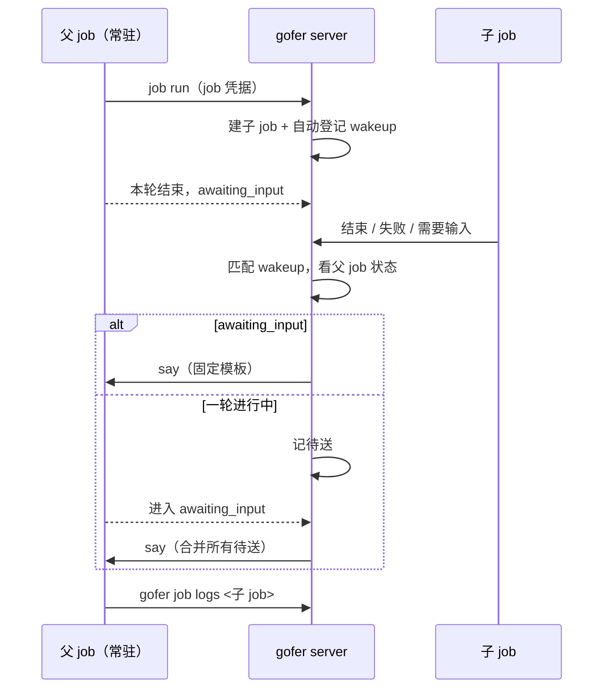

<!-- template_id: design; template_version: 1.2.0 -->
# 常驻 ACP job 的子 job 回执设计

> 状态：Draft 0.3 / 已批准（用户 2026-11-03：取消暂停空闲超时“按建议”；回执事件“能让事件可以配置吗”，按本稿做成可配置），待 closure 复核后写计划
> issue：gofer-rt3z

## 修订记录

| 版本 | 日期 | 作者 | 摘要 |
|---|---|---|---|
| 0.1 | 2026-11-03 | Claude（gofer 监督会话） | 初稿 |
| 0.2 | 2026-11-03 | Claude（gofer 监督会话） | 按独立审核修订：增加待送扫描与两条进入路径、子 job 接管链、提交时登记、结果落定后发送、远程送达确认；取消暂停空闲超时，改为超时后 resume；第一版只回执结束和待验收；新增标记列 |
| 0.3 | 2026-11-03 | Claude（gofer 监督会话） | 按用户要求：回执事件可配置，默认结束与待验收，可选工具审批与 hold；取消暂停空闲超时定稿 |

> 仅语义变化递增版本；纯 identity/provenance/元数据纠正沿用原版本，并在 Git/进度记录中留痕。

思考模式：RIGOROUS。核心目标：常驻 job 派出的子 job 有结果时，gofer 自动给它开下一轮。Scope freeze：只做下文“范围”所列。Review budget：一轮独立审核（已完成，4 个阻塞项、17 个重要项，均已吸收）加一轮 closure 复核。停止条件：待确认项由用户定下、独立审核无阻塞项。

## 背景与目标

用户的使用方式：个人助手让 gofer 起一个常驻 claude-acp job 当监督者（下称父 job），由它派子 job 干活。父 job 一轮结束后停在 awaiting_input，子 job 结束时没有任何东西叫醒它，要靠外部再说一句。

用户明确不接受由外部客户端跟踪子 job 再转告：“要 xhen 一直在线，并自己记住要盯哪些子 job - 这就让 sup-agent 失去意义了，也打乱了 xhen 的角色。”

用户可见结果：父 job 派完子 job 就结束本轮；子 job 结束、失败或需要输入时，父 job 自动开新一轮，没有外部参与。

## 名词

- 常驻 job：`--session` 的 ACP job，一轮结束后停在 awaiting_input，`job say` 开下一轮。
- 父 job / 子 job：子 job 由父 job 用自己的 job 凭据提交，带 `submitted_by_job:<父 id>` 标签。
- 开新一轮：对活着的常驻 job 走 say。
- 续接：对已结束的常驻 job 走 resume，新建 continuation job，用 `session/load` 接回同一会话。
- 待送：回执已触发，但父 job 这一轮还没结束，等它进入 awaiting_input 再发。

## 范围与非目标

范围：
1. event wakeup 支持活着的常驻 job：走 say，不走 resume。
2. 常驻 job 用自己的凭据提交子 job 时，自动登记回执。
3. 失败不再显示为触发成功。
4. 给有提交权限的常驻 job 注入一段提示，告诉它派完结束本轮。
5. 子 job 被自动续跑、换 agent 或重试时，回执跟到最终那个 job。
6. 回执哪些事件可配置（见“回执事件”）。

非目标：
- say 记录发送者、独立 caller（R2、R4）；caller 范围事件订阅（R3）。
- 子 job 经 plan 待办派发时的回执。
- 非 ACP 的 job：行为不变，仍走 resume。
- 不默认放开 can_submit。
- 不暂停空闲超时（用户已定）。
- 定时类 wakeup（at / every / cron）对活着的常驻 job 的行为不变。

## 已确认事实与规范

均为 2026-11-03 在 v0.209.2 上实测或读代码所得。

| 事实 | 证据 |
|---|---|
| 对活着的常驻 job 注册 event wakeup，子 job 结束约 30 秒后报 `source job is not in a terminal state`，父 job 不开新一轮 | 实测；`dispatchWakeup` 等目标终态（`wakeupTerminalWait`=30s），`checkResume` 返回 `ErrJobNotTerminal` |
| 失败后 `wakeup ls` 仍显示 `enabled fired=1` | 实测 |
| 真实的监督 job 派子 job 被拒：403 `agent claude-acp has not been granted can_submit` | 真实 job 输出；`jobMaySubmit` |
| can_submit 默认关闭，放开后 `submit_agents` 默认只有 exec，当前所有 agent 都未开 | `/v1/config`；`jobcredential.go` |
| job 凭据提交时服务端已知父 job，并盖 `submitted_by_job` 标签 | `jobMaySubmit` |
| job 凭据不能给 job 发信（403） | 实测 |
| say 只接受 awaiting_input；已有排队输入时报 `session input already queued`；worker 离线时报错 | `saySession` |
| 常驻 job 有空闲超时（实测 1800s、3600s），子 job 可能比它长 | job 记录 |
| wakeup 已持久化，有 TTL、列表、停用入口 | `internal/jobstore/wakeups.go` |
| 没有对 event wakeup 的扫描重试：`DueWakeups` 只选到期定时和过期行；事件在关停窗口内会丢 | `wakeups.go` `DueWakeups`；`wakeup.go` `dispatchWakeup` |
| 进入 awaiting_input 有两条路径：本机在 `awaitSessionInput`，worker 父 job 在 hub 的 `applyRemoteSessionState`，后者同一轮不重复记事件 | `session_state.go`；`session_recovery.go` |
| 子 job 被接管时原 job 不记 `job.terminal`，新 job 是新 id；重试则先记 terminal 再另起 | `execute.go` `finish`、`maybeRetryJob` |
| 常驻 job 到 `execute` 返回前一直占目录锁和项目槽位，可写 ACP / CLI agent 默认独占目录；排队默认最多等 1 小时 | `execute.go`；`submit.go`；`config/model.go` |
| 空闲回收是执行机上 runner 的本地计时器，worker 没有延长命令 | `runner/acp/runner.go`；`worker/client.go` |
| job 凭据不能回答 interaction、批准 hold、验收 | `jobcredential.go` 白名单 |
| 子 job 可用自己的凭据改标题，标题不过滤换行 | `jobcredential.go`；`job/title.go` |
| `fired_count` 在提交前就累加，失败不回退 | `wakeups.go` `ClaimWakeupFire` |

规范：G021–G024 分层；G046 提示词按语言；G056 路由登记；SR1410 最小充分；SR1301 安全；SR1402.1 真实验证。

## 总体方案

复用现有 wakeup，不新增表和子系统：登记（自动或手动）产生一条 wakeup，触发时按目标 job 的状态选路。

| 目标 job 状态 | 触发时做什么 |
|---|---|
| 已结束（手动登记） | 按现状走 resume / rebuild（不变） |
| 活着的常驻 job，awaiting_input | say 开新一轮 |
| 活着的常驻 job，一轮进行中 | 记为待送，等它进入 awaiting_input 再 say |
| 常驻 job 因空闲超时结束 | 走现有 resume，从同一会话续一轮 |
| 常驻 job 被人结束、失败或取消 | 停用 wakeup，记 `job.wakeup_failed`，不复活 |
| 非常驻且未结束 | 按现状等终态（不变） |

同一时刻多个子 job 有结果时合并成一条 say，因为 say 同时只能排一条。

say 内容是固定模板：子 job id、状态、退出码、查看命令，前缀用已有的 `msgprefix.Wakeup`。不放标题（子 job 能改自己的标题，可借此注入），不转述输出，父 job 自己用 `gofer job logs` 读。手动 wakeup 的 instruction 附在模板后，按调用方输入对待。

**回执事件：** 可配置，分两层：

| 层 | 写法 | 说明 |
|---|---|---|
| 全局默认 | `wakeup.child_events` | 不配时为 `[job.terminal, job.needs_review]` |
| 单次提交 | `gofer job run --parent-wake-events a,b` | 只影响这个子 job；`--no-parent-wake` 仍是完全关闭 |

可选值：`job.terminal`、`job.needs_review`、`job.awaiting_approval`（hold 待批准）、`interaction.created`（工具审批和提问）。`job.terminal` 始终包含，不能去掉：它是自动 wakeup 的退役点，也是回执的底线；写了别的值会自动补上，未知值拒绝。

默认不开后两个：父 job 没有权限回答或批准，只能转告，而人已经能从现有通知收到。打开后：
- 回执模板写明“你不能代答，请转告人”。
- 工具审批可能连续发生，同一子 job 的“需要输入”类回执最多 1 分钟一条（常量），期间的合并进下一条；`job.terminal` 不受限。

**空闲与资源：** 父 job 等子 job 期间不特殊处理。超时就结束，释放进程、目录锁和项目槽位；子 job 结束后 resume 接回同一会话。这样既没有长期占用，也不会有“父等子、子等父”：子 job 排在父 job 的锁后面时，最迟等父 job 超时也能跑。提示词建议父 job 用 `--shared-dir`、可写子 job 用 `--worktree`，避免干等。

## 架构

代码组织：
- `internal/job/wakeup_session.go`（新）：待送、合并、发送、扫描、对账。`dispatchWakeup` 和 `fireWakeup` 在现有分支之前先判断“目标是活着的常驻 job 且 wakeup 是 event 类”。
- 检查待送的函数由 `awaitSessionInput` 和 `applyRemoteSessionState` 共用，条件是状态为 awaiting_input，不依赖事件是否新记。
- `internal/serve`：tick 调用待送扫描；启动时对账一次（投递遗留待送；子 job 已结束而 wakeup 未触发的补 fire）。
- 自动登记在 `Submit` 内部、job id 确定之后执行。父 job id 由 handler 从 `jobCallerFromCtx` 取，经 `json:"-"` 字段传入，不信请求体和标签；hold 批准、retry、rebuild 不重复登记。`--sync` 不登记（这一轮已拿到结果）。`submitGrant` 下沉到 job 层，httpapi 调用它（G021）。
- `internal/commands`：`job run --no-parent-wake`；`wakeup ls`、HTTP、MCP 三处把 `await_input` 显示为待送，不当 job id。
- Schema：`job_wakeups` 增加 additive 列 `auto_child`（G057），区分自动登记和手动。待送用 `continuation_job_id` 的新哨兵 `await_input`。
- store：`fired_count` 改到成功后累加；新增不计数的待送写入。接管和重试成功时 CAS 把 `filter_job_id` 改到新 job。
- `session_commands.go`：把“轮次进行中”“已有排队”“worker 离线”“会话结束中”拆成可区分的错误；前三种保持待送，最后一种按父 job 结束处理。
- 提示词：模板在 `internal/i18n/prompts/<lang>/`，标题标记在 `protocol.go`；`prompt_sections.go` 增加独立分支，因为现有判断排除 Session；空 prompt 不注入，否则空启动的常驻 job 会立刻开一轮。
- 配置：`config.WakeupConfig` 增加 `ChildEvents`，校验放在 config 层；入库后随 `wakeup` 段一起在 web 上改（配置入库设计）。
- 事件：`interaction.created`、`job.awaiting_approval` 进 wakeup 事件目录。worker 子 job 的 interaction 经 `injectInteraction` 桥接时不记事件，要在其非幂等分支补记；这会让 worker 子 job 的 interaction 也进入该事件原有的通知链路，计划里要核对并写明。`job.awaiting_approval` 在 `parkJob` 内同步记录，自动登记要放在它之前（hold 路径单独一个登记点）。
- 文档：G045（gofer-usage 的 wakeup、job run、can_submit）、G058 能力清单。

## 关键流程

异常：
- say 报 `already queued`（人刚好也说了话）：保持待送，下次 awaiting_input 再发。
- worker 离线、升级排空中：保持待送，由新增的待送扫描重试。
- 写入待送后再读一次父 job 状态，已是 awaiting_input 就立刻投递，避免“检查后再写”的竞态；扫描兜底。
- 发送前等子 job 状态落定（事件先于状态翻转），放后台执行，不阻塞子 job 的 finish。
- worker 父 job：say 成功只代表帧写出去了。TurnNo 超过发送时的 turn 才算送达并清待送；超时重发，同时解开 pending。
- 父 job 空闲超时结束：走 resume。父 job 被人结束或失败：把它名下的待送和自动 wakeup 全部停用并记录。这个处理挂在父 job 的终态上，因为待送行的 `filter_job_id` 是子 job，匹配不到。
- 子 job 接管链：自动续跑、换 agent、核验续跑、重试成功时把 wakeup 改到新 job；提交失败时原 job 补记 terminal，照常回执。
- 自动登记用 continuous，处理完 `job.terminal` 后在代码里停用；监听的事件取上文配置的结果。TTL 取 `max(wakeup.ttl_sec, 子 job 时限 + 排队余量)`。

## 安全、数据、运维与回滚

- 权限：不放宽。只有已获 can_submit 的常驻 job 才会触发自动登记；子 job 仍受同项目与 `submit_agents` 约束。放开 can_submit 是用户配置（用户已自行给 claude-acp 打开）。手动 event wakeup 走 say 时，要求调用方有向该 job say 的权限，实现时核实 `job.wake.others` 不能借此绕过 `job.manage.others`。
- 内容：say 只含 id、状态、退出码，不含标题和输出，不把子 job 的文本注入父 job。
- 循环：一个子 job 的回执不会再触发同一条 wakeup。父 job 被叫醒后再派子 job 是正常工作，由 token 用量和 TTL 兜底，本次不加轮数上限。
- 数据：一个 additive 列（`auto_child`）。
- 日志：依赖 gofer-j8oh 的事件；本次补 `wakeup.say_pending`、`wakeup.say_sent`。
- 回滚：回退版本可用，但遗留待送会丢：旧版本只有再来一次触发才会释放 `await_input`，且会显示成 job id。降级前先确认没有待送，发版说明写明。
- 凭据：worker 父 job 的令牌只在 worker 侧续期，hub 不续，醒来后可能 401（读代码所得，未实测）。hub 在 `applyRemoteSessionState` 看到新 turn 时续期。

## 决策

- 复用 wakeup，不新建父子回执机制：已有持久化、TTL、列表、权限；只缺一条路径。
- 用 say 不用 resume：常驻 job 活着，resume 语义不对，还会多出 continuation job。
- 回执不走 messenger 或信箱：job 凭据发信被拒，且信箱解决的是另一类投递。
- 回执事件可配置：用户要求。默认克制，避免白耗 token，需要时能打开。
- 不暂停空闲超时（用户已定）：暂停要新增 worker 协议和 runner 改动，还会让父 job 一直占锁，造成互等；超时后 resume 用现成路径就能到达同样结果。
- 待送单独扫描，不借用 `next_run_at`：`sweepDueWakeups` 会在触发后停用 once 行。

## 待确认事项

无。用户已定（2026-11-03）。can_submit 用户已按 agent 打开，role 方式是后续可选的收窄办法。

## 结论与人工计划 Gate

用户已批准本设计。通过一轮 closure 复核后写实施计划，计划另需批准；批准设计不等于授权实施。

验收（真实 claude-acp，本机与 worker 父 job 各一遍）：
- 派 exec 子 job 后结束本轮，子 job 结束后父 job 自动开新一轮并读到结果。
- 子 job 在父 job 一轮进行中结束，等这轮结束后送达；多个子 job 合并成一条。
- 父 job 空闲超时后子 job 才结束：resume 接回同一会话并读到结果。
- 父 job 被人结束：有失败记录，不复活。
- 子 job 被重试或换 agent：回执指向最终结果。
- 可写 agent 子 job（`--worktree`）能跑通。
- server 在待送期间重启，重启后仍能送达。
- 改了多行标题的子 job，say 内容不受影响。
- 配置 `--parent-wake-events job.terminal,interaction.created` 的子 job 触发工具审批：父 job 收到回执（本机与 worker 子 job 各一遍），连续审批被限频；默认配置下不收到。
