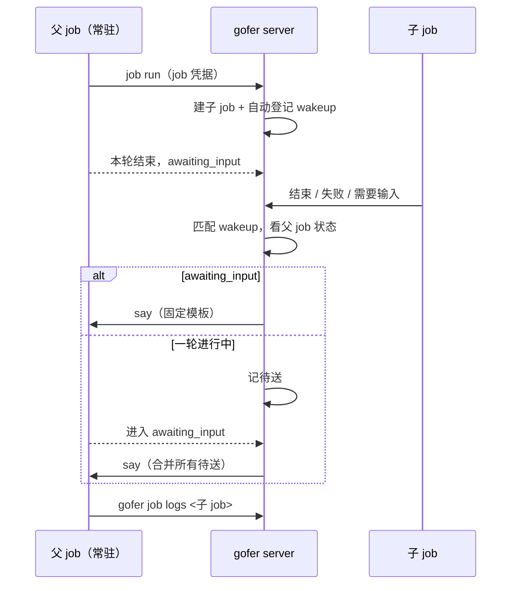

<!-- template_id: design; template_version: 1.2.0 -->
# 常驻 ACP job 的子 job 回执设计

> 状态：Draft 0.1 / 已批准（用户 2026-11-03：“R1 设计 按建议”，三个待确认项按建议），待独立审核后写计划
> issue：gofer-rt3z

## 修订记录

| 版本 | 日期 | 作者 | 摘要 |
|---|---|---|---|
| 0.1 | 2026-11-03 | Claude（gofer 监督会话） | 初稿 |

> 仅语义变化递增版本；纯 identity/provenance/元数据纠正沿用原版本，并在 Git/进度记录中留痕。

思考模式：RIGOROUS。核心目标：常驻 job 派出的子 job 有结果时，gofer 自动给它开下一轮。Scope freeze：只做下文“范围”所列。Review budget：一轮独立审核。停止条件：待确认项由用户定下、独立审核无阻塞项。

## 背景与目标

用户的使用方式：个人助手让 gofer 起一个常驻 claude-acp job 当监督者（下称父 job），由它派子 job 干活。父 job 一轮结束后停在 awaiting_input，子 job 结束时没有任何东西叫醒它，要靠外部再说一句。

用户明确不接受由外部客户端跟踪子 job 再转告：“要 xhen 一直在线，并自己记住要盯哪些子 job - 这就让 sup-agent 失去意义了，也打乱了 xhen 的角色。”

用户可见结果：父 job 派完子 job 就结束本轮；子 job 结束、失败或需要输入时，父 job 自动开新一轮，没有外部参与。

## 名词

- 常驻 job：`--session` 的 ACP job，一轮结束后停在 awaiting_input，`job say` 开下一轮。
- 父 job / 子 job：子 job 由父 job 用自己的 job 凭据提交，带 `submitted_by_job:<父 id>` 标签。
- 开新一轮：对活着的常驻 job 走 say。resume 是另一回事：它为已结束的 job 新建 continuation job。

## 范围与非目标

范围：
1. event wakeup 支持活着的常驻 job：走 say，不走 resume。
2. 常驻 job 用自己的凭据提交子 job 时，自动登记回执。
3. 失败不再显示为触发成功。
4. 给有提交权限的常驻 job 注入一段提示，告诉它派完结束本轮。

非目标：
- say 记录发送者、独立 caller（R2、R4）；caller 范围事件订阅（R3）。
- 子 job 经 plan 待办派发时的回执。
- 非 ACP 的 job：行为不变，仍走 resume。
- 不默认放开 can_submit。

## 已确认事实与规范

均为 2026-11-03 在 v0.209.2 上实测或读代码所得。

| 事实 | 证据 |
|---|---|
| 对活着的常驻 job 注册 event wakeup，子 job 结束约 30 秒后报 `source job is not in a terminal state`，父 job 不开新一轮 | 实测；`dispatchWakeup` 等目标终态（`wakeupTerminalWait`=30s），`checkResume` 返回 `ErrJobNotTerminal` |
| 失败后 `wakeup ls` 仍显示 `enabled fired=1` | 实测 |
| 真实的监督 job 派子 job 被拒：403 `agent claude-acp has not been granted can_submit` | 真实 job 输出；`jobMaySubmit` |
| can_submit 默认关闭，放开后 `submit_agents` 默认只有 exec，当前所有 agent 都未开 | `/v1/config`；`jobcredential.go` |
| job 凭据提交时服务端已知父 job，并盖 `submitted_by_job` 标签 | `jobMaySubmit` |
| job 凭据不能给 job 发信（403） | 实测 |
| say 只接受 awaiting_input；已有排队输入时报 `session input already queued`；worker 离线时报错 | `saySession` |
| 常驻 job 有空闲超时（实测 1800s、3600s），子 job 可能比它长 | job 记录 |
| wakeup 已持久化，有 TTL、列表、停用入口 | `internal/jobstore/wakeups.go` |

规范：G021–G024 分层；G046 提示词按语言；G056 路由登记；SR1410 最小充分；SR1301 安全；SR1402.1 真实验证。

## 总体方案

复用现有 wakeup，不新增表和子系统：登记（自动或手动）产生一条 wakeup，触发时按目标 job 的状态选路。

| 目标 job 状态 | 触发时做什么 |
|---|---|
| 已结束 | 按现状走 resume / rebuild（不变） |
| 活着的常驻 job，awaiting_input | say 开新一轮 |
| 活着的常驻 job，一轮进行中 | 记为待送，等它进入 awaiting_input 再 say |
| 非常驻且未结束 | 按现状等终态（不变） |

同一时刻多个子 job 有结果时合并成一条 say，因为 say 同时只能排一条。

say 内容是固定模板：子 job id、标题、状态、退出码、查看命令。不转述子 job 的输出，父 job 自己用 `gofer job logs` 读。

## 架构

代码组织：
- `internal/job/wakeup.go`：`fireWakeup` 按目标状态分支；超过 1000 行的部分放新文件 `internal/job/wakeup_session.go`（待送、合并、发送）。
- `internal/job/session_state.go`：进入 awaiting_input 时检查待送。
- 自动登记放 `internal/job`，由提交流程调用；`internal/httpapi` 只把“这是哪个 job 的凭据”传进去（G021）。
- `internal/commands`：`job run --no-parent-wake`；`wakeup ls` 显示待送状态。
- 待送状态：沿用 `continuation_job_id` 的哨兵做法，新增值 `await_input`，不改 Schema。子 job 的结果在发送时读当前状态，不存快照。
- 提示词进 `internal/i18n/lang/*/job_prompts.ini`，在 `prompt_sections.go` 里对“常驻且有提交权限”的 job 注入。

## 关键流程

异常：
- say 报 `already queued`（人刚好也说了话）：保持待送，下次 awaiting_input 再发。
- worker 离线：保持待送，由现有 wakeup 扫描重试。server 重启后同样由扫描接上。
- 父 job 已结束：停用 wakeup，记 `job.wakeup_failed`，不复活父 job。
- 监听的事件：`job.terminal`、`job.needs_review`，以及需要输入类事件（`interaction.created`、`job.awaiting_approval`）。后两者要进 wakeup 事件目录，计划阶段核对它们是否落在子 job 自己的事件流上。

## 安全、数据、运维与回滚

- 权限：不放宽。只有已获 can_submit 的常驻 job 才会触发自动登记；子 job 仍受同项目与 `submit_agents` 约束。放开 can_submit 是用户配置，只给片段，不代改。
- 内容：say 只含元数据，不把子 job 输出当指令注入父 job。
- 循环：一个子 job 的回执不会再触发同一条 wakeup。父 job 被叫醒后再派子 job 是正常工作，由 token 用量和 TTL 兜底，本次不加轮数上限。
- 数据：无 Schema 变更。
- 日志：依赖 gofer-j8oh 的事件；本次补 `wakeup.say_pending`、`wakeup.say_sent`。
- 回滚：回退版本即可，遗留的 `await_input` 由旧版本当作“continuation 已不存在”释放（计划阶段写测试确认）。

## 决策

- 复用 wakeup，不新建父子回执机制：已有持久化、TTL、列表、权限；只缺一条路径。
- 用 say 不用 resume：常驻 job 活着，resume 语义不对，还会多出 continuation job。
- 回执不走 messenger 或信箱：job 凭据发信被拒，且信箱解决的是另一类投递。

## 待确认事项

1. **自动登记还是靠 agent 自己注册？** 建议自动登记，可用 `--no-parent-wake` 关闭。这次的问题正是 agent 没注册；靠提示词不可靠。
2. **can_submit 怎么放开？** 不放开，这个功能对监督 job 就没有意义。建议用 role 限定：只给监督角色开，`submit_agents` 列出 exec 和实施用的 agent，而不是给 claude-acp 全局开。由用户决定并自己改配置。
3. **有未完成子 job 时，父 job 的空闲超时是否暂停？** 建议暂停，否则长子 job 结束时父 job 已被回收，回执送不到；上限是 wakeup TTL。代价是父 job 进程多占资源。

## 结论与人工计划 Gate

建议按上述方案做。需要用户定下三个待确认项并批准本设计，之后才写实施计划；批准设计不等于授权实施。

验收：真实 claude-acp 常驻 job 用 job 凭据派一个 exec 子 job 后结束本轮，子 job 结束后父 job 自动开新一轮并读到结果；子 job 在父 job 一轮进行中结束时同样能送达；父 job 已结束时有失败记录。
