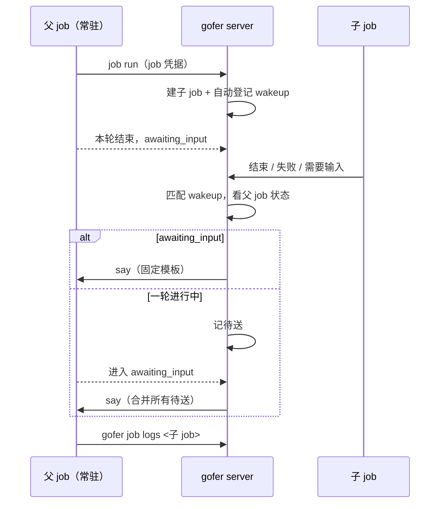

<!-- template_id: design; template_version: 1.2.0 -->
# 常驻 ACP job 的子 job 回执设计

> 状态：Draft 0.7 / 已批准（用户 2026-11-03：“批准 R1 计划 0.4 并开始实施”，0.5–0.7 复核修订一并确认；超时后 resume 拆第二期，原话“R1 拆第二期”）
> issue：gofer-rt3z

## 修订记录

| 版本 | 日期 | 作者 | 摘要 |
|---|---|---|---|
| 0.1 | 2026-11-03 | Claude（gofer 监督会话） | 初稿 |
| 0.2 | 2026-11-03 | Claude（gofer 监督会话） | 按独立审核修订：增加待送扫描与两条进入路径、子 job 接管链、提交时登记、结果落定后发送、远程送达确认；取消暂停空闲超时，改为超时后 resume；第一版只回执结束和待验收；新增标记列 |
| 0.3 | 2026-11-03 | Claude（gofer 监督会话） | 按用户要求：回执事件可配置，默认结束与待验收，可选工具审批与 hold；取消暂停空闲超时定稿 |
| 0.4 | 2026-11-03 | Claude（gofer 监督会话） | 按 closure 复核修订（5 阻塞、11 重要）：超时后 resume 拆到第二期；第一期父 job 结束即告警；补重试回执顺序、更新暂停登记点、批次确认、限频哨兵 |
| 0.5 | 2026-11-03 | Claude（gofer 监督会话） | 按窄范围复核修订（7 阻塞、4 纠正）：`job.wakeup_failed` 进默认通知；tick 对账已结束子 job；确认时比对子 job 状态；parked `--sync` 也登记；父 job needs_review 按结束处理；重试 CAS 后补查、只在取消时补发；本机不重发 |
| 0.6 | 2026-11-03 | Claude（gofer 监督会话） | 按确认轮修订（5 阻塞、1 纠正）：告警改用新事件 `job.child_wake_failed`，webpush 补分支并绕过合并窗口；tick 对账加宽限期，只看 terminal；送达确认要求回到 awaiting_input |
| 0.7 | 2026-11-03 | Claude（gofer 监督会话） | 按确认轮修订（2 阻塞、1 纠正）：webpush 告警用独立 Tag、不设线程 Topic；每个父 job 一把回执锁，worker say 发送前先占 pending；补收件箱 kind 和发版说明要求 |

> 仅语义变化递增版本；纯 identity/provenance/元数据纠正沿用原版本，并在 Git/进度记录中留痕。

思考模式：RIGOROUS。核心目标：常驻 job 派出的子 job 有结果时，gofer 自动给它开下一轮。Scope freeze：只做下文“范围”所列。Review budget：一轮独立审核和一轮 closure 复核已完成，均已吸收；再做一轮窄范围复核。停止条件：待确认项由用户定下、独立审核无阻塞项。

## 背景与目标

用户的使用方式：个人助手让 gofer 起一个常驻 claude-acp job 当监督者（下称父 job），由它派子 job 干活。父 job 一轮结束后停在 awaiting_input，子 job 结束时没有任何东西叫醒它，要靠外部再说一句。

用户明确不接受由外部客户端跟踪子 job 再转告：“要 xhen 一直在线，并自己记住要盯哪些子 job - 这就让 sup-agent 失去意义了，也打乱了 xhen 的角色。”

用户可见结果：父 job 派完子 job 就结束本轮；子 job 结束、失败或需要输入时，父 job 自动开新一轮，没有外部参与。

## 名词

- 常驻 job：`--session` 的 ACP job，一轮结束后停在 awaiting_input，`job say` 开下一轮。
- 父 job / 子 job：子 job 由父 job 用自己的 job 凭据提交，带 `submitted_by_job:<父 id>` 标签。
- 开新一轮：对活着的常驻 job 走 say。
- 待送：回执已触发，但父 job 这一轮还没结束，等它进入 awaiting_input 再发。

## 范围与非目标

范围：
1. event wakeup 支持活着的常驻 job：走 say，不走 resume。
2. 常驻 job 用自己的凭据提交子 job 时，自动登记回执。
3. 失败不再显示为触发成功。
4. 给有提交权限的常驻 job 注入一段提示，告诉它派完结束本轮。
5. 子 job 被自动续跑、换 agent 或重试时，回执跟到最终那个 job。
6. 回执哪些事件可配置（见“回执事件”）。

非目标：
- say 记录发送者、独立 caller（R2、R4）；caller 范围事件订阅（R3）。
- 子 job 经 plan 待办派发时的回执。
- 非 ACP 的 job：行为不变，仍走 resume。
- 不默认放开 can_submit。
- 不暂停空闲超时（用户已定）。
- 父 job 结束后的自动续接（第二期，见“分期”）。
- 定时类 wakeup（at / every / cron）对活着的常驻 job 的行为不变。

## 已确认事实与规范

均为 2026-11-03 在 v0.209.2 上实测或读代码所得。

| 事实 | 证据 |
|---|---|
| 对活着的常驻 job 注册 event wakeup，子 job 结束约 30 秒后报 `source job is not in a terminal state`，父 job 不开新一轮 | 实测；`dispatchWakeup` 等目标终态（`wakeupTerminalWait`=30s），`checkResume` 返回 `ErrJobNotTerminal` |
| 失败后 `wakeup ls` 仍显示 `enabled fired=1` | 实测 |
| 真实的监督 job 派子 job 被拒：403 `agent claude-acp has not been granted can_submit` | 真实 job 输出；`jobMaySubmit` |
| can_submit 默认关闭，放开后 `submit_agents` 默认只有 exec，当前所有 agent 都未开 | `/v1/config`；`jobcredential.go` |
| job 凭据提交时服务端已知父 job，并盖 `submitted_by_job` 标签 | `jobMaySubmit` |
| job 凭据不能给 job 发信（403） | 实测 |
| say 只接受 awaiting_input；已有排队输入时报 `session input already queued`；worker 离线时报错 | `saySession` |
| 常驻 job 有空闲超时（实测 1800s、3600s），子 job 可能比它长 | job 记录 |
| wakeup 已持久化，有 TTL、列表、停用入口 | `internal/jobstore/wakeups.go` |
| 没有对 event wakeup 的扫描重试：`DueWakeups` 只选到期定时和过期行；事件在关停窗口内会丢 | `wakeups.go` `DueWakeups`；`wakeup.go` `dispatchWakeup` |
| 进入 awaiting_input 有两条路径：本机在 `awaitSessionInput`，worker 父 job 在 hub 的 `applyRemoteSessionState`，后者同一轮不重复记事件 | `session_state.go`；`session_recovery.go` |
| 子 job 被接管时原 job 不记 `job.terminal`，新 job 是新 id；重试则先记 terminal 再另起 | `execute.go` `finish`、`maybeRetryJob` |
| 常驻 job 到 `execute` 返回前一直占目录锁和项目槽位，可写 ACP / CLI agent 默认独占目录；排队默认最多等 1 小时 | `execute.go`；`submit.go`；`config/model.go` |
| 空闲回收是执行机上 runner 的本地计时器，worker 没有延长命令 | `runner/acp/runner.go`；`worker/client.go` |
| job 凭据不能回答 interaction、批准 hold、验收 | `jobcredential.go` 白名单 |
| 子 job 可用自己的凭据改标题，标题不过滤换行 | `jobcredential.go`；`job/title.go` |
| `fired_count` 在提交前就累加，失败不回退 | `wakeups.go` `ClaimWakeupFire` |

规范：G021–G024 分层；G046 提示词按语言；G056 路由登记；SR1410 最小充分；SR1301 安全；SR1402.1 真实验证。

## 总体方案

复用现有 wakeup，不新增表和子系统：登记（自动或手动）产生一条 wakeup，触发时按目标 job 的状态选路。

| 目标 job 状态 | 触发时做什么 |
|---|---|
| 已结束（手动登记，`auto_child=0`） | 按现状走 resume / rebuild（不变） |
| 活着的常驻 job，awaiting_input | say 开新一轮 |
| 活着的常驻 job，一轮进行中 | 记为待送，等它进入 awaiting_input 再 say |
| 常驻 job 已结束（超时、被人结束、失败、进入 needs_review，`auto_child=1`） | 第一期：停用 wakeup，记 `job.child_wake_failed` 并通知人，不复活 |
| 非常驻且未结束 | 按现状等终态（不变） |

同一时刻多个子 job 有结果时合并成一条 say，因为 say 同时只能排一条。

say 内容是固定模板：子 job id、状态、退出码、查看命令，前缀用已有的 `msgprefix.Wakeup`。不放标题（子 job 能改自己的标题，可借此注入），不转述输出，父 job 自己用 `gofer job logs` 读。手动 wakeup 的 instruction 附在模板后，按调用方输入对待。

**回执事件：** 可配置，分两层：

| 层 | 写法 | 说明 |
|---|---|---|
| 全局默认 | `wakeup.child_events` | 不配时为 `[job.terminal, job.needs_review]` |
| 单次提交 | `gofer job run --parent-wake-events a,b` | 只影响这个子 job；`--no-parent-wake` 仍是完全关闭 |

可选值：`job.terminal`、`job.needs_review`、`job.awaiting_approval`（hold 待批准）、`interaction.created`（工具审批和提问）。`job.terminal` 始终包含，不能去掉：它是自动 wakeup 的退役点，也是回执的底线；写了别的值会自动补上，未知值拒绝。

默认不开后两个：父 job 没有权限回答或批准，只能转告，而人能从现有通知收到（worker 子 job 的 interaction 目前收不到，本次一并修）。打开后：
- 回执模板写明“你不能代答，请转告人”。
- 工具审批可能连续发生，同一子 job 的“需要输入”类回执最多 1 分钟一条（常量）。限频内写待送哨兵，由 tick 补发，否则子 job 卡住后就再没有下一条；最后发送时间放内存，重启最多多发一条。`job.terminal` 不受限。
- 限频窗口内人把审批答了、子 job 回到运行且当下不需要人：这条待送回执已经没有意义（父 job 被叫醒也只能看到一个还在跑的 job），哨兵直接清掉、不发 say、不计 `fired_count`、不停用行——子 job 自己的结束还欠父 job 一条回执。判据是子 job 的现状而不是触发事件。手动 wakeup 不走这条：它可能订阅 `job.stalled` 之类不关于输入的事件。
- 子 job 还没结束时，回执行只写状态、不写退出码（运行中的 job 那个默认的 0 会读成“结果”）。

**空闲与资源：** 父 job 等子 job 期间不特殊处理。第一期父 job 必须活到子 job 结束，所以监督类 job 要显式设够长的 `--idle-timeout`（默认只有 1800 秒），提示词和文档都写明。父 job 先结束时回执送不到，但不会静默：记 `job.child_wake_failed`，走通知告诉人。告警用新事件 `job.child_wake_failed`，只由 `auto_child` 路径记录，进 webhook、桌面默认集合、webpush 和通知目录。不把旧事件 `job.wakeup_failed` 加进默认：重复定时的 wakeup 挂在未结束的 job 上时每分钟失败一次，今天只写时间线，进默认就成了通知风暴。webpush 只加白名单不够：要补标题和正文分支与 i18n；绕过 30 秒合并窗口（既不检查也不占用），否则告警紧跟父 job 结束的推送，会被丢掉；用独立 Tag（`child-wake:<id>`）且不设线程 Topic，否则同线程的下一条推送会把它替换。桌面默认事件必须映射到 action 类收件箱 kind（`internal/inbox/rules_test.go` 约束），现有 kind 语义不符，所以新增一个 kind 及其卡片。通知目录、默认集合的测试同步改，并写进发版说明和 CHANGELOG。

资源：父 job 在等待期间占进程和项目槽位。提示词建议父 job 用 `--shared-dir`、可写子 job 用 `--worktree`。子 job 排在父 job 的目录锁后面时不会死锁：排队最多 1 小时（`dir_lock_max_wait_sec`）后失败，父 job 会收到失败回执。项目、caller、agent 并发槽位的等待没有时限：上限为 1 时，子 job 要排到父 job 退出，长 `--idle-timeout` 下可达一天且没有回执。提示词和文档要写明槽位留余量。

**分期：**
- 第一期：上述 say 主路径。解决的场景：父 job 活着，子 job 有结果就开新一轮。
- 第二期：父 job 空闲超时结束后，子 job 结束时自动 resume 接回同一会话。第一期不做的原因是它自带 5 个问题，都要专门处理：
  1. 自动 wakeup 的 `job_id` 指向旧 job，第二个子 job 的回执会再次 resume，同一 session 出现两个进程。需要续接时迁移，并按链头选路。
  2. 多个子 job 同时结束会并发 resume，需要按 session single-flight。
  3. worker 父 job 的结束原因传不到 hub（`wsproto.Result` 没有这个字段），分不清超时和人工结束。需要加 wire 字段，老 worker 报空时不复活。
  4. 自动 wakeup 没有 instruction，空 prompt 续接只会停在 awaiting_input，回执发不出去。需要在触发时渲染 prompt。
  5. 续接 job 的 CallerID、Role 与接管链的继承和失败重试。
  第一期留好 `auto_child` 列和回执模板，第二期不用返工。

## 架构

代码组织：
- `internal/job/wakeup_session.go`（新）：待送、合并、发送、扫描、对账。`dispatchWakeup` 和 `fireWakeup` 在现有分支之前先判断“目标是活着的常驻 job 且 wakeup 是 event 类”。
- 检查待送的函数由 `awaitSessionInput` 和 `applyRemoteSessionState` 共用，条件是状态为 awaiting_input，不依赖事件是否新记。
- `internal/serve`：`startScheduleLoop` 的 `run()` 里紧随 `sweepDueWakeups` 调待送扫描；启动对账排在 `ReconcileOrphanJobs` 之后（投递遗留待送）。待送扫描同时对账 `auto_child=1`、启用、子 job 已 terminal（用 `IsTerminal`，等验收的不算，否则父 job 每次空闲都收一遍，还会刷新空闲计时）且 `ended_at` 超过宽限期（常量，覆盖 finish 收尾到写重试行和接管标记的窗口）的行：有重试行或接管标记就按“子 job 重试”“子 job 接管链”处理，重试行已 done 且有 `new_job_id` 时补做 CAS 再补查（覆盖崩溃在两步之间），都没有才补发。这条对账是必要的：恢复窗口到期的 worker 子 job 由 `FailRecoveringJobs` 直接改库，不记 `job.terminal`，只在启动时对账会漏，回执就丢了。不改成补记事件：那会让重启后的每个丢失 job 都发一轮通知。自动行 TTL 到期记 `job.child_wake_failed`，不记 `job.wakeup_expired`（后者不在通知目录）。
- 自动登记写成一个新 helper，由普通路径和 `parkJob` 两处调用（今天两处各自落库，没有共用函数；持久化之后、记事件之前），这样 hold 和更新暂停都覆盖，`job.awaiting_approval` 的登记也早于事件；用 `req.heldJobID == ""` 防放行时重复。父 job id 由 handler 从 `jobCallerFromCtx` 取，经 `json:"-"` 字段传入，不信请求体和标签；retry、rebuild 不重复登记。`--sync` 不登记（这一轮已拿到结果），但 hold 和更新暂停的 job 对 `--sync` 也是立即按异步返回，所以 `parkJob` 路径一律登记。`CreatedBy` 用父 job 的 CallerID，不用 job 凭据身份。`submitGrant` 下沉到 job 层，httpapi 调用它（G021）。
- `internal/commands`：`job run --no-parent-wake`；`wakeup ls`、HTTP、MCP 三处把 `await_input` 显示为待送，不当 job id。
- Schema：`job_wakeups` 增加 additive 列 `auto_child INTEGER NOT NULL DEFAULT 0`，走迁移（G057）；同步 `selectWakeupCols`、`scanWakeup`、`InsertWakeup` 和 schema 校验数据。待送用 `continuation_job_id` 的新哨兵 `await_input`。
- store：`fired_count` 改到成功后累加；新增不计数的待送写入。接管和重试成功时 CAS 把 `filter_job_id` 改到新 job。
- `session_commands.go`：把“轮次进行中”“已有排队”“worker 离线”“会话结束中”拆成可区分的错误；前三种保持待送，最后一种按父 job 结束处理。再加第五种“job 未终态且无活会话”：recovering 时保持待送，needs_review 按父 job 结束处理。路由判断“父 job 已结束”用 `IsFinished`，不用 `IsTerminal`（needs_review 不算 terminal，但进程已退出）。
- 提示词：模板在 `internal/i18n/prompts/<lang>/`，标题标记在 `protocol.go`；`prompt_sections.go` 增加独立分支，因为现有判断排除 Session；空 prompt 不注入，否则空启动的常驻 job 会立刻开一轮。
- 配置：`config.WakeupConfig` 增加 `ChildEvents`，校验放在 config 层。web 上改依赖配置入库设计，第一期只能写文件或用单次参数。
- 事件：`interaction.created`、`job.awaiting_approval` 进 wakeup 事件目录。worker 子 job 的 interaction 经 `injectInteraction` 桥接时不记事件，要在其非幂等分支补记；这是全局变化：IM、桌面、webpush 都会开始收到 worker 和 peer job 的 interaction 通知，实际上修了一个缺口，要写进发版说明。事件形状沿用 `{interaction_id,type,prompt}`；补记前查 DB，避免 hub 重启后重复记（是否会重发未确认）。`job.awaiting_approval` 在 `parkJob` 内同步记录，自动登记要放在它之前。
- 文档：G045（gofer-usage 的 wakeup、job run、can_submit）、G058 能力清单。

## 关键流程

异常：
- say 报 `already queued`（人刚好也说了话）：保持待送，下次 awaiting_input 再发。
- worker 离线、升级排空中：保持待送，由新增的待送扫描重试。
- 每个父 job 一把回执锁，覆盖“读待送、合并、发送、记批次”，tick 和事件路径共用。worker 分支的 say 今天先解锁发送、发送后才置 pending，两路可同时通过，第二帧被 worker 拒收时 hub 不知道，那条回执会被下一轮的确认清掉且没有告警；改为发送前在 `entry.mu` 内占 pending，发送失败回滚（人手动 say 的路径也受益）。
- 写入待送后再读一次父 job 状态，已是 awaiting_input 就立刻投递，避免“检查后再写”的竞态；扫描兜底。
- 发送放后台（含目标已终态的分支），不阻塞子 job 的 finish，也不阻塞 hub 读循环。终态和待验收类事件等 `entry.done` 后再读状态（事件先于状态翻转）；entry 要在 observer 内同步取到再进后台，否则已驱逐时取不到，会查不到重试而误发、误停用；`interaction.created`、`job.awaiting_approval` 不翻状态，不等。
- 送达确认：say 成功只代表写出去了（worker 是帧，本机是写进缓冲 channel，空闲计时器到期的窗口内也会丢）。两种父 job 都以“回到 awaiting_input 且 TurnNo 超过发送时的 turn”算送达并清待送（TurnNo 在 prompt 发给 agent 之前就加一，只看它，这一轮中途死掉就算成送达了，人收不到告警），只清这一批（发送时记下批次的行 id 和当时的子 job 状态，内存即可，重启后重发无害）。确认时子 job 状态已变就保留哨兵：同一行会再次触发，比如 interaction 回执未确认时子 job 结束，直接清会丢掉 terminal 回执。超时重发只限 worker 父 job，用稳定 CmdID，同时解开 pending。本机父 job 只确认、不重发：重发要持 `entry.mu` 写容量 1 的 channel，空闲到期后没人读，会卡住 finish。父 job 结束时未确认的按“父 job 已结束”处理。
- 父 job 结束（含被接管和进入 needs_review，这两个分支不记 terminal，要单独挂；核验失败转 needs_review 的 `parkAfterFailedCheckResume` 也要挂）：把它名下的待送和自动 wakeup 全部停用，记 `job.child_wake_failed` 并通知人。这个处理挂在父 job 的结束上，因为待送行的 `filter_job_id` 是子 job，匹配不到。
- 子 job 接管链：自动续跑、换 agent、核验续跑、未提交续跑成功时 CAS 把 wakeup 改到新 job，CAS 后补查一次（新 job 可能已经结束）；提交失败时原 job 补记 terminal，照常回执。核验续跑例外：提交失败会转 needs_review，只配 `job.terminal` 的子 job 要等人裁决后才有回执。
- 子 job 重试：普通失败先记 terminal，重试行在 finish 末尾才写。所以回执放到 `entry.done` 之后，先查有没有待执行的重试：有就不发也不停用，重试提交成功时 CAS，CAS 后同样补查（`Submit` 返回前新 job 已启动，可能已经结束，之后再无事件）。只在重试走到取消这个终局时补发回执（请求解不开、无 owner、权限拒绝、`job retry cancel` 四处都要挂，其中解不开和 API 取消不记事件；漏挂时由 tick 对账兜底）；可重试的提交失败只是退避再来，不算结束。
- 自动登记用 continuous，处理完 `job.terminal` 后在代码里停用；监听的事件取上文配置的结果。TTL 取 `max(wakeup.ttl_sec, 子 job 时限 + 排队余量)`。

## 安全、数据、运维与回滚

- 权限：不放宽。只有已获 can_submit 的常驻 job 才会触发自动登记；子 job 仍受同项目与 `submit_agents` 约束。放开 can_submit 是用户配置（用户已自行给 claude-acp 打开）。手动 event wakeup 走 say 时，要求调用方有向该 job say 的权限，实现时核实 `job.wake.others` 不能借此绕过 `job.manage.others`。
- 内容：say 只含 id、状态、退出码（子 job 未结束时只有状态），不含标题和输出，不把子 job 的文本注入父 job。
- 循环：一个子 job 的回执不会再触发同一条 wakeup。父 job 被叫醒后再派子 job 是正常工作，由 token 用量和 TTL 兜底，本次不加轮数上限。
- 数据：一个 additive 列（`auto_child`）。
- 日志：依赖 gofer-j8oh 的事件；本次补 `wakeup.say_pending`、`wakeup.say_sent`。
- 续接后的权限（第二期再涉及）：第一期父 job 不换 id，不受影响。
- 回滚：回退版本可用，但遗留待送会丢：旧版本只有再来一次触发才会释放 `await_input`，且会显示成 job id。降级前先确认没有待送，发版说明写明。
- 凭据：worker 父 job 的令牌只在 worker 侧续期，hub 不续，醒来后可能 401（读代码所得，未实测）。hub 在 `applyRemoteSessionState` 看到新 turn 时续期。

## 决策

- 复用 wakeup，不新建父子回执机制：已有持久化、TTL、列表、权限；只缺一条路径。
- 用 say 不用 resume：常驻 job 活着，resume 语义不对，还会多出 continuation job。
- 回执不走 messenger 或信箱：job 凭据发信被拒，且信箱解决的是另一类投递。
- 回执事件可配置：用户要求。默认克制，避免白耗 token，需要时能打开。
- 不暂停空闲超时（用户已定）：暂停要新增 worker 协议和 runner 改动，还会让父 job 一直占锁，造成互等。
- 超时后 resume 拆到第二期：0.3 把它说成“用现成路径就能做到”，复核证明不成立，它是这个设计里最复杂的部分。第一期先让主路径可用、可验证。
- 待送单独扫描，不借用 `next_run_at`：`sweepDueWakeups` 会在触发后停用 once 行。

## 待确认事项

无。“超时后 resume”拆到第二期，用户已于 2026-11-03 确认。第一期父 job 超时后回执送不到（有告警），监督类 job 要显式设长 `--idle-timeout`，比如 86400。

## 结论与人工计划 Gate

窄范围复核无阻塞项后写实施计划，计划另需批准；批准设计不等于授权实施。

验收（真实 claude-acp，本机与 worker 父 job 各一遍）：
- 派 exec 子 job 后结束本轮，子 job 结束后父 job 自动开新一轮并读到结果。
- 子 job 在父 job 一轮进行中结束，等这轮结束后送达；多个子 job 合并成一条。
- 父 job 空闲超时或被人结束后子 job 才结束：有 `job.child_wake_failed` 和给人的通知，不复活。
- 子 job 被重试或换 agent：回执指向最终结果；重试被取消时补发。
- 更新暂停期间提交的子 job 也有回执。
- 可写 agent 子 job（`--worktree`）能跑通。
- server 在待送期间重启，重启后仍能送达。
- 改了多行标题的子 job，say 内容不受影响。
- 配置 `--parent-wake-events job.terminal,interaction.created` 的子 job 触发工具审批：父 job 收到回执（本机与 worker 子 job 各一遍），连续审批被限频；默认配置下不收到。

## 实施记录

- 实施：2026-11-03 起分四批（W1 地基、W2 主路径三次合并、W3 提示词与文档），提交区间 `f94a181f..cb112500`。真实环境验收（计划 T12）在 W4 单独做。
- 与设计 / 计划的差异（均为实现细节，未改语义）：
  - 计划 W2 的三个 job 拆分为 T5–T6、T7–T8、T9 三批合并，批次边界不影响任务内容。
  - 手动（`auto_child=0`）event wakeup 只有目标是**活着的常驻 job** 时才走 say；目标已结束时保持原有的 resume / rebuild，不跟随接管链的 CAS（对应“总体方案”表首行）。手动行确认后按计划 `CompleteWakeupSay(id, true)` 消费。
  - 手动 event wakeup 注册在活着的常驻 job 上时，除 `job.wake.others` + `job.submit` 外追加要求 `job.manage.others`（say 等价权限）。设计只写了「实现时核实」，判定放在 httpapi 入口（G021），job 层仍只管归属。
  - 待送的对外表示：`continuation_job_id` 置空 + 新字段 `pending_delivery`（CLI 另显示“pending delivery”），不是把 `await_input` 透出去。
  - 提示词注入的判据：`Submit` 用 `SubmitGrantFor(agent, role)`（与 job 凭据提交同一个判定函数）决定是否注入，且只对有非空 prompt 的常驻 job 注入。
- 第一期未做（同设计）：父 job 结束后的自动续接、R2 / R3 / R4。
- W4 真实验收（2026-11-04）发现并修的第一处回执行为：人在限频窗口内答了审批、子 job 回到 `running` 时，这条待送回执不再算“需要输入”，于是当作普通回执发了出去（`running（退出码 0）`），白叫父 job 一轮且读着像结果。现在自动回执在“子 job 未结束且当下不需要人”时清哨兵、不发、不计、不停用（`jobstore.DropPendingSay`，日志 `wakeup.say_dropped reason=no_longer_needs_input`），手动行不受影响；同时回执模板对未结束的子 job 只写状态、不写退出码。

