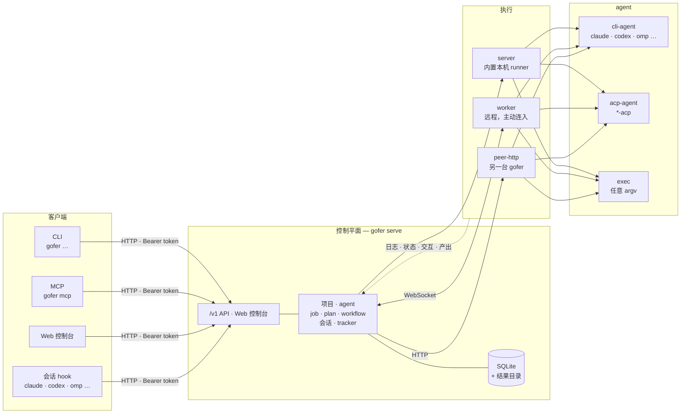

# 核心概念

gofer 的心智模型很简单：**一件工作 = 一个 job**。job 绑定一个**项目**（在哪做）、一个 **agent**（用什么做）、一个 **runner**（在哪台机器做），以及任务内容（prompt 或 argv）。其余概念都是围绕这件事的扩展：怎样排队（plan / todo）、怎样长期对话（session）、怎样验收（verify / review）、怎样把上下文交接给下一个 agent（tracker）。

## 一张图



记住**两条互相独立的轴**：

- **入口轴**（别人怎么跟 gofer 说话）：CLI、HTTP `/v1`、MCP、Web 控制台、agent 的会话 hook。
- **执行位置轴**（job 实际在哪台机器跑）：server 本机的内置 runner、某台 worker、另一台 gofer（peer-http）。

两轴正交：任一入口都能把 job 派到任一执行位置。`server` / `local` / `<worker-id>` / peer 名是 **runner**；HTTP / CLI / MCP / Web 是 **入口**——别把两者混成一个维度。

> 更细的机制（镜像、对端再校验、driver agent 与 presence 等）和完整术语表在 [`docs/architecture-overview.md`](../architecture-overview.md)；那一篇是设计与历史记录，读法与本文不同——它按当时的实现状态写。

## server

`gofer serve` 启动的控制平面，是唯一真源：项目注册表与准入规则、job 存储（SQLite + 每个 job 的结果目录）、调度与队列、Web 控制台、HTTP `/v1` 与 MCP 接口，都在这里。**一台机器只跑一个 server**，你的所有项目通常都登记在它上面。

```bash
gofer init server --global      # 写出 <config-dir>/config.yaml（默认 ~/.config/gofer）
gofer config validate
gofer serve                     # 前台；或 gofer serve -d 后台，gofer serve register 注册成受管服务
```

server 自己不干活，它决定“这个 job 能不能跑、该交给谁”。默认监听 `0.0.0.0:8765`，浏览器打开 `http://<server>:8765/` 就是控制台。

## worker

`gofer worker` 是远程执行机：它**主动**拨出连到 server（WebSocket），上报自己有哪些目录（`roots`）和装了哪些 agent，然后在本机执行派过来的 job。worker 不需要在防火墙上开放入站端口，所以放在 NAT 后面、容器里、家用宽带后面都没问题。

```bash
# server 上登记并拿到一次性 token
gofer worker add <worker-id> --project <project>
# worker 机器上初始化（推断 roots、探测 agent、写 worker.yaml，并跑一次自检）
gofer worker init --server http://<server>:8765 --id <worker-id> --token <一次性 token>
gofer worker -d
```

策略始终在 server：worker 只做两件事——把 server 的项目路径映射到本机路径（`roots`），以及在本机**再校验一次**（项目放行的 agent / runner、`allow_exec`、cwd 不能逃出项目目录）。所以即使 server 被人拿到，也逼不了 worker 跑它没放行的东西。

## runner

runner 是“job 在哪执行”的名字，在提交时用 `--runner` 指定：

| runner | 含义 |
|---|---|
| `server` | server 本机的内置 runner。CLI 上的默认值；落库与 API 里的规范名是 `local`（两个拼写是同一个东西，`server` / `local` 都是保留名，不能用作 worker id） |
| `<worker-id>` | 派到那台 worker 上执行；worker 上必须先有对应目录与 agent |
| `<peer 名>` | 转发给另一台 gofer（`peer-http` runner），由那台 server 执行 |

```bash
gofer job run -p <project> -a exec --runner server --sync -- go version      # 本机
gofer job run -p <project> -a claude --runner <worker-id> --prompt "…"       # 那台 worker
```

想按标签而不是按名字选机器，用 `--worker-labels`（worker 注册时带 `labels`）；想知道哪台机器现在在线、装了哪些 agent，打开 Web 的 Runners 页。

## project

项目是**允许执行工作的已登记目录**，也是准入边界。它至少要有 `host_path`（绝对路径），通常还写清：

- 允许的 agent（`allowed_agents`）与 runner（`allowed_runners`）；
- 是否允许裸命令（`allow_exec`）与交互式任务（`allow_interactive`）；
- 并发、超时上限，默认验证命令（`verify`），验收与改动范围策略。

```bash
gofer project add <project> --host-path /abs/path/to/<project> \
  --default-agent codex --allow-agent codex --allow-agent claude --allow-agent exec \
  --allow-runner server --allow-exec
```

配置里没声明任何项目时，server 会注入一个内置的 `default` 项目，指向默认工作空间（`~/.gofer/workspace`，可用 `GOFER_WORKSPACE` 改）。它是给你随手试命令用的，正式工作请显式 `project add`。

job 的工作目录被限制在项目目录内（`--cwd` 写相对项目根的路径），写出的结果也落在项目自己的 `tmp/gofer/<job-id>/` 下。

## agent

agent 是“怎么调用真正干活的程序”，三种类型：

| 类型 | 用法 |
|---|---|
| `cli-agent` | 一个 argv 模板，用 `{{prompt}}`、`{{cwd}}` 等占位符拼出批处理命令；可选 `interactive_args` 用于 pty 交互 |
| `acp-agent` | 通过 stdio 说 Agent Client Protocol 的常驻进程（`claude-acp`、`codex-acp`、`omp-acp` …），支持持续会话 |
| `exec` | 原样执行提交里的 argv，不经过 shell；用于构建、测试、部署这类确定性命令 |

gofer **不内置模型**，只负责启动、监督、记录已有 CLI。`PATH` 上装了的 CLI（claude、codex、omp …）会被自动注入内置模板，Web 的 Agents 页把它们标成「内置」；你在配置里显式声明的同名 agent 会整条覆盖内置模板。

```bash
gofer agent ls                                  # 这台 server 上可用的 agent
gofer job run -p <project> -a exec --sync -- ls -la     # exec：命令放在 -- 之后
gofer job run -p <project> -a claude --prompt "解释这个仓库的构建流程"
```

## job

一个 job 就是一次执行：项目 + agent + prompt/argv + 工作目录。生命周期：

```
queued ─→ running ─→ done / failed / cancelled / timeout
   │           │
   │           └─→ pending_interaction（等人回答）/ awaiting_input（持续会话等你说话）
   └─→ waiting_dir（目录被别的 job 占着）/ awaiting_approval（等你批准）/ recovering（worker 重连中）
```

开了 `--review` 的 job 正常结束后停在 `needs_review`，只有人能接受（`done`）或驳回（`rejected`）。每个 job 都有：状态、stdout/stderr 日志、事件时间线、diff 与提交列表、token 用量与成本、退出码、评论。

```bash
gofer job run -p <project> -a exec --title "看下 Go 版本" --sync -- go version
gofer job list                       # 找 job id 与状态
gofer job show <id>                  # 状态详情
gofer job logs <id> --tail -n 50     # 输出
gofer job watch <id>                 # 跟到结束（长任务用这个，别用 --sync 干等）
```

## plan 与 todo

plan 是一组 job 的容器，todo 是它的清单。todo 可以是纯记录，也可以带派发信息：写了指派人（`--assign`）且状态为 `ready` 的 todo 会自己变成一个 job；用 `--after prev` 把 todo 串成链，前一项 `done` 后一项才出 job；`gofer plan run` 一次推动整条链。改代码的多步任务通常这样组织：方案 → 实施 → 测试 → 复核。

```bash
gofer plan create --project <project> --title "修掉登录超时"
gofer plan add-todo <plan> "先看复现步骤与日志" --assign claude
gofer plan add-todo <plan> "按结论实施修复" --assign claude --after prev \
  --acceptance "- 超时时间可配" --scope 'src/auth/**'
gofer plan add-todo <plan> "跑测试" --assign exec --cmd 'go test ./...' --after prev
gofer plan run <plan>
```

## session（会话）

session 是**一段持续的对话**，有三种形态：

- **ACP 持续会话 job**：`job run --session` 开一个常驻 agent 进程，用 `job say <id> "…"` 继续、`job end <id>` 结束，期间 job 停在 `awaiting_input`；
- **pty 交互 job**：`--interactive`，可以在浏览器里 attach 到终端；
- **终端会话**：装了 hook 之后（`gofer init hooks`），你终端里跑的 Claude Code / Codex / omp 会被登记成一个 session——它停下来的那一轮可以**等在 Web 上回复**，也可以在 Web 上传话、唤醒、催办。

```bash
gofer init hooks --agent all --global     # 一次性安装（会话中继 + 记忆注入）
gofer session relay on                    # 本会话：每次停下都在 Web 等我回复
gofer session ls                          # 谁在等回复
gofer session say <sid> "按 B 方案继续"     # 从 CLI 代答（Web 上是同一个输入框）
```

## 工作项与收集箱

工作项（`gofer work`）是“你正在做的这件事”的一张卡，跨会话存在：目标、状态、阻塞、下一步、关联的 issue / plan / job / 会话，加上一条时间线。它解决的是“同时开五个终端以后，忘了自己在做什么”。

收集箱是它的入口：任何想法先丢进去，之后再分派。

```bash
gofer work capture "登录偶发超时，怀疑 token 刷新并发" --kind idea   # 随手记，进收集箱
gofer work ls                                                      # 在做的与待整理的
gofer work dispatch <id> --to todo --plan <plan>                   # 整理：转成 plan 的 todo
```

Web 上对应 Works 页（「待整理」区就是收集箱）与顶栏「随手记」按钮。

## 信箱

信箱是会话、job 与调用方之间的**信件**往来：一封纯文本的信，投给某个会话 / job / 主题 / 路径 / 调用方本身。普通件在收件方下一轮开始时注入，急件在轮内的下一个工具调用前注入；收件方读信即算送达。地址没有唯一命中、或超过送达期限的信会落到「待指派」，由人改投或撤回。

```bash
gofer session mail send session:<sid> "这个分支我接手了，别再改 src/auth" --urgent
gofer session mail ls
gofer session mail reply <mail-id> "收到，我把结论写到 issue 里"
```

Web 上对应 `/mail`（顶栏右侧信封按钮）。适合“通知另一个正在跑的会话”，不适合正式验收——验收用 job 的 review / accept。

## tracker（仓库里的 issue 与记忆）

tracker 把 issue、记忆和规则放进**仓库自己**的 `.gofer/tracker/*.jsonl`，随代码一起提交，并镜像到 server。好处是新会话不用你复述：`gofer repo prime`（装成 SessionStart hook）会把当前重点、未结 issue、规则和记忆索引注入开场；`gofer issue brief` / `gofer plan brief` 一条命令交接一整件事（字段、方案评论、上下文、设计稿、相关提交、验证命令）。

```bash
gofer repo init                                   # 建 .gofer/tracker/
gofer issue create "登录偶发超时" --type bug --acceptance "- 复现步骤与结论"
gofer issue brief <issue-id>                      # 接手一件事
gofer memory set <key> "这条约定" --kind rule --summary "一句话"
```

详见 skill 的 [tracker 参考](../../skills/gofer-usage/references/tracker.md)。

## 概念速查

| 概念 | 一句话 | 最小例子 |
|---|---|---|
| server | 控制平面与唯一真源 | `gofer serve` |
| worker | 拨入 server 的远程执行机 | `gofer worker -d` |
| runner | job 在哪执行（`server` / `<worker-id>` / peer） | `--runner <worker-id>` |
| project | 允许执行工作的已登记目录与准入边界 | `gofer project add …` |
| agent | 怎么调用干活的程序（cli / acp / exec） | `-a claude` |
| job | 一次执行及其全部记录 | `gofer job list` |
| plan / todo | 多步任务的容器与清单 | `gofer plan run <plan>` |
| session | 一段持续对话（ACP / pty / 终端） | `gofer session ls` |
| 工作项 / 收集箱 | 跨会话“我在做什么”的卡 | `gofer work capture "…"` |
| 信箱 | 会话与 job 之间的信件 | `gofer session mail send …` |
| tracker | 仓库里的 issue / 记忆 / prime | `gofer repo prime` |
