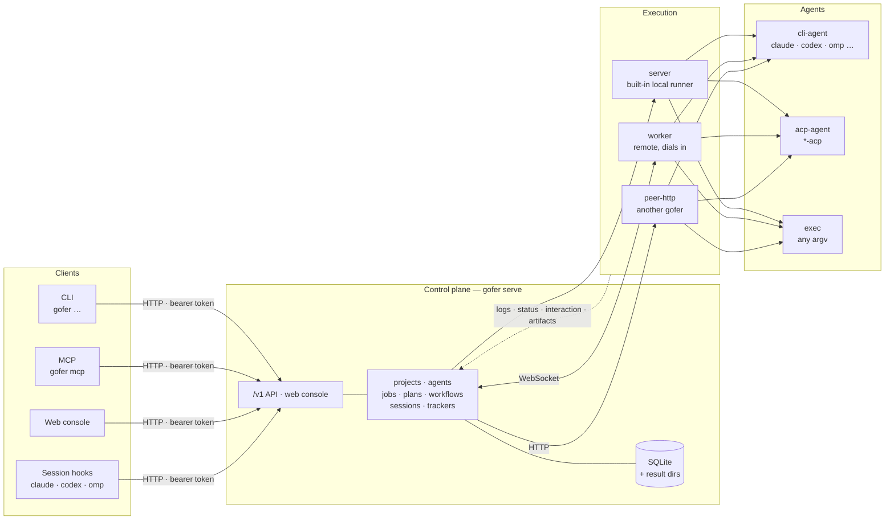

# Concepts

gofer's mental model is one sentence long: **one piece of work is one job**. A job is bound to a **project** (where it runs), an **agent** (what runs it), a **runner** (which machine runs it) and the task itself (a prompt or an argv). Everything else is built around that: how work is queued (plan, workflow), how it is conversed with (session), how it is accepted (verify, review), and how context reaches the next agent (tracker).

## The picture



There are **two independent axes**, and mixing them up is the usual source of confusion:

- **Entry axis** — how something talks to gofer: CLI, HTTP `/v1`, MCP, the web console, an agent's session hook.
- **Execution axis** — where the job actually runs: the server's built-in runner, a worker, or another gofer (peer-http).

Either entry can send a job to either execution target. `server` / `local` / `<worker-id>` / a peer name are **runners**; CLI / HTTP / MCP / web are **entries**. They are not the same dimension.

## server

The control plane started by `gofer serve`, and the single source of truth: the project registry and its admission rules, the job store (SQLite plus one result directory per job), scheduling and queues, the web console, the `/v1` HTTP API and the MCP endpoint. **One server per machine**; all your projects are normally registered on it.

```bash
gofer init server --global      # writes <config-dir>/config.yaml (default ~/.config/gofer)
gofer config validate
gofer serve                     # foreground; `gofer serve -d` background, `gofer serve register` managed service
```

The server does no work itself: it decides whether a job may run and who should run it. It listens on `0.0.0.0:8765` by default; `http://<server>:8765/` is the console.

## worker

`gofer worker` is a remote executor. It **dials out** to the server (WebSocket), reports the directories it has (`roots`) and the agents installed there, and then runs jobs locally. No inbound port is needed, so a worker fits behind NAT, in a container, or on a home connection.

```bash
# on the server: register the worker, get a one-time token
gofer worker add <worker-id> --project <project>
# on that machine: infer roots, probe agents, write worker.yaml, run a self-check
gofer worker init --server http://<server>:8765 --id <worker-id> --token <one-time token>
gofer worker -d
```

Policy always lives on the server, and the worker only does two things: map the server's project paths to local paths (`roots`), and **re-validate locally** (allowed agents and runners, `allow_exec`, cwd inside the project). So even a compromised server cannot make a worker run something the worker's own config does not allow.

## runner

A runner is the name of "where a job executes", chosen with `--runner` at submit time:

| runner | meaning |
|---|---|
| `server` | the server's built-in runner. CLI default; the canonical name in storage and the API is `local` (the two spellings are the same thing) |
| `<worker-id>` | run on that worker, which must have the mapped directory and the agent |
| `<peer name>` | forward to another gofer (`peer-http` runner), which runs it there |

```bash
gofer job run -p <project> -a exec --runner server --sync -- go version   # this host
gofer job run -p <project> -a claude --runner <worker-id> --prompt "…"    # that worker
```

`server` and `local` are reserved names: no worker, custom runner or self-registered worker id may use them. To pick a machine by tag instead of by name, use `--worker-labels` (workers register with `labels`); the Runners page shows what is online and which agents it has.

## project

A project is a **registered directory that work is allowed to run in** — and the admission boundary for it. It needs at least `host_path` (the directory, stored as an absolute path), and usually declares:

- allowed agents (`allowed_agents`) and runners (`allowed_runners`);
- whether raw commands (`allow_exec`) and interactive jobs (`allow_interactive`) are allowed;
- concurrency and timeout limits, a default `verify` command, review and change-scope policy.

```bash
gofer project add <project> --host-path /abs/path/to/<project> \
  --default-agent codex --allow-agent codex --allow-agent claude --allow-agent exec \
  --allow-runner server --allow-exec
```

When a config declares no projects at all, the server injects a built-in `default` project pointing at the default workspace (`~/.gofer/workspace`, or `GOFER_WORKSPACE`). It exists so you can try a command; register real projects explicitly. A job's working directory is confined to the project (`--cwd` takes a path relative to the project root), and its output lands in the project's own `tmp/gofer/<job-id>/`.

## agent

An agent is "how the program that does the work is invoked". Three kinds:

| kind | use |
|---|---|
| `cli-agent` | an argv template using placeholders such as `{{prompt}}` and `{{cwd}}`; optional `interactive_args` for pty interaction |
| `acp-agent` | a long-lived process speaking Agent Client Protocol over stdio (`claude-acp`, `codex-acp`, `omp-acp` …), which is what makes persistent sessions possible |
| `exec` | run the submitted argv as-is, without a shell; for builds, tests and deploys |

gofer **has no model of its own**; it starts, supervises and records CLIs you already have. CLIs found on `PATH` get built-in templates injected, which the Agents page marks as built-in; declaring an agent of the same name in your config replaces the template entirely.

```bash
gofer agent ls                                          # what this server can run
gofer job run -p <project> -a exec --sync -- ls -la     # exec: the command after --
gofer job run -p <project> -a claude --prompt "Explain how this repository is built"
```

## job

A job is one execution: project + agent + prompt/argv + working directory. Lifecycle:

```
queued ─→ running ─→ done / failed / cancelled / timeout
   │          │
   │          └─→ pending_interaction (someone must answer) / awaiting_input (persistent session waiting on you)
   └─→ waiting_dir (another job holds the directory) / awaiting_approval (waiting for a person) / recovering (worker reconnecting)
```

A job submitted with `--review` stops at `needs_review` when it finishes normally; only a person can accept (`done`) or reject it. Every job has status, stdout/stderr logs, an event timeline, diff and commit list, token usage and cost, exit code, and comments.

```bash
gofer job run -p <project> -a exec --title "check Go version" --sync -- go version
gofer job list                       # ids and statuses
gofer job show <id>                  # details
gofer job logs <id> --tail -n 50     # output
gofer job watch <id>                 # follow to the end (use this for long jobs, not --sync)
```

## plan and todo

A plan is a container for a group of jobs; its todos are the checklist. A todo can be a plain note, or carry dispatch information: a todo with an assignee (`--assign`) in state `ready` becomes a job by itself; `--after prev` chains items so the next one is only dispatched after the previous is `done`; `gofer plan run` advances the whole chain. Multi-step code work is usually organised this way: plan → implement → test → review.

```bash
gofer plan create --project <project> --title "Fix the login timeout"
gofer plan add-todo <plan> "Read the code and logs, propose a fix" --assign claude --read-only
gofer plan add-todo <plan> "Implement it" --assign claude --after prev \
  --acceptance "- the timeout is configurable" --scope 'src/auth/**' --review
gofer plan add-todo <plan> "Run the tests" --assign exec --cmd 'go test ./...' --after prev
gofer plan run <plan>
```

A **workflow** is the other orchestration shape: one YAML/JSON file of steps, where a step can fan out to several agents and a later step picks the best result (`gofer workflow run|show|pick|template`). Plans are for "one thing, several steps"; workflows are for "several attempts, compare, continue".

Details: [plans and workflows](../../../skills/gofer-usage/references/plans-workflows.md) (Chinese).

## session

A session is **an ongoing conversation**, in three shapes:

- **ACP session job**: `job run --session` starts a resident agent process; continue it with `job say <id> "…"`, end it with `job end <id>`. It sits in `awaiting_input` between turns.
- **pty interaction job**: `--interactive`, attachable to a terminal in the browser.
- **terminal session**: after `gofer init hooks`, the Claude Code / Codex / omp you run in your terminal is registered as a session — when it stops, that turn can **wait for a reply in the web console**, and messages, wake-ups and nudges can reach it.

```bash
gofer init hooks --agent all --global     # one-time install (session relay + memory injection)
gofer session relay on                    # this session: wait in the web every time it stops
gofer session ls                          # who is waiting for a reply
gofer session say <sid> "go with plan B"  # answer from the CLI (same box as in the web console)
```

## Work items and the capture box

A work item (`gofer work`) is the card for "the thing I am currently doing", kept across sessions: goal, status, blockers, next step, linked issues / plans / jobs / sessions, plus a timeline. It exists to answer "what was I in the middle of" when five terminals are open.

The capture box is its inbox: drop an idea first, sort it out later.

```bash
gofer work capture "login times out occasionally, suspect token refresh race" --kind idea
gofer work ls                                                       # in progress and unsorted
gofer work dispatch <id> --to todo --plan <plan>                    # turn it into a plan todo
```

In the web console this is the Works page (the "to sort" section *is* the capture box) and the quick-capture button in the top bar.

## Mailbox

The mailbox is **letters** between sessions, jobs and callers: plain text addressed to a session, a job, a topic, a path, or a caller. A normal letter is injected at the recipient's next turn; an urgent one before the recipient's next tool call. Reading counts as delivery. A letter that matches no address uniquely, or that expires, lands in "needs assignment", where a person re-addresses or withdraws it.

```bash
gofer session mail send session:<sid> "I am taking this branch, stop editing src/auth" --urgent
gofer session mail ls
gofer session mail reply <mail-id> "got it, the conclusion is in the issue"
```

In the web console it is `/mail` (the envelope button in the top bar). It is for notifying something that is already running, not for formal acceptance — that is what job review is for.

## tracker (issues and memories in the repository)

The tracker keeps issues, memories and rules in the repository itself, as `.gofer/tracker/*.jsonl` files that are committed with the code and mirrored to the server. The point is that a new session does not need you to re-explain: `gofer repo prime` (installed as a SessionStart hook) injects the current focus, open issues, rules and memory index at the start of a session; `gofer issue brief` / `gofer plan brief` hand a whole task over in one command (fields, plan comments, context, design docs, related commits, verification commands).

```bash
gofer repo init                                   # create .gofer/tracker/
gofer issue create "login times out occasionally" --type bug --acceptance "- repro steps and conclusion"
gofer issue brief <issue-id>                      # take a task over
gofer memory set <key> "this rule about the codebase" --kind rule --summary "one line"
```

Details: [tracker reference](../../../skills/gofer-usage/references/tracker.md) (Chinese).

## Review

Review is not a separate concept so much as a job state with a panel: `--review` parks a finished job at `needs_review`, and `gofer job review <id>` prints report, acceptance criteria, commits, diff, verify output and usage on one screen. `gofer job accept` ends it; `gofer job reject --note … --resume` sends it back to the same agent session with your notes. The web console has `/review`, one row per waiting job, oldest first.

## Cheat sheet

| concept | one line | smallest example |
|---|---|---|
| server | control plane and single source of truth | `gofer serve` |
| worker | remote executor that dials in to the server | `gofer worker -d` |
| runner | where a job executes (`server` / `<worker-id>` / peer) | `--runner <worker-id>` |
| project | registered directory plus admission rules | `gofer project add …` |
| agent | how the working program is invoked (cli / acp / exec) | `-a claude` |
| job | one execution with all its records | `gofer job list` |
| plan / todo | container and checklist for multi-step work | `gofer plan run <plan>` |
| workflow | one file of steps, with fan-out and pick | `gofer workflow run wf.yaml` |
| session | an ongoing conversation (ACP / pty / terminal) | `gofer session ls` |
| work item / capture box | the "what am I doing" card across sessions | `gofer work capture "…"` |
| mailbox | letters between sessions and jobs | `gofer session mail send …` |
| tracker | issues / memories / prime in the repository | `gofer repo prime` |
| review | the human gate in front of `done` | `gofer job review <id>` |
